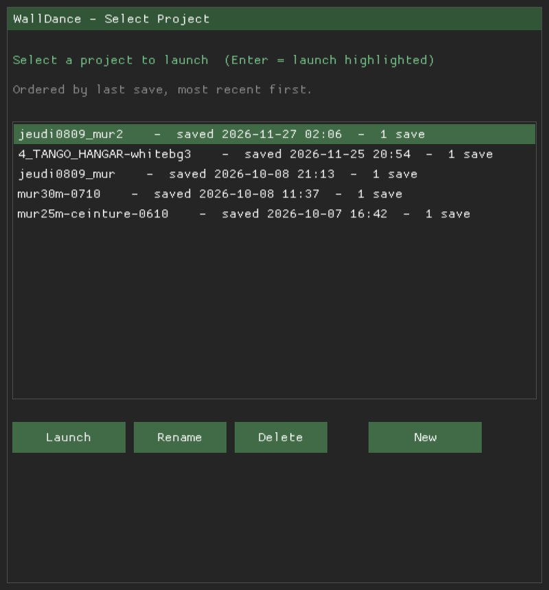
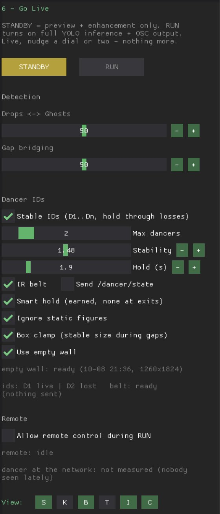
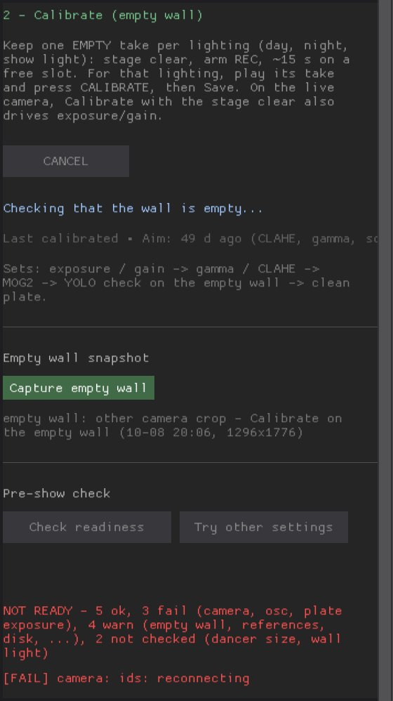
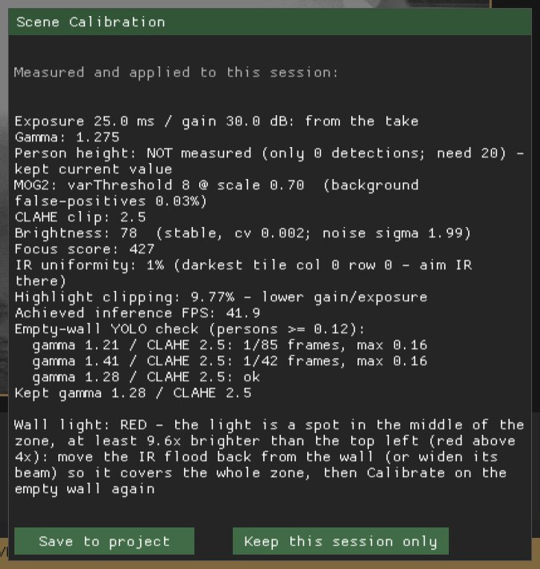
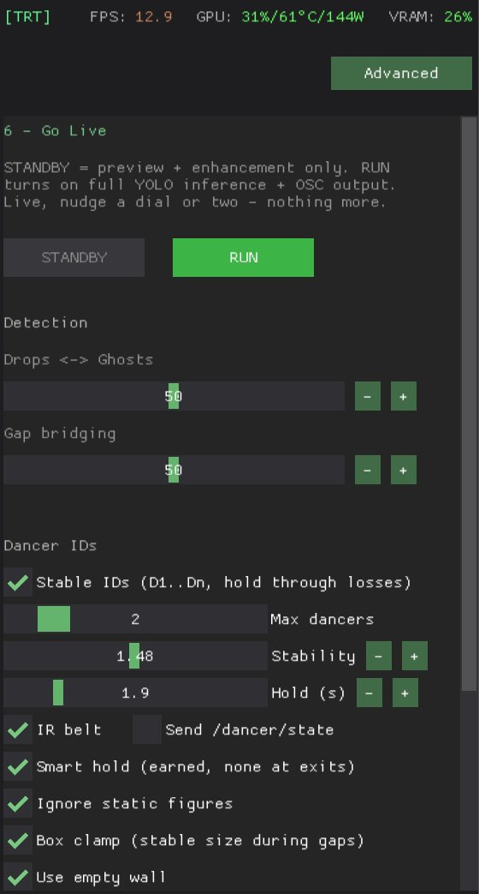
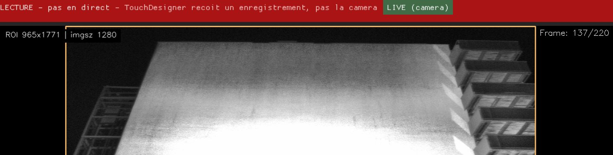
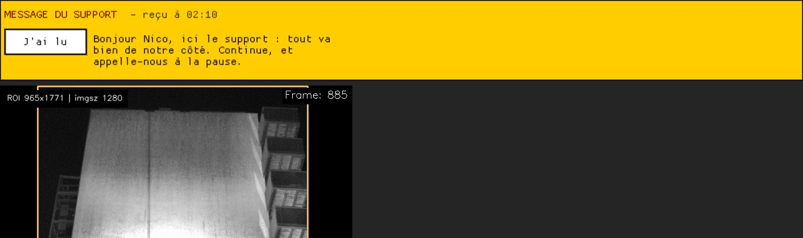

# WallDance — guide de l'opérateur

<!--
GUIDE (hub walldance#t-062, Thomas's request of 26/11 14:50): the full operator manual behind the two-page sheet
docs/FICHE_TECHNICIEN_FR.md, in French, for Nico. Written from the rehearsal build as it stands on 26/11 (cordee-r2
@ 0912d44) and its docs; brought up to release 1 (cordee-r2 @ c823b93) on 27/11, with the app's own
window pictures in docs/img/ (S2, tmp_analysis/r2-1126/gates/shots); updated as the last steps land (see « État du guide » at the end).
Conventions, checked by tmp_analysis/r2-1126/gates/guide/run_gate.sh <code-root>:
- A code span = a string exactly as the app shows it. « … » inside a span stands for a value the app fills in.
  Every code span is backed, on the same source line, by a citation comment "src: <path>:<line> «snippet»": the
  snippet is a literal piece of the span, found at that line (paths relative to application/src unless they start
  with launcher/), and every piece of the span between « … » is a string literal of a cited file.
- Section 8 quotes every alert, toast, banner and readiness row the code can show (the gate lists them from the
  code and reports the coverage).
- Markers: [à confirmer avec Thomas …], [à compléter le 2/12 …], [étape en cours de développement — X4];
  [capture d'écran : …] only where no picture of the app can show it (the reason in the report of S2). No phone number, no address, no account name.
-->

**Pour Nico** — la répétition des 7 et 8/12 (avec un support à distance) et le premier spectacle du 12/12 (seul).

**Ce guide décrit la version de répétition telle qu'elle est le 27/11 (la « release 1 »).** Elle bouge encore : la dernière page, « État du guide », dit quoi.

La fiche de deux pages (*FICHE_TECHNICIEN_FR*) résume ce guide. Ce guide, on le lit une fois avant ; on l'ouvre à la bonne page quand quelque chose arrive.

> **Comment lire ce guide**
>
> - `CALIBRATE` : un texte écrit **exactement** comme à l'écran (en anglais). La traduction suit, entre parenthèses. <!-- src: gui_builder.py:842 «CALIBRATE» @«label="CALIBRATE"» -->
> - `Camera down for …s` : les « … » remplacent un nombre ou un nom que l'app écrit (une durée, une heure, des pixels). <!-- src: core/ops_monitor.py:898 «Camera down for » -->
> - **[à confirmer avec Thomas]**, **[à compléter le 2/12]** : un point pas encore réglé. Ne pas deviner : demander.
> - Les images sont de vraies photos de la fenêtre, faites par l'app elle-même, au banc, avec des prises enregistrées le 8/10 sur la façade. Leur légende dit ce qui diffère d'un soir de spectacle.

**Sommaire**

1. En deux minutes — p. 1
2. Le matériel et le branchement — p. 3
3. Lancer l'application — p. 5
4. L'écran, zone par zone — p. 7
5. La mise en place, pas à pas — p. 11
6. Pendant le spectacle — p. 21
7. Entre deux pièces — p. 25
8. Si quelque chose ne va pas — p. 27
9. Le support à distance — p. 36
10. Lexique — p. 38
11. L'essentiel — p. 41

## 1. En deux minutes

### Ce que fait WallDance

- Une caméra filme le mur **en infrarouge** (IR).
- Un projecteur IR éclaire le mur. Le public ne voit pas cette lumière.
- L'application WallDance repère chaque danseur sur l'image.
- Elle donne à chacun un numéro qui ne change pas (D1, D2…).
- Elle envoie sa position aux visuels (TouchDesigner), plusieurs fois par seconde.
- Ce message réseau s'appelle **OSC**.
- Les visuels suivent les danseurs grâce à ces positions.

### Le rôle de Nico

- **Installer** : cadrer, faire la photo du mur vide (`CALIBRATE`), vérifier. <!-- src: gui_builder.py:842 «CALIBRATE» @«label="CALIBRATE"» -->
- **Lancer** : `RUN`. <!-- src: gui_builder.py:1076 «RUN» @«label="RUN"» -->
- **Surveiller une seule chose** : la ligne de santé, la bande de couleur sous l'image.
- **Réagir** : chaque message de l'app dit la seule chose à faire. Ce guide la redit en français (§6 et §8).
- **Noter l'heure** de chaque souci : les journaux de l'app sont relus après la séance.

### La mise en place, sur une page

| | Étape | Où | Ce qu'on fait | C'est bon quand |
|---|---|---|---|---|
| ① | Le cadre | `1 Rig` | tracer la zone des danseurs ; régler le nombre de danseurs | la zone entoure le mur dansé <!-- src: gui_builder.py:641 «1 Rig» --> |
| ② | Le mur vide | `2 Calibrate` | personne dans l'image, `CALIBRATE`, puis `Save to project` | la carte `Scene Calibration` s'est affichée et a été enregistrée <!-- src: gui_builder.py:642 «2 Calibrate» ; gui_builder.py:842 «CALIBRATE» @«label="CALIBRATE"» ; gui.py:3043 «Save to project» ; gui.py:3023 «Scene Calibration» --> |
| ③ | Un danseur, 10 s | `3 Live` | en `RUN`, un danseur debout 10 s au fond du mur | la ligne `dancer size` est `OK` <!-- src: gui_builder.py:643 «3 Live» ; gui_builder.py:1076 «RUN» @«label="RUN"» ; core/ops_monitor.py:361 «dancer size» ; core/ops_monitor.py:55 «OK» @«"OK"» --> |
| ④ | Vérifier | `2 Calibrate` | lire le bilan (`Check readiness`) | le bilan dit `READY` <!-- src: gui_builder.py:642 «2 Calibrate» ; gui_builder.py:877 «Check readiness» ; core/ops_monitor.py:59 «READY» @«"READY"» --> |
| ⑤ | Le spectacle | `3 Live` | `RUN`, puis ne plus toucher | la ligne de santé est verte (`OK`) <!-- src: gui_builder.py:643 «3 Live» ; gui_builder.py:1076 «RUN» @«label="RUN"» ; core/ops_monitor.py:55 «OK» @«"OK"» --> |

<figure style="break-inside: avoid; page-break-inside: avoid; margin: 0.8em 0;"><figcaption style="font-size: 0.9em; color: #444;">La fenêtre en RUN : la ligne de santé verte, OK - all 7 checks fine. En rouge en haut à gauche, le message Go-Live check du bilan fait au passage en RUN (sur le banc, rien n'écoutait l'OSC et la lumière de cette prise est rouge). Image de banc (27/11) : une prise du 8/10 (le mur) lue comme caméra, d'où [CV] dans la barre du haut ; au spectacle, [IDS].</figcaption></figure>

### Les quatre règles d'or

1. **Une seule app caméra à la fois** : jamais deux WallDance ouverts.
2. **Pendant une pièce, ne toucher que `Max dancers`** (le nombre de danseurs). Tout le reste attend la pause. <!-- src: gui_builder.py:1159 «Max dancers» -->
3. **Après chaque changement : `Ctrl+S`** (enregistrer). Sinon une relance l'oublie. <!-- src: gui_builder.py:394 «Ctrl+S» @«Save config (Ctrl+S)» -->
4. **Jamais un emplacement de prise (1 à 9) cliqué en `RUN`** : les visuels suivraient l'enregistrement, plus les danseurs (§6). <!-- src: gui_builder.py:1076 «RUN» @«label="RUN"» -->

## 2. Le matériel et le branchement

Ce que le code et les notes de Thomas établissent. Le reste est marqué **[à confirmer avec Thomas]**.

### Le portable

- Un portable Windows avec une carte graphique NVIDIA. Il fait tourner WallDance.
- TouchDesigner (les visuels) tourne aussi sur ce portable **[à confirmer avec Thomas : le même portable le 7/12 et le 12/12]**.
- **Toujours sur secteur.** Sur batterie, l'image ralentit.
- **Arrière surélevé, aérations dégagées.** La carte graphique chauffe ; l'app alerte à 85 °C.
- Ne pas fermer le capot ni toucher au bouton d'alimentation pendant que l'app tourne : le portable se mettrait en veille.
- Ne pas ouvrir d'autre logiciel de caméra (par exemple IDS peak Cockpit) pendant que WallDance tourne : une caméra ne sert qu'à un logiciel.

### La caméra

- Une caméra industrielle IDS, branchée en **USB3**.
- Sur les prises du 08/10 : objectif 6 mm, filtre infrarouge derrière l'objectif, caméra montée à la verticale **[à confirmer avec Thomas : même caméra, même objectif, même montage]**.
- Montée à la verticale, l'image est tournée par l'app (`Rotate`, dans `1 Rig`). <!-- src: gui_builder.py:1836 «Rotate» @«"Rotate"» ; gui_builder.py:641 «1 Rig» -->
- La mise au point se fait à la main, sur la bague de l'objectif, **sous la lumière IR**.
- Câble USB3 enfoncé à fond des deux côtés, alimentation de la caméra branchée **[à confirmer avec Thomas : la caméra a-t-elle une alimentation à part]**.
- **Brancher la caméra avant de lancer l'app.** Sans elle, l'app prend une autre caméra (la webcam du portable) et écrit `[CV]` en haut, au lieu de `[IDS]`. <!-- src: gui.py:1959 «[CV]» @«"[CV]"» ; gui.py:1956 «[IDS]» @«"[IDS]"» -->
- La caméra peut se figer environ 1,7 s (« stall »). Quelques fois par minute, c'est connu. L'app les compte (`camera stalls`). <!-- src: core/ops_monitor.py:1086 «camera stalls» -->

### Le projecteur IR (« IR flood »)

- Allumé **avant** `CALIBRATE`. <!-- src: gui_builder.py:842 «CALIBRATE» @«label="CALIBRATE"» -->
- Tout près de l'objectif (moins de 10 cm), tourné vers le mur.
- Aucune lampe, aucun projecteur visible dans l'image.
- `CALIBRATE` juge la lumière et peut demander de déplacer le projecteur (§5.2). <!-- src: gui_builder.py:842 «CALIBRATE» @«label="CALIBRATE"» -->

### Les ceintures IR des danseurs

- Si les danseurs portent la ceinture réfléchissante : cocher `IR belt` (dans `3 Live`). Elle aide à garder un danseur quand l'app perd sa silhouette. <!-- src: gui_builder.py:1206 «IR belt» @«label="IR belt"» ; gui_builder.py:643 «3 Live» -->
- **[à confirmer avec Thomas : ceintures portées le 7/12 et le 12/12]**

### Le réseau

- **7–8/12** : le portable doit être en ligne (4G) pour le support à distance (§9) **[à confirmer avec Thomas : la 4G du portable ou un routeur 4G]**.
- L'adresse où l'app envoie les positions est dans le projet (`Advanced` → `OSC` → `Target Address`). Ne pas la changer. <!-- src: gui_builder.py:685 «Advanced» @«label="Advanced"» ; gui_builder.py:1609 «OSC» @«label="OSC"» ; gui_builder.py:1621 «Target Address» -->

### Avant de lancer l'app, dans l'ordre

1. Portable sur secteur, arrière surélevé.
2. Caméra fixée et branchée en USB3.
3. Projecteur IR allumé, tourné vers le mur.
4. TouchDesigner lancé avec son patch. Sinon le bilan dit `nothing listening on …` (personne n'écoute). <!-- src: core/ops_monitor.py:258 «nothing listening on » -->
5. 7–8/12 : la connexion 4G **[à confirmer avec Thomas]**.
6. Puis WallDance (§3).

*[capture d'écran : photo du montage, la caméra et le projecteur IR en place]*

## 3. Lancer l'application

### Deux versions sur le portable

| Version | À quoi elle sert | Comment la lancer |
|---|---|---|
| La **version de répétition** | celle que décrit ce guide ; la répétition des 7–8/12 | **[à compléter le 2/12 : l'icône]** |
| La **version du 8 octobre** | la version de secours | l'icône `WallDance`, qui ouvre le lanceur `WallDance Launcher` <!-- src: launcher/install_manager.py:27 «WallDance» ; launcher/gui.py:75 «WallDance Launcher» --> |

- Le 12/12 : quelle version on lance, et laquelle sert de secours **[à confirmer avec Thomas]**.
- **Une seule ouverte à la fois.** Fermer l'une avant d'ouvrir l'autre.

### Lancer la version de répétition

1. Double-cliquer **[à compléter le 2/12 : l'icône de la version de répétition ; aujourd'hui une icône « WallDance DEV » existe sur le bureau]**.
2. La fenêtre `WallDance - Select Project` s'ouvre (choisir un projet). Les projets sont rangés du plus récent au plus ancien. <!-- src: gui.py:2441 «WallDance - Select Project» -->
3. Cliquer le projet **[à compléter le 2/12 : le projet à ouvrir]**.
4. Cliquer `Launch` (lancer), ou la touche Entrée (`Enter = launch highlighted`). <!-- src: gui.py:2453 «Launch» @«label="Launch"» ; gui.py:2446 «Enter = launch highlighted» -->
5. Jamais `Delete` (supprimer), `Rename` (renommer) ni `New` (nouveau). <!-- src: gui.py:2457 «Delete» @«label="Delete"» ; gui.py:2455 «Rename» @«label="Rename"» ; gui.py:2460 «New» @«label="New"» -->
6. Si une fenêtre `Model Loading` (chargement du modèle) s'affiche : attendre qu'elle se ferme. <!-- src: gui.py:2790 «Model Loading» -->
7. L'app démarre **en `RUN`** : le badge en haut dit `RUN`. <!-- src: gui_builder.py:1076 «RUN» @«label="RUN"» ; gui_builder.py:1076 «RUN» @«label="RUN"» -->
8. Après quelques secondes d'image, le bilan se lance seul. Un message `Go-Live check: …` s'affiche en haut à gauche de la fenêtre (§5.4). <!-- src: core/ops_monitor.py:127 «Go-Live check: » -->

<figure style="break-inside: avoid; page-break-inside: avoid; margin: 0.8em 0;"><figcaption style="font-size: 0.9em; color: #444;">La fenêtre WallDance - Select Project : le dernier projet enregistré est en tête et surligné ; Entrée le lance. Image de banc (27/11) : les projets d'un dossier d'essai.</figcaption></figure>

### Au démarrage, on peut voir

- `Previous session crashed (…)` en rouge, 15 s : la séance d'avant s'est arrêtée anormalement. **Noter l'heure, continuer.** <!-- src: services/crash_marker.py:174 «Previous session crashed (» -->
- La fenêtre `TensorRT Engine` (`No TensorRT engine found for …`) : voir §8, ligne « moteur ». <!-- src: gui.py:2870 «TensorRT Engine» ; gui.py:2883 «No TensorRT engine found for » -->
- `/!\ Running on CPU - no GPU acceleration` : voir §8. <!-- src: runtime/main_loop.py:352 «Running on CPU - no GPU acceleration» -->
- `[CV]` en haut au lieu de `[IDS]` : la caméra IDS n'est pas trouvée. Fermer l'app, brancher la caméra, relancer. <!-- src: gui.py:1959 «[CV]» @«"[CV]"» ; gui.py:1956 «[IDS]» @«"[IDS]"» -->

### Lancer la version du 8 octobre (secours)

1. Fermer la version de répétition (voir « Fermer l'application » ci-dessous).
2. Double-cliquer l'icône `WallDance` du bureau. La fenêtre `WallDance Launcher` s'ouvre. <!-- src: launcher/install_manager.py:27 «WallDance» ; launcher/gui.py:75 «WallDance Launcher» -->
3. Si la question `Update Available` (une mise à jour existe) s'affiche : répondre **non**, sauf accord de Thomas. <!-- src: launcher/gui.py:410 «Update Available» -->
4. Si `Local Version Differs` (la version locale est différente) s'affiche : `Keep local version` (garder la version locale). <!-- src: launcher/gui.py:196 «Local Version Differs» ; launcher/gui.py:204 «Keep local version» -->
5. Le lanceur démarre l'app **[à confirmer avec Thomas : par le bouton `Start` ou tout seul]**. <!-- src: launcher/gui.py:104 «Start» @«text="Start"» -->
6. Même fenêtre de choix du projet : **[à compléter le 2/12 : le projet de la version du 8 octobre]**.
7. Mêmes étapes ① ② ④ ⑤.
8. **Laisser la fenêtre du lanceur ouverte** pendant le spectacle : un ancien lanceur fermait l'app avec sa fenêtre.

Cette version est plus ancienne que ce guide : pas de ligne de santé, pas de bande `MESSAGE DU SUPPORT`, le bilan ne se lance pas seul. Ce que montre son écran **[à confirmer avec Thomas]**. <!-- src: gui_builder.py:520 «MESSAGE DU SUPPORT» -->

### Fermer l'application

1. `3 Live` → `STANDBY` : plus rien n'est envoyé aux visuels. <!-- src: gui_builder.py:643 «3 Live» ; gui_builder.py:1065 «STANDBY» @«label="STANDBY"» -->
2. `Ctrl+S` si un réglage a changé. <!-- src: gui_builder.py:394 «Ctrl+S» @«Save config (Ctrl+S)» -->
3. Fermer la fenêtre par sa croix **[à confirmer avec Thomas]**. L'app garde une dernière fois la photo du mur vide en partant.

## 4. L'écran, zone par zone

| Zone | Où | Ce qu'on y voit |
|---|---|---|
| 1. Barre du haut | tout en haut | le projet, l'état (`RUN` / `STANDBY`), la caméra, l'envoi, la vitesse <!-- src: gui_builder.py:1076 «RUN» @«label="RUN"» ; gui_builder.py:1065 «STANDBY» @«label="STANDBY"» --> |
| 2. Rail des phases | sous la barre | `PHASE`, `1 Rig`, `2 Calibrate`, `3 Live` ; `Advanced` à droite <!-- src: gui_builder.py:666 «PHASE» @«"PHASE"» ; gui_builder.py:641 «1 Rig» ; gui_builder.py:642 «2 Calibrate» ; gui_builder.py:643 «3 Live» ; gui_builder.py:685 «Advanced» @«label="Advanced"» --> |
| 3. L'image | au milieu, à gauche | la caméra, les danseurs, les points envoyés ; les bandeaux au-dessus |
| 4. Le panneau | au milieu, à droite | les réglages de la phase choisie |
| 5. La ligne de santé | sous l'image, toute la largeur | une bande de couleur : la santé du spectacle |
| 6. Les alertes | sous la ligne de santé | `Alerts:` puis `(none)` (aucune) ou les alertes qui durent <!-- src: gui_builder.py:1314 «Alerts:» @«"Alerts:"» ; gui_builder.py:1315 «(none)» @«"(none)"» --> |
| 7. Les enregistrements | sous les alertes | `Recordings`, `LIVE`, `REC`, les emplacements 1 à 9 <!-- src: gui_builder.py:1323 «Recordings» @«"Recordings"» ; gui_builder.py:1360 «LIVE» @«label="LIVE"» ; gui_builder.py:1367 «REC» @«label="REC"» --> |
| 8. Barre du bas | tout en bas | des chiffres de vitesse, rien à faire |

<figure style="break-inside: avoid; page-break-inside: avoid; margin: 0.8em 0;"><figcaption style="font-size: 0.9em; color: #444;">Les huit zones du §4. Les cadres orange et leurs numéros sont ajoutés sur l'image : l'app ne les montre pas. Image de banc (27/11) : une prise du 8/10 (le mur) lue comme caméra, d'où [CV] dans la barre du haut ; au spectacle, [IDS].</figcaption></figure>

### 4.1 La barre du haut

- `Project:` (projet) et son nom. L'icône disquette à côté : `Save config (Ctrl+S)` (enregistrer). <!-- src: gui_builder.py:375 «Project:» @«"Project:"» ; gui_builder.py:394 «Ctrl+S» @«Save config (Ctrl+S)» -->
- L'état, en gros : `RUN` (vert) ou `STANDBY` (jaune). <!-- src: gui_builder.py:63 «RUN» @«"RUN"» ; gui_builder.py:62 «STANDBY» @«"STANDBY"» -->
  - `RUN` = l'app détecte les danseurs et envoie leurs positions. <!-- src: gui_builder.py:411 «RUN» @«RUN: Full YOLO + OSC output» -->
  - `STANDBY` = l'image seule ; rien n'est détecté, rien n'est envoyé. <!-- src: gui_builder.py:411 «STANDBY» @«STANDBY: Preview only, no YOLO» -->
- `CAM:` puis `ON` (vert, la caméra marche) ou `OFF` (rouge, pas de caméra). <!-- src: gui_builder.py:413 «CAM:» @«"CAM:"» ; gui.py:1949 «ON» @«"ON" if camera_running» ; gui_builder.py:414 «OFF» @«"OFF"» -->
  - `[IDS]` = la caméra du spectacle. `[CV]` = une autre caméra : **pas la bonne**. <!-- src: gui.py:1956 «[IDS]» @«"[IDS]"» ; gui.py:1959 «[CV]» @«"[CV]"» -->
  - `RECONNECTING` (orange) = la caméra se reconnecte. <!-- src: gui_builder.py:423 «RECONNECTING» @«"RECONNECTING"» -->
- `OSC:` puis `ON` / `OFF` : l'envoi des positions aux visuels. <!-- src: gui_builder.py:429 «OSC:» @«"OSC:"» ; gui.py:1976 «ON» @«"ON" if osc_enabled» ; gui_builder.py:414 «OFF» @«"OFF"» -->
- `REMOTE` (orange) : une session à distance parle à l'app. `REMOTE*` : elle a aussi le droit d'agir en RUN (§9). <!-- src: gui_builder.py:433 «REMOTE» @«"REMOTE"» ; gui.py:1065 «REMOTE*» @«"REMOTE*"» -->
- Le nom du modèle de détection, puis `[TRT]` (le moteur rapide : normal) ou `[PT]` (le moteur lent : anormal, §8). <!-- src: gui.py:2172 «[TRT]» @«"[TRT]"» ; gui_builder.py:442 «[PT]» @«"[PT]"» -->
- `[CPU FALLBACK]` en rouge : la carte graphique n'est pas utilisée (§8). <!-- src: gui_builder.py:446 «[CPU FALLBACK]» -->
- `FPS:` : images traitées par seconde. Vert à 19 et plus, rouge à 10 et moins. <!-- src: gui_builder.py:451 «FPS:» @«"FPS:"» -->
- `GPU:` et `VRAM:` : la charge et la mémoire de la carte graphique. Rien à faire. <!-- src: gui_builder.py:454 «GPU:» @«"GPU:"» ; gui_builder.py:457 «VRAM:» @«"VRAM:"» -->

### 4.2 Le rail des phases

- `PHASE` puis trois boutons : `1 Rig` (le montage), `2 Calibrate` (le mur vide), `3 Live` (le direct). <!-- src: gui_builder.py:666 «PHASE» @«"PHASE"» ; gui_builder.py:641 «1 Rig» ; gui_builder.py:642 «2 Calibrate» ; gui_builder.py:643 «3 Live» -->
- Un clic montre le panneau de cette phase à droite. Le bouton choisi devient vert.
- Ouvrir `2 Calibrate` relance le bilan tout seul. <!-- src: gui_builder.py:642 «2 Calibrate» -->
- `Advanced` (avancé), à droite : une fenêtre de réglages experts, `Advanced  (numeric knobs)`. **Ne pas l'ouvrir**, sauf quand §8 le dit. <!-- src: gui_builder.py:685 «Advanced» @«label="Advanced"» ; gui_builder.py:1330 «Advanced  (numeric knobs)» -->

### 4.3 L'image

- L'image de la caméra, déjà tournée.
- Le cadre de la zone surveillée (la `Region of Interest`). Les cases masquées sont assombries. <!-- src: gui_builder.py:1981 «Region of Interest» @«label="Region of Interest"» -->
- Sur chaque danseur : son squelette, sa boîte, son numéro, et **une boule** : le point envoyé aux visuels.
- Le bord de la boule dit l'état du danseur :
  - **vert** : suivi normal ;
  - **cyan** : tenu par la ceinture IR ;
  - **blanc** : tenu par la photo du mur vide ;
  - **orange** : pas vu à cet instant, tenu à sa dernière place quelques secondes.
- Beaucoup d'orange = de mauvaises conditions (lumière, taille). Noter l'heure.

**Les bandeaux au-dessus de l'image** (ils apparaissent seulement quand il le faut) :

- Rouge : `TensorRT OFF - running PyTorch (…)` et un bouton `Rebuild TRT`. Le moteur rapide ne marche pas (§8). **Ne jamais cliquer `Rebuild TRT`** pendant un spectacle. <!-- src: runtime/model_controller.py:372 «TensorRT OFF - running PyTorch (» ; gui_builder.py:481 «Rebuild TRT» -->
- Rouge : `LECTURE - pas en direct` `- TouchDesigner recoit un enregistrement, pas la camera` et un bouton `LIVE (camera)` (§6.3). <!-- src: gui_builder.py:499 «LECTURE - pas en direct» ; gui_builder.py:510 «TouchDesigner recoit un enregistrement, pas la camera» ; gui_builder.py:512 «LIVE (camera)» -->
- Jaune : `MESSAGE DU SUPPORT` et un bouton `J'ai lu` (§9). <!-- src: gui_builder.py:520 «MESSAGE DU SUPPORT» ; gui_builder.py:521 «J'ai lu» -->

**Les messages en haut à gauche de la fenêtre** (« toasts ») : ils s'effacent seuls après quelques secondes. Un seul à la fois. Ceux qui commencent par `/!\ ` sont des alertes, en rouge, 8 s. <!-- src: ui/adapter.py:412 «/!» @«{e.message}» -->

### 4.4 Le panneau de droite

- `1 Rig` montre `1 - Rig & Frame` (montage et cadre) : §5.1. <!-- src: gui_builder.py:641 «1 Rig» ; gui_builder.py:714 «1 - Rig & Frame» -->
- `2 Calibrate` montre `2 - Calibrate (empty wall)` (mur vide) : §5.2 et §5.4. <!-- src: gui_builder.py:642 «2 Calibrate» ; gui_builder.py:834 «2 - Calibrate (empty wall)» -->
- `3 Live` montre `6 - Go Live` (le direct). Le titre dit « 6 », le bouton dit « 3 » : c'est le même panneau. <!-- src: gui_builder.py:643 «3 Live» ; gui_builder.py:1057 «6 - Go Live» -->

<figure style="break-inside: avoid; page-break-inside: avoid; margin: 0.8em 0;"><figcaption style="font-size: 0.9em; color: #444;">Le panneau 3 Live en entier (6 - Go Live), ici en STANDBY : les réglages de détection, les identités des danseurs, la commande à distance, les vues. Image de banc (27/11).</figcaption></figure>

### 4.5 La ligne de santé et les alertes

- La **ligne de santé** : une bande de couleur, toute la largeur de la fenêtre, sous l'image. Elle change chaque seconde. Tout est au §6.
- Dessous, `Alerts:` garde les alertes qui durent (la lumière, la photo du mur vide) jusqu'à ce qu'on les règle. `(none)` = aucune. <!-- src: gui_builder.py:1314 «Alerts:» @«"Alerts:"» ; gui_builder.py:1315 «(none)» @«"(none)"» -->

### 4.6 La barre des enregistrements

- `Recordings` (enregistrements), puis : <!-- src: gui_builder.py:1323 «Recordings» @«"Recordings"» -->
- `LIVE` : revenir à la caméra en direct. <!-- src: gui_builder.py:1360 «LIVE» @«label="LIVE"» -->
- `REC` : enregistrer une prise (§5.2). <!-- src: gui_builder.py:1367 «REC» @«label="REC"» -->
- 1 à 9 : les emplacements des prises. Gris = vide, bleu = une prise, bleu vif = en lecture, rouge = en enregistrement.
- **Un clic sur un emplacement lance la lecture de sa prise.** En `RUN`, les visuels suivent alors la prise, plus les danseurs. <!-- src: gui_builder.py:1076 «RUN» @«label="RUN"» -->
- `IMPORT` (importer une vidéo) : outil expert, ne pas utiliser. <!-- src: gui_builder.py:1387 «IMPORT» @«label="IMPORT"» -->
- L'état, à droite : `LIVE` (direct), `REC ARMED - Select slot` (choisir un emplacement), `SLOT …` (l'emplacement en cours). <!-- src: gui.py:1353 «LIVE» @«"rec_status_text", "LIVE"» ; gui.py:1356 «REC ARMED - Select slot» ; gui.py:1359 «SLOT» @«f"SLOT {current_slot}"» -->
- En lecture : vitesse, pause, image par image, et `ISSUE` (signaler un problème, outil expert). <!-- src: gui_builder.py:1437 «ISSUE» @«label="ISSUE"» -->

### 4.7 La barre du bas

- `Dancers:` (danseurs suivis), `In:` (taille de l'image), `Bright:` (luminosité), `FPS:`, puis des temps de calcul (`Enh:`, `YOLO:`, `Trk:`, `Tot:`). <!-- src: gui_builder.py:565 «Dancers:» @«"Dancers:"» ; gui_builder.py:568 «In:» @«"In:"» ; gui_builder.py:574 «Bright:» @«"Bright:"» ; gui_builder.py:451 «FPS:» @«"FPS:"» ; gui_builder.py:582 «Enh:» @«"Enh:"» ; gui_builder.py:585 «YOLO:» @«"YOLO:"» ; gui_builder.py:588 «Trk:» @«"Trk:"» ; gui_builder.py:594 «Tot:» @«"Tot:"» -->
- Rien à faire. Utile seulement au téléphone avec le support.

### 4.8 Le clavier

| Touche | Effet | Pendant une pièce |
|---|---|---|
| `Ctrl+S` | enregistre le projet <!-- src: gui_builder.py:394 «Ctrl+S» @«Save config (Ctrl+S)» --> | permis |
| S, K, B, T, I, C | affichent ou cachent squelette, points, boîtes, traînées, numéros, boule (`View:`) <!-- src: gui_builder.py:1537 «View:» @«"View:"» --> | sans effet sur le spectacle ; éviter |
| P | fige l'image **à l'écran** (le suivi continue) ; P à nouveau la rend | éviter |
| F8 | ouvre le signalement d'un problème (outil expert) | non |
| `Ctrl+Shift+E` | le mode expert, `Expert mode ON` / `Expert mode OFF` (§8) <!-- src: core/ops_monitor.py:465 «Ctrl+Shift+E» ; gui.py:608 «Expert mode ON» @«"Expert mode ON"» ; gui.py:608 «Expert mode OFF» @«"Expert mode OFF"» --> | non |

Pendant qu'on écrit dans une case (un nom, la fiche du montage), les lettres seules ne déclenchent rien.

## 5. La mise en place, pas à pas

### 5.1 Le cadre — `1 Rig` <!-- src: gui_builder.py:641 «1 Rig» -->

**Faire :**

1. Cliquer `1 Rig`. Le panneau `1 - Rig & Frame` s'ouvre. <!-- src: gui_builder.py:641 «1 Rig» ; gui_builder.py:714 «1 - Rig & Frame» -->
2. Bloc `Input` (l'entrée) : `Camera` = la caméra IDS. <!-- src: gui_builder.py:1797 «Input» @«label="Input"» ; gui_builder.py:1798 «Camera» @«"Camera"» -->
3. `Rotate` (tourner) = la rotation du montage (caméra verticale : 90° **[à confirmer avec Thomas]**). `Mirror` (miroir) : décoché, sauf consigne. <!-- src: gui_builder.py:1836 «Rotate» @«"Rotate"» ; gui_builder.py:1830 «Mirror» @«label="Mirror"» -->
4. Mise au point : tourner la bague de l'objectif, sous l'IR, jusqu'à une image nette.
   - Aide : l'icône QR, `Phone monitor: show a QR code to open the web UI`. La fenêtre `Phone Monitor` dit `Scan with a phone on the same Wi-Fi / hotspot:`. On voit alors l'image sur un téléphone, près de la caméra. <!-- src: gui_builder.py:810 «Phone monitor: show a QR code to open the web UI» ; gui.py:3085 «Phone Monitor» @«"Phone Monitor"» ; gui.py:3096 «Scan with a phone on the same Wi-Fi / hotspot:» -->
5. Bloc `Region of Interest` (la zone surveillée) : cocher `Enable ROI`. <!-- src: gui_builder.py:1981 «Region of Interest» @«label="Region of Interest"» ; gui_builder.py:1984 «Enable ROI» -->
6. Double-cliquer l'image. Message : `ROI edit mode: drag on preview` (tracer sur l'image). <!-- src: ui/roi_mask_editor.py:674 «ROI edit mode: drag on preview» -->
7. Tirer un rectangle autour du mur où l'on danse, avec une petite marge pour les entrées et sorties.
8. Double-cliquer à nouveau : `ROI edit mode: off` (fini). <!-- src: ui/roi_mask_editor.py:674 «ROI edit mode: off» -->
9. Bloc `Exclusion Mask` (les cases ignorées) : seulement pour un endroit où personne ne danse jamais et où l'app croit voir quelqu'un (une affiche, un reflet). <!-- src: gui_builder.py:1952 «Exclusion Mask» @«label="Exclusion Mask"» -->
   - `Edit`, puis cliquer ou glisser sur l'image : les cases deviennent rouges. `Edit` à nouveau pour finir. <!-- src: gui_builder.py:1959 «Edit» @«label="Edit"» ; gui_builder.py:1959 «Edit» @«label="Edit"» -->
   - **Dans le doute : ne rien masquer.** `Clear all` efface tout le masque. <!-- src: gui_builder.py:1965 «Clear all» @«label="Clear all"» -->
10. Le nombre de danseurs : `3 Live` → `Max dancers` = le nombre de danseurs sur le mur, au plus (1 à 8). <!-- src: gui_builder.py:643 «3 Live» ; gui_builder.py:1159 «Max dancers» -->
11. `Rig sheet` (la fiche du montage) : facultatif, à remplir si Thomas le demande. <!-- src: gui_builder.py:752 «Rig sheet» @«label="Rig sheet"» -->
12. `Ctrl+S`. <!-- src: gui_builder.py:394 «Ctrl+S» @«Save config (Ctrl+S)» -->

**Plus la zone est serrée sur le mur dansé, plus les danseurs sont grands pour la détection.** C'est le premier réglage de la qualité.

**C'est bon quand :**

- le rectangle entoure le mur dansé, et rien d'autre de large ;
- sous `Region of Interest`, la ligne donne la zone (position et taille) ; <!-- src: gui_builder.py:1981 «Region of Interest» @«label="Region of Interest"» -->
- `Masked:` donne le nombre de cases masquées (souvent `0 cell(s)`). <!-- src: gui_builder.py:1955 «Masked:» @«"Masked:"» ; gui_builder.py:1956 «0 cell(s)» @«"0 cell(s)"» -->

**Si ce n'est pas bon :** le bilan (§5.4) a une ligne `ROI` ; ses messages sont au §8. <!-- src: core/ops_monitor.py:509 «ROI» @«CheckResult("ROI"» -->

**Si la caméra bouge après cette étape :** refaire ② à ④.

`Reset` (sous `Enable ROI`) efface la zone : ne pas cliquer sans raison. <!-- src: gui_builder.py:1990 «Reset» @«label="Reset"» ; gui_builder.py:1984 «Enable ROI» -->

<figure style="break-inside: avoid; page-break-inside: avoid; margin: 0.8em 0;"><figcaption style="font-size: 0.9em; color: #444;">Le panneau 1 Rig : la zone tracée en orange sur l'image, sa position et sa taille sous Enable ROI. Image de banc (27/11) : une prise du 8/10 lue comme caméra, d'où un nom de fichier sous Camera ; au spectacle, la caméra IDS.</figcaption></figure>

### 5.2 Le mur vide et CALIBRATE — `2 Calibrate` <!-- src: gui_builder.py:642 «2 Calibrate» -->

**Pourquoi :** `CALIBRATE` règle l'exposition de la caméra et l'amélioration de l'image, puis prend la **photo du mur vide**. Cette photo sert à repérer les danseurs et à refuser les « fantômes » (une forme fixe prise pour quelqu'un). <!-- src: gui_builder.py:842 «CALIBRATE» @«label="CALIBRATE"» -->

**Quand :** une fois par éclairage (jour, nuit, lumière du spectacle), et après tout changement de caméra, de zone ou de projecteur.

**Avant :** personne sur le mur, personne dans l'image, même au bord. Projecteur IR allumé. `CAM:` `ON`. <!-- src: gui_builder.py:413 «CAM:» @«"CAM:"» ; gui.py:1949 «ON» @«"ON" if camera_running» -->

**Faire :**

1. Cliquer `2 Calibrate`. Le panneau `2 - Calibrate (empty wall)` s'ouvre. <!-- src: gui_builder.py:642 «2 Calibrate» ; gui_builder.py:834 «2 - Calibrate (empty wall)» -->
2. Vider le mur.
3. Appuyer **une fois** sur `CALIBRATE`. Le bouton devient `CANCEL` (annuler) pendant le calcul. <!-- src: gui_builder.py:842 «CALIBRATE» @«label="CALIBRATE"» ; gui.py:948 «CANCEL» @«"CANCEL"» -->
4. Lire la ligne bleue sous le bouton. Elle passe par :
   - `Checking that the wall is empty...` (vérifie que le mur est vide) ; <!-- src: runtime/calibration_flows.py:628 «Checking that the wall is empty...» -->
   - `Calibrating exposure...` (règle l'exposition, avec la caméra en direct seulement) ; <!-- src: runtime/calibration_flows.py:283 «Calibrating exposure...» -->
   - `Calibrating …%` (mesure la scène) ; <!-- src: runtime/calibration_flows.py:426 «Calibrating» @«f"Calibrating {int(cal.progress() * 100)}%"» -->
   - `Checking the empty wall …%` (vérifie que l'app ne voit personne sur le mur vide). <!-- src: runtime/calibration_flows.py:542 «Checking the empty wall » -->
5. Attendre 20 à 30 secondes. Ne rien toucher.
6. La carte `Scene Calibration` s'ouvre : `Measured and applied to this session:` (mesuré et appliqué à cette séance). <!-- src: gui.py:3023 «Scene Calibration» ; gui.py:3036 «Measured and applied to this session:» -->
7. Lire la carte (plus bas), puis cliquer **`Save to project`** (enregistrer dans le projet). **Toujours.** <!-- src: gui.py:3043 «Save to project» -->
8. Le bilan se relance seul (§5.4).

- `Keep this session only` (garder pour cette séance seulement) : ne pas utiliser. Sans `Save to project`, la photo du mur vide n'est pas gardée. <!-- src: gui.py:3049 «Keep this session only» ; gui.py:3043 «Save to project» -->
- Un deuxième appui sur `CANCEL` annule : tout revient comme avant (`Calibration cancelled`). <!-- src: gui.py:948 «CANCEL» @«"CANCEL"» ; runtime/calibration_flows.py:239 «Calibration cancelled» -->
- Pendant le calcul, des messages disent `Calibrating - driving exposure/gain, keep the stage clear` ou `Calibrating scene - keep the stage clear` (garder la scène vide). <!-- src: runtime/calibration_flows.py:284 «Calibrating - driving exposure/gain, keep the stage clear» ; runtime/calibration_flows.py:311 «Calibrating scene - keep the stage clear» -->

<figure style="break-inside: avoid; page-break-inside: avoid; margin: 0.8em 0;"><figcaption style="font-size: 0.9em; color: #444;">Le panneau 2 Calibrate pendant le calcul : la ligne bleue Checking that the wall is empty..., le bouton devenu CANCEL. En bas, le bilan d'avant. Image de banc (27/11) : une prise du 8/10 (le mur) jouée, sans caméra. D'où sa ligne camera rouge.</figcaption></figure>

#### Si quelqu'un est dans l'image : CALIBRATE s'arrête

- `CALIBRATE` regarde d'abord si le mur est vide. S'il voit quelqu'un, il **s'arrête tout de suite, ne change rien** et dit où. <!-- src: gui_builder.py:842 «CALIBRATE» @«label="CALIBRATE"» -->
- La ligne bleue : `Stopped: someone in view, …` (arrêté : quelqu'un dans l'image). <!-- src: runtime/calibration_flows.py:667 «Stopped: someone in view, » -->
- Le message (10 s) : `Someone is in view, … Calibrate stopped and changed nothing. Clear the wall, then press Calibrate again.` <!-- src: runtime/calibration_flows.py:661 «Someone is in view, » ; runtime/calibration_flows.py:661 «Calibrate stopped and changed nothing. » -->
- L'endroit est dit en tiers du mur : `top` (haut), `middle` (milieu), `bottom` (bas), `left` (gauche), `centre`, `right` (droite), suivi de `of the wall (…)`. Ou `outside the Region of Interest (…)` : hors de la zone. <!-- src: core/empty_wall.py:78 «top» @«("top", "middle", "bottom")» ; core/empty_wall.py:78 «middle» @«("top", "middle", "bottom")» ; core/empty_wall.py:78 «bottom» @«("top", "middle", "bottom")» ; core/empty_wall.py:79 «left» @«("left", "centre", "right")» ; core/empty_wall.py:79 «centre» @«("left", "centre", "right")» ; core/empty_wall.py:79 «right» @«("left", "centre", "right")» ; core/empty_wall.py:81 «of the wall (» ; core/empty_wall.py:77 «outside the Region of Interest (» -->
- **Faire :** vider le mur à l'endroit dit, puis rappuyer sur `CALIBRATE`. <!-- src: gui_builder.py:842 «CALIBRATE» @«label="CALIBRATE"» -->
- **Pendant `CALIBRATE`, personne n'attend près du mur, même immobile.** <!-- src: gui_builder.py:842 «CALIBRATE» @«label="CALIBRATE"» -->

#### L'exposition

- Avec la caméra en direct, `CALIBRATE` règle l'exposition et le gain de la caméra. Il protège la partie la plus claire du mur : elle ne doit pas devenir blanche. <!-- src: gui_builder.py:842 «CALIBRATE» @«label="CALIBRATE"» -->
- **Le mur peut paraître plus sombre qu'avant : c'est voulu.** Il ne descend jamais sous un plancher : le mur reste assez clair pour que l'app voie les danseurs.
- Ligne de la carte : `Exposure: …` (exposition, gain, et `highlights p99.5 …`, les parties claires). Rien à faire. <!-- src: core/calibration.py:382 «Exposure:» @«f"Exposure: {self.exposure_us/1000.0:.1f} ms  gain» ; core/calibration.py:396 «highlights p99.5 » -->
- Si la lumière elle-même est la limite (la partie claire reste blanche alors que le mur est déjà au plus sombre permis, son « plancher ») : la ligne `Exposure: …` de la carte finit par `kept at the wall's floor …` et un message (10 s), répété sur la carte, dit `Kept the exposure, the bright spot stays at white: …` suivi d'une consigne sur le projecteur. Ce n'est pas un échec : l'exposition est gardée, la photo du mur vide est bonne. <!-- src: core/calibration.py:382 «Exposure:» @«f"Exposure: {self.exposure_us/1000.0:.1f} ms  gain» ; core/calibration.py:392 «kept at the wall's floor » ; core/calibration.py:403 «Kept the exposure, the bright spot stays at white: » -->
  - **Faire :** suivre la consigne (souvent `move the IR flood back from the wall (or widen its beam) so it covers the whole zone`), puis `CALIBRATE` à nouveau. <!-- src: core/calibration.py:662 «move the IR flood back from the wall (or widen its beam) so it covers the whole zone» @«move the IR flood back from the wall (or widen its beam) so it covers the whole zone, » ; gui_builder.py:842 «CALIBRATE» @«label="CALIBRATE"» -->
- En lisant une prise enregistrée, l'exposition vient de la prise : `Exposure …: from the take`, ou `Exposure: not driven (playback or non-IDS camera) - kept current`. Normal. <!-- src: runtime/calibration_flows.py:299 «: from the take» ; core/calibration.py:376 «Exposure: not driven (playback or non-IDS camera) - kept current» -->

#### Le verdict de la lumière

La carte finit **toujours** par une ligne `Wall light:` (la lumière du mur). Elle a une de ces formes : <!-- src: core/light_verdict.py:84 «Wall light: » -->

- **Le verdict** : `Wall light:` puis `ok`, `CHECK` (à vérifier), `RED` (rouge) ou `not judged` (pas jugé), puis les mots de la ligne `wall light` du bilan. **Faire :** ce que dit le tableau ci-dessous. <!-- src: core/light_verdict.py:84 «Wall light: » ; core/light_verdict.py:83 «ok» @«"ok": "ok"» ; core/light_verdict.py:83 «CHECK» @«"CHECK"» ; core/light_verdict.py:83 «RED» @«"RED"» ; core/light_verdict.py:83 «not judged» @«"skip": "not judged"» ; core/ops_monitor.py:655 «wall light» @«"wall light"» -->
  - `not judged` avec `the empty-wall snapshot is from another camera crop - Calibrate on the empty wall` : la photo du mur vide vient d'un autre cadre de la caméra. **Faire :** `CALIBRATE` sur le mur vide. <!-- src: core/light_verdict.py:83 «not judged» @«"skip": "not judged"» ; core/ops_monitor.py:657 «the empty-wall snapshot is from another camera crop - » ; gui_builder.py:842 «CALIBRATE» @«label="CALIBRATE"» -->
- `Wall light: being measured - it will show here in a few seconds` : la photo du mur vide se prend encore. **Faire :** attendre, le mur vide. La carte se met à jour seule, en quelques secondes, avec le verdict. <!-- src: app.py:195 «Wall light: being measured - it will show here in a few seconds» -->
- `Wall light: no verdict - …` puis `Calibrate on the empty wall` : pas de verdict, parce que ce `CALIBRATE` n'a pas pris de photo du mur vide (`this Calibrate took no empty-wall picture`) ou parce qu'elle a raté (`the empty-wall picture failed`). **Faire :** `CALIBRATE` à nouveau, sur le mur vide. <!-- src: app.py:196 «Wall light: no verdict - » ; app.py:197 «Calibrate on the empty wall» ; app.py:196 «this Calibrate took no empty-wall picture» ; app.py:198 «the empty-wall picture failed» ; gui_builder.py:842 «CALIBRATE» @«label="CALIBRATE"» -->
- `Wall light: no verdict - not judged here (…) - read the wall light row of the readiness check` : la carte n'a pas pu juger. **Faire :** lire la ligne `wall light` du bilan (§5.4). <!-- src: app.py:278 «Wall light: no verdict - not judged here (» ; app.py:279 «read the wall light row of the readiness check» ; core/ops_monitor.py:655 «wall light» @«"wall light"» -->

L'app compare la partie la plus claire de la zone à la plus sombre. Au-dessus de 4 fois, c'est rouge (`red above …x`). <!-- src: core/light_verdict.py:195 «red above » -->

| Le message | Ce que ça veut dire | Faire |
|---|---|---|
| `even enough` | la lumière est assez égale <!-- src: core/light_verdict.py:219 «even enough» --> | rien |
| `aim the IR flood more toward the …, away from the …` | la lumière tombe d'un côté <!-- src: core/light_verdict.py:200 «aim the IR flood more toward the » ; core/light_verdict.py:200 «, away from the » --> | tourner le projecteur vers le côté nommé, puis `CALIBRATE` <!-- src: gui_builder.py:842 «CALIBRATE» @«label="CALIBRATE"» --> |
| `the light is a spot in the middle of the zone` | une tache au milieu, le reste trop sombre <!-- src: core/light_verdict.py:203 «the light is a spot in the middle of the zone» --> | reculer le projecteur du mur, ou élargir son faisceau, puis `CALIBRATE` <!-- src: gui_builder.py:842 «CALIBRATE» @«label="CALIBRATE"» --> |
| `the light does not reach the … of the zone` | un côté reste dans l'ombre <!-- src: core/light_verdict.py:207 «the light does not reach the » --> | tourner le projecteur vers ce côté, puis `CALIBRATE` <!-- src: gui_builder.py:842 «CALIBRATE» @«label="CALIBRATE"» --> |
| `the whole zone is dark: no IR light reached the camera (…)` | la photo du mur vide a été prise sans lumière IR <!-- src: core/light_verdict.py:279 «the whole zone is dark: no IR light reached the camera (» --> | `light the zone with the IR flood (…)` : allumer le projecteur, vérifier son alimentation, ôter le bouchon de l'objectif (`switch the IR flood on, check its power, take the lens cap off`), puis `CALIBRATE` sur le mur vide (`then Calibrate on the empty wall again`) <!-- src: core/light_verdict.py:281 «light the zone with the IR flood (» ; core/light_verdict.py:53 «switch the IR flood on, check its power, take the lens cap off» ; core/light_verdict.py:57 «then Calibrate on the empty wall again» ; gui_builder.py:842 «CALIBRATE» @«label="CALIBRATE"» --> |
| `… is at white, so its light is at least …` | la partie claire est blanche : l'app ne peut pas juger <!-- src: core/light_verdict.py:214 «is at white, so its light is at least» --> | refaire `CALIBRATE`, puis relire le bilan <!-- src: gui_builder.py:842 «CALIBRATE» @«label="CALIBRATE"» --> |

- **Déplacer le projecteur IR**, c'est le bouger pour de vrai : l'orienter, le reculer, l'élargir.
- Une seule correction à la fois. Puis `CALIBRATE`, puis relire le verdict. <!-- src: gui_builder.py:842 «CALIBRATE» @«label="CALIBRATE"» -->
- Rouge malgré tout, et plus le temps : continuer, noter l'heure, le dire au support (7–8/12).

#### Le contrôle « personne sur le mur vide »

- À la fin, `CALIBRATE` vérifie que la détection ne voit personne sur le mur vide : `Empty-wall YOLO check (persons >= …):`. <!-- src: gui_builder.py:842 «CALIBRATE» @«label="CALIBRATE"» ; core/empty_wall.py:169 «Empty-wall YOLO check (persons >= » -->
- `Kept the current gamma …` ou `Kept gamma …` = **bon**. <!-- src: core/empty_wall.py:179 «Kept the current gamma » ; core/empty_wall.py:182 «Kept gamma » -->
- `YOLO now and then sees a person on the EMPTY wall …` = un objet ressemble à une personne, à l'endroit dit (`near x=…, y=…`). <!-- src: core/empty_wall.py:186 «YOLO now and then sees a person on the EMPTY wall» ; core/empty_wall.py:185 «near x=» -->
  - **Faire :** enlever l'objet, ou sortir la zone (`Region of Interest`) de là, puis `CALIBRATE` à nouveau. <!-- src: gui_builder.py:1981 «Region of Interest» @«label="Region of Interest"» ; gui_builder.py:842 «CALIBRATE» @«label="CALIBRATE"» -->

#### Les autres lignes de la carte

| Ligne | Ce que ça veut dire | Faire |
|---|---|---|
| `Person height: NOT measured …` | pas de danseur sur le mur vide <!-- src: core/calibration.py:755 «Person height: NOT measured » --> | rien : c'est normal |
| `Gamma:`, `CLAHE clip:`, `MOG2: …` | les réglages d'image choisis <!-- src: runtime/calibration_flows.py:598 «Gamma:» @«f"Gamma: » ; core/calibration.py:771 «CLAHE clip: » ; core/calibration.py:759 «MOG2:» @«MOG2: varThreshold » --> | rien |
| `… the scene is too noisy for MOG2 (raise IR / decouple CLAHE)` | l'image est trop « bruitée » <!-- src: core/calibration.py:766 «the scene is too noisy for MOG2 (raise IR / decouple CLAHE)» --> | éclairer le mur plus également (IR), puis `CALIBRATE` <!-- src: gui_builder.py:842 «CALIBRATE» @«label="CALIBRATE"» --> |
| `Focus score: …` `(LOW - check focus)` | l'image est floue <!-- src: core/calibration.py:778 «Focus score: » ; core/calibration.py:777 « (LOW - check focus)» --> | refaire la mise au point sous IR, puis `CALIBRATE` <!-- src: gui_builder.py:842 «CALIBRATE» @«label="CALIBRATE"» --> |
| `IR uniformity: …` `aim IR there` | une partie du mur est trop sombre (colonne, rangée) <!-- src: core/calibration.py:782 «IR uniformity: » ; core/calibration.py:780 «aim IR there» --> | tourner le projecteur vers elle, puis `CALIBRATE` <!-- src: gui_builder.py:842 «CALIBRATE» @«label="CALIBRATE"» --> |
| `Highlight clipping: …` `- lower gain/exposure` | des parties claires sont blanches <!-- src: core/calibration.py:784 «Highlight clipping: » ; core/calibration.py:785 «- lower gain/exposure» --> | lire `Wall light:` et suivre sa consigne **[à confirmer avec Thomas]** <!-- src: core/light_verdict.py:84 «Wall light: » --> |
| `Brightness:`, `Achieved inference FPS:` | luminosité, vitesse <!-- src: core/calibration.py:773 «Brightness: » ; core/calibration.py:786 «Achieved inference FPS: » --> | rien |

<figure style="break-inside: avoid; page-break-inside: avoid; margin: 0.8em 0;"><figcaption style="font-size: 0.9em; color: #444;">La carte Scene Calibration, avec Save to project et Keep this session only. Sa dernière ligne, Wall light, donne ici le verdict RED : la lumière est une tache au milieu de la zone. Sa consigne suit : reculer le projecteur IR du mur (ou élargir son faisceau), puis Calibrate sur le mur vide. Image de banc (27/11) : une prise du 8/10 (le mur) jouée, sans caméra ; d'où « from the take » sur la ligne Exposure.</figcaption></figure>

#### Garder 15 secondes de ce mur vide

Utile pour refaire `CALIBRATE` plus tard sans vider la scène (§7.2). <!-- src: gui_builder.py:842 «CALIBRATE» @«label="CALIBRATE"» -->

1. `REC`. L'état dit `REC ARMED - Select slot` (choisir un emplacement). <!-- src: gui_builder.py:1367 «REC» @«label="REC"» ; gui.py:1356 «REC ARMED - Select slot» -->
2. Cliquer un emplacement libre (gris), de 1 à 9. L'enregistrement commence.
3. Attendre 15 s, mur vide.
4. `REC` pour arrêter. <!-- src: gui_builder.py:1367 «REC» @«label="REC"» -->
5. Noter sur papier : l'emplacement, l'heure, l'éclairage.

#### Si CALIBRATE ne démarre pas

- `Load a model before calibrating` : le modèle charge encore. Attendre, rappuyer. <!-- src: runtime/calibration_flows.py:245 «Load a model before calibrating» -->
- `Start the camera or play a recording first` : pas d'image. Vérifier `CAM:` `ON`, cliquer `LIVE`, rappuyer. <!-- src: runtime/calibration_flows.py:255 «Start the camera or play a recording first» ; gui_builder.py:413 «CAM:» @«"CAM:"» ; gui.py:1949 «ON» @«"ON" if camera_running» ; gui_builder.py:1360 «LIVE» @«label="LIVE"» -->

### 5.3 Le danseur — [étape en cours de développement — X4]

**Ce que fait la version d'aujourd'hui.** Il n'y a pas encore de bouton « danseur ». L'app mesure seule la taille des danseurs quand elle les voit en `RUN` (silhouettes entières, au moins 2 s). <!-- src: gui_builder.py:1076 «RUN» @«label="RUN"» -->

**Faire :**

1. `3 Live` → `RUN`. <!-- src: gui_builder.py:643 «3 Live» ; gui_builder.py:1076 «RUN» @«label="RUN"» -->
2. Un danseur debout, entier dans l'image, contre le mur, **à l'endroit le plus loin de la caméra** (là où il paraît le plus petit). 10 secondes.
3. Cliquer `2 Calibrate` : le bilan se relance (ou `Check readiness`). <!-- src: gui_builder.py:642 «2 Calibrate» ; gui_builder.py:877 «Check readiness» -->
4. Lire la ligne `dancer size` (taille des danseurs) : <!-- src: core/ops_monitor.py:368 «dancer size» @«"dancer size", "ok"» -->
   - `OK` : `dancers ~… px -> ~… px in YOLO's input at …`. La taille suffit (100 pixels ou plus pour la détection). <!-- src: core/ops_monitor.py:55 «OK» @«"OK"» ; core/ops_monitor.py:366 «px in YOLO's input at» @«f"dancers ~{h:.0f} px -> ~{net:.0f} px in YOLO's input at {where}"» -->
   - `WARN` : `… below the ~… px YOLO needs: …`. Les danseurs sont trop petits. La ligne propose de resserrer la zone (`narrow the ROI to the dancers' area`). Voir §8. <!-- src: core/ops_monitor.py:55 «WARN» @«"WARN"» ; core/ops_monitor.py:378 « px YOLO needs: » ; core/ops_monitor.py:377 «narrow the ROI to the dancers' area» -->
   - `NOT CHECKED` : `not measured - have a dancer stand at the far wall for 10 s, then check again`. Refaire 2 et 3. <!-- src: core/ops_monitor.py:55 «NOT CHECKED» @«"NOT CHECKED"» ; core/ops_monitor.py:362 «not measured - have a dancer stand at the far wall for 10 s, then check again» -->
- La mesure vaut 30 minutes. Sans danseur vu depuis, la ligne repasse en `NOT CHECKED`. <!-- src: core/ops_monitor.py:55 «NOT CHECKED» @«"NOT CHECKED"» -->
- Message possible : `Person height … -> … px (measured on the dancers)`. L'app a corrigé la taille seule. **Rien à faire.** <!-- src: runtime/main_loop.py:1317 «px (measured on the dancers)» @«f"Person height {old_h} -> {new_h} px (measured on the dancers)"» -->
- **L'amélioration d'image** (ligne `enhancement`) : aujourd'hui `CALIBRATE` ne l'allume pas. Si sa ligne est rouge ou orange, suivre §8 **[à confirmer avec Thomas]**. <!-- src: core/ops_monitor.py:480 «enhancement» @«CheckResult("enhancement"» ; gui_builder.py:842 «CALIBRATE» @«label="CALIBRATE"» -->

**Ce qui vient (la nouvelle étape) :** un danseur pendant 10 s ; l'app mesure sa taille, choisit l'amélioration d'image sur lui, vérifie le reflet de la ceinture et qu'il est bien vu. **[étape en cours de développement — X4]**

### 5.4 Vérifier — le bilan (`Check readiness`) <!-- src: gui_builder.py:877 «Check readiness» -->

**Il se lance seul :**

- au démarrage, après 3 s d'image (ou 15 s sans image) ;
- après chaque `CALIBRATE` (ou son annulation) ; <!-- src: gui_builder.py:842 «CALIBRATE» @«label="CALIBRATE"» -->
- quand on ouvre `2 Calibrate` ; <!-- src: gui_builder.py:642 «2 Calibrate» -->
- au passage de `STANDBY` à `RUN` (le message `Go-Live check:` seulement). <!-- src: core/ops_monitor.py:127 «Go-Live check:» ; gui_builder.py:1065 «STANDBY» @«label="STANDBY"» ; gui_builder.py:1076 «RUN» @«label="RUN"» -->

Le bouton `Check readiness` (dans `2 Calibrate`, bloc `Pre-show check`) le relance à tout moment. Il dure moins d'une seconde et n'arrête rien. <!-- src: gui_builder.py:877 «Check readiness» ; gui_builder.py:642 «2 Calibrate» ; gui_builder.py:874 «Pre-show check» @«"Pre-show check"» -->

Un message `Go-Live check: …` résume le bilan, en haut à gauche de la fenêtre. <!-- src: core/ops_monitor.py:127 «Go-Live check: » -->

**En tête de la liste, le verdict :**

| Verdict | Couleur | Ce que ça veut dire | Faire |
|---|---|---|---|
| `READY` | vert | toutes les lignes sont `OK` <!-- src: core/ops_monitor.py:59 «READY» @«"READY"» ; core/ops_monitor.py:55 «OK» @«"OK"» --> | passer à `RUN` <!-- src: gui_builder.py:1076 «RUN» @«label="RUN"» --> |
| `NOT ALL CHECKED` | bleu-gris | des lignes ne sont pas vérifiées <!-- src: core/ops_monitor.py:59 «NOT ALL CHECKED» @«"NOT ALL CHECKED"» --> | normal avant ③ (`dancer size`) ; sinon lire les lignes <!-- src: core/ops_monitor.py:361 «dancer size» --> |
| `CHECK` | orange | au moins une ligne orange <!-- src: core/ops_monitor.py:59 «CHECK» @«"warn": "CHECK"» --> | lire la ligne, faire son action (§8) |
| `NOT READY` | rouge | au moins une ligne rouge <!-- src: core/ops_monitor.py:59 «NOT READY» @«"NOT READY"» --> | faire l'action de la ligne rouge (§8) |

Après le verdict : le compte des lignes (`ok`, `fail`, `warn`, `not checked`) et leurs noms. `RUN` reste toujours possible : le bilan n'empêche rien. <!-- src: core/ops_monitor.py:80 «ok» @«("ok", "ok"), ("fail", "fail"), ("warn", "warn"), ("skip", "not checked")» ; core/ops_monitor.py:80 «fail» @«("ok", "ok"), ("fail", "fail"), ("warn", "warn"), ("skip", "not checked")» ; core/ops_monitor.py:80 «warn» @«("ok", "ok"), ("fail", "fail"), ("warn", "warn"), ("skip", "not checked")» ; core/ops_monitor.py:80 «not checked» @«("ok", "ok"), ("fail", "fail"), ("warn", "warn"), ("skip", "not checked")» ; gui_builder.py:1076 «RUN» @«label="RUN"» -->

**Chaque ligne** commence par son mot, entre crochets, en couleur :

- `OK` vert : bon ; <!-- src: core/ops_monitor.py:55 «OK» @«"OK"» -->
- `NOT CHECKED` bleu-gris : pas vérifié (jamais vert) ; <!-- src: core/ops_monitor.py:55 «NOT CHECKED» @«"NOT CHECKED"» -->
- `WARN` orange : à surveiller, une action conseillée ; <!-- src: core/ops_monitor.py:55 «WARN» @«"WARN"» -->
- `FAIL` rouge : à corriger. <!-- src: core/ops_monitor.py:55 «FAIL» @«"FAIL"» -->

Puis le nom de la ligne, puis le détail. **L'action est à la fin du détail**, après le dernier « - » ou « : ».

**Les quatorze lignes :**

| Ligne | Ce qu'elle vérifie | Verte quand |
|---|---|---|
| `camera` | la caméra envoie des images, assez vite | `… @ … FPS` (15 et plus) <!-- src: core/ops_monitor.py:147 «camera» @«CheckResult("camera", "ok", detail)» ; core/ops_monitor.py:136 «FPS» @«f"{source} @ {fps:.1f} FPS"» --> |
| `tensorrt` | le moteur rapide de détection | `engine … active` (moteur actif) <!-- src: core/ops_monitor.py:184 «tensorrt» @«CheckResult("tensorrt", "ok"» ; core/ops_monitor.py:180 «engine» @«f"engine{engine} active"» --> |
| `net input` | la forme d'image donnée à la détection | `… (rectangle)` <!-- src: core/ops_monitor.py:228 «net input» @«CheckResult("net input", "ok"» ; core/ops_monitor.py:228 « (rectangle)» --> |
| `osc` | TouchDesigner reçoit | `responded to the probe` ou `probe sent to … (UDP - listener cannot be confirmed)` : les deux sont bons <!-- src: core/ops_monitor.py:273 «osc» @«CheckResult("osc"» ; core/ops_monitor.py:256 «responded to the probe» ; core/ops_monitor.py:260 «probe sent to » ; core/ops_monitor.py:261 «(UDP - listener cannot be confirmed)» --> |
| `calibration` | l'âge du dernier enregistrement du projet | `saved … h ago` (moins de 24 h) <!-- src: core/ops_monitor.py:299 «calibration» @«CheckResult("calibration", "ok"» ; core/ops_monitor.py:295 «saved» @«f"saved {age_h:.1f} h ago» --> |
| `empty wall` | la photo du mur vide, et qu'elle va avec ce que voit la caméra | `ready, …` `the empty-wall picture lines up with the camera (… px)` (prête, alignée avec la caméra) <!-- src: core/ops_monitor.py:1337 «empty wall» @«CheckResult("empty wall", rst, f"ready, {rtext}"» ; core/ops_monitor.py:1337 «ready,» @«f"ready, {rtext}"» ; core/reference_watch.py:229 «the empty-wall picture lines up with the camera (» ; core/reference_watch.py:229 «px)» @«({shift:.1f} px)» --> |
| `references` | d'où viennent la photo du mur vide et le dernier `CALIBRATE` : leur date, le modèle et l'entrée avec lesquels il a été fait, ceux qui tournent | `empty wall taken … (…)` ; `Calibrate … with … @ …` ; `runs … @ …` <!-- src: core/ops_monitor.py:1592 «references» @«CheckResult("references", "ok", detail)» ; gui_builder.py:842 «CALIBRATE» @«label="CALIBRATE"» ; core/ops_monitor.py:1563 «empty wall taken » ; core/ops_monitor.py:1539 « ago» @«return f"{seconds / 60:.0f} min ago"» ; core/ops_monitor.py:1578 «Calibrate » @«made = f"Calibrate {calibrated_at}"» ; core/ops_monitor.py:1579 « with » @«made += f" with {with_model} @ {with_input}"» ; core/ops_monitor.py:1584 «runs » @«facts.append(f"runs {model or '?'} @ {net_input or '?'}")» --> |
| `dancer size` | la taille des danseurs pour la détection | `dancers ~… px -> ~… px in YOLO's input at …` (§5.3) <!-- src: core/ops_monitor.py:368 «dancer size» @«"dancer size", "ok"» ; core/ops_monitor.py:366 «px in YOLO's input at» @«f"dancers ~{h:.0f} px -> ~{net:.0f} px in YOLO's input at {where}"» --> |
| `disk` | la place pour enregistrer | `… GB free for recordings` (60 Go et plus) <!-- src: core/ops_monitor.py:446 «disk» @«CheckResult("disk", "ok"» ; core/ops_monitor.py:440 « GB free for recordings» --> |
| `enhancement` | l'amélioration d'image | `on: …` (allumée) <!-- src: core/ops_monitor.py:497 «enhancement» @«CheckResult("enhancement", "ok", f"on: {which} ({by})")» ; core/ops_monitor.py:497 «on:» @«CheckResult("enhancement", "ok", f"on: {which} ({by})")» --> |
| `ROI` | la zone tracée va avec le cadre de la caméra | `… on the … picture` <!-- src: core/ops_monitor.py:521 «ROI» @«CheckResult("ROI", "ok"» ; core/ops_monitor.py:521 «picture» @«f"{zone} on the {W}x{H} picture» --> |
| `plate exposure` | la photo du mur vide a la même exposition que la caméra | `as the camera now`, dès la fin de `CALIBRATE`, avant même `Save to project`. Seul un ancien projet (sa photo enregistrée avant cette version) peut dire `the snapshot does not say at which exposure and gain it was taken` : §8.4 <!-- src: core/ops_monitor.py:539 «plate exposure» @«name = "plate exposure"» ; core/ops_monitor.py:572 «as the camera now» ; gui_builder.py:842 «CALIBRATE» @«label="CALIBRATE"» ; gui.py:3043 «Save to project» ; core/ops_monitor.py:565 «the snapshot does not say at which exposure and gain » --> |
| `wall light` | la lumière sur la zone (§5.2) | `even enough` <!-- src: core/ops_monitor.py:655 «wall light» @«"wall light"» ; core/light_verdict.py:219 «even enough» --> |
| `gpu` | la température de la carte graphique | `… C, …% util` (sous 85 °C) <!-- src: core/ops_monitor.py:458 «gpu» @«CheckResult("gpu", "ok", detail)» ; core/ops_monitor.py:453 «% util» @«f"{temp} C, {gpu_stats.get('util', 0)}% util"» --> |

**C'est bon quand :** `READY`. Avant l'étape ③, `NOT ALL CHECKED` avec la seule ligne `dancer size` est normal. <!-- src: core/ops_monitor.py:59 «READY» @«"READY"» ; core/ops_monitor.py:59 «NOT ALL CHECKED» @«"NOT ALL CHECKED"» ; core/ops_monitor.py:361 «dancer size» -->

**Sinon :** chaque message de chaque ligne est au §8, avec l'action.

<figure style="break-inside: avoid; page-break-inside: avoid; margin: 0.8em 0;"><figcaption style="font-size: 0.9em; color: #444;">Le bas du panneau 2 Calibrate, bloc Pre-show check : le verdict en tête (NOT READY - 8 ok, 2 fail, 4 warn), puis les quatorze lignes, chacune dans sa couleur. Image de banc (27/11) : une prise du 8/10 (le mur) lue comme caméra, d'où [CV] dans la barre du haut ; au spectacle, [IDS]. Rien n'écoutait l'OSC (osc rouge) ; la lumière de cette prise est rouge (wall light).</figcaption></figure>

### 5.5 RUN — `3 Live` <!-- src: gui_builder.py:643 «3 Live» -->

1. Cliquer `3 Live`. Le panneau `6 - Go Live` s'ouvre. <!-- src: gui_builder.py:643 «3 Live» ; gui_builder.py:1057 «6 - Go Live» -->
2. Cliquer `RUN` : il devient vert. (L'app démarre déjà en `RUN`.) <!-- src: gui_builder.py:1076 «RUN» @«label="RUN"» ; gui_builder.py:1076 «RUN» @«label="RUN"» -->
3. Vérifier en haut : `RUN`, `CAM:` `ON` `[IDS]`, `OSC:` `ON`, `[TRT]`. <!-- src: gui_builder.py:63 «RUN» @«"RUN"» ; gui_builder.py:413 «CAM:» @«"CAM:"» ; gui.py:1949 «ON» @«"ON" if camera_running» ; gui.py:1949 «ON» @«"ON" if camera_running» ; gui.py:1956 «[IDS]» @«"[IDS]"» ; gui_builder.py:429 «OSC:» @«"OSC:"» ; gui.py:2172 «[TRT]» @«"[TRT]"» -->
4. Vérifier dans le panneau : `Max dancers` = le nombre de danseurs ; `Use empty wall` coché ; dessous, `empty wall: ready`. <!-- src: gui_builder.py:1159 «Max dancers» ; gui_builder.py:1256 «Use empty wall» @«label="Use empty wall"» ; app.py:1974 «empty wall: ready» @«"empty wall: ready"» -->
5. `Ctrl+S`. <!-- src: gui_builder.py:394 «Ctrl+S» @«Save config (Ctrl+S)» -->

- `STANDBY` = l'image seule : pas de détection, rien envoyé aux visuels. <!-- src: gui_builder.py:1065 «STANDBY» @«label="STANDBY"» -->
- `Allow remote control during RUN` (autoriser le contrôle à distance en RUN) : **[à confirmer avec Thomas : cocher ou non les 7–8/12]**. Le 12/12 : ne pas cocher. <!-- src: gui_builder.py:1131 «Allow remote control during RUN» -->
- Les autres réglages du panneau (`Detection`, `Dancer IDs`, `Stability`, `Hold (s)`…) sont réglés par Thomas dans le projet. Ne pas les changer. <!-- src: gui_builder.py:1088 «Detection» @«add_text("Detection"» ; gui_builder.py:1151 «Dancer IDs» @«"Dancer IDs"» ; gui_builder.py:1176 «Stability» @«label="Stability"» ; gui_builder.py:1190 «Hold (s)» @«label="Hold (s)"» -->

**C'est bon quand :** la ligne de santé est verte : `OK - all … checks fine (…)`, et une boule suit chaque danseur. <!-- src: core/ops_monitor.py:1452 «checks fine (» @«f"OK - all {len(rows)} checks fine ({shown})"» -->

<figure style="break-inside: avoid; page-break-inside: avoid; margin: 0.8em 0;"><figcaption style="font-size: 0.9em; color: #444;">Le panneau 3 Live (6 - Go Live), RUN actif en vert ; au-dessus, la fin de la barre du haut et Advanced. Image de banc (27/11).</figcaption></figure>

### 5.6 Essayer d'autres réglages — `Try other settings` <!-- src: gui_builder.py:889 «Try other settings» @«label="Try other settings"» -->

**Pourquoi :** le 8/10, sur la façade, le réglage en service (le modèle de détection et sa taille d'entrée) ne voyait qu'à peu près la moitié des danseurs ; un autre en voyait plus de 90 %. Rien ne le disait. Ce bouton compare le réglage en cours aux autres, sur ce que l'app voit des danseurs, et **conseille**. Rien ne change tout seul.

**Où :** `2 Calibrate`, bloc `Pre-show check`, sous `Check readiness`. <!-- src: gui_builder.py:642 «2 Calibrate» ; gui_builder.py:874 «Pre-show check» @«"Pre-show check"» ; gui_builder.py:877 «Check readiness» -->

**Quand :** pendant l'échauffement, en `RUN`, les danseurs sur le mur, **après** `CALIBRATE` (il faut une bonne photo du mur vide). <!-- src: gui_builder.py:1076 «RUN» @«label="RUN"» ; gui_builder.py:842 «CALIBRATE» @«label="CALIBRATE"» -->

**Faire :**

1. Laisser danser **environ deux minutes et demie** : l'app garde une image par seconde (150 images).
2. Cliquer `Try other settings`. Le message `Swipe: keeping 150 frames with a dancer on the wall (…), then trying other settings; the show runs on` s'affiche. La ligne sous le bouton dit `collecting … / … frames with a dancer on the wall`, puis `trying …`. Le spectacle continue ; l'image peut être un peu moins fluide une trentaine de secondes. Le bouton devient `Cancel swipe` (arrêter l'essai). <!-- src: gui_builder.py:889 «Try other settings» @«label="Try other settings"» ; app.py:3009 «Swipe: keeping 150 frames with a dancer on the wall (» ; app.py:3010 «then trying other settings; the show runs on» ; runtime/swipe_controller.py:373 «collecting » @«f"collecting {len(frames)} / {p.frames} frames with a dancer on the wall"» ; runtime/swipe_controller.py:373 « frames with a dancer on the wall» @«f"collecting {len(frames)} / {p.frames} frames with a dancer on the wall"» ; runtime/swipe_controller.py:10 «trying » ; gui.py:3194 «Cancel swipe» -->
3. Lire le verdict :
   - `keep …: it covers … % of the dancers, …` (garder le réglage) : **ne rien faire**. Avec le modèle « l », c'est presque toujours la réponse. <!-- src: core/swipe.py:493 «keep » @«f"keep {current.label}: it covers» ; core/swipe.py:493 «: it covers » ; core/swipe.py:493 « % of the dancers, » -->
   - `… covers … % of the dancers, …` avec un bouton `Apply … (STANDBY)` : un meilleur réglage est proposé. **À la pause** : `3 Live` → `STANDBY`, puis ce bouton. Quelques secondes sans suivi, puis `Ctrl+S` pour le garder dans le projet. <!-- src: core/swipe.py:512 « covers » @«f"{pick.candidate.label} covers {100 * pick.coverage:.0f} % of the dancers, "» ; core/swipe.py:493 « % of the dancers, » ; gui.py:3244 «Apply » @«label=f"Apply {r['winner']} (STANDBY)"» ; gui.py:3244 « (STANDBY)» @«label=f"Apply {r['winner']} (STANDBY)"» ; gui_builder.py:643 «3 Live» ; gui_builder.py:1065 «STANDBY» @«label="STANDBY"» ; gui_builder.py:394 «Ctrl+S» @«Save config (Ctrl+S)» -->
   - Pas d'accord, ou pas le moment : `Dismiss` (le conseil disparaît). <!-- src: gui_builder.py:913 «Dismiss» @«label="Dismiss"» -->
4. **Jamais `Apply` en `RUN`** : l'app refuse (`Apply: stop the show first - Apply reloads the model, a few seconds without tracking`). <!-- src: gui_builder.py:1076 «RUN» @«label="RUN"» ; app.py:3024 «Apply: stop the show first - Apply reloads the model, a few seconds » ; gui_builder.py:906 «Apply» @«label="Apply", tag="swipe_apply_btn"» -->

- Le conseil vaut 30 minutes, pour le réglage, la zone et la photo du mur vide du moment. Si l'un change, l'app demande de recommencer : `Swipe Apply: … since the swipe: run it again`, ou `the swipe is … min old: run it again`. <!-- src: app.py:3033 «Swipe Apply: » ; runtime/swipe_controller.py:509 « since the swipe: run it again» @«since the swipe: run it again", None, None» ; runtime/swipe_controller.py:512 «the swipe is » ; runtime/swipe_controller.py:512 « min old: run it again» -->
- **Si la photo du mur vide ne vaut plus rien** (périmée, refusée pour cette caméra), le conseil est retiré et `Apply` répond `the empty-wall plate is no longer valid - Calibrate on the empty wall, then run 'Try other settings' again`. Faire : `CALIBRATE` sur le mur vide, puis `Try other settings` à nouveau. <!-- src: runtime/swipe_controller.py:94 «the empty-wall plate is no longer valid - Calibrate on the empty wall, then run » ; runtime/swipe_controller.py:95 «'Try other settings' again» ; gui_builder.py:842 «CALIBRATE» @«label="CALIBRATE"» ; gui_builder.py:889 «Try other settings» @«label="Try other settings"» ; gui_builder.py:906 «Apply» @«label="Apply", tag="swipe_apply_btn"» -->
- Sans photo du mur vide utilisable, le bouton ne démarre pas : `Swipe: …` (`no valid empty-wall plate: Calibrate on the empty wall first`). <!-- src: app.py:3005 «Swipe: » @«f"Swipe: {why}"» ; runtime/swipe_controller.py:307 «no valid empty-wall plate: Calibrate on the empty wall first» -->
- Les autres messages du bouton, avec la chose à faire : §8.2.
- Ce qui n'est **pas** dans cette version : l'essai tout seul en fond, et un `Apply` sans pause. <!-- src: gui_builder.py:906 «Apply» @«label="Apply", tag="swipe_apply_btn"» -->

## 6. Pendant le spectacle

### 6.1 La ligne de santé

- Une bande de couleur, toute la largeur de la fenêtre, sous l'image. Elle change chaque seconde.
- Elle montre **le pire** de tout ce que l'app surveille, avec **la seule chose à faire**.
- Les couleurs :

| Couleur | Mot | Ce que ça veut dire |
|---|---|---|
| vert | `OK` | tout va bien <!-- src: core/ops_monitor.py:55 «OK» @«"OK"» --> |
| bleu-gris | `NOT CHECKED` | quelque chose n'est pas vérifié (jamais vert) <!-- src: core/ops_monitor.py:55 «NOT CHECKED» @«"NOT CHECKED"» --> |
| orange | `WARN` | à surveiller <!-- src: core/ops_monitor.py:55 «WARN» @«"WARN"» --> |
| rouge | `FAIL` | un vrai problème <!-- src: core/ops_monitor.py:55 «FAIL» @«"FAIL"» --> |

- Le texte : le mot, la source, le fait, puis l'action (après le dernier « - »). S'il y a d'autres soucis : `(+…: …)` à la fin, avec leurs noms ; ils viendront sur la ligne une fois celui-ci réglé. <!-- src: core/ops_monitor.py:1457 «(+» @«   (+{len(others)}» -->
- **L'action n'est jamais coupée.** Quand la ligne est trop longue pour la fenêtre, l'app raccourcit d'abord la liste des autres soucis, puis le détail du fait : un `...` ou un `(...)` marque ce qui a été raccourci à l'écran. Rien à faire. <!-- src: ui/line_fit.py:26 «...» @«ELLIPSIS = "..."» -->
- Au démarrage : `NOT CHECKED - the health line starts with the app's first second`. Normal, une seconde. <!-- src: gui_builder.py:1275 «NOT CHECKED - the health line starts with the app's first second» -->
- En `STANDBY`, la ligne est bleu-grise (`not checked:` puis `STANDBY: no frame is processed`). Normal. <!-- src: gui_builder.py:1065 «STANDBY» @«label="STANDBY"» ; runtime/main_loop.py:1583 «STANDBY: no frame is processed» ; core/ops_monitor.py:1216 «not checked:» @«f"not checked: {self._why}"» -->

**La règle pendant une pièce :**

- Orange : **ne rien faire, continuer.** Noter l'heure. Agir à la pause.
- Rouge : faire l'action **seulement si elle n'arrête pas le spectacle** (tableau ci-dessous). Sinon : continuer, agir à la pause.
- Toujours noter l'heure et le message.

**Chaque message de la ligne, et quoi faire :**

| Source | Le message (début) | Pendant la pièce | À la pause |
|---|---|---|---|
| `camera` | `… not open` / `reconnecting …` `check the camera's USB3 cable and power` <!-- src: core/ops_monitor.py:1304 «camera» @«CheckResult("camera", "fail", f"{source + » ; core/ops_monitor.py:135 «camera» @«CheckResult("camera", "fail"» ; core/ops_monitor.py:1305 «not open» @«'reconnecting' if reconnecting else 'not open'» ; core/ops_monitor.py:1305 «reconnecting» @«'reconnecting' if reconnecting else 'not open'» ; core/ops_monitor.py:1079 «check the camera's USB3 cable and power» --> | vérifier tout de suite le câble USB3 et l'alimentation de la caméra : sans caméra, plus rien ne suit | si elle ne revient pas : relancer l'app (§7.4) |
| `camera` | `a recording is playing, not the camera - LIVE (Recordings bar)` <!-- src: core/ops_monitor.py:1301 «camera» @«CheckResult("camera", "warn", "a recording» ; core/ops_monitor.py:1301 «a recording is playing, not the camera - LIVE (Recordings bar)» --> | **tout de suite** : `LIVE (camera)` sur le bandeau rouge, ou `LIVE` <!-- src: gui_builder.py:512 «LIVE (camera)» ; gui_builder.py:1360 «LIVE» @«label="LIVE"» --> | — |
| `output` | `OSC is off: the visuals get no point` <!-- src: core/ops_monitor.py:1313 «output» @«CheckResult("output", "warn"» ; core/ops_monitor.py:1313 «OSC is off: the visuals get no point» @«OSC is off: the visuals get no point - » ; core/ops_monitor.py:1313 «OSC» @«OSC is off: the visuals get no point - » --> | tout de suite : `Advanced` → `OSC` → cocher `Enable OSC` <!-- src: gui_builder.py:685 «Advanced» @«label="Advanced"» ; gui_builder.py:1609 «OSC» @«label="OSC"» ; gui_builder.py:1612 «Enable OSC» --> | `Ctrl+S` <!-- src: gui_builder.py:394 «Ctrl+S» @«Save config (Ctrl+S)» --> |
| `output` | `OSC sends to … fail (… dropped) - start TouchDesigner and its patch` <!-- src: core/ops_monitor.py:1315 «output» @«CheckResult("output", "fail"» ; core/ops_monitor.py:1315 «f"OSC sends to {target} fail ({errors} dropped) - start "» ; core/ops_monitor.py:1316 «TouchDesigner and its patch» --> | tout de suite : relancer TouchDesigner et son patch (avec l'équipe des visuels) | — |
| `points` | `a body on the wall has` `had no point for … s` … `check Max dancers (3 Live)` <!-- src: core/ops_monitor.py:1077 «points» @«POINTS_ROW = "points"» ; core/ops_monitor.py:1224 «a body on the wall has» ; core/ops_monitor.py:1226 «had no point for » ; core/ops_monitor.py:1078 «check Max dancers (3 Live)» --> | si c'est un danseur sans boule : `Max dancers` doit valoir au moins le nombre de danseurs, le monter s'il est trop bas ; si c'est une ombre ou quelqu'un hors danse : **ne rien faire, continuer** <!-- src: gui_builder.py:1159 «Max dancers» --> | noter l'heure |
| `points` | `not checked: …` <!-- src: core/ops_monitor.py:1077 «points» @«POINTS_ROW = "points"» ; core/ops_monitor.py:1216 «not checked:» @«f"not checked: {self._why}"» --> | **ne rien faire, continuer** | — |
| `empty wall` | `stale since …` / `no longer matches the wall` / `from another camera crop` <!-- src: core/ops_monitor.py:1340 «empty wall» @«"empty wall", "fail", f"stale since» ; core/ops_monitor.py:1340 «stale since» @«f"stale since {stale_since}{why} - {EMPTY_WALL_HOW}"» ; core/ops_monitor.py:938 «no longer matches the wall» ; core/ops_monitor.py:657 «from another camera crop» @«from another camera crop - » --> | **ne rien faire, continuer** | `CALIBRATE` sur le mur vide (§7.2) <!-- src: gui_builder.py:842 «CALIBRATE» @«label="CALIBRATE"» --> |
| `empty wall` | `none - …` `when the wall is empty: CALIBRATE (2 Calibrate), then Save to project` <!-- src: core/ops_monitor.py:1349 «empty wall» @«CheckResult("empty wall", "warn", f"none» ; core/ops_monitor.py:1349 «none -» @«f"none - {EMPTY_WALL_HOW}"» ; core/ops_monitor.py:1083 «when the wall is empty: CALIBRATE (2 Calibrate), then Save to project» --> | **ne rien faire, continuer** | §5.2 |
| `empty wall` | `off: the dancers' points are not checked - 3 Live > Use empty wall` <!-- src: core/ops_monitor.py:1346 «empty wall» @«CheckResult("empty wall", "warn", "off:» ; core/ops_monitor.py:1346 «off: the dancers' points are not checked - 3 Live > Use » --> | **ne rien faire, continuer** | cocher `Use empty wall`, `Ctrl+S` <!-- src: gui_builder.py:1256 «empty wall» @«label="Use empty wall"» ; gui_builder.py:1256 «Use empty wall» @«label="Use empty wall"» ; gui_builder.py:394 «Ctrl+S» @«Save config (Ctrl+S)» --> |
| `empty wall` | `being captured` <!-- src: core/ops_monitor.py:1344 «empty wall» @«CheckResult("empty wall", "skip", "being captured")» ; core/ops_monitor.py:1344 «being captured» @«"being captured"» --> | **ne rien faire** : 2 s | — |
| `empty wall` | `the camera moved about … px since the empty-wall picture …` <!-- src: core/reference_watch.py:231 «the camera moved about » ; core/reference_watch.py:231 « px since the empty-wall picture» ; core/ops_monitor.py:1335 «empty wall» @«CauseResult("empty wall", "fail", rtext)» --> | **ne rien faire, continuer** | `STANDBY`, vérifier la zone et le masque (`1 Rig`), puis `CALIBRATE` sur le mur vide et `Save to project` <!-- src: gui_builder.py:1065 «STANDBY» @«label="STANDBY"» ; gui_builder.py:641 «1 Rig» ; gui_builder.py:842 «CALIBRATE» @«label="CALIBRATE"» ; gui.py:3043 «Save to project» --> |
| `empty wall` | `the empty-wall picture is not this wall …: nothing in it lines up with the camera - …` <!-- src: core/reference_watch.py:234 «the empty-wall picture is not this wall» ; core/reference_watch.py:234 «: nothing in it lines up with the camera - » ; core/ops_monitor.py:1335 «empty wall» @«CauseResult("empty wall", "fail", rtext)» --> | **ne rien faire, continuer** | `CALIBRATE` sur le mur vide, `Save to project` (§7.2) <!-- src: gui_builder.py:842 «CALIBRATE» @«label="CALIBRATE"» ; gui.py:3043 «Save to project» --> |
| `empty wall` | `the wall is empty now: …` (la consigne change quand le mur est vide depuis 5 s) <!-- src: core/reference_watch.py:605 «the wall is empty now: » @«PROMPT_STANDBY = "the wall is empty now: CALIBRATE» ; core/ops_monitor.py:1335 «empty wall» @«CauseResult("empty wall", "fail", rtext)» --> | le mur est vide : si c'est la pause, faire tout de suite ce qu'elle dit | idem |
| `frames` | `… frame(s) in a row failed to process - …` `restart the app` <!-- src: core/ops_monitor.py:1359 «frames» @«CheckResult("frames", "fail"» ; core/ops_monitor.py:1359 «frame(s) in a row failed to process - » ; core/ops_monitor.py:1084 «restart the app» @«RESTART_HOW = "restart the app"» --> | si les boules suivent encore : continuer ; si l'image est figée et rien ne suit : relancer l'app (§7.4) | relancer l'app |
| `engine` | `running PyTorch, not the TensorRT engine` `restart the app` <!-- src: core/ops_monitor.py:1084 «restart the app» @«RESTART_HOW = "restart the app"» ; core/ops_monitor.py:1368 «engine» @«running PyTorch, not the TensorRT engine - » ; core/ops_monitor.py:1368 «running PyTorch, not the TensorRT engine» @«running PyTorch, not the TensorRT engine - » --> | **ne rien faire, continuer** | relancer l'app (§7.4) |
| `camera stalls` | `… a minute …` `at the next break: reseat the camera's USB cable at both ends, then try the other cable` / `the picture freezes often` <!-- src: core/ops_monitor.py:1277 «camera stalls» @«name = "camera stalls"» ; core/ops_monitor.py:1282 «a minute» @«f"{per_min:.1f} a minute ({n} in the last» ; core/ops_monitor.py:1082 «at the next break: reseat the camera's USB cable at both ends, then try the other cable» ; core/ops_monitor.py:1284 «the picture freezes often» --> | **ne rien faire, continuer** | rebrancher à fond le câble USB de la caméra, aux deux bouts ; si la ligne reste orange ou rouge, mettre l'autre câble |
| `fps` | `FPS under half its baseline … - mains plugged in, close everything but WallDance and TouchDesigner` <!-- src: core/ops_monitor.py:1383 «fps» @«CheckResult("fps", "warn"» ; core/ops_monitor.py:1383 «FPS under half its baseline» ; core/ops_monitor.py:1384 «mains plugged in, close everything but WallDance and » --> | vérifier le secteur ; fermer ce qui n'est ni WallDance ni TouchDesigner | idem |
| `gpu` | `GPU at … C for … s - raise the laptop's back, clear its vents` <!-- src: core/ops_monitor.py:1389 «gpu» @«CheckResult("gpu", "warn", f"GPU at» ; core/ops_monitor.py:1389 «GPU at» @«f"GPU at {temp} C for {s:.0f} s - raise the laptop's back, clear "» --> | surélever l'arrière du portable, dégager les aérations | idem |
| `light` | `the light is not the empty-wall snapshot's - …` <!-- src: core/ops_monitor.py:1395 «light» @«CheckResult("light", "warn"» ; core/ops_monitor.py:1395 «the light is not the empty-wall snapshot's - » --> | **ne rien faire, continuer** | `CALIBRATE` sur le mur vide (§7.2) <!-- src: gui_builder.py:842 «CALIBRATE» @«label="CALIBRATE"» --> |
| `light` | `no IR light reaches the camera (the picture's brightest 1 % at … of 255, under …)` - `switch the IR flood on, check its power, take the lens cap off` <!-- src: core/ops_monitor.py:1393 «light» @«CauseResult("light", "fail", no_light_line(mon._no_light_dn))» ; core/ops_monitor.py:668 «no IR light reaches the camera (the picture's brightest 1 % at » ; core/ops_monitor.py:668 « of 255, under » ; core/light_verdict.py:53 «switch the IR flood on, check its power, take the lens cap off» --> | **tout de suite** : le projecteur IR est-il allumé ? branché ? le bouchon de l'objectif est-il ôté ? Sans lumière IR, l'app ne voit rien | — |
| `no dancer` | `no dancer tracked for … s - if dancers are on the wall: check the IR and the picture` <!-- src: core/ops_monitor.py:1398 «no dancer» @«CheckResult("no dancer", "warn"» ; core/ops_monitor.py:1398 «no dancer» @«f"no dancer tracked for {s:.0f} s - if dancers are on the "» ; core/ops_monitor.py:1399 «wall: check the IR and the picture» --> | s'il y a des danseurs : le projecteur IR est-il allumé ? l'image est-elle normale ? Sinon **ne rien faire** | — |
| `over cap` | `more people than max_persons for … s` `check Max dancers (3 Live)` <!-- src: core/ops_monitor.py:1402 «over cap» @«CheckResult("over cap", "warn"» ; core/ops_monitor.py:1402 «more people than max_persons for» @«f"more people than max_persons for {s:.0f} s - "» ; core/ops_monitor.py:1078 «check Max dancers (3 Live)» --> | vérifier `Max dancers` <!-- src: gui_builder.py:1159 «Max dancers» --> | — |
| `height` | `the dancers' height looks stale - a dancer standing 10 s at the far wall` <!-- src: core/ops_monitor.py:1406 «height» @«CheckResult("height", "warn"» ; core/ops_monitor.py:1406 «the dancers' height looks stale - a dancer standing 10 s at » --> | **ne rien faire, continuer** | étape ③ (§5.3) |
| `enhancement`, `ROI`, `plate exposure` | les lignes du bilan qui sont en `FAIL` (§8) <!-- src: core/ops_monitor.py:480 «enhancement» @«CheckResult("enhancement"» ; core/ops_monitor.py:509 «ROI» @«CheckResult("ROI"» ; core/ops_monitor.py:539 «plate exposure» @«name = "plate exposure"» ; core/ops_monitor.py:55 «FAIL» @«"FAIL"» --> | **ne rien faire, continuer** | l'action du §8 |

**Bon à savoir :** la ligne passe parfois au rouge `points` alors que tous les danseurs ont leur boule (une ombre à côté d'un danseur, des gens au bord du toit). Regarder l'image : si chaque danseur a sa boule, **continuer**. <!-- src: core/ops_monitor.py:1077 «points» @«POINTS_ROW = "points"» -->

<figure style="break-inside: avoid; page-break-inside: avoid; margin: 0.8em 0;"><figcaption style="font-size: 0.9em; color: #444;">En orange : WARN - output, l'OSC est coupé, et l'action à la fin (Advanced > OSC > Enable OSC). Dessous, la ligne des alertes : (none). Image de banc (27/11) : l'OSC coupé exprès.</figcaption></figure>

<figure style="break-inside: avoid; page-break-inside: avoid; margin: 0.8em 0;"><figcaption style="font-size: 0.9em; color: #444;">En rouge, le texte : « FAIL - empty wall: from another camera crop - the wall is empty now: STANDBY, check the zone and the mask (1 Rig), then CALIBRATE on it and Save to project (+4: ...) » : la photo du mur vide vient d'un autre cadre, l'action est à la fin ; (+4: ...) = quatre autres soucis, qui viendront ensuite. Image de banc (27/11) : une prise du 8/10 (le mur) jouée, sans caméra. La photo du mur vide d'un autre cadre, exprès.</figcaption></figure>

### 6.2 Ce qu'on ne touche jamais pendant une pièce

- Les emplacements 1 à 9, `REC`, `IMPORT` : une prise lue en `RUN` part aux visuels à la place des danseurs. <!-- src: gui_builder.py:1367 «REC» @«label="REC"» ; gui_builder.py:1387 «IMPORT» @«label="IMPORT"» ; gui_builder.py:1076 «RUN» @«label="RUN"» -->
- `CALIBRATE` et `STANDBY`. <!-- src: gui_builder.py:842 «CALIBRATE» @«label="CALIBRATE"» ; gui_builder.py:1065 «STANDBY» @«label="STANDBY"» -->
- `Advanced`, `Project:`, `Config version`, `Rebuild TRT`. <!-- src: gui_builder.py:685 «Advanced» @«label="Advanced"» ; gui_builder.py:375 «Project:» @«"Project:"» ; gui_builder.py:780 «Config version» @«"Config version"» ; gui_builder.py:481 «Rebuild TRT» -->
- Dans `1 Rig` : l'image (un double-clic change la zone), `Reset`, `Clear all`. <!-- src: gui_builder.py:641 «1 Rig» ; gui_builder.py:1990 «Reset» @«label="Reset"» ; gui_builder.py:1965 «Clear all» @«label="Clear all"» -->
- Le clavier, sauf `Ctrl+S`. La touche P fige l'image à l'écran. <!-- src: gui_builder.py:394 «Ctrl+S» @«Save config (Ctrl+S)» -->
- **Le seul réglage permis : `Max dancers`**, si un danseur n'a pas de boule. <!-- src: gui_builder.py:1159 «Max dancers» -->

### 6.3 « LECTURE - pas en direct »

- Un bandeau rouge au-dessus de l'image : `LECTURE - pas en direct` `- TouchDesigner recoit un enregistrement, pas la camera`. <!-- src: gui_builder.py:499 «LECTURE - pas en direct» ; gui_builder.py:510 «TouchDesigner recoit un enregistrement, pas la camera» -->
- Il veut dire : l'app est en `RUN` et lit une prise enregistrée (un emplacement a été cliqué). **Les visuels suivent la prise, pas les danseurs.** Même en pause de lecture. <!-- src: gui_builder.py:1076 «RUN» @«label="RUN"» -->
- **Faire, tout de suite :** cliquer `LIVE (camera)` sur le bandeau (ou `LIVE` dans la barre des enregistrements). Le bandeau disparaît. <!-- src: gui_builder.py:512 «LIVE (camera)» ; gui_builder.py:1360 «LIVE» @«label="LIVE"» -->

<figure style="break-inside: avoid; page-break-inside: avoid; margin: 0.8em 0;"><figcaption style="font-size: 0.9em; color: #444;">Le bandeau rouge LECTURE - pas en direct au-dessus de l'image, et son bouton LIVE (camera). Image de banc (27/11) : une prise du 8/10 jouée en RUN.</figcaption></figure>

### 6.4 Noter

Sur une feuille, pour chaque souci : **l'heure**, **le message** (les premiers mots suffisent), **ce qui a été fait**. Les journaux de l'app sont relus après la séance ; l'heure permet de retrouver le moment.

## 7. Entre deux pièces

### 7.1 Quand refaire CALIBRATE

- l'alerte `The light is … the empty-wall snapshot` (la lumière a changé) ; <!-- src: core/ops_monitor.py:882 «the empty-wall snapshot» @«f"The light is {light_ratio_text(light_ratio)} the empty-wall snapshot{when}: "» -->
- `empty wall: scene changed - Calibrate on the empty wall` ou l'alerte `The empty-wall snapshot no longer matches the wall (…)` (la photo du mur vide est périmée) ; <!-- src: app.py:1976 «empty wall: scene changed - Calibrate on the empty wall» @«"empty wall: scene changed - Calibrate on the empty wall"» ; core/ops_monitor.py:938 «The empty-wall snapshot no longer matches the wall (» @«f"The empty-wall snapshot no longer matches the wall ({plate_stale}): the foreground is not "» -->
- la caméra, la zone ou le projecteur IR ont bougé ;
- `wall light` rouge, après avoir déplacé le projecteur ; <!-- src: core/ops_monitor.py:655 «wall light» @«"wall light"» -->
- une ligne du bilan qui dit `Calibrate on the empty wall`. <!-- src: core/ops_monitor.py:315 «Calibrate on the empty wall» -->

### 7.2 Comment, entre deux pièces

**La scène peut être vidée :**

1. `3 Live` → `STANDBY`. Plus rien n'est envoyé aux visuels. <!-- src: gui_builder.py:643 «3 Live» ; gui_builder.py:1065 «STANDBY» @«label="STANDBY"» -->
2. Vider le mur.
3. `2 Calibrate` → `CALIBRATE` → attendre → `Save to project`. <!-- src: gui_builder.py:642 «2 Calibrate» ; gui_builder.py:842 «CALIBRATE» @«label="CALIBRATE"» ; gui.py:3043 «Save to project» -->
4. Lire le bilan (§5.4).
5. `3 Live` → `RUN`. <!-- src: gui_builder.py:643 «3 Live» ; gui_builder.py:1076 «RUN» @«label="RUN"» -->

**La scène ne peut pas être vidée,** mais une prise de mur vide de cet éclairage existe (§5.2) :

1. `3 Live` → `STANDBY`. <!-- src: gui_builder.py:643 «3 Live» ; gui_builder.py:1065 «STANDBY» @«label="STANDBY"» -->
2. Cliquer l'emplacement de la prise de mur vide : elle se lit.
3. `2 Calibrate` → `CALIBRATE` → attendre → `Save to project`. <!-- src: gui_builder.py:642 «2 Calibrate» ; gui_builder.py:842 «CALIBRATE» @«label="CALIBRATE"» ; gui.py:3043 «Save to project» -->
4. **`LIVE`** : retour à la caméra. <!-- src: gui_builder.py:1360 «LIVE» @«label="LIVE"» -->
5. `3 Live` → `RUN`. <!-- src: gui_builder.py:643 «3 Live» ; gui_builder.py:1076 «RUN» @«label="RUN"» -->

**Jamais une prise lue en `RUN`.** Le message de l'app le dit aussi : `never play a take in RUN`. <!-- src: gui_builder.py:1076 «RUN» @«label="RUN"» ; core/ops_monitor.py:316 «never play a take in RUN» -->

**Un autre projet ouvert entre deux pièces** (ou une autre caméra choisie, ou un nouveau projet) part de zéro : rien de la pièce d'avant n'est gardé, ni les points ni les numéros des danseurs, et les visuels reçoivent une seule fois l'ordre d'effacer leurs points. Le court arrêt de l'image pendant l'ouverture n'est pas compté comme une panne de la caméra. Si l'ouverture rate, l'ancien projet reste ouvert, tel quel. Jamais pendant une pièce (§6.2).

### 7.3 La photo du mur vide (« plate ») et « plate stale »

- L'app compare chaque image à la photo du mur vide : ce qui n'est pas sur la photo est quelqu'un.
- Quand la scène change (lumière, caméra bougée), la photo est **périmée** (« plate stale »). L'app le dit à trois endroits :
  - sous `Use empty wall` et dans `2 Calibrate` : `empty wall: scene changed - Calibrate on the empty wall` ; <!-- src: gui_builder.py:1256 «Use empty wall» @«label="Use empty wall"» ; gui_builder.py:642 «2 Calibrate» ; app.py:1976 «empty wall: scene changed - Calibrate on the empty wall» @«"empty wall: scene changed - Calibrate on the empty wall"» -->
  - dans `Alerts:` : `The empty-wall snapshot no longer matches the wall (…): the foreground is not to be trusted until a new one - …` ; <!-- src: gui_builder.py:1314 «Alerts:» @«"Alerts:"» ; core/ops_monitor.py:938 «f"The empty-wall snapshot no longer matches the wall ({plate_stale}): the foreground is not "» ; core/ops_monitor.py:939 «to be trusted until a new one - » -->
  - sur la ligne de santé, en rouge : `empty wall` `stale since …`. <!-- src: core/ops_monitor.py:1340 «empty wall» @«"empty wall", "fail", f"stale since» ; core/ops_monitor.py:1340 «stale since» @«"empty wall", "fail", f"stale since» ; core/ops_monitor.py:1340 «f"stale since {stale_since}{why} - {EMPTY_WALL_HOW}"» -->
- **Ce message reste** jusqu'à une nouvelle photo : il ne part pas tout seul, même si la scène revient.
- Pendant la pièce : continuer (les points sont moins sûrs). À la pause : §7.2.
- Une photo prise à une autre exposition ou avec un autre cadre est refusée : ligne `plate exposure`, `RUN refuses it: Calibrate on the empty wall`. Même action : §7.2. <!-- src: core/ops_monitor.py:539 «plate exposure» @«name = "plate exposure"» ; core/ops_monitor.py:563 «RUN refuses it: Calibrate on the empty wall» @« - RUN refuses it: Calibrate on the empty wall» -->
- **L'app vérifie aussi que la photo du mur vide va avec ce que voit la caméra**, à l'ouverture du projet et en `RUN`. Trois réponses, sur la ligne `empty wall` du bilan et sur la ligne de santé : <!-- src: gui_builder.py:1076 «RUN» @«label="RUN"» ; core/ops_monitor.py:1337 «empty wall» @«CheckResult("empty wall", rst, f"ready, {rtext}"» -->
  - `the empty-wall picture lines up with the camera (… px)` : elle va avec ; rien à faire ; <!-- src: core/reference_watch.py:229 «the empty-wall picture lines up with the camera (» ; core/reference_watch.py:229 «px)» @«({shift:.1f} px)» -->
  - `the camera moved about … px …` (rouge) : la caméra a bougé depuis la photo ; à la pause, `STANDBY`, vérifier la zone (`1 Rig`), puis `CALIBRATE` et `Save to project` ; <!-- src: core/reference_watch.py:231 «the camera moved about » ; gui_builder.py:1065 «STANDBY» @«label="STANDBY"» ; gui_builder.py:641 «1 Rig» ; gui_builder.py:842 «CALIBRATE» @«label="CALIBRATE"» ; gui.py:3043 «Save to project» -->
  - `the empty-wall picture is not this wall …` (rouge) : la photo est celle d'un autre mur (ou d'un autre cadre) ; à la pause, `CALIBRATE` sur le mur vide, `Save to project`. <!-- src: core/reference_watch.py:234 «the empty-wall picture is not this wall» ; gui_builder.py:842 «CALIBRATE» @«label="CALIBRATE"» ; gui.py:3043 «Save to project» -->
- Quand le mur est vide depuis 5 s et que la photo ne va pas, la consigne devient `the wall is empty now: …` (le mur est vide maintenant) et un message le dit une fois : c'est le moment de faire `CALIBRATE`. L'app ne refait jamais la photo toute seule. <!-- src: core/reference_watch.py:605 «the wall is empty now: » @«PROMPT_STANDBY = "the wall is empty now: CALIBRATE» ; gui_builder.py:842 «CALIBRATE» @«label="CALIBRATE"» -->
- La ligne `references` du bilan dit d'où viennent la photo et le dernier `CALIBRATE` (leur date, le modèle) : orange si la photo est d'un autre jour, ou si `CALIBRATE` a été fait avec un autre modèle que celui qui tourne. Même action : §7.2. <!-- src: core/ops_monitor.py:1592 «references» @«CheckResult("references", "ok", detail)» ; gui_builder.py:842 «CALIBRATE» @«label="CALIBRATE"» -->

### 7.4 Relancer l'app : le spectacle revient

**Ce que l'app garde seule :**

- les réglages du projet, à chaque `Ctrl+S` ou `Save to project` ; <!-- src: gui_builder.py:394 «Ctrl+S» @«Save config (Ctrl+S)» ; gui.py:3043 «Save to project» -->
- la photo du mur vide « vivante », toutes les minutes, sans rien faire.

**Ce qu'une relance perd :** un réglage changé sans `Ctrl+S`. <!-- src: gui_builder.py:394 «Ctrl+S» @«Save config (Ctrl+S)» -->

**Relancer :**

1. Si possible : `3 Live` → `STANDBY`. <!-- src: gui_builder.py:643 «3 Live» ; gui_builder.py:1065 «STANDBY» @«label="STANDBY"» -->
2. Fermer l'app (§3). Figée et impossible à fermer : **[à confirmer avec Thomas : comment la fermer de force]**.
3. La relancer (§3), le **même projet**, `Launch`. <!-- src: gui.py:2453 «Launch» @«label="Launch"» -->
4. Elle revient en `RUN`, avec les derniers réglages enregistrés et la dernière photo du mur vide. <!-- src: gui_builder.py:1076 «RUN» @«label="RUN"» -->
5. Lire le bilan. Si `empty wall: ready` : continuer. Sinon : `CALIBRATE` dès que le mur est vide. <!-- src: app.py:1974 «empty wall: ready» @«"empty wall: ready"» ; gui_builder.py:842 «CALIBRATE» @«label="CALIBRATE"» -->
- Après un arrêt forcé, `Previous session crashed (…)` s'affiche une fois au démarrage suivant : normal, noter l'heure. <!-- src: services/crash_marker.py:174 «Previous session crashed (» -->

## 8. Si quelque chose ne va pas

**Où l'app parle :**

- les **messages** en haut à gauche de la fenêtre (quelques secondes) ; ceux qui commencent par `/!\ ` sont des alertes, rouges, 8 s ; <!-- src: ui/adapter.py:412 «/!» @«{e.message}» -->
- `Alerts:`, sous la ligne de santé : les alertes qui durent ; <!-- src: gui_builder.py:1314 «Alerts:» @«"Alerts:"» -->
- la **ligne de santé** (§6) ;
- les **lignes du bilan** (§5.4) ;
- les **bandeaux** au-dessus de l'image ;
- les **badges** de la barre du haut.

Les tableaux suivent par thème. Chercher les **premiers mots** du message.

### 8.1 La caméra

| À l'écran | Ce que ça veut dire | Que faire |
|---|---|---|
| `CAM:` `OFF` ; `RECONNECTING` <!-- src: gui_builder.py:413 «CAM:» @«"CAM:"» ; gui_builder.py:414 «OFF» @«"OFF"» ; gui_builder.py:423 «RECONNECTING» @«"RECONNECTING"» ; gui_builder.py:423 «ON» @«"RECONNECTING"» --> | pas de caméra, ou elle se reconnecte | vérifier le câble USB3 et l'alimentation ; attendre `ON` <!-- src: gui.py:1949 «ON» @«"ON" if camera_running» --> |
| `camera` `FAIL` `… not open` / `reconnecting` <!-- src: core/ops_monitor.py:135 «camera» @«CheckResult("camera", "fail", f"{source}: {state}")» ; core/ops_monitor.py:55 «FAIL» @«"FAIL"» ; core/ops_monitor.py:134 «not open» @«"reconnecting" if reconnecting else "not open"» ; core/ops_monitor.py:134 «reconnecting» @«"reconnecting" if reconnecting else "not open"» --> | idem (ligne du bilan) | idem ; si elle ne revient pas : relancer l'app (§8.8) |
| `camera` `… check the camera's USB3 cable and power` <!-- src: core/ops_monitor.py:1304 «camera» @«CheckResult("camera", "fail", f"{source + ': ' if source else ''}"» ; core/ops_monitor.py:1079 «check the camera's USB3 cable and power» --> | idem (ligne de santé) | idem |
| `Camera down for …s - check USB3/power` <!-- src: core/ops_monitor.py:898 «Camera down for » ; core/ops_monitor.py:899 «check USB3/power» --> | alerte : la caméra est perdue depuis 15 s ou plus | idem ; l'alerte revient toutes les 2 min tant qu'elle manque |
| `[CV]` (au lieu de `[IDS]`) <!-- src: gui.py:1959 «[CV]» @«"[CV]"» ; gui.py:1956 «[IDS]» @«"[IDS]"» --> | l'app a pris une autre caméra (la webcam) | fermer l'app, brancher la caméra IDS, relancer |
| `camera` `WARN` `… below the … FPS show floor` <!-- src: core/ops_monitor.py:143 «camera» @«CheckResult("camera", "warn",» ; core/ops_monitor.py:55 «WARN» @«"WARN"» ; core/ops_monitor.py:144 « FPS show floor» --> | la caméra donne moins de 15 images par seconde | secteur branché ; fermer tout sauf WallDance et TouchDesigner |
| `camera stalls` `WARN` `… a minute (…)` - `at the next break: reseat the camera's USB cable at both ends, then try the other cable` <!-- src: core/ops_monitor.py:1277 «camera stalls» @«name = "camera stalls"» ; core/ops_monitor.py:55 «WARN» @«"WARN"» ; core/ops_monitor.py:1282 «a minute (» @«f"{per_min:.1f} a minute ({n} in the last» ; core/ops_monitor.py:1082 «at the next break: reseat the camera's USB cable at both ends, then try the other cable» --> | l'image se fige 2 fois par minute ou plus (la caméra lâche une image pendant environ 1,7 s) | pendant la pièce : rien ; à la pause : rebrancher à fond le câble USB de la caméra aux deux bouts ; si c'est encore orange, mettre l'autre câble |
| `camera stalls` `FAIL` `… a minute (…)` `: the picture freezes often - …` `at the next break: reseat …, then try the other cable` <!-- src: core/ops_monitor.py:1277 «camera stalls» @«name = "camera stalls"» ; core/ops_monitor.py:55 «FAIL» @«"FAIL"» ; core/ops_monitor.py:1282 «a minute (» @«f"{per_min:.1f} a minute ({n} in the last» ; core/ops_monitor.py:1284 «: the picture freezes often - » @«f"{fact}: the picture freezes often - {STALL_HOW}"» ; core/ops_monitor.py:1082 «at the next break: reseat » ; core/ops_monitor.py:1082 «, then try the other cable» --> | 6 fois par minute ou plus : l'image se fige souvent | idem : à la pause, le câble rebranché aux deux bouts, puis l'autre câble |
| `camera` `… @ … FPS` `(acquired=…, dropped=…)`, `link limit … MB/s` ; en orange `…: the camera runs … FPS, not …` - `set ids_throughput_limit_mbps to 0 in the project (the camera's own)` <!-- src: core/ops_monitor.py:146 «camera» @«CheckResult("camera", "warn", f"{detail} - {link_how}")» ; core/ops_monitor.py:136 «@» @«detail = f"{source} @ {fps:.1f} FPS"» ; core/ops_monitor.py:136 «FPS» @«detail = f"{source} @ {fps:.1f} FPS"» ; core/ops_monitor.py:138 «(acquired=» ; core/ops_monitor.py:138 «, dropped=» ; core/ops_monitor.py:163 «link limit » @«f"link limit {float(mbps):.0f} MB/s"» ; core/ops_monitor.py:163 « MB/s» @«f"link limit {float(mbps):.0f} MB/s"» ; core/ops_monitor.py:166 «: the camera runs » ; core/ops_monitor.py:166 « FPS, not » ; core/ops_monitor.py:150 «set ids_throughput_limit_mbps to 0 in the project (the camera's own)» --> | la limite de débit de la caméra : un réglage décidé par Thomas, visible dans la ligne caméra de la vérification | rien ; en orange, prévenir Thomas |
| `camera stalls` `not checked: the camera is not live` <!-- src: core/ops_monitor.py:1277 «camera stalls» @«name = "camera stalls"» ; core/ops_monitor.py:1280 «not checked: the camera is not live» --> | pas de caméra en direct (lecture, `STANDBY` sans image) <!-- src: gui_builder.py:1065 «STANDBY» @«label="STANDBY"» --> | rien |
| `camera` `WARN` `a recording is playing, not the camera - LIVE (Recordings bar)` <!-- src: core/ops_monitor.py:1301 «camera» @«CheckResult("camera", "warn", "a recording» ; core/ops_monitor.py:55 «WARN» @«"WARN"» ; core/ops_monitor.py:1301 «a recording is playing, not the camera - LIVE (Recordings bar)» --> | une prise est lue à la place de la caméra | `LIVE` tout de suite (§6.3) <!-- src: gui_builder.py:1360 «LIVE» @«label="LIVE"» --> |
| `LECTURE - pas en direct` <!-- src: gui_builder.py:499 «LECTURE - pas en direct» --> | idem, en `RUN` <!-- src: gui_builder.py:1076 «RUN» @«label="RUN"» --> | `LIVE (camera)` tout de suite <!-- src: gui_builder.py:512 «LIVE (camera)» --> |
| `Slot … was recorded with mirror/rotate: … - the project now uses: … (1 Rig > Input)` <!-- src: runtime/recording_controller.py:532 «was recorded with mirror/rotate: » ; runtime/recording_controller.py:533 «- the project now uses: » ; runtime/recording_controller.py:533 «(1 Rig > Input)» --> | une prise lue a été filmée avec une autre rotation | rien ; `LIVE` pour revenir à la caméra <!-- src: gui_builder.py:1360 «LIVE» @«label="LIVE"» --> |
| `Exposure-limited: … FPS` <!-- src: gui.py:2138 «Exposure-limited: » --> | (réglage expert) l'exposition limite la vitesse | rien |

### 8.2 La vitesse, la carte graphique, le moteur de détection

| À l'écran | Ce que ça veut dire | Que faire |
|---|---|---|
| `FPS dropped to … (baseline …) for …s` ; `fps` `FPS under half its baseline …` ; `FPS:` en rouge <!-- src: core/ops_monitor.py:785 «FPS dropped to » ; core/ops_monitor.py:786 «(baseline » ; core/ops_monitor.py:1383 «fps» @«CheckResult("fps", "warn"» ; core/ops_monitor.py:1383 «FPS under half its baseline» ; gui_builder.py:451 «FPS:» @«"FPS:"» --> | l'app tourne deux fois moins vite que d'habitude | secteur branché ; fermer tout sauf WallDance et TouchDesigner |
| `GPU at … C for …s` ; `gpu` `WARN` `… at/above … C` ; `gpu` `GPU at … C for … s - raise the laptop's back, clear its vents` <!-- src: core/ops_monitor.py:919 «GPU at» @«f"GPU at {stats['temp']} C for "» ; core/ops_monitor.py:919 «C» @«f"GPU at {stats['temp']} C for "» ; core/ops_monitor.py:457 «gpu» @«CheckResult("gpu", "warn", detail» ; core/ops_monitor.py:457 «gpu» @«CheckResult("gpu", "warn", detail» ; core/ops_monitor.py:55 «WARN» @«"WARN"» ; core/ops_monitor.py:457 « - at/above » ; core/ops_monitor.py:1389 «raise the laptop's back, clear » --> | la carte graphique chauffe (85 °C ou plus) | surélever l'arrière du portable, dégager les aérations |
| `gpu` `NOT CHECKED` `no NVIDIA GPU stats available` <!-- src: core/ops_monitor.py:451 «gpu» @«CheckResult("gpu", "skip"» ; core/ops_monitor.py:55 «NOT CHECKED» @«"NOT CHECKED"» ; core/ops_monitor.py:451 «no NVIDIA GPU stats available» --> | la température n'est pas lue | rien ; le dire au support |
| `TensorRT OFF - running PyTorch (…)` + `Rebuild TRT` ; `[PT]` <!-- src: runtime/model_controller.py:372 «TensorRT OFF - running PyTorch (» ; gui_builder.py:481 «Rebuild TRT» ; gui_builder.py:442 «[PT]» @«"[PT]"» --> | le moteur rapide ne marche pas : la détection est lente | **jamais `Rebuild TRT`** ; relancer l'app à la pause (§8.8) <!-- src: gui_builder.py:481 «Rebuild TRT» --> |
| `Swipe: …` ; `Swipe: …` (`no valid empty-wall plate: Calibrate on the empty wall first`) <!-- src: app.py:3005 «Swipe: » @«f"Swipe: {why}"» ; runtime/swipe_controller.py:307 «no valid empty-wall plate: Calibrate on the empty wall first» --> | `Try other settings` ne démarre pas, et dit pourquoi <!-- src: gui_builder.py:889 «Try other settings» @«label="Try other settings"» --> | le plus souvent : `CALIBRATE` sur le mur vide d'abord (§5.6) <!-- src: gui_builder.py:842 «CALIBRATE» @«label="CALIBRATE"» --> |
| `Apply: stop the show first - Apply reloads the model, a few seconds without tracking` <!-- src: app.py:3024 «Apply: stop the show first - Apply reloads the model, a few seconds » ; app.py:3025 «without tracking» --> | `Apply` cliqué en `RUN` <!-- src: gui_builder.py:1076 «RUN» @«label="RUN"» --> | à la pause : `STANDBY`, puis `Apply` <!-- src: gui_builder.py:1065 «STANDBY» @«label="STANDBY"» ; gui_builder.py:906 «Apply» @«label="Apply", tag="swipe_apply_btn"» --> |
| `Swipe Apply: …` (`… since the swipe: run it again`, `the swipe is … min old: run it again`, `the empty-wall plate is no longer valid - …`) <!-- src: app.py:3033 «Swipe Apply: » ; runtime/swipe_controller.py:509 « since the swipe: run it again» @«since the swipe: run it again", None, None» ; runtime/swipe_controller.py:512 «the swipe is » ; runtime/swipe_controller.py:512 « min old: run it again» ; runtime/swipe_controller.py:94 «the empty-wall plate is no longer valid - » --> | le conseil n'est plus valable | recommencer `Try other settings` (et `CALIBRATE` d'abord si la photo n'est plus valable) <!-- src: gui_builder.py:889 «Try other settings» @«label="Try other settings"» ; gui_builder.py:842 «CALIBRATE» @«label="CALIBRATE"» --> |
| `only … / … frames with a dancer on the wall in … s - the swipe needs … of dancing; press again later` <!-- src: runtime/swipe_controller.py:385 «only » @«f"only {len(frames)} / {p.frames} frames with a dancer on "» ; runtime/swipe_controller.py:373 «frames with a dancer on » ; runtime/swipe_controller.py:386 «the wall in » ; runtime/swipe_controller.py:386 « s - the swipe needs » ; runtime/swipe_controller.py:387 « of dancing; press again later» --> | pas assez d'images avec un danseur | laisser danser, recliquer plus tard |
| `no verdict: …` <!-- src: runtime/swipe_controller.py:134 «no verdict: » @«REFEREE_REFUSAL = "no verdict: every setting» --> | pas de conclusion (photo du mur vide qui ne va plus, trop peu de danseurs, machine trop chargée) | si la ligne parle de la photo : `CALIBRATE` sur le mur vide ; sinon recommencer plus tard <!-- src: gui_builder.py:842 «CALIBRATE» @«label="CALIBRATE"» --> |
| `swipe` `WARN` `… - in STANDBY press 'Apply … (STANDBY)', under Try other settings` (bilan) <!-- src: core/ops_monitor.py:406 «swipe» @«name = "swipe"» ; core/ops_monitor.py:55 «WARN» @«"WARN"» ; core/ops_monitor.py:415 « - in STANDBY press 'Apply » ; core/ops_monitor.py:415 « (STANDBY)', under Try other » ; core/ops_monitor.py:416 «settings» @«f"settings")» --> | un meilleur réglage attend | à la pause : `STANDBY`, ce bouton ; sinon `Dismiss` <!-- src: gui_builder.py:1065 «STANDBY» @«label="STANDBY"» ; gui_builder.py:913 «Dismiss» @«label="Dismiss"» --> |
| `swipe` `FAIL` / `WARN` `Apply of … failed: …` (bilan) <!-- src: core/ops_monitor.py:406 «swipe» @«name = "swipe"» ; core/ops_monitor.py:55 «FAIL» @«"FAIL"» ; core/ops_monitor.py:55 «WARN» @«"WARN"» ; app.py:3061 «Apply of » ; app.py:3061 « failed: » @«failed: its engine did not load» --> | le nouveau réglage n'a pas démarré | orange : `Dismiss`, continuer, prévenir Thomas ; rouge : attendre quelques secondes (retour à l'ancien réglage), sinon recharger le projet et appeler Thomas <!-- src: gui_builder.py:913 «Dismiss» @«label="Dismiss"» --> |
| `Rebuilding TensorRT engine...` <!-- src: runtime/model_controller.py:359 «Rebuilding TensorRT engine...» --> | quelqu'un a cliqué `Rebuild TRT` : plusieurs minutes <!-- src: gui_builder.py:481 «Rebuild TRT» --> | attendre la fin ; appeler (§8.8) |
| `tensorrt` `FAIL` `requested but the engine … is MISSING …` / `requested but running PyTorch (…)` <!-- src: core/ops_monitor.py:190 «tensorrt» @«CheckResult("tensorrt", "fail",» ; core/ops_monitor.py:55 «FAIL» @«"FAIL"» ; core/ops_monitor.py:191 «requested but the engine» @«f"requested but the engine{engine} is MISSING» ; core/ops_monitor.py:196 «requested but running PyTorch (» @«f"requested but running PyTorch ({reason})» --> | le moteur du projet manque ou ne charge pas | relancer l'app ; si ça reste : la version du 8 octobre (§8.8) |
| `tensorrt` `WARN` `not requested (PyTorch, 3-7x slower) …` / `… (GPU path degraded: …)` <!-- src: core/ops_monitor.py:182 «tensorrt» @«CheckResult("tensorrt", "warn",» ; core/ops_monitor.py:55 «WARN» @«"WARN"» ; core/ops_monitor.py:202 «not requested (PyTorch, 3-7x slower)» ; core/ops_monitor.py:183 « (GPU path degraded: » --> | le moteur rapide est décoché dans le projet, ou dégradé | entre deux pièces, en `STANDBY` : `Advanced` → `Model` → cocher `TensorRT:`, attendre **[à confirmer avec Thomas]** <!-- src: gui_builder.py:1065 «STANDBY» @«label="STANDBY"» ; gui_builder.py:685 «Advanced» @«label="Advanced"» ; gui_builder.py:1643 «Model» @«label="Model"» ; gui_builder.py:1667 «)» @«add_text("TensorRT:")» ; gui_builder.py:1667 «TensorRT:» @«add_text("TensorRT:")» --> |
| `engine` `FAIL` `running PyTorch, not the TensorRT engine` `restart the app` <!-- src: core/ops_monitor.py:1368 «engine» @«CheckResult("engine", "fail"» ; core/ops_monitor.py:55 «FAIL» @«"FAIL"» ; core/ops_monitor.py:1368 «running PyTorch, not the TensorRT engine» @«running PyTorch, not the TensorRT engine - » ; core/ops_monitor.py:1084 «restart the app» @«RESTART_HOW = "restart the app"» --> | idem (ligne de santé) | relancer l'app à la pause |
| `engine` `not checked: no model loaded` <!-- src: core/ops_monitor.py:1366 «engine» @«CheckResult("engine", "skip"» ; core/ops_monitor.py:1366 «not checked: no model loaded» --> | le modèle charge | attendre |
| `Using PyTorch (fallback)` ; `TRT engine incompatible — using PyTorch` ; `TensorRT not available` ; `TensorRT is not installed on this system` <!-- src: runtime/model_controller.py:667 «Using PyTorch (fallback)» ; runtime/model_controller.py:733 «TRT engine incompatible — using PyTorch» ; runtime/model_controller.py:320 «TensorRT not available» @«"TensorRT not available"» ; runtime/model_controller.py:347 «TensorRT is not installed on this system» --> | le moteur rapide n'a pas pu charger | relancer l'app ; si ça reste : la version du 8 octobre |
| `No TRT for …px, using PyTorch` ; `No TRT engine for …px — running PyTorch (slower). …` <!-- src: runtime/main_loop.py:873 «px, using PyTorch» @«f"No TRT for {app.settings.imgsz}px, using PyTorch"» ; app.py:2146 «px — running PyTorch (slower).» @«f"No TRT engine for {new_imgsz}px — running PyTorch (slower). "» --> | un réglage de taille d'image a changé (outil expert) | relancer l'app sur le projet ; appeler |
| `Model reload failed (…) — kept the current engine.` <!-- src: runtime/model_controller.py:466 «Model reload failed (» @«f"Model reload failed ({model_to_load}) — kept the current "» ; runtime/model_controller.py:466 «Model» @«f"Model reload failed ({model_to_load}) — kept the current "» ; runtime/model_controller.py:467 «"engine."» --> | un changement de modèle a échoué ; l'ancien reste | rien ; ne plus toucher `Model` <!-- src: gui_builder.py:1643 «Model» @«label="Model"» --> |
| fenêtre `TensorRT Engine` : `No TensorRT engine found for …`, `Build TensorRT (5-10 min)` / `Use PyTorch` <!-- src: gui.py:2870 «TensorRT Engine» ; gui.py:2883 «No TensorRT engine found for » ; gui.py:2894 «Build TensorRT (5-10 min)» ; gui.py:2900 «Use PyTorch» @«label="Use PyTorch"» ; gui.py:2900 «Use PyTorch» @«label="Use PyTorch"» --> | le moteur du modèle demandé n'est pas sur le portable | plus de 15 min avant le spectacle : `Build TensorRT (5-10 min)`, attendre ; sinon `Use PyTorch` puis la version du 8 octobre **[à confirmer avec Thomas]** <!-- src: gui.py:2894 «Build TensorRT (5-10 min)» ; gui.py:2900 «Use PyTorch» @«label="Use PyTorch"» ; gui.py:2900 «Use PyTorch» @«label="Use PyTorch"» --> |
| `net input` `WARN` `the project asks for … but the square … runs` <!-- src: core/ops_monitor.py:224 «net input» @«CheckResult("net input", "warn",» ; core/ops_monitor.py:55 «WARN» @«"WARN"» ; core/ops_monitor.py:225 «the project asks for» @«f"the project asks for {shape_str(requested)} but the square {imgsz} runs"» --> | le moteur « rectangle » du projet manque : la détection voit les danseurs plus petits | relancer l'app ; si ça reste : continuer, le dire au support **[à confirmer avec Thomas]** |
| `[CPU FALLBACK]` ; `/!\ Running on CPU - no GPU acceleration` <!-- src: gui_builder.py:446 «[CPU FALLBACK]» ; runtime/main_loop.py:352 «Running on CPU - no GPU acceleration» --> | la carte graphique n'est pas utilisée | relancer l'app ; si ça reste : appeler (§8.8) |
| `frames` `FAIL` `… frame(s) in a row failed to process - …` `restart the app` <!-- src: core/ops_monitor.py:1359 «frames» @«CheckResult("frames", "fail"» ; core/ops_monitor.py:55 «FAIL» @«"FAIL"» ; core/ops_monitor.py:1359 «frame(s) in a row failed to process - » ; core/ops_monitor.py:1084 «restart the app» @«RESTART_HOW = "restart the app"» --> | des images n'ont pas pu être traitées | §6.1 : si rien ne suit plus, relancer tout de suite ; sinon à la pause |
| `… error, frame skipped: …` (alerte) <!-- src: runtime/main_loop.py:487 «"frame_error" if where == "frame processing" else "tick_error"» ; runtime/main_loop.py:488 «error, frame skipped: » --> | une image sautée ; après une longue série, l'app s'arrête seule | noter l'heure ; en boucle : relancer l'app |

### 8.3 L'envoi aux visuels (OSC)

| À l'écran | Ce que ça veut dire | Que faire |
|---|---|---|
| `OSC:` `OFF` ; `osc` `WARN` `disabled: the visuals get no point` `Advanced > OSC > Enable OSC` ; `output` `OSC is off: the visuals get no point - …` <!-- src: gui_builder.py:429 «OSC:» @«"OSC:"» ; gui_builder.py:429 «OSC» @«"OSC:"» ; gui_builder.py:414 «OFF» @«"OFF"» ; core/ops_monitor.py:273 «osc» @«CheckResult("osc", "warn"» ; core/ops_monitor.py:55 «WARN» @«"WARN"» ; core/ops_monitor.py:273 «disabled: the visuals get no point» @«disabled: the visuals get no point - » ; core/ops_monitor.py:266 «Advanced > OSC > Enable OSC» @«OSC_ON_HOW = "Advanced > OSC > Enable OSC"» ; core/ops_monitor.py:266 «Advanced» @«OSC_ON_HOW = "Advanced > OSC > Enable OSC"» ; core/ops_monitor.py:266 «Enable OSC» @«OSC_ON_HOW = "Advanced > OSC > Enable OSC"» ; core/ops_monitor.py:1313 «output» @«CheckResult("output", "warn"» ; core/ops_monitor.py:1313 «OSC is off: the visuals get no point - » --> | l'envoi est coupé : les visuels ne reçoivent rien | `Advanced` → `OSC` → cocher `Enable OSC` ; `Ctrl+S` <!-- src: gui_builder.py:685 «Advanced» @«label="Advanced"» ; gui_builder.py:1609 «OSC» @«label="OSC"» ; gui_builder.py:1612 «Enable OSC» ; gui_builder.py:394 «Ctrl+S» @«Save config (Ctrl+S)» --> |
| `osc` `FAIL` `host reachable but nothing listening on …` / `… unreachable (…)` <!-- src: core/ops_monitor.py:275 «osc» @«CheckResult("osc", status, detail)» ; core/ops_monitor.py:55 «FAIL» @«"FAIL"» ; core/ops_monitor.py:258 «host reachable but nothing listening on » ; core/ops_monitor.py:263 « unreachable (» --> | TouchDesigner n'écoute pas | lancer (ou relancer) TouchDesigner et son patch |
| `output` `FAIL` `OSC sends to … fail (… dropped) - start TouchDesigner and its patch` <!-- src: core/ops_monitor.py:1315 «output» @«CheckResult("output", "fail"» ; core/ops_monitor.py:55 «FAIL» @«"FAIL"» ; core/ops_monitor.py:1315 «f"OSC sends to {target} fail ({errors} dropped) - start "» ; core/ops_monitor.py:1316 «TouchDesigner and its patch» --> | les envois échouent en ce moment | idem, tout de suite |
| `OSC send to … failing (…) - … message(s) dropped; output continues` <!-- src: core/osc_output.py:66 «OSC send to » ; core/osc_output.py:68 «message(s) dropped; output continues» --> | idem (alerte) | idem |
| `osc` `… (UDP - listener cannot be confirmed)` ; `output` `OSC to …` <!-- src: core/ops_monitor.py:275 «osc» @«CheckResult("osc", status, detail)» ; core/ops_monitor.py:261 «(UDP - listener cannot be confirmed)» ; core/ops_monitor.py:1317 «output» @«CheckResult("output", "ok"» ; core/ops_monitor.py:1317 «OSC to» @«f"OSC to {target}"» --> | bon | rien |

### 8.4 Le mur vide, la lumière, l'exposition

| À l'écran | Ce que ça veut dire | Que faire |
|---|---|---|
| `empty wall: none - Calibrate on the empty wall` ; `empty wall` `WARN` `… - Calibrate on the empty wall (2 - Calibrate)` ; `empty wall` `none - …` <!-- src: app.py:1973 «empty wall: none - Calibrate on the empty wall» @«"empty wall: none - Calibrate on the empty wall"» ; app.py:1973 «empty wall» @«"empty wall: none - Calibrate on the empty wall"» ; app.py:1973 «empty wall» @«"empty wall: none - Calibrate on the empty wall"» ; app.py:1973 «none -» @«"empty wall: none - Calibrate on the empty wall"» ; core/ops_monitor.py:339 «CheckResult("empty wall", "ok" if ok else "warn",» ; core/ops_monitor.py:55 «WARN» @«"WARN"» ; core/ops_monitor.py:341 « - Calibrate on the empty wall (2 - Calibrate)» ; core/ops_monitor.py:1349 «CheckResult("empty wall", "warn", f"none - {EMPTY_WALL_HOW}")» ; core/ops_monitor.py:1083 «when the wall is empty: » --> | pas de photo du mur vide | dès que le mur est vide : §5.2 jusqu'à `Save to project` <!-- src: gui.py:3043 «Save to project» --> |
| `empty wall: off` ; `empty wall` `off: the dancers' points are not checked - 3 Live > Use empty wall` <!-- src: app.py:1972 «empty wall: off» @«"empty wall: off"» ; app.py:1972 «empty wall» @«"empty wall: off"» ; core/ops_monitor.py:1346 «off: the dancers' points are not checked - 3 Live > Use » --> | la comparaison au mur vide est coupée | à la pause : `3 Live` → cocher `Use empty wall` ; `Ctrl+S` <!-- src: gui_builder.py:643 «3 Live» ; gui_builder.py:1256 «empty wall» @«label="Use empty wall"» ; gui_builder.py:1256 «Use empty wall» @«label="Use empty wall"» ; gui_builder.py:394 «Ctrl+S» @«Save config (Ctrl+S)» --> |
| `empty wall: other camera crop - …` ; `empty wall` `from another camera crop - …` ; `wall light` `the empty-wall snapshot is from another camera crop - …` <!-- src: core/ops_monitor.py:657 «wall light» @«CheckResult("wall light", "skip"» ; core/ops_monitor.py:1351 «empty wall» @«"empty wall", "fail", f"from another camera crop» ; app.py:1975 «empty wall: other camera crop -» @«"empty wall: other camera crop - Calibrate on the empty wall"» ; app.py:1975 «empty wall» @«"empty wall: other camera crop - Calibrate on the empty wall"» ; core/ops_monitor.py:657 «from another camera crop - » ; core/ops_monitor.py:657 «the empty-wall snapshot is from another camera crop - » --> | la photo vient d'un autre cadre de la caméra | à la pause : `CALIBRATE` (§7.2) <!-- src: gui_builder.py:842 «CALIBRATE» @«label="CALIBRATE"» --> |
| `empty wall: scene changed - …` ; `empty wall` `stale since …` / `no longer matches the wall …` ; `The empty-wall snapshot no longer matches the wall (…)` (alerte) <!-- src: app.py:1976 «empty wall: scene changed -» @«"empty wall: scene changed - Calibrate on the empty wall"» ; app.py:1976 «empty wall» @«"empty wall: scene changed - Calibrate on the empty wall"» ; core/ops_monitor.py:1340 «stale since» @«f"stale since {stale_since}{why} - {EMPTY_WALL_HOW}"» ; core/ops_monitor.py:1353 «no longer matches the wall» @«f"no longer matches the wall{why} - {EMPTY_WALL_HOW}"» ; core/ops_monitor.py:938 «The empty-wall snapshot no longer matches the wall (» @«f"The empty-wall snapshot no longer matches the wall ({plate_stale}): the foreground is not "» --> | la photo est périmée (« plate stale ») ; le message reste jusqu'à une nouvelle photo | pendant la pièce : continuer ; à la pause : §7.2 |
| `empty wall: capturing...` ; `empty wall` `being captured` ; `plate exposure` `the empty wall is being captured now` <!-- src: core/ops_monitor.py:539 «plate exposure» @«name = "plate exposure"» ; core/ops_monitor.py:1344 «empty wall» @«CheckResult("empty wall", "skip", "being captured")» ; app.py:1977 «empty wall: capturing...» @«"empty wall: capturing..."» ; app.py:1977 «empty wall» @«"empty wall: capturing..."» ; core/ops_monitor.py:1344 «being captured» @«"being captured"» ; core/ops_monitor.py:541 «the empty wall is being captured now» --> | la photo se prend (2 s) | ne rien faire, mur vide |
| `empty wall` `not checked (…)` <!-- src: core/ops_monitor.py:1354 «empty wall» @«CheckResult("empty wall", "skip", f"not checked» ; core/ops_monitor.py:1354 «not checked (» @«f"not checked ({status})"» --> | état inconnu | rien ; noter l'heure |
| `Capturing the empty wall (2 s): keep the wall empty` ; `Empty wall captured (dancer-id evidence ready)` <!-- src: app.py:2042 «Capturing the empty wall (2 s): keep the wall empty» ; app.py:2033 «Empty wall captured (dancer-id evidence ready)» --> | la photo se prend / est prise (`Capture empty wall`) <!-- src: gui_builder.py:865 «Capture empty wall» @«label="Capture empty wall"» --> | garder le mur vide 2 s ; puis rien |
| `Empty-wall capture failed: …` <!-- src: app.py:2018 «Empty-wall capture failed:» @«f"Empty-wall capture failed: {error}"» --> | la photo a raté | refaire `CALIBRATE` <!-- src: gui_builder.py:842 «CALIBRATE» @«label="CALIBRATE"» --> |
| `The light is … the empty-wall snapshot …` `between two pieces, in STANDBY, Calibrate on the empty wall` (alerte) ; `empty wall` `WARN` `… - the light is …` ; `light` `WARN` <!-- src: core/ops_monitor.py:882 «the empty-wall snapshot» @«f"The light is {light_ratio_text(light_ratio)} the empty-wall snapshot{when}: "» ; core/ops_monitor.py:882 «light» @«f"The light is {light_ratio_text(light_ratio)} the empty-wall snapshot{when}: "» ; core/ops_monitor.py:315 «LIGHT_REMEDY = ("between two pieces, in STANDBY, Calibrate» ; core/ops_monitor.py:337 «empty wall» @«f"{detail or 'empty wall: ' + status} - the light is "» ; core/ops_monitor.py:337 «- the light is» @«f"{detail or 'empty wall: ' + status} - the light is "» ; core/ops_monitor.py:55 «WARN» @«"WARN"» ; core/ops_monitor.py:55 «WARN» @«"WARN"» ; core/ops_monitor.py:1395 «CheckResult("light", "warn"» --> | la lumière a changé depuis la photo (reste dans `Alerts:`) <!-- src: gui_builder.py:1314 «Alerts:» @«"Alerts:"» --> | à la pause : §7.2 |
| `wall light` `FAIL` : `aim the IR flood more toward the …`, `move the IR flood back from the wall …`, `the light does not reach the …`, `light the zone with the IR flood` <!-- src: core/ops_monitor.py:661 «wall light» @«CheckResult("wall light", v.status, v.detail)» ; core/ops_monitor.py:55 «FAIL» @«"FAIL"» ; core/light_verdict.py:200 «aim the IR flood more toward the » ; core/light_verdict.py:205 «move the IR flood back from the wall » ; core/light_verdict.py:207 «the light does not reach the » ; core/light_verdict.py:187 «light the zone with the IR flood» --> | la lumière est trop inégale (§5.2) | déplacer le projecteur comme dit, puis `CALIBRATE` <!-- src: gui_builder.py:842 «CALIBRATE» @«label="CALIBRATE"» --> |
| `wall light` `FAIL` : `the … of the zone is … brighter than the …` ; `the light is a spot in the middle of the zone, …` <!-- src: core/ops_monitor.py:55 «FAIL» @«STATUS_WORDS = » ; core/ops_monitor.py:661 «wall light» @«CheckResult("wall light", v.status» ; core/light_verdict.py:199 «of the zone is» @«brighter than the {dark_at} ({limit})» ; core/light_verdict.py:199 «brighter than the» @«brighter than the {dark_at} ({limit})» ; core/light_verdict.py:203 «the light is a spot in the middle of the zone,» --> | le fait : quelle partie est plus claire que laquelle, et de combien | la consigne qui suit (ligne du dessus) |
| `wall light` `WARN` `… is at white, so its light is at least …` <!-- src: core/ops_monitor.py:655 «wall light» @«"wall light"» ; core/ops_monitor.py:55 «WARN» @«"WARN"» ; core/light_verdict.py:214 «is at white, so its light is at least» --> | partie claire blanche : pas jugeable | refaire `CALIBRATE`, relire <!-- src: gui_builder.py:842 «CALIBRATE» @«label="CALIBRATE"» --> |
| `light` `FAIL` `no IR light reaches the camera (…)` - `switch the IR flood on, check its power, take the lens cap off` (ligne de santé ; l'alerte, sous `Alerts:`, dit la même chose avec une majuscule) ; `wall light` `no IR light reaches the camera (…): …` (bilan) <!-- src: core/ops_monitor.py:1393 «light» @«CauseResult("light", "fail", no_light_line(mon._no_light_dn))» ; core/ops_monitor.py:55 «FAIL» @«"FAIL"» ; core/ops_monitor.py:668 «no IR light reaches the camera (» ; core/light_verdict.py:53 «switch the IR flood on, check its power, take the lens cap off» ; gui_builder.py:1314 «Alerts:» @«"Alerts:"» ; core/ops_monitor.py:655 «wall light» @«"wall light"» ; core/light_verdict.py:275 «no IR light reaches the camera (» --> | la caméra ne reçoit pas de lumière IR : l'image est noire | **tout de suite** : allumer le projecteur IR, vérifier son alimentation, ôter le bouchon de l'objectif |
| `wall light` `FAIL` `the whole zone is dark: no IR light reached the camera (…)` : `light the zone with the IR flood (…)`, `then Calibrate on the empty wall again` <!-- src: core/ops_monitor.py:655 «wall light» @«"wall light"» ; core/ops_monitor.py:55 «FAIL» @«"FAIL"» ; core/light_verdict.py:279 «the whole zone is dark: no IR light reached the camera (» ; core/light_verdict.py:281 «light the zone with the IR flood (» ; core/light_verdict.py:57 «then Calibrate on the empty wall again» --> | la photo du mur vide a été prise sans lumière IR | allumer le projecteur, puis `CALIBRATE` sur le mur vide <!-- src: gui_builder.py:842 «CALIBRATE» @«label="CALIBRATE"» --> |
| `empty wall` `ready, …` `the empty-wall picture lines up with the camera (… px)` <!-- src: core/ops_monitor.py:1337 «empty wall» @«CheckResult("empty wall", rst, f"ready, {rtext}"» ; core/ops_monitor.py:1337 «ready, » @«f"ready, {rtext}"» ; core/reference_watch.py:229 «the empty-wall picture lines up with the camera (» ; core/reference_watch.py:229 «px)» @«({shift:.1f} px)» --> | la photo va avec ce que voit la caméra | rien |
| `empty wall` `FAIL` `the camera moved about … px since the empty-wall picture …` `: the zone and the exclusion mask moved with it - …` `STANDBY, check the zone and mask (1 Rig), then CALIBRATE on the empty wall, Save to project` <!-- src: core/ops_monitor.py:1335 «empty wall» @«CauseResult("empty wall", "fail", rtext)» ; core/ops_monitor.py:55 «FAIL» @«"FAIL"» ; core/reference_watch.py:231 «the camera moved about » ; core/reference_watch.py:231 « px since the empty-wall picture» ; core/reference_watch.py:232 «: the zone and the exclusion mask moved with it - » ; core/reference_watch.py:82 «STANDBY, check the zone and mask (1 Rig), then CALIBRATE on the empty wall, Save to project» --> | la caméra a bougé depuis la photo ; la zone et le masque ont suivi | à la pause : `STANDBY`, vérifier la zone (§5.1), `CALIBRATE`, `Save to project` <!-- src: gui_builder.py:1065 «STANDBY» @«label="STANDBY"» ; gui_builder.py:842 «CALIBRATE» @«label="CALIBRATE"» ; gui.py:3043 «Save to project» --> |
| `empty wall` `FAIL` `the empty-wall picture is not this wall …` `: nothing in it lines up with the camera - …` `STANDBY, then CALIBRATE on the empty wall (2 Calibrate), then Save to project` <!-- src: core/ops_monitor.py:1335 «empty wall» @«CauseResult("empty wall", "fail", rtext)» ; core/ops_monitor.py:55 «FAIL» @«"FAIL"» ; core/reference_watch.py:234 «the empty-wall picture is not this wall» ; core/reference_watch.py:234 «: nothing in it lines up with the camera - » ; core/ops_monitor.py:1500 «STANDBY, then CALIBRATE on the empty wall (2 Calibrate), then Save to project» --> | la photo est celle d'un autre mur ou d'un autre cadre (`another crop`) <!-- src: core/reference_watch.py:396 «another crop» @«crop = f" (another crop: » --> | à la pause : `CALIBRATE` sur le mur vide, `Save to project` <!-- src: gui_builder.py:842 «CALIBRATE» @«label="CALIBRATE"» ; gui.py:3043 «Save to project» --> |
| `empty wall` `not checked against the camera: … - …` <!-- src: core/ops_monitor.py:1337 «empty wall» @«CheckResult("empty wall", rst, f"ready, {rtext}"» ; core/reference_watch.py:240 «not checked against the camera: » --> | l'app n'a pas pu comparer (image trop sombre, floue, zone trop petite, des gens dans l'image) | la consigne qui suit : souvent vérifier le projecteur IR et l'image, ou la mise au point |
| `the empty-wall picture is too dark for the foreground (…)` - `light the wall as for the show, then CALIBRATE on the empty wall (2 Calibrate), then Save to project` <!-- src: core/reference_watch.py:663 «the empty-wall picture is too dark for the foreground (» ; core/reference_watch.py:626 «light the wall as for the show, then CALIBRATE on the empty wall (2 Calibrate), then Save to project» --> | la photo du mur vide est trop sombre pour repérer les danseurs | éclairer le mur comme pour le spectacle, puis `CALIBRATE`, `Save to project` <!-- src: gui_builder.py:842 «CALIBRATE» @«label="CALIBRATE"» ; gui.py:3043 «Save to project» --> |
| `the wall is empty now: …` ; un message, une fois : le problème avec une majuscule, puis la consigne (`the camera moved since the empty-wall picture`, `the empty-wall picture is not this wall`…) <!-- src: core/reference_watch.py:605 «the wall is empty now: » @«PROMPT_STANDBY = "the wall is empty now: CALIBRATE» ; core/reference_watch.py:949 «the camera moved since the empty-wall picture» @«MOVED: "the camera moved since the empty-wall picture"» ; core/reference_watch.py:950 «the empty-wall picture is not this wall» @«OTHER_WALL: "the empty-wall picture is not this wall"» --> | la photo ne va pas et le mur est vide depuis 5 s | si c'est la pause : faire ce que dit la consigne (`CALIBRATE`…) <!-- src: gui_builder.py:842 «CALIBRATE» @«label="CALIBRATE"» --> |
| `references` `WARN` (la provenance, puis ce qui ne va pas) - `STANDBY, then CALIBRATE on the empty wall (2 Calibrate), then Save to project` (bilan) <!-- src: core/ops_monitor.py:1591 «references» @«CheckResult("references", "warn"» ; core/ops_monitor.py:55 «WARN» @«"WARN"» ; core/ops_monitor.py:1500 «STANDBY, then CALIBRATE on the empty wall (2 Calibrate), then Save to project» --> | la photo est d'un autre jour, sans heure, ou `CALIBRATE` a été fait avec un autre modèle ou une autre entrée <!-- src: gui_builder.py:842 «CALIBRATE» @«label="CALIBRATE"» --> | à la pause : §7.2 |
| `references` `not checked (…)` <!-- src: app.py:2736 «references» @«CheckResult("references", "skip"» ; app.py:2682 «not checked (» @«f"not checked ({type(e).__name__}: {e})"» --> | la ligne n'a pas pu être calculée | rien ; le dire au support |
| `wall light` `no empty-wall snapshot to judge the light - …` / `the zone is too small to judge the light - check the ROI` / `not judged (…)` <!-- src: core/ops_monitor.py:655 «wall light» @«"wall light"» ; core/light_verdict.py:161 «no empty-wall snapshot to judge the light - » ; core/light_verdict.py:164 «the zone is too small to judge the light - check the ROI» ; app.py:2544 «not judged (» @«f"not judged ({type(e).__name__}: {e})"» --> | pas de photo, ou zone trop petite | §5.2 ; si la zone est minuscule : §5.1 |
| `Wall light: being measured - it will show here in a few seconds` (dernière ligne de la carte `Scene Calibration`) <!-- src: app.py:195 «Wall light: being measured - it will show here in a few seconds» ; gui.py:3023 «Scene Calibration» --> | la photo du mur vide se prend encore | attendre, le mur vide : la carte se met à jour seule avec le verdict |
| `Wall light: no verdict - this Calibrate took no empty-wall picture - Calibrate on the empty wall` (carte) <!-- src: app.py:196 «Wall light: no verdict - this Calibrate took no empty-wall picture» --> | ce `CALIBRATE` n'a pas pris de photo du mur vide : pas de verdict | `CALIBRATE` à nouveau, sur le mur vide <!-- src: gui_builder.py:842 «CALIBRATE» @«label="CALIBRATE"» --> |
| `Wall light: no verdict - the empty-wall picture failed - Calibrate on the empty wall` (carte) <!-- src: app.py:198 «Wall light: no verdict - the empty-wall picture failed - Calibrate on the empty wall» --> | la photo du mur vide a raté : pas de verdict | `CALIBRATE` à nouveau, sur le mur vide <!-- src: gui_builder.py:842 «CALIBRATE» @«label="CALIBRATE"» --> |
| `Wall light: no verdict - not judged here (…) - read the wall light row of the readiness check` (carte) <!-- src: app.py:278 «Wall light: no verdict - not judged here (» ; app.py:279 «read the wall light row of the readiness check» --> | la carte n'a pas pu juger la lumière | lire la ligne `wall light` du bilan (§5.4) <!-- src: core/ops_monitor.py:655 «wall light» @«"wall light"» --> |
| `Kept the exposure, the bright spot stays at white: …` <!-- src: core/calibration.py:403 «Kept the exposure, the bright spot stays at white: » --> | même au plancher du mur, la partie claire reste blanche ; l'exposition est gardée, la photo est bonne | suivre la consigne qui suit (le projecteur), puis `CALIBRATE` <!-- src: gui_builder.py:842 «CALIBRATE» @«label="CALIBRATE"» --> |
| `plate exposure` `FAIL` `refused: …` / `… - RUN refuses it: Calibrate on the empty wall` <!-- src: core/ops_monitor.py:539 «plate exposure» @«name = "plate exposure"» ; core/ops_monitor.py:55 «FAIL» @«"FAIL"» ; core/ops_monitor.py:555 «refused:» @«f"refused: {invalid}"» ; core/ops_monitor.py:563 « - RUN refuses it: Calibrate on the empty wall» --> | la photo n'a pas l'exposition, le gain ou le cadre de la caméra : l'app la refuse | à la pause : `CALIBRATE`, `Save to project` <!-- src: gui_builder.py:842 «CALIBRATE» @«label="CALIBRATE"» ; gui.py:3043 «Save to project» --> |
| `plate exposure` `WARN` `…: the snapshot does not say at which exposure and gain it was taken - …` <!-- src: core/ops_monitor.py:539 «plate exposure» @«name = "plate exposure"» ; core/ops_monitor.py:55 «WARN» @«"WARN"» ; core/ops_monitor.py:565 «the snapshot does not say at which exposure and gain » --> | la photo d'un ancien projet, enregistrée avant cette version (après un `CALIBRATE` de cette version, la ligne dit `as the camera now`) | `CALIBRATE` quand le mur est vide, puis `Save to project` <!-- src: gui_builder.py:842 «CALIBRATE» @«label="CALIBRATE"» ; core/ops_monitor.py:572 «as the camera now» ; gui.py:3043 «Save to project» --> |
| `plate exposure` `… is not loaded yet (no picture since the project opened)` <!-- src: core/ops_monitor.py:539 «plate exposure» @«name = "plate exposure"» ; core/ops_monitor.py:543 «is not loaded yet (no picture since » --> | pas encore d'image | vérifier la caméra ; attendre |
| `plate exposure` `no empty-wall snapshot to compare - …` <!-- src: core/ops_monitor.py:539 «plate exposure» @«name = "plate exposure"» ; core/ops_monitor.py:546 «no empty-wall snapshot to compare - » --> | pas de photo | §5.2 |
| `plate exposure` `…: not compared` <!-- src: core/ops_monitor.py:539 «plate exposure» @«name = "plate exposure"» ; core/ops_monitor.py:571 «: not compared» @«picture, auto, or not an IDS camera): not compared» --> | la caméra ne dit pas son exposition (pas d'image, ou pas la caméra IDS) | vérifier `[IDS]` <!-- src: gui.py:1956 «[IDS]» @«"[IDS]"» --> |

### 8.5 Le cadre, l'image, les danseurs

| À l'écran | Ce que ça veut dire | Que faire |
|---|---|---|
| `ROI` `WARN` `off: YOLO watches the whole … - draw the dancers' wall (1 Rig > Region of Interest)` <!-- src: core/ops_monitor.py:509 «ROI» @«CheckResult("ROI", "warn", f"off: YOLO watches the whole {where}» ; core/ops_monitor.py:55 «WARN» @«"WARN"» ; core/ops_monitor.py:510 «(1 Rig > Region of Interest)» --> | pas de zone : l'app regarde toute l'image | §5.1 ; puis `CALIBRATE` <!-- src: gui_builder.py:842 «CALIBRATE» @«label="CALIBRATE"» --> |
| `ROI` `FAIL` `the zone is empty - …` <!-- src: core/ops_monitor.py:512 «the zone is empty - » @«CheckResult("ROI", "fail", "the zone is empty» ; core/ops_monitor.py:512 «ROI» @«CheckResult("ROI", "fail", "the zone is empty» ; core/ops_monitor.py:55 «FAIL» @«"FAIL"» --> | zone vide | §5.1 ; puis `CALIBRATE` <!-- src: gui_builder.py:842 «CALIBRATE» @«label="CALIBRATE"» --> |
| `ROI` `WARN` `… it may frame another part of the wall - check it on the picture (1 Rig)` <!-- src: core/ops_monitor.py:523 «ROI» @«CheckResult("ROI", "warn", f"zone {zone} drawn» ; core/ops_monitor.py:55 «WARN» @«"WARN"» ; core/ops_monitor.py:524 «may frame another part of the wall - check it on the picture (1 Rig)» --> | le cadre de la caméra a changé depuis le tracé | regarder la zone sur l'image ; la retracer si elle a glissé ; puis `CALIBRATE` <!-- src: gui_builder.py:842 «CALIBRATE» @«label="CALIBRATE"» --> |
| `ROI` `FAIL` `…, cut to … by the camera's …: draw it again (1 Rig > Region of Interest), then Calibrate` <!-- src: core/ops_monitor.py:526 «ROI» @«CheckResult("ROI", "fail", f"zone {zone} drawn» ; core/ops_monitor.py:55 «FAIL» @«"FAIL"» ; core/ops_monitor.py:527 «draw it again (1 Rig > Region of Interest), then Calibrate» --> | la zone dépasse le cadre de la caméra | retracer la zone (§5.1), puis `CALIBRATE` <!-- src: gui_builder.py:842 «CALIBRATE» @«label="CALIBRATE"» --> |
| `ROI` `NOT CHECKED` `…; no picture now, so not checked against the camera's crop` <!-- src: core/ops_monitor.py:516 «ROI» @«CheckResult("ROI", "skip"» ; core/ops_monitor.py:55 «NOT CHECKED» @«"NOT CHECKED"» ; core/ops_monitor.py:517 «checked against the camera's crop» --> | pas d'image en ce moment | vérifier la caméra |
| `points` `FAIL` `… had no point for … s …` <!-- src: core/ops_monitor.py:1077 «points» @«POINTS_ROW = "points"» ; core/ops_monitor.py:1226 «CheckResult(POINTS_ROW, "fail"» ; core/ops_monitor.py:55 «FAIL» @«"FAIL"» ; core/ops_monitor.py:1226 «had no point for » --> | une forme sur le mur n'a pas de boule depuis plus de 3 s | un danseur : `Max dancers` au moins égal au nombre de danseurs ; une ombre : rien (§6.1) <!-- src: gui_builder.py:1159 «Max dancers» --> |
| `points` `… on the wall, … point…: none without a point for more than … s` ; `points` `not checked: …` <!-- src: core/ops_monitor.py:1077 «points» @«POINTS_ROW = "points"» ; core/ops_monitor.py:1229 «CheckResult(POINTS_ROW, "ok"» ; core/ops_monitor.py:1230 «none without a point for more than » ; core/ops_monitor.py:1218 «not checked:» @«CheckResult(POINTS_ROW, "skip", "not checked: no new frame processed")» ; core/ops_monitor.py:1216 «f"not checked: {self._why}"» --> | bon ; ou pas vérifiable (`STANDBY`, pas de photo) <!-- src: gui_builder.py:1065 «STANDBY» @«label="STANDBY"» --> | rien |
| `No dancers tracked for …s while RUNNING` (alerte) ; `no dancer` `WARN` <!-- src: core/ops_monitor.py:807 «No dancers tracked for » ; core/ops_monitor.py:808 «while RUNNING» ; core/ops_monitor.py:1398 «no dancer» @«CheckResult("no dancer", "warn"» ; core/ops_monitor.py:55 «WARN» @«"WARN"» --> | personne n'est suivi depuis 30 s | des danseurs sur le mur : vérifier l'IR et l'image ; sinon rien |
| `More people than max_persons visible - …` (alerte) ; `over cap` `WARN` <!-- src: core/ops_monitor.py:822 «More people than max_persons visible - » ; core/ops_monitor.py:1402 «over cap» @«CheckResult("over cap", "warn"» ; core/ops_monitor.py:55 «WARN» @«"WARN"» --> | plus de silhouettes que `Max dancers` <!-- src: gui_builder.py:1159 «Max dancers» --> | vérifier `Max dancers` ; si c'est juste, rien <!-- src: gui_builder.py:1159 «Max dancers» --> |
| `Person height calibration looks stale - …` (alerte) ; `height` `WARN` <!-- src: core/ops_monitor.py:844 «Person height calibration looks stale -» @«Person height calibration looks stale - live median » ; core/ops_monitor.py:844 «height» @«Person height calibration looks stale - live median » ; core/ops_monitor.py:1406 «CheckResult("height", "warn"» ; core/ops_monitor.py:55 «WARN» @«"WARN"» --> | la taille des danseurs ne correspond plus | à la pause : étape ③ (§5.3) |
| `Person height … -> … px (measured on the dancers)` <!-- src: runtime/main_loop.py:1317 «px (measured on the dancers)» @«f"Person height {old_h} -> {new_h} px (measured on the dancers)"» --> | l'app a corrigé la taille seule | rien |
| `dancer size` `NOT CHECKED` `not measured - …` <!-- src: core/ops_monitor.py:361 «dancer size» @«CheckResult("dancer size", "skip",» ; core/ops_monitor.py:55 «NOT CHECKED» @«"NOT CHECKED"» ; core/ops_monitor.py:362 «not measured -» @«not measured - have a dancer stand at the far wall for 10 s, then check again» --> | pas de danseur mesuré depuis 30 min | étape ③ (§5.3) |
| `dancer size` `WARN` `…, below the ~… px YOLO needs: …` <!-- src: core/ops_monitor.py:378 «dancer size» @«CheckResult("dancer size", "warn", f"{detail}, below the» ; core/ops_monitor.py:55 «WARN» @«"WARN"» ; core/ops_monitor.py:378 « px YOLO needs: » --> | les danseurs sont trop petits pour la détection | resserrer la zone sur le mur dansé (§5.1), puis ② et ③ ; le jour même : demander d'abord **[à confirmer avec Thomas]** |
| `enhancement` `FAIL` `OFF, but Calibrate chose … for this project (…): turn it on - …` `Ctrl+Shift+E, Advanced > Enhancement > Enable` <!-- src: core/ops_monitor.py:480 «enhancement» @«CheckResult("enhancement", "fail",» ; core/ops_monitor.py:55 «FAIL» @«"FAIL"» ; core/ops_monitor.py:481 «OFF, but Calibrate chose» @«f"OFF, but Calibrate chose {which} for this project ({calibrated}): turn it on - "» ; core/ops_monitor.py:465 «Ctrl+Shift+E, Advanced > Enhancement > Enable» @«ENHANCE_ON_HOW = "Ctrl+Shift+E, Advanced > Enhancement > Enable"» --> | l'amélioration d'image est éteinte : la détection voit moins bien | à la pause : les cinq gestes ci-dessous |
| `enhancement` `WARN` `OFF, and Calibrate never chose one for this project …` <!-- src: core/ops_monitor.py:485 «enhancement» @«CheckResult("enhancement", "warn",» ; core/ops_monitor.py:55 «WARN» @«"WARN"» ; core/ops_monitor.py:486 «OFF, and Calibrate never chose one for this project» --> | éteinte, et jamais choisie | `CALIBRATE`, puis les cinq gestes **[à confirmer avec Thomas]** <!-- src: gui_builder.py:842 «CALIBRATE» @«label="CALIBRATE"» --> |
| `enhancement` `WARN` `on (…), … - Calibrate on the empty wall` (`not chosen by Calibrate on this project`) <!-- src: core/ops_monitor.py:496 «enhancement» @«CheckResult("enhancement", "warn", f"on ({which}), {by} - Calibrate on the empty wall")» ; core/ops_monitor.py:496 «- Calibrate on the empty wall» @«CheckResult("enhancement", "warn", f"on ({which}), {by} - Calibrate on the empty wall")» ; core/ops_monitor.py:55 «WARN» @«"WARN"» ; core/ops_monitor.py:488 «not chosen by Calibrate on this project» --> | allumée, mais pas réglée par `CALIBRATE` <!-- src: gui_builder.py:842 «CALIBRATE» @«label="CALIBRATE"» --> | `CALIBRATE` quand le mur est vide <!-- src: gui_builder.py:842 «CALIBRATE» @«label="CALIBRATE"» --> |
| `enhancement` `WARN` `… but faded out: … - tick Force (expert mode, Advanced > Enhancement)` <!-- src: core/ops_monitor.py:485 «enhancement» @«CheckResult("enhancement", "warn",» ; core/ops_monitor.py:55 «WARN» @«"WARN"» ; core/ops_monitor.py:494 «tick Force (expert mode, Advanced > Enhancement)» --> | effacée par la luminosité | appeler (§8.8) **[à confirmer avec Thomas]** |
| `enhancement` `off; Calibrate chose none here …` ; `on, neutral (…)` <!-- src: core/ops_monitor.py:484 «enhancement» @«CheckResult("enhancement", "ok", f"off; Calibrate» ; core/ops_monitor.py:484 «off; Calibrate chose none here» ; core/ops_monitor.py:490 «on, neutral (» @«f"on, neutral ({which}, {by})» --> | bon | rien |
| `ENHANCEMENT OFF - run Calibrate (or tick it in expert mode)` (en rouge dans `3 Live`) <!-- src: gui_builder.py:1679 «ENHANCEMENT OFF - run Calibrate (or tick it in expert mode)» ; gui_builder.py:643 «3 Live» --> | l'amélioration d'image est éteinte | lire la ligne `enhancement` du bilan, et faire son action <!-- src: core/ops_monitor.py:480 «enhancement» @«CheckResult("enhancement"» --> |

**Allumer l'amélioration d'image, les cinq gestes** (à la pause) :

1. `Ctrl+Shift+E` : le message dit `Expert mode ON`. <!-- src: core/ops_monitor.py:465 «Ctrl+Shift+E» ; gui.py:608 «Expert mode ON» @«"Expert mode ON"» -->
2. `Advanced` → bloc `Enhancement` → cocher `Enable`. <!-- src: gui_builder.py:685 «Advanced» @«label="Advanced"» ; gui_builder.py:1684 «Enhancement» @«label="Enhancement"» ; gui_builder.py:1691 «Enable» @«label="Enable"» -->
3. Fermer la fenêtre `Advanced  (numeric knobs)`. <!-- src: gui_builder.py:1330 «Advanced  (numeric knobs)» -->
4. `Ctrl+Shift+E` : `Expert mode OFF`. <!-- src: core/ops_monitor.py:465 «Ctrl+Shift+E» ; gui.py:608 «Expert mode OFF» @«"Expert mode OFF"» -->
5. `Ctrl+S`, puis `Check readiness` : la ligne `enhancement` doit passer `OK`. <!-- src: core/ops_monitor.py:480 «enhancement» @«CheckResult("enhancement", "fail"» ; gui_builder.py:394 «Ctrl+S» @«Save config (Ctrl+S)» ; gui_builder.py:877 «Check readiness» ; core/ops_monitor.py:55 «OK» @«"OK"» -->

### 8.6 CALIBRATE, le projet, l'enregistrement, le disque

| À l'écran | Ce que ça veut dire | Que faire |
|---|---|---|
| `Someone is in view, … Calibrate stopped and changed nothing. …` ; `Stopped: someone in view, …` <!-- src: runtime/calibration_flows.py:661 «Someone is in view, » ; runtime/calibration_flows.py:661 «Calibrate stopped and changed nothing. » ; runtime/calibration_flows.py:667 «Stopped: someone in view, » --> | quelqu'un dans l'image (§5.2) | vider le mur à l'endroit dit, `CALIBRATE` <!-- src: gui_builder.py:842 «CALIBRATE» @«label="CALIBRATE"» --> |
| `YOLO now and then sees a person on the EMPTY wall, even at the weakest setting: …` <!-- src: runtime/calibration_flows.py:581 «YOLO now and then sees a person on the EMPTY wall, even at the weakest » --> | un objet ressemble à une personne | l'enlever ou sortir la zone de là ; `CALIBRATE` <!-- src: gui_builder.py:842 «CALIBRATE» @«label="CALIBRATE"» --> |
| `Calibrate: scene too noisy for MOG2 (varThreshold saturated) …` <!-- src: runtime/calibration_flows.py:448 «Calibrate: scene too noisy for MOG2 (varThreshold saturated) » --> | l'image est trop bruitée : les fantômes sont mal refusés | éclairer le mur plus également (IR), `CALIBRATE` ; si ça reste : continuer, le dire au support <!-- src: gui_builder.py:842 «CALIBRATE» @«label="CALIBRATE"» --> |
| `Calibration cancelled` <!-- src: runtime/calibration_flows.py:239 «Calibration cancelled» --> | un 2e appui a annulé ; tout est revenu | rappuyer une seule fois si besoin |
| `Load a model before calibrating` <!-- src: runtime/calibration_flows.py:245 «Load a model before calibrating» --> | le modèle charge encore | attendre, rappuyer |
| `Start the camera or play a recording first` <!-- src: runtime/calibration_flows.py:255 «Start the camera or play a recording first» --> | pas d'image | `CAM:` `ON`, `LIVE`, rappuyer <!-- src: gui_builder.py:413 «CAM:» @«"CAM:"» ; gui.py:1949 «ON» @«"ON" if camera_running» ; gui_builder.py:1360 «LIVE» @«label="LIVE"» --> |
| `Calibrating - driving exposure/gain, keep the stage clear` ; `Calibrating scene - keep the stage clear` <!-- src: runtime/calibration_flows.py:284 «Calibrating - driving exposure/gain, keep the stage clear» ; runtime/calibration_flows.py:311 «Calibrating scene - keep the stage clear» --> | CALIBRATE travaille | garder la scène vide |
| `Finish or cancel the calibration before changing Mirror/Rotate` <!-- src: app.py:1195 «Finish or cancel the calibration before changing Mirror/Rotate» --> | on a touché `Rotate` pendant CALIBRATE <!-- src: gui_builder.py:1836 «Rotate» @«"Rotate"» --> | attendre la fin de CALIBRATE |
| `Mirror/Rotate: … - ROI and mask moved with the image (Save to keep)` ; `. Re-run Calibrate: heights were measured sideways` <!-- src: app.py:1244 «f"Mirror/Rotate: {t.label()} - ROI and mask moved with the "» ; app.py:1245 «image (Save to keep)» ; app.py:1247 «. Re-run Calibrate: heights were measured sideways» --> | la rotation ou le miroir a changé | si c'est une erreur : remettre comme avant ; sinon `CALIBRATE`, `Save to project` <!-- src: gui_builder.py:842 «CALIBRATE» @«label="CALIBRATE"» ; gui.py:3043 «Save to project» --> |
| `Previous session crashed (…): … - details in logs/…` <!-- src: services/crash_marker.py:174 «Previous session crashed (» ; services/crash_marker.py:175 «- details in logs/» --> | la séance d'avant s'est arrêtée anormalement | noter l'heure ; continuer |
| `Go-Live check: …` <!-- src: core/ops_monitor.py:127 «Go-Live check: » --> | le résumé du bilan | lire les lignes (§5.4) |
| `readiness` `check error: …` ; `… not checked (…)` <!-- src: app.py:2576 «readiness» @«"name": "readiness", "status": "fail"» ; app.py:2577 «check error:» @«f"check error: {e}"» ; app.py:2682 «not checked (» @«f"not checked ({type(e).__name__}: {e})"» --> | le bilan n'a pas pu lire une ligne | `Check readiness` à nouveau ; si ça reste : continuer, noter l'heure <!-- src: gui_builder.py:877 «Check readiness» --> |
| `calibration` `WARN` `no saved config found …` / `… - consider recalibrating after a re-rig` / `unreadable save timestamp …` <!-- src: core/ops_monitor.py:285 «calibration» @«CheckResult("calibration", "warn",» ; core/ops_monitor.py:55 «WARN» @«"WARN"» ; core/ops_monitor.py:286 «no saved config found» @«f"no saved config found (profile: {active_profile})"» ; core/ops_monitor.py:298 «consider recalibrating after a re-rig» ; core/ops_monitor.py:292 «unreadable save timestamp» @«f"unreadable save timestamp {saved_at_iso!r}"» --> | le projet n'a pas été enregistré depuis 24 h | après la mise en place : `Ctrl+S` ; si le montage a bougé : ② <!-- src: gui_builder.py:394 «Ctrl+S» @«Save config (Ctrl+S)» --> |
| `Save FAILED: …` <!-- src: runtime/config_manager.py:419 «Save FAILED:» @«f"Save FAILED: {e}"» --> | l'enregistrement a raté | `Ctrl+S` à nouveau ; si ça rate encore : noter l'heure (le réglage reste actif jusqu'à la fermeture) <!-- src: gui_builder.py:394 «Ctrl+S» @«Save config (Ctrl+S)» --> |
| `Could not load … (unreadable) - pick another save` <!-- src: runtime/config_manager.py:197 «f"Could not load {os.path.basename(config_filepath)} "» ; runtime/config_manager.py:198 «(unreadable) - pick another save» --> | une sauvegarde du projet est abîmée | appeler (§8.8) ; ou `Config version` : la sauvegarde d'avant **[à confirmer avec Thomas]** <!-- src: gui_builder.py:780 «Config version» @«"Config version"» --> |
| `Config: … value(s) adjusted on load - see console` <!-- src: runtime/config_manager.py:637 «value(s) adjusted on load - see console» --> | l'app a corrigé des réglages à l'ouverture | rien |
| `disk` `WARN` / `FAIL` `… GB free for recordings …` ; `disk` `could not stat …` <!-- src: core/ops_monitor.py:445 «disk» @«CheckResult("disk", "warn", detail)» ; core/ops_monitor.py:445 «disk» @«CheckResult("disk", "warn", detail)» ; core/ops_monitor.py:443 «CheckResult("disk", "fail", detail)» ; core/ops_monitor.py:55 «WARN» @«"WARN"» ; core/ops_monitor.py:55 «FAIL» @«"FAIL"» ; core/ops_monitor.py:440 « GB free for recordings» ; core/ops_monitor.py:436 «could not stat» @«f"could not stat {recordings_dir} ({e})"» --> | peu de place sur le disque (moins de 60 Go, rouge sous 10 Go) | ne plus enregistrer (`REC`) <!-- src: gui_builder.py:1367 «REC» @«label="REC"» --> |
| `Preview OFF: playback keeps running but the image will not update` ; `Preview ON` <!-- src: app.py:2377 «Preview OFF: playback keeps running but the image will not update» ; app.py:2348 «Preview ON» @«"Preview ON"» --> | l'image à l'écran est arrêtée / reprend (le suivi continue) | touche P pour la rendre |
| `ROI edit mode: drag on preview` ; `ROI edit mode: off` <!-- src: ui/roi_mask_editor.py:674 «ROI edit mode: drag on preview» ; ui/roi_mask_editor.py:674 «ROI edit mode: off» --> | un double-clic sur l'image a ouvert ou fermé le tracé de la zone | pendant une pièce : double-cliquer pour fermer, ne rien tirer |
| `Mask edit: click/drag preview cells` ; `Mask edit: off` ; `Exclusion mask cleared (auto + manual)` <!-- src: ui/roi_mask_editor.py:585 «Mask edit: click/drag preview cells» ; ui/roi_mask_editor.py:586 «Mask edit: off» @«"Mask edit: off"» ; ui/roi_mask_editor.py:597 «Exclusion mask cleared (auto + manual)» --> | le masque s'édite / est effacé (§5.1) | si c'est une erreur : refaire le masque (§5.1) |
| `Web monitor is off (set WEB_MONITOR_ENABLED=True)` <!-- src: app.py:940 «Web monitor is off (set WEB_MONITOR_ENABLED=True)» --> | l'aide téléphone n'est pas disponible | faire la mise au point en regardant l'écran |
| `Expert mode ON` / `Expert mode OFF` <!-- src: gui.py:608 «Expert mode ON» @«"Expert mode ON"» ; gui.py:608 «Expert mode OFF» @«"Expert mode OFF"» --> | `Ctrl+Shift+E` a été tapé <!-- src: core/ops_monitor.py:465 «Ctrl+Shift+E» --> | `Ctrl+Shift+E` à nouveau si ce n'était pas voulu <!-- src: core/ops_monitor.py:465 «Ctrl+Shift+E» --> |
| `NOT CHECKED - the health line starts with the app's first second` <!-- src: gui_builder.py:1275 «NOT CHECKED - the health line starts with the app's first second» --> | l'app démarre | attendre une seconde |
| `REMOTE` ; `REMOTE*` <!-- src: gui_builder.py:433 «REMOTE» @«add_text("REMOTE", tag="badge_remote"» ; gui.py:1065 «REMOTE*» --> | une session du support est connectée ; avec l'étoile, elle peut aussi agir en `RUN` (§9) <!-- src: gui_builder.py:1076 «RUN» @«label="RUN"» --> | rien ; le 12/12 : ne pas cocher `Allow remote control during RUN` <!-- src: gui_builder.py:1131 «Allow remote control during RUN» --> |
| `Scene Calibration` <!-- src: gui.py:3023 «Scene Calibration» --> | la carte du résultat de `CALIBRATE` (§5.2) <!-- src: gui_builder.py:842 «CALIBRATE» @«label="CALIBRATE"» --> | la lire, puis `Save to project` <!-- src: gui.py:3043 «Save to project» --> |
| `WallDance - Select Project` <!-- src: gui.py:2441 «WallDance - Select Project» --> | la fenêtre de choix du projet, au démarrage | le projet de la séance, `Launch` (§3) <!-- src: gui.py:2453 «Launch» @«label="Launch"» --> |
| `Model Loading` <!-- src: gui.py:2790 «Model Loading» --> | le modèle de détection se charge | attendre qu'elle se ferme |
| `MESSAGE DU SUPPORT` <!-- src: gui_builder.py:520 «MESSAGE DU SUPPORT» --> | un message du support (§9) | le lire, `J'ai lu` <!-- src: gui_builder.py:521 «J'ai lu» --> |

### 8.7 Les messages des outils experts

Nico n'utilise pas ces outils. Si un de ces messages apparaît, quelqu'un a cliqué dans `Advanced`, `IMPORT`, `ISSUE` ou la fenêtre de choix du projet. **Ne rien faire de plus**, fermer la fenêtre ouverte, revenir à `LIVE`, puis `RUN`. <!-- src: gui_builder.py:685 «Advanced» @«label="Advanced"» ; gui_builder.py:1387 «IMPORT» @«label="IMPORT"» ; gui_builder.py:1437 «ISSUE» @«label="ISSUE"» ; gui_builder.py:1360 «LIVE» @«label="LIVE"» ; gui_builder.py:1076 «RUN» @«label="RUN"» -->

| À l'écran | L'outil |
|---|---|
| `Dry-run: replaying the last recording...` ; `Dry-run runs in STANDBY (stop the show first).` ; `Dry-run: … frames, …` ; `… live Mirror/Rotate (…) differs from the saved config …` <!-- src: app.py:2752 «Dry-run: replaying the last recording...» ; app.py:2746 «Dry-run runs in STANDBY (stop the show first).» ; app.py:2827 «Dry-run:» @«f"Dry-run: {summary.get('frames_processed', '?')} frames, "» ; app.py:2775 «live Mirror/Rotate (» @«: live Mirror/Rotate (» ; app.py:2776 «from the saved config (» --> | relecture d'essai |
| `Auto-tune: sweeping CLAHE x confidence (~2-4 min)...` ; `Auto-tune runs in STANDBY (stop the show first).` ; `Auto-tune done: …` ; `Auto-tune applied: …` ; `No auto-tune result to apply yet - run it first.` <!-- src: app.py:2851 «Auto-tune: sweeping CLAHE x confidence (~2-4 min)...» ; app.py:2845 «Auto-tune runs in STANDBY (stop the show first).» ; app.py:2910 «Auto-tune done:» @«f"Auto-tune done: CLAHE » ; app.py:2961 «Auto-tune applied:» @«f"Auto-tune applied: CLAHE » ; app.py:2929 «No auto-tune result to apply yet - run it first.» --> | réglage automatique |
| `Known-N tune: searching vs known counts (several min)...` ; `Known-N tune runs in STANDBY (stop the show first).` ; `Known-N done: …` ; `Known-N applied + saved (…).` ; `No known-N result to apply yet — run it first.` <!-- src: app.py:3138 «Known-N tune: searching vs known counts (several min)...» ; app.py:3132 «Known-N tune runs in STANDBY (stop the show first).» ; app.py:3166 «Known-N done:» @«f"Known-N done: » ; app.py:3198 «Known-N applied + saved (» @«f"Known-N applied + saved (» ; app.py:3183 «No known-N result to apply yet — run it first.» --> | réglage par comptage |
| `Dancer calibration - have 1-4 dancers move around` ; `Dancer calibration cancelled` ; `Scene calibration is running` ; `Cleared … run(s)` ; `Dancer calibration (pooled)` <!-- src: runtime/calibration_flows.py:873 «Dancer calibration - have 1-4 dancers move around» ; runtime/calibration_flows.py:840 «Dancer calibration cancelled» ; runtime/calibration_flows.py:846 «Scene calibration is running» ; runtime/calibration_flows.py:1093 «Cleared » @«f"Cleared {removed} run(s)"» ; runtime/calibration_flows.py:1086 «Dancer calibration (pooled)» --> | ancienne calibration avec danseurs |
| `Drops<->Ghosts dial re-anchored (conf …)` ; `Gap-bridging dial re-anchored` <!-- src: app.py:1849 «Drops<->Ghosts dial re-anchored (conf» @«f"Drops<->Ghosts dial re-anchored (conf {value:.2f})"» ; app.py:1897 «Gap-bridging dial re-anchored» @«"Gap-bridging dial re-anchored"» --> | réglages de détection bruts |
| `Lighting profile: …` <!-- src: runtime/config_manager.py:408 «Lighting profile:» @«f"Lighting profile: {name.upper()}"» --> | anciens profils d'éclairage |
| `New project: give it a name` ; `'…' already exists - pick another name` ; `New project: camera rig from '…' (…)` ; `Rename failed - name already in use?` ; `Could not delete '…'` <!-- src: runtime/config_manager.py:510 «New project: give it a name» ; runtime/config_manager.py:516 «' already exists - pick another name» ; runtime/config_manager.py:615 «New project: camera rig from '» @«f"New project: camera rig from '{name}' ("» ; runtime/config_manager.py:615 «'» @«f"New project: camera rig from '{name}' ("» ; runtime/config_manager.py:486 «Rename failed - name already in use?» ; runtime/config_manager.py:498 «f"Could not delete '{name}'"» --> | création, renommage, suppression de projet : **ne pas toucher** |
| `Switch to STANDBY to import a video` ; les messages de `IMPORT` <!-- src: gui.py:1147 «Switch to STANDBY to import a video» ; gui_builder.py:1387 «IMPORT» @«label="IMPORT"» --> | import d'une vidéo |
| `An import is already running - wait for it to finish` ; `Stop the recording before importing a video` ; `Import refused: …` ; `Importing … into slot … (…)...` ; `Import slot …: …% (…)` ; `Import failed: …` ; `Slot …: … (… frames @ …` <!-- src: runtime/recording_controller.py:611 «An import is already running - wait for it to finish» ; runtime/recording_controller.py:615 «Stop the recording before importing a video» ; runtime/recording_controller.py:621 «Import refused: » ; runtime/recording_controller.py:625 «Importing » @«into slot {slot} ({how})...» ; runtime/recording_controller.py:645 «Import slot » @«{fraction * 100:.0f}%» ; runtime/recording_controller.py:652 «Import failed: » ; runtime/recording_controller.py:660 «frames @ » @«({result.frames} frames @» --> | import d'une vidéo (`IMPORT`) <!-- src: gui_builder.py:1387 «IMPORT» @«label="IMPORT"» --> |
| `Issue saved: slot … frame …` ; `Issue reporting is available during playback only` <!-- src: app.py:2315 «Issue saved: slot» @«f"Issue saved: slot {slot_num} frame {frame_num}"» ; app.py:2226 «Issue reporting is available during playback only» --> | signalement d'un problème (F8, `ISSUE`) <!-- src: gui_builder.py:1437 «ISSUE» @«label="ISSUE"» --> |
| `Review mode: slot …` ; `Paused at frame …` <!-- src: runtime/recording_controller.py:296 «Review mode: slot» @«f"Review mode: slot {opts.slot}"» ; runtime/recording_controller.py:322 «Paused at frame» @«f"Paused at frame {target}"» --> | relecture lancée par le support |

### 8.8 Les secours, dans l'ordre

1. **Relancer l'app** (§7.4) : fermer, relancer, le même projet, `Launch`, lire le bilan, `RUN`. <!-- src: gui.py:2453 «Launch» @«label="Launch"» ; gui_builder.py:1076 «RUN» @«label="RUN"» -->
2. **La version du 8 octobre** (§3) : fermer la version de répétition d'abord, puis l'icône `WallDance`, mêmes étapes ① ② ④ ⑤. <!-- src: launcher/install_manager.py:27 «WallDance» -->
3. **Appeler** :
   - 7–8/12 : le support à distance (§9) et Thomas au téléphone **[à compléter le 2/12 : le numéro, sur papier]**.
   - 12/12 : personne ne répond. Ce guide et la fiche sont tout.
4. **Toujours noter l'heure** de chaque souci et de chaque relance.

## 9. Le support à distance

### Les 7 et 8/12

- Une session sur l'ordinateur de Thomas regarde le portable à distance. Nico est d'accord.
- Elle lit, toutes les 30 secondes environ : l'état de l'app, la ligne de santé, les alertes, une petite photo de l'image de la caméra.
- Elle peut aussi demander **une photo de la fenêtre de l'app** : exactement ce que Nico voit (les panneaux, le bilan, la ligne de santé, la bande du support). Seulement la fenêtre de WallDance, jamais le reste de l'écran. Les images de ce guide sont faites ainsi. En `RUN`, au plus une toutes les 10 s ; chacune peut retarder une image de la caméra, rien de plus. <!-- src: gui_builder.py:1076 «RUN» @«label="RUN"» -->
- Quand elle est connectée, `REMOTE` s'allume en haut. <!-- src: gui_builder.py:433 «REMOTE» @«"REMOTE"» -->
- Dans `3 Live`, bloc `Remote` : `remote: idle` (personne) ou `remote: connected …`. <!-- src: gui_builder.py:643 «3 Live» ; gui_builder.py:1130 «Remote» @«add_text("Remote"» ; gui_builder.py:1139 «remote: idle» @«"remote: idle"» ; gui.py:1069 «remote: connected» -->

### Le message du support

- Une bande **jaune** au-dessus de l'image : `MESSAGE DU SUPPORT`, l'heure (`reçu à …`), le texte, et un bouton `J'ai lu`. <!-- src: gui_builder.py:520 «MESSAGE DU SUPPORT» ; gui.py:1102 «reçu à » ; gui_builder.py:521 «J'ai lu» -->
- Le message reste jusqu'au clic sur `J'ai lu`. <!-- src: gui_builder.py:521 «J'ai lu» -->
- **Le lire, faire ce qu'il dit si c'est possible, cliquer `J'ai lu`.** Le support voit alors qu'il est lu. <!-- src: gui_builder.py:521 «J'ai lu» -->
- Un deuxième message attend son tour : `encore … message… après celui-ci`. Il vient après le clic. <!-- src: gui.py:1104 «f" - encore {waiting} message» ; gui.py:1104 «après celui-ci» -->
- Un clic dans la seconde où un nouveau message arrive ne compte pas : un double-clic ne fait pas sauter un message.
- Le spectacle continue pendant ce temps : la bande n'arrête rien, ne cache ni le panneau ni la ligne de santé.
- Rien à cocher pour recevoir les messages.
- Seul Nico peut dire `J'ai lu` : le support ne peut pas le faire à sa place. <!-- src: gui_builder.py:521 «J'ai lu» -->

<figure style="break-inside: avoid; page-break-inside: avoid; margin: 0.8em 0;"><figcaption style="font-size: 0.9em; color: #444;">La bande jaune MESSAGE DU SUPPORT au-dessus de l'image : l'heure d'arrivée, le bouton J'ai lu, le message. Image de banc (27/11) : un message d'essai.</figcaption></figure>

### Ce que le support peut faire, et ne peut pas faire

| Le support peut | Le support ne peut pas |
|---|---|
| lire l'état, la ligne de santé, les alertes, les journaux | voir la vidéo en continu (seulement des petites photos, la 4G est lente) |
| écrire un message sur l'écran | cliquer `J'ai lu` à la place de Nico <!-- src: gui_builder.py:521 «J'ai lu» --> |
| en `STANDBY` : lancer le bilan, enregistrer, régler <!-- src: gui_builder.py:1065 «STANDBY» @«label="STANDBY"» --> | en `RUN` : changer quoi que ce soit, **sauf** si `Allow remote control during RUN` est coché sur le portable (alors `REMOTE*`) <!-- src: gui_builder.py:1076 «RUN» @«label="RUN"» ; gui_builder.py:1131 «Allow remote control during RUN» ; gui.py:1065 «REMOTE*» @«"REMOTE*"» --> |
| — | supprimer ou renommer un projet : jamais ; quitter l'app : seulement si la version a été lancée pour le permettre **[à confirmer avec Thomas]** |
| — | faire les gros calculs (réglages automatiques, changement de modèle) en `RUN` : jamais <!-- src: gui_builder.py:1076 «RUN» @«label="RUN"» --> |

- `Allow remote control during RUN` se coche sur le portable, par Nico ; personne ne peut le cocher à distance. Selon la façon dont la version de répétition est lancée, il peut être déjà coché au démarrage (`REMOTE*` dès que le support se connecte). **[à confirmer avec Thomas : le cocher ou non, et comment l'app est lancée]** <!-- src: gui.py:1065 «REMOTE*» ; gui_builder.py:1131 «Allow remote control during RUN» -->
- Thomas est joignable par téléphone, à temps partiel. Le support prépare chaque message ; Thomas dit oui avant l'envoi.

### Le 12/12

- **Personne derrière.** Pas de message du support : le projet du 12/12 n'a pas la bande des messages.
- Un enregistreur silencieux peut tourner chez Thomas : il garde l'état et des photos pour plus tard ; il ne contacte personne et n'agit sur rien **[à confirmer avec Thomas : en marche ou non]**.
- Un souci : sa ligne au §6 ou au §8. Rien ne va : relancer (§7.4). Ne repart pas : la version de secours (§8.8).

## 10. Lexique

Les mots anglais de l'écran, en français.

| À l'écran | En français |
|---|---|
| `Project:` | projet <!-- src: gui_builder.py:375 «Project:» @«"Project:"» --> |
| `Save config (Ctrl+S)` | enregistrer le réglage <!-- src: gui_builder.py:394 «Ctrl+S» @«Save config (Ctrl+S)» --> |
| `Config version` | version du réglage (les sauvegardes du projet) <!-- src: gui_builder.py:780 «Config version» @«"Config version"» --> |
| `RUN` | en marche : détection et envoi aux visuels <!-- src: gui_builder.py:1076 «RUN» @«label="RUN"» --> |
| `STANDBY` | en attente : image seule, rien n'est envoyé <!-- src: gui_builder.py:1065 «STANDBY» @«label="STANDBY"» --> |
| `CAM:` | caméra <!-- src: gui_builder.py:413 «CAM:» @«"CAM:"» --> |
| `ON` / `OFF` | marche / arrêt <!-- src: gui.py:1949 «ON» @«"ON" if camera_running» ; gui_builder.py:414 «OFF» @«"OFF"» --> |
| `RECONNECTING` | reconnexion en cours <!-- src: gui_builder.py:423 «RECONNECTING» @«"RECONNECTING"» --> |
| `OSC:` | l'envoi des positions aux visuels <!-- src: gui_builder.py:429 «OSC:» @«"OSC:"» --> |
| `REMOTE` | à distance : une session du support est connectée <!-- src: gui_builder.py:433 «REMOTE» @«"REMOTE"» --> |
| `[TRT]` / `[PT]` | moteur rapide (normal) / moteur lent (anormal) <!-- src: gui.py:2172 «[TRT]» @«"[TRT]"» ; gui_builder.py:442 «[PT]» @«"[PT]"» --> |
| `[CPU FALLBACK]` | secours sur le processeur : pas de carte graphique <!-- src: gui_builder.py:446 «[CPU FALLBACK]» --> |
| `FPS:` | images par seconde <!-- src: gui_builder.py:451 «FPS:» @«"FPS:"» --> |
| `PHASE` | étape <!-- src: gui_builder.py:666 «PHASE» @«"PHASE"» --> |
| `1 Rig` | 1 – le montage <!-- src: gui_builder.py:641 «1 Rig» --> |
| `2 Calibrate` | 2 – le calibrage (mur vide) <!-- src: gui_builder.py:642 «2 Calibrate» --> |
| `3 Live` | 3 – le direct <!-- src: gui_builder.py:643 «3 Live» --> |
| `Advanced` | avancé (réglages experts) <!-- src: gui_builder.py:685 «Advanced» @«label="Advanced"» --> |
| `Rig & Frame` | montage et cadre <!-- src: gui_builder.py:714 «Rig & Frame» @«1 - Rig & Frame» --> |
| `Input` / `Camera` | l'entrée / la caméra <!-- src: gui_builder.py:1797 «Input» @«label="Input"» ; gui_builder.py:1798 «Camera» @«"Camera"» --> |
| `Mirror` / `Rotate` | miroir / tourner <!-- src: gui_builder.py:1830 «Mirror» @«label="Mirror"» ; gui_builder.py:1836 «Rotate» @«"Rotate"» --> |
| `Region of Interest` / `ROI` | zone surveillée (le mur dansé) <!-- src: gui_builder.py:1981 «Region of Interest» @«label="Region of Interest"» ; core/ops_monitor.py:509 «ROI» @«CheckResult("ROI"» --> |
| `Enable ROI` | activer la zone <!-- src: gui_builder.py:1984 «Enable ROI» --> |
| `Reset` | remettre à zéro <!-- src: gui_builder.py:1990 «Reset» @«label="Reset"» --> |
| `Exclusion Mask` | masque : les cases ignorées <!-- src: gui_builder.py:1952 «Exclusion Mask» @«label="Exclusion Mask"» --> |
| `Edit` / `Clear all` | modifier / tout effacer <!-- src: gui_builder.py:1959 «Edit» @«label="Edit"» ; gui_builder.py:1965 «Clear all» @«label="Clear all"» --> |
| `Masked:` | masquées <!-- src: gui_builder.py:1955 «Masked:» @«"Masked:"» --> |
| `Rig sheet` | fiche du montage <!-- src: gui_builder.py:752 «Rig sheet» @«label="Rig sheet"» --> |
| `Phone Monitor` | l'image sur un téléphone <!-- src: gui.py:3085 «Phone Monitor» @«"Phone Monitor"» --> |
| `CALIBRATE` / `CANCEL` | calibrer / annuler <!-- src: gui_builder.py:842 «CALIBRATE» @«label="CALIBRATE"» ; gui.py:948 «CANCEL» @«"CANCEL"» --> |
| `Empty wall snapshot` / `empty wall` | la photo du mur vide (en anglais technique : « plate ») <!-- src: gui_builder.py:864 «Empty wall snapshot» @«"Empty wall snapshot"» ; core/ops_monitor.py:329 «empty wall» @«"empty wall"» --> |
| `Capture empty wall` | prendre la photo du mur vide (2 s ; CALIBRATE le fait déjà) <!-- src: gui_builder.py:865 «Capture empty wall» @«label="Capture empty wall"» --> |
| `ready` / `none` / `off` / `stale` | prête / aucune / coupée / périmée <!-- src: core/ops_monitor.py:1342 «ready» @«CheckResult("empty wall", "ok", "ready")» ; core/ops_monitor.py:1348 «none» @«if status == "none":» ; core/ops_monitor.py:1345 «off» @«if status == "off":» ; core/ops_monitor.py:1352 «stale» @«if status == "stale":» --> |
| `scene changed` | la scène a changé <!-- src: app.py:1976 «scene changed» @«"empty wall: scene changed - Calibrate on the empty wall"» --> |
| `other camera crop` | un autre cadre de caméra <!-- src: app.py:1975 «other camera crop» @«"empty wall: other camera crop - Calibrate on the empty wall"» --> |
| `Pre-show check` / `Check readiness` | contrôle avant spectacle / lancer le bilan <!-- src: gui_builder.py:874 «Pre-show check» @«"Pre-show check"» ; gui_builder.py:877 «Check readiness» --> |
| `READY` / `NOT READY` | prêt / pas prêt <!-- src: core/ops_monitor.py:59 «READY» @«"READY"» ; core/ops_monitor.py:59 «NOT READY» @«"NOT READY"» --> |
| `NOT ALL CHECKED` / `NOT CHECKED` | pas tout vérifié / pas vérifié <!-- src: core/ops_monitor.py:59 «NOT ALL CHECKED» @«"NOT ALL CHECKED"» ; core/ops_monitor.py:55 «NOT CHECKED» @«"NOT CHECKED"» --> |
| `OK` / `WARN` / `FAIL` / `CHECK` | bon / attention / échec / à vérifier <!-- src: core/ops_monitor.py:55 «OK» @«"OK"» ; core/ops_monitor.py:55 «WARN» @«"WARN"» ; core/ops_monitor.py:55 «FAIL» @«"FAIL"» ; core/ops_monitor.py:59 «CHECK» @«"warn": "CHECK"» --> |
| `Scene Calibration` | calibrage de la scène (la carte du résultat) <!-- src: gui.py:3023 «Scene Calibration» --> |
| `Save to project` / `Keep this session only` | enregistrer dans le projet / garder pour cette séance seulement <!-- src: gui.py:3043 «Save to project» ; gui.py:3049 «Keep this session only» --> |
| `Wall light` | la lumière du mur <!-- src: core/light_verdict.py:84 «Wall light» @«Wall light: » --> |
| `IR flood` | le projecteur infrarouge <!-- src: core/light_verdict.py:200 «IR flood» @«aim the IR flood more toward the » --> |
| `zone` | la zone surveillée <!-- src: core/light_verdict.py:188 «zone» @«the whole zone is dark» --> |
| `top` / `middle` / `bottom` | haut / milieu / bas <!-- src: core/empty_wall.py:78 «top» @«("top", "middle", "bottom")» ; core/empty_wall.py:78 «middle» @«("top", "middle", "bottom")» ; core/empty_wall.py:78 «bottom» @«("top", "middle", "bottom")» --> |
| `left` / `centre` / `right` | gauche / centre / droite <!-- src: core/empty_wall.py:79 «left» @«("left", "centre", "right")» ; core/empty_wall.py:79 «centre» @«("left", "centre", "right")» ; core/empty_wall.py:79 «right» @«("left", "centre", "right")» --> |
| `Someone is in view` | quelqu'un est dans l'image <!-- src: runtime/calibration_flows.py:661 «Someone is in view» @«Someone is in view, » --> |
| `Clear the wall` | vider le mur <!-- src: runtime/calibration_flows.py:662 «Clear the wall» @«Clear the wall, then press Calibrate again.» --> |
| `Detection` / `Drops <-> Ghosts` / `Gap bridging` | détection / pertes ou fantômes / combler les trous (réglages de Thomas) <!-- src: gui_builder.py:1088 «Detection» @«add_text("Detection"» ; gui_builder.py:1089 «Drops <-> Ghosts» ; gui_builder.py:1108 «Gap bridging» @«"Gap bridging"» --> |
| `Dancer IDs` | les numéros des danseurs <!-- src: gui_builder.py:1151 «Dancer IDs» @«"Dancer IDs"» --> |
| `Max dancers` | nombre de danseurs au plus <!-- src: gui_builder.py:1159 «Max dancers» --> |
| `Stability` / `Hold (s)` | lissage du point / tenue en secondes après une perte <!-- src: gui_builder.py:1176 «Stability» @«label="Stability"» ; gui_builder.py:1190 «Hold (s)» @«label="Hold (s)"» --> |
| `IR belt` | ceinture infrarouge <!-- src: gui_builder.py:1206 «IR belt» @«label="IR belt"» --> |
| `Use empty wall` | se servir de la photo du mur vide <!-- src: gui_builder.py:1256 «Use empty wall» @«label="Use empty wall"» --> |
| `Smart hold (earned, none at exits)` | tenue intelligente <!-- src: gui_builder.py:1224 «Smart hold (earned, none at exits)» --> |
| `Ignore static figures` | ignorer les formes immobiles <!-- src: gui_builder.py:1235 «Ignore static figures» --> |
| `Allow remote control during RUN` | autoriser le contrôle à distance en RUN <!-- src: gui_builder.py:1131 «Allow remote control during RUN» --> |
| `Alerts:` / `(none)` | alertes / aucune <!-- src: gui_builder.py:1314 «Alerts:» @«"Alerts:"» ; gui_builder.py:1315 «(none)» @«"(none)"» --> |
| `Recordings` / `LIVE` / `REC` | enregistrements / direct / enregistrer <!-- src: gui_builder.py:1323 «Recordings» @«"Recordings"» ; gui_builder.py:1360 «LIVE» @«label="LIVE"» ; gui_builder.py:1367 «REC» @«label="REC"» --> |
| `REC ARMED - Select slot` | enregistrement prêt : choisir un emplacement <!-- src: gui.py:1356 «REC ARMED - Select slot» --> |
| `IMPORT` / `ISSUE` | importer / signaler (outils experts) <!-- src: gui_builder.py:1387 «IMPORT» @«label="IMPORT"» ; gui_builder.py:1437 «ISSUE» @«label="ISSUE"» --> |
| `Dancers:` | danseurs suivis <!-- src: gui_builder.py:565 «Dancers:» @«"Dancers:"» --> |
| `Bright:` | luminosité <!-- src: gui_builder.py:574 «Bright:» @«"Bright:"» --> |
| `points` | les boules envoyées aux visuels <!-- src: core/ops_monitor.py:1077 «points» @«POINTS_ROW = "points"» --> |
| `a body on the wall` | une forme (un corps) sur le mur <!-- src: core/ops_monitor.py:1224 «a body on the wall» @«a body on the wall has» --> |
| `output` | la sortie vers les visuels <!-- src: core/ops_monitor.py:1317 «output» @«CheckResult("output", "ok"» --> |
| `frames` | les images <!-- src: core/ops_monitor.py:1359 «frames» @«CheckResult("frames", "fail"» ; core/ops_monitor.py:1361 «frames» @«CheckResult("frames", "ok"» --> |
| `engine` | le moteur de détection <!-- src: core/ops_monitor.py:1369 «engine» @«CheckResult("engine", "ok"» --> |
| `camera stalls` | la caméra qui se fige <!-- src: core/ops_monitor.py:1277 «camera stalls» @«name = "camera stalls"» ; core/ops_monitor.py:1277 «camera stalls» @«name = "camera stalls"» --> |
| `enhancement` | amélioration d'image (contraste) <!-- src: core/ops_monitor.py:480 «enhancement» @«CheckResult("enhancement"» --> |
| `plate exposure` | l'exposition de la photo du mur vide <!-- src: core/ops_monitor.py:539 «plate exposure» @«name = "plate exposure"» --> |
| `dancer size` | la taille des danseurs <!-- src: core/ops_monitor.py:361 «dancer size» --> |
| `net input` | l'image donnée à la détection <!-- src: core/ops_monitor.py:228 «net input» @«CheckResult("net input", "ok"» --> |
| `restart the app` | relancer l'app <!-- src: core/ops_monitor.py:1084 «restart the app» @«RESTART_HOW = "restart the app"» --> |
| `between two pieces` | entre deux pièces <!-- src: core/ops_monitor.py:315 «between two pieces» @«LIGHT_REMEDY = ("between two pieces, in STANDBY, Calibrate» --> |
| `LECTURE - pas en direct` | (déjà en français) <!-- src: gui_builder.py:499 «LECTURE - pas en direct» --> |
| `Expert mode ON` | mode expert activé <!-- src: gui.py:608 «Expert mode ON» @«"Expert mode ON"» --> |
| `YOLO` | le nom du logiciel de détection des silhouettes <!-- src: gui_builder.py:585 «YOLO» @«"YOLO:"» --> |
| `MOG2`, `CLAHE`, `gamma` | des réglages d'image internes : rien à faire <!-- src: core/empty_wall.py:182 «gamma» @«Kept gamma » ; core/calibration.py:759 «MOG2» @«MOG2: varThreshold » ; core/calibration.py:771 «CLAHE» @«CLAHE clip: » ; runtime/calibration_flows.py:598 «f"Gamma: » --> |

## 11. L'essentiel

**La fiche de deux pages, *FICHE_TECHNICIEN_FR*, résume ce guide. L'avoir imprimée à côté du portable.**

1. Secteur, caméra USB3, projecteur IR, TouchDesigner — **puis** WallDance.
2. ① `1 Rig` : la zone (`Region of Interest`), `Max dancers`. <!-- src: gui_builder.py:641 «1 Rig» ; gui_builder.py:1981 «Region of Interest» @«label="Region of Interest"» ; gui_builder.py:1159 «Max dancers» -->
3. ② `2 Calibrate` : mur vide, `CALIBRATE`, **`Save to project`**. <!-- src: gui_builder.py:642 «2 Calibrate» ; gui_builder.py:842 «CALIBRATE» @«label="CALIBRATE"» ; gui.py:3043 «Save to project» -->
4. ③ Un danseur 10 s au fond du mur, en `RUN`. <!-- src: gui_builder.py:1076 «RUN» @«label="RUN"» -->
5. ④ Le bilan : `READY`, ou chaque ligne réglée (§8). <!-- src: core/ops_monitor.py:59 «READY» @«"READY"» -->
6. ⑤ `RUN`, `Ctrl+S`, puis on ne touche plus que `Max dancers`. <!-- src: gui_builder.py:1076 «RUN» @«label="RUN"» ; gui_builder.py:394 «Ctrl+S» @«Save config (Ctrl+S)» ; gui_builder.py:1159 «Max dancers» -->
7. La ligne de santé : vert = rien ; orange = continuer, noter ; rouge = l'action seulement si elle n'arrête pas le spectacle (§6).
8. `LECTURE - pas en direct` : `LIVE (camera)`, tout de suite. <!-- src: gui_builder.py:499 «LECTURE - pas en direct» ; gui_builder.py:512 «LIVE (camera)» -->
9. Entre deux pièces : `STANDBY`, `CALIBRATE`, `Save to project`, `RUN` (§7). <!-- src: gui_builder.py:1065 «STANDBY» @«label="STANDBY"» ; gui_builder.py:842 «CALIBRATE» @«label="CALIBRATE"» ; gui.py:3043 «Save to project» ; gui_builder.py:1076 «RUN» @«label="RUN"» -->
10. Rien ne va : relancer ; ne repart pas : la version du 8 octobre ; noter l'heure.

> **État du guide — 27/11, la « release 1 »** (ce qui bouge encore ; la prochaine mise à jour regarde ici)
>
> - **L'étape danseur (X4)** : en cours. §5.3 décrit la version d'aujourd'hui (mesure seule en RUN, pas de bouton). La nouvelle étape choisira aussi l'amélioration d'image : §5.3, §8.5 (`enhancement`) et la ligne de la fiche changeront. <!-- src: core/ops_monitor.py:480 «enhancement» @«CheckResult("enhancement"» -->
> - **Le point tenu (F4)** : un point tenu devra reposer sur une forme du mur ; pas encore dans cette version. Les bords orange des boules (§4.3) pourront changer.
> - **La caméra qui se fige (U1)** : la tenue d'un danseur ne sera plus mangée par un arrêt de la caméra ; pas encore dans cette version. §8.1 inchangé.
> - **Essayer d'autres réglages (« swipe », P5)** : dans cette version, en conseil seulement (§5.6, §8.2). L'essai tout seul en fond (P6) n'y est pas ; s'il entre, §5.6 et §8.2 changeront.
> - **L'exposition (X1)** : le plancher du mur est dans cette version (§5.2, « kept at the wall's floor »).
> - **La surveillance des références (H4)** : dans cette version (§5.4, §7.3, §8.4) : la photo du mur vide est comparée à ce que voit la caméra ; l'app alerte, elle ne refait jamais la photo seule.
> - **La caméra qui se fige (U2)** : la consigne dit maintenant de rebrancher le câble USB aux deux bouts, puis l'autre câble (§6.1, §8.1). Une limite de débit de la caméra a supprimé ces arrêts au banc ; l'appliquer au spectacle est un réglage décidé par Thomas, visible dans la ligne caméra de la vérification.
> - **L'amélioration légère (« lite »)** : la détection recevait avec elle une image mal rangée ; corrigé dans cette version, rien à faire.
> - **La ligne de santé (H2)** : l'action n'est plus jamais coupée à l'écran, et une image noire dit « pas de lumière IR » (§6.1) ; le rouge `points` pourrait encore se partager entre rouge et orange. <!-- src: core/ops_monitor.py:1077 «points» @«POINTS_ROW = "points"» -->
> - **Le 2/12** : l'icône et le projet de la version de répétition, le projet de la version du 8 octobre (§3).
> - **Avec Thomas** : chaque **[à confirmer avec Thomas]** de ce guide ; le numéro de téléphone (§8.8) ; la version et le secours du 12/12.
> - **Les images** : prises le 27/11 au banc par l'app elle-même, sur des prises du 8/10 ; la photo du montage (§2) reste à faire sur place.
