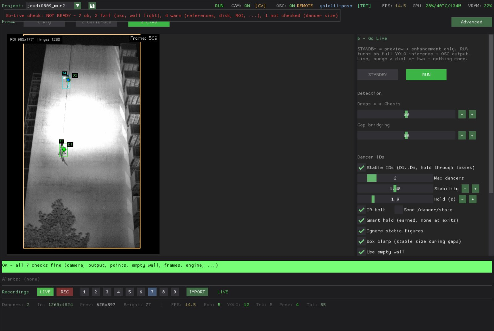
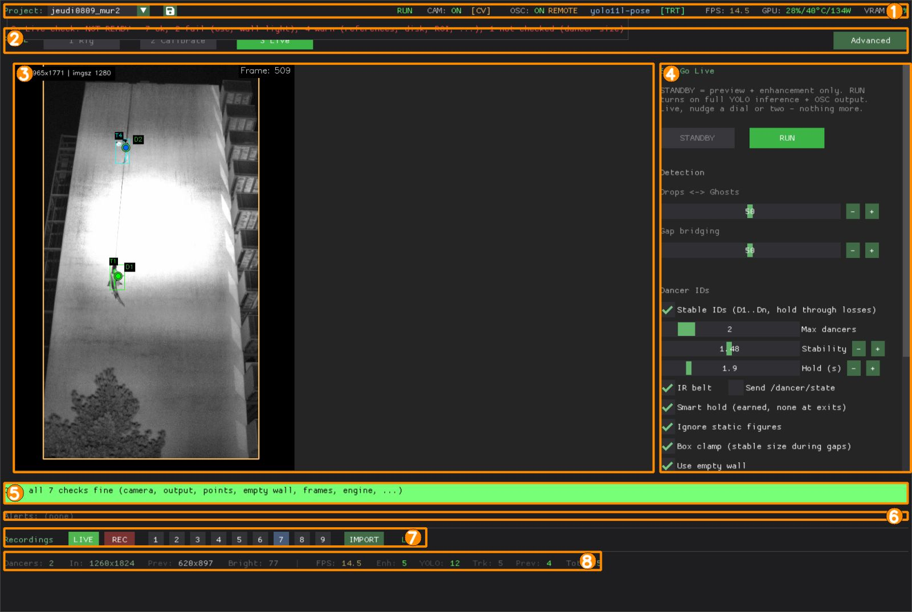
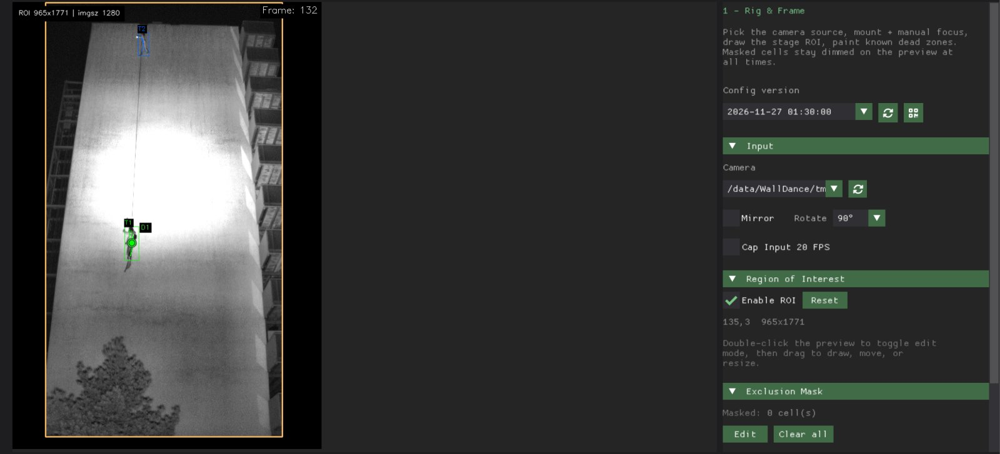
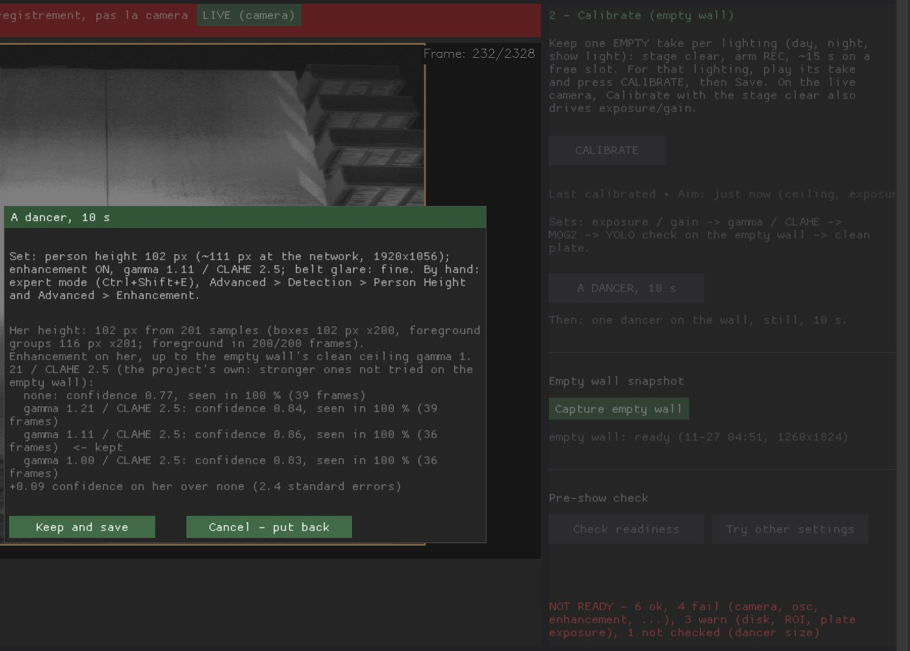
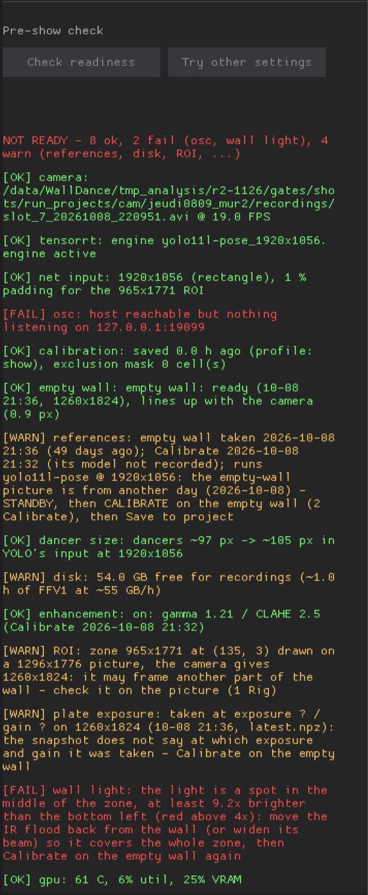
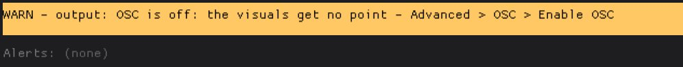
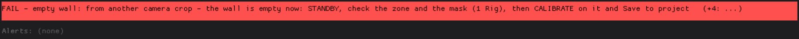

# WallDance — guide de l'opérateur

<!--
GUIDE (hub walldance#t-062, Thomas's request of 26/11 14:50): the full operator manual behind the two-page sheet
docs/FICHE_TECHNICIEN_FR.md, in French, for Nico. Written from the rehearsal build as it stands on 26/11 (cordee-r2
@ 0912d44) and its docs; brought up to release 1 (cordee-r2 @ c823b93) on 27/11, then to cordee-r2 @ 4938d97 with
X4's dancer step (X4f, 27/11), then to cordee-r2 @ 64d4dc7 (docs5a, 27/11: the band keeps the cause's
name, the dancer step refuses a wrong empty-wall picture, Calibrate honours the Exclusion Mask, held points are named), then to cordee-r2 @ d537acc
(docs5c, 27/11: the automatic swipe P6, written for « suggest » released: §5.6's list « Auto: », §8.2), with the app's own
window pictures in docs/img/ (S2, tmp_analysis/r2-1126/gates/shots); updated as the last steps land (see « État du guide » at the end).
N3 (hub walldance#t-067, 28/11): rewritten for a technician alone -- no instruction ends in asking anyone (Thomas, the support): each ends in something Nico does alone (note the time and the line and carry on, the fix, or the fallback icon); the two icons named « WallDance (répétition) » (the build) and « WallDance » (the 08/10 fallback, its labels checked in its own tree 63f4989); §5.6 and §8.2 written for the build 13138ba + the automatic swipe's three patches (gates/sadv/final: suggest by default, advice only, the 15 fps floor), its new sentences checked against that tree and gates/sadv/final/STRINGS.txt; links to the booklet docs/SITUATIONS_FR.md (#<id> of gates/sit1/situations.json); gate: gates/n3/run_gate.sh.
docfix (28/11, the swipe's fix fe28d83 on r2-int): citations re-pointed onto it; §5.6 and §8.2 say what the app does with « suggest »: the operator's own verdict's « Apply … » switches between two frames, the show runs on, in RUN too (Thomas's decision of 28/11 on the review's F1); « Apply … (STANDBY: …) » reloads, STANDBY only; the advice: at the warm-up, never during a piece; §5.4, §5.6 and §8.2 carry the new readiness row « … is still to load … » and the warm-up's 10 s in STANDBY (msg/p7fix/STRINGS_P7FIX.txt).
Conventions, checked by tmp_analysis/r2-1126/gates/guide/run_gate.sh <code-root>:
- A code span = a string exactly as the app shows it. « … » inside a span stands for a value the app fills in.
  Every code span is backed, on the same source line, by a citation comment "src: <path>:<line> «snippet»": the
  snippet is a literal piece of the span, found at that line (paths relative to application/src unless they start
  with launcher/), and every piece of the span between « … » is a string literal of a cited file.
- Section 8 quotes every alert, toast, banner and readiness row the code can show (the gate lists them from the
  code and reports the coverage), and the automatic swipe's own sentences. The guide describes the automatic
  swipe with « suggest » released (core/config.py SWIPE_AUTO_RELEASED = ("off", "suggest")); while a tree
  releases only « off », the messages it cannot show are not counted (the gate names them), and « switch »-only
  ones are never counted while « switch » is not released (gates/docs5c).
- A sentence the app composes from several literals may be backed, beside its source line, by the test that pins
  it whole (application/tests/...): its pieces are then read in that test's literal.
- Markers (N3, 28/11): [à compléter par Thomas …] only -- a blank Thomas fills before printing, never an instruction to ask him;
  [capture d'écran : …] only where no picture of the app can show it (the reason in the report of S2). No phone number, no address, no account name.
-->

**Pour Nico, seul** — la répétition des 7 et 8/12 et le premier spectacle du 12/12. Les deux fois, Nico est seul aux commandes : Thomas ne répond qu'un peu au téléphone le 7/12, et personne ne répond le 12/12.

**Ce guide décrit la version de répétition telle qu'elle est le 28/11 (la « release 1 », avec l'essai automatique en conseil).** Elle bouge encore : la dernière page, « État du guide », dit quoi.

La fiche de deux pages (*FICHE_TECHNICIEN_FR*) résume ce guide. Ce guide, on le lit une fois avant ; on l'ouvre à la bonne page quand quelque chose arrive.

> **Comment lire ce guide**
>
> - `CALIBRATE` : un texte écrit **exactement** comme à l'écran (en anglais). La traduction suit, entre parenthèses. <!-- src: gui_builder.py:890 «CALIBRATE» @«label="CALIBRATE"» -->
> - `Camera down for …s` : les « … » remplacent un nombre ou un nom que l'app écrit (une durée, une heure, des pixels). <!-- src: core/ops_monitor.py:962 «Camera down for » -->
> - **[à compléter par Thomas : …]** : un point que Thomas remplit avant d'imprimer ce guide. Resté vide : faire ce que dit le reste de la phrase, sans attendre personne.
> - **Seul aux commandes** : chaque consigne de ce guide finit par une chose que l'on fait soi-même — la faire ; ou **noter l'heure et la phrase**, et continuer ; ou **la version de secours** (l'icône « WallDance », §8.8).
> - [livret *Situations*](SITUATIONS_FR.md) : un renvoi vers le livret *Situations*, qui montre le même souci en images, sur une prise de la façade du 8/10.
> - Les images sont de vraies photos de la fenêtre, faites par l'app elle-même, au banc, avec des prises enregistrées le 8/10 sur la façade. Leur légende dit ce qui diffère d'un soir de spectacle.

**Sommaire**

1. En deux minutes — p. 1
2. Le matériel et le branchement — p. 4
3. Lancer l'application — p. 6
4. L'écran, zone par zone — p. 8
5. La mise en place, pas à pas — p. 12
6. Pendant le spectacle — p. 29
7. Entre deux pièces — p. 33
8. Si quelque chose ne va pas — p. 35
9. Le support à distance — p. 48
10. Lexique — p. 50
11. L'essentiel — p. 53

## 1. En deux minutes

### Ce que fait WallDance

- Une caméra filme le mur **en infrarouge** (IR).
- Un projecteur IR éclaire le mur. Le public ne voit pas cette lumière.
- L'application WallDance repère chaque danseur sur l'image.
- Elle donne à chacun un numéro qui ne change pas (D1, D2…).
- Elle envoie sa position aux visuels (TouchDesigner), plusieurs fois par seconde.
- Ce message réseau s'appelle **OSC**.
- Les visuels suivent les danseurs grâce à ces positions.

### Le rôle de Nico

- **Installer** : cadrer, faire la photo du mur vide (`CALIBRATE`), vérifier. <!-- src: gui_builder.py:890 «CALIBRATE» @«label="CALIBRATE"» -->
- **Lancer** : `RUN`. <!-- src: gui_builder.py:1158 «RUN» @«label="RUN"» -->
- **Surveiller une seule chose** : la ligne de santé, la bande de couleur sous l'image.
- **Réagir** : chaque message de l'app dit la seule chose à faire. Ce guide la redit en français (§6 et §8).
- **Noter l'heure** de chaque souci : les journaux de l'app sont relus après la séance.
- **Seul** : personne ne décide à sa place. Chaque message dit la seule chose à faire ; sinon, noter l'heure et la phrase, et continuer. Une soirée normale, en images : [livret *Situations* — la soirée normale](SITUATIONS_FR.md#normal_evening).

### La mise en place, sur une page

| | Étape | Où | Ce qu'on fait | C'est bon quand |
|---|---|---|---|---|
| ① | Le cadre | `1 Rig` | tracer la zone des danseurs ; régler le nombre de danseurs | la zone entoure le mur dansé <!-- src: gui_builder.py:643 «1 Rig» --> |
| ② | Le mur vide | `2 Calibrate` | personne dans l'image, `CALIBRATE`, puis `Save to project` | la carte `Scene Calibration` s'est affichée et a été enregistrée <!-- src: gui_builder.py:644 «2 Calibrate» ; gui_builder.py:890 «CALIBRATE» @«label="CALIBRATE"» ; gui.py:3147 «Save to project» ; gui.py:3127 «Scene Calibration» --> |
| ③ | Un danseur, 10 s | `2 Calibrate` | après ②, `A DANCER, 10 s` : un danseur seul, immobile 10 s au fond du mur ; puis la carte : `Keep and save` | la carte s'est affichée et a été gardée ; ensuite, au bilan, `dancer size` est `OK` <!-- src: gui_builder.py:644 «2 Calibrate» ; gui_builder.py:988 «A DANCER, 10 s» @«DANCER_STEP_LABEL = "A DANCER, 10 s"» ; gui.py:986 «Keep and save» ; core/ops_monitor.py:369 «dancer size» @«"dancer size", "ok"» ; core/ops_monitor.py:55 «OK» @«"OK"» --> |
| ④ | Vérifier | `2 Calibrate` | lire le bilan (`Check readiness`) | le bilan dit `READY` <!-- src: gui_builder.py:644 «2 Calibrate» ; gui_builder.py:927 «Check readiness» ; core/ops_monitor.py:59 «READY» @«"READY"» --> |
| ⑤ | Le spectacle | `3 Live` | `RUN`, puis ne plus toucher | la ligne de santé est verte (`OK`) <!-- src: gui_builder.py:645 «3 Live» ; gui_builder.py:1158 «RUN» @«label="RUN"» ; core/ops_monitor.py:55 «OK» @«"OK"» --> |

<figure style="break-inside: avoid; page-break-inside: avoid; margin: 0.8em 0;"><figcaption style="font-size: 0.9em; color: #444;">La fenêtre en RUN : la ligne de santé verte, OK - all 7 checks fine. En rouge en haut à gauche, le message Go-Live check du bilan fait au passage en RUN (sur le banc, rien n'écoutait l'OSC et la lumière de cette prise est rouge). Image de banc (28/11) : une prise du 8/10 (le mur) lue comme caméra, d'où [CV] dans la barre du haut ; au spectacle, [IDS]. REMOTE en orange après OSC: ON : l'image a été prise par l'accès à distance, comme le support la voit (§9).</figcaption></figure>

### Les quatre règles d'or

1. **Une seule app caméra à la fois** : jamais deux WallDance ouverts.
2. **Pendant une pièce, ne toucher que `Max dancers`** (le nombre de danseurs). Tout le reste attend la pause. <!-- src: gui_builder.py:1244 «Max dancers» -->
3. **Après chaque changement : `Ctrl+S`** (enregistrer). Sinon une relance l'oublie. <!-- src: gui_builder.py:396 «Ctrl+S» @«Save config (Ctrl+S)» -->
4. **Jamais un emplacement de prise (1 à 9) cliqué en `RUN`** : les visuels suivraient l'enregistrement, plus les danseurs (§6). <!-- src: gui_builder.py:1158 «RUN» @«label="RUN"» -->

## 2. Le matériel et le branchement

Ce que le code et les notes de Thomas établissent. Le reste est un blanc **[à compléter par Thomas]**, rempli avant l'impression.

### Le portable

- Un portable Windows avec une carte graphique NVIDIA. Il fait tourner WallDance.
- TouchDesigner (les visuels) tourne aussi sur ce portable **[à compléter par Thomas : le même portable le 7/12 et le 12/12]**.
- **Toujours sur secteur.** Sur batterie, l'image ralentit.
- **Arrière surélevé, aérations dégagées.** La carte graphique chauffe ; l'app alerte à 85 °C.
- Ne pas fermer le capot ni toucher au bouton d'alimentation pendant que l'app tourne : le portable se mettrait en veille.
- Ne pas ouvrir d'autre logiciel de caméra (par exemple IDS peak Cockpit) pendant que WallDance tourne : une caméra ne sert qu'à un logiciel.

### La caméra

- Une caméra industrielle IDS, branchée en **USB3**.
- Sur les prises du 08/10 : objectif 6 mm, filtre infrarouge derrière l'objectif, caméra montée à la verticale **[à compléter par Thomas : même caméra, même objectif, même montage]**.
- Montée à la verticale, l'image est tournée par l'app (`Rotate`, dans `1 Rig`). <!-- src: gui_builder.py:1925 «Rotate» @«"Rotate"» ; gui_builder.py:643 «1 Rig» -->
- La mise au point se fait à la main, sur la bague de l'objectif, **sous la lumière IR**.
- Câble USB3 enfoncé à fond des deux côtés, alimentation de la caméra branchée **[à compléter par Thomas : la caméra a-t-elle une alimentation à part]**.
- **Brancher la caméra avant de lancer l'app.** Sans elle, l'app prend une autre caméra (la webcam du portable) et écrit `[CV]` en haut, au lieu de `[IDS]`. <!-- src: gui.py:2038 «[CV]» @«"[CV]"» ; gui.py:2035 «[IDS]» @«"[IDS]"» -->
- La caméra peut se figer environ 1,7 s (« stall »). Quelques fois par minute, c'est connu. L'app les compte (`camera stalls`). <!-- src: core/ops_monitor.py:1152 «camera stalls» -->

### Le projecteur IR (« IR flood »)

- Allumé **avant** `CALIBRATE`. <!-- src: gui_builder.py:890 «CALIBRATE» @«label="CALIBRATE"» -->
- Tout près de l'objectif (moins de 10 cm), tourné vers le mur.
- Aucune lampe, aucun projecteur visible dans l'image.
- `CALIBRATE` juge la lumière et peut demander de déplacer le projecteur (§5.2). <!-- src: gui_builder.py:890 «CALIBRATE» @«label="CALIBRATE"» -->

### Les ceintures IR des danseurs

- Si les danseurs portent la ceinture réfléchissante : cocher `IR belt` (dans `3 Live`). Elle aide à garder un danseur quand l'app perd sa silhouette. <!-- src: gui_builder.py:1291 «IR belt» @«label="IR belt"» ; gui_builder.py:645 «3 Live» -->
- **[à compléter par Thomas : ceintures portées le 7/12 et le 12/12]**

### Le réseau

- **7–8/12** : le portable doit être en ligne (4G) pour le support à distance (§9) **[à compléter par Thomas : la 4G du portable ou un routeur 4G]**.
- L'adresse où l'app envoie les positions est dans le projet (`Advanced` → `OSC` → `Target Address`). Ne pas la changer. <!-- src: gui_builder.py:687 «Advanced» @«label="Advanced"» ; gui_builder.py:1695 «OSC» @«label="OSC"» ; gui_builder.py:1707 «Target Address» -->

### Avant de lancer l'app, dans l'ordre

1. Portable sur secteur, arrière surélevé.
2. Caméra fixée et branchée en USB3.
3. Projecteur IR allumé, tourné vers le mur.
4. TouchDesigner lancé avec son patch. Sinon le bilan dit `nothing listening on …` (personne n'écoute). <!-- src: core/ops_monitor.py:258 «nothing listening on » -->
5. 7–8/12 : la connexion 4G **[à compléter par Thomas : la 4G du portable ou un routeur 4G]**.
6. Puis WallDance (§3).

*[capture d'écran : photo du montage, la caméra et le projecteur IR en place]*

## 3. Lancer l'application

### Deux versions sur le portable : deux icônes

| L'icône du bureau | La version | Quand |
|---|---|---|
| **« WallDance (répétition) »** | la **version de répétition**, celle que décrit ce guide | la répétition des 7–8/12 **et** le spectacle du 12/12 |
| **« WallDance »** (l'icône de toujours) | la **version du 8 octobre** : la **version de secours** ; elle passe d'abord par le lanceur `WallDance Launcher` | seulement si la version de répétition ne repart pas (§8.8) <!-- src: launcher/gui.py:75 «WallDance Launcher» --> |

- **Une seule ouverte à la fois** : une seule app tient la caméra. Fermer l'une avant d'ouvrir l'autre.
- Dans ce guide et sur la fiche, les deux icônes ont toujours ces deux noms : « WallDance (répétition) » pour la version de répétition, « WallDance » pour la version de secours.

### Lancer la version de répétition

1. Double-cliquer l'icône **« WallDance (répétition) »** du bureau.
2. La fenêtre `WallDance - Select Project` s'ouvre (choisir un projet). Les projets sont rangés du plus récent au plus ancien. <!-- src: gui.py:2545 «WallDance - Select Project» -->
3. Cliquer le projet **[à compléter par Thomas : le projet à ouvrir]**.
4. Cliquer `Launch` (lancer), ou la touche Entrée (`Enter = launch highlighted`). <!-- src: gui.py:2557 «Launch» @«label="Launch"» ; gui.py:2550 «Enter = launch highlighted» -->
5. Jamais `Delete` (supprimer), `Rename` (renommer) ni `New` (nouveau). <!-- src: gui.py:2561 «Delete» @«label="Delete"» ; gui.py:2559 «Rename» @«label="Rename"» ; gui.py:2564 «New» @«label="New"» -->
6. Si une fenêtre `Model Loading` (chargement du modèle) s'affiche : attendre qu'elle se ferme. <!-- src: gui.py:2894 «Model Loading» -->
7. L'app démarre **en `RUN`** : le badge en haut dit `RUN`. <!-- src: gui_builder.py:1158 «RUN» @«label="RUN"» ; gui_builder.py:1158 «RUN» @«label="RUN"» -->
8. Après quelques secondes d'image, le bilan se lance seul. Un message `Go-Live check: …` s'affiche en haut à gauche de la fenêtre (§5.4). <!-- src: core/ops_monitor.py:127 «Go-Live check: » -->

<figure style="break-inside: avoid; page-break-inside: avoid; margin: 0.8em 0;"><figcaption style="font-size: 0.9em; color: #444;">La fenêtre WallDance - Select Project : le dernier projet enregistré est en tête et surligné ; Entrée le lance. Image de banc (27/11) : les projets d'un dossier d'essai.</figcaption></figure>

### Au démarrage, on peut voir

- `Automatic swipe: … (the default)` ou `Automatic swipe: … (from the project)`, en bleu, 6 s : l'essai automatique est allumé, comme prévu. **Rien à faire** (§5.6). <!-- src: app.py:1701 «Automatic swipe: » ; application/tests/test_swipe_auto_lock.py:28 «(the default)» ; application/tests/test_swipe_auto_lock.py:27 «(from the project)» -->
- `Previous session crashed (…)` en rouge, 15 s : la séance d'avant s'est arrêtée anormalement. **Noter l'heure, continuer.** <!-- src: services/crash_marker.py:174 «Previous session crashed (» -->
- La fenêtre `TensorRT Engine` (`No TensorRT engine found for …`) : voir §8, ligne « moteur ». <!-- src: gui.py:2974 «TensorRT Engine» ; gui.py:2987 «No TensorRT engine found for » -->
- `/!\ Running on CPU - no GPU acceleration` : voir §8. <!-- src: runtime/main_loop.py:361 «Running on CPU - no GPU acceleration» -->
- `[CV]` en haut au lieu de `[IDS]` : la caméra IDS n'est pas trouvée. Fermer l'app, brancher la caméra, relancer. <!-- src: gui.py:2038 «[CV]» @«"[CV]"» ; gui.py:2035 «[IDS]» @«"[IDS]"» -->

### Lancer la version de secours (l'icône « WallDance »), pas à pas

À faire seulement quand la version de répétition ne repart pas après une relance (§8.8). Compter cinq minutes avant que le suivi revienne.

1. Fermer la version de répétition (« Fermer l'application » ci-dessous ; figée : §7.4). **Laisser TouchDesigner ouvert.**
2. Double-cliquer l'icône **« WallDance »** du bureau (l'icône de toujours). La fenêtre `WallDance Launcher` s'ouvre et démarre l'app **toute seule** ; elle écrit `WallDance is running...`. <!-- src: launcher/gui.py:75 «WallDance Launcher» ; launcher/gui.py:236 «WallDance is running...» -->
3. La question `Update Available` (une mise à jour existe) : répondre **non**. <!-- src: launcher/gui.py:410 «Update Available» -->
4. La question `Local Version Differs` (la version locale est différente) : `Keep local version` (garder la version locale). La fenêtre parle aussi de Thomas : `Keep local version` suffit, seul. <!-- src: launcher/gui.py:196 «Local Version Differs» ; launcher/gui.py:204 «Keep local version» -->
5. La même fenêtre de choix du projet s'ouvre : **[à compléter par Thomas : le projet à ouvrir dans la version de secours]**, puis `Launch`. <!-- src: gui.py:2557 «Launch» @«label="Launch"» -->
6. Les étapes ① ② ④ ⑤ comme au §5 : les mêmes onglets `1 Rig`, `2 Calibrate`, `3 Live`, les mêmes boutons `CALIBRATE`, `Check readiness`, `RUN`. <!-- src: gui_builder.py:643 «1 Rig» ; gui_builder.py:644 «2 Calibrate» ; gui_builder.py:645 «3 Live» ; gui_builder.py:890 «CALIBRATE» @«label="CALIBRATE"» ; gui_builder.py:927 «Check readiness» ; gui_builder.py:1158 «RUN» @«label="RUN"» -->
7. **Laisser la fenêtre du lanceur ouverte** pendant le spectacle : un ancien lanceur fermait l'app avec sa fenêtre.
8. Le lanceur s'arrête sur une erreur : fermer sa fenêtre, double-cliquer une seule fois de plus l'icône « WallDance ». Toujours rien : le spectacle continue sans suivi (§8.8), noter l'heure.

Cette version est plus ancienne que ce guide : pas d'étape ③ (`A DANCER, 10 s`), pas de `Try other settings`, pas de ligne de santé, pas de bande `MESSAGE DU SUPPORT`, et le bilan ne se lance pas seul (cliquer `Check readiness`). Ses autres messages ne sont pas tous dans ce guide : faire ce que dit la fin du message, sinon noter l'heure et la phrase, et continuer. <!-- src: gui_builder.py:988 «A DANCER, 10 s» @«DANCER_STEP_LABEL = "A DANCER, 10 s"» ; gui_builder.py:939 «Try other settings» @«label="Try other settings"» ; gui_builder.py:522 «MESSAGE DU SUPPORT» ; gui_builder.py:927 «Check readiness» -->

### Fermer l'application

1. `3 Live` → `STANDBY` : plus rien n'est envoyé aux visuels. <!-- src: gui_builder.py:645 «3 Live» ; gui_builder.py:1147 «STANDBY» @«label="STANDBY"» -->
2. `Ctrl+S` si un réglage a changé. <!-- src: gui_builder.py:396 «Ctrl+S» @«Save config (Ctrl+S)» -->
3. Fermer la fenêtre `WallDance Control Panel` par sa croix, en haut à droite. L'app garde une dernière fois la photo du mur vide en partant ; la fenêtre disparaît en quelques secondes. <!-- src: gui.py:3507 «WallDance Control Panel» -->

## 4. L'écran, zone par zone

| Zone | Où | Ce qu'on y voit |
|---|---|---|
| 1. Barre du haut | tout en haut | le projet, l'état (`RUN` / `STANDBY`), la caméra, l'envoi, la vitesse <!-- src: gui_builder.py:1158 «RUN» @«label="RUN"» ; gui_builder.py:1147 «STANDBY» @«label="STANDBY"» --> |
| 2. Rail des phases | sous la barre | `PHASE`, `1 Rig`, `2 Calibrate`, `3 Live` ; `Advanced` à droite <!-- src: gui_builder.py:668 «PHASE» @«"PHASE"» ; gui_builder.py:643 «1 Rig» ; gui_builder.py:644 «2 Calibrate» ; gui_builder.py:645 «3 Live» ; gui_builder.py:687 «Advanced» @«label="Advanced"» --> |
| 3. L'image | au milieu, à gauche | la caméra, les danseurs, les points envoyés ; les bandeaux au-dessus |
| 4. Le panneau | au milieu, à droite | les réglages de la phase choisie |
| 5. La ligne de santé | sous l'image, toute la largeur | une bande de couleur : la santé du spectacle |
| 6. Les alertes | sous la ligne de santé | `Alerts:` puis `(none)` (aucune) ou les alertes qui durent <!-- src: gui_builder.py:1400 «Alerts:» @«"Alerts:"» ; gui_builder.py:1401 «(none)» @«"(none)"» --> |
| 7. Les enregistrements | sous les alertes | `Recordings`, `LIVE`, `REC`, les emplacements 1 à 9 <!-- src: gui_builder.py:1409 «Recordings» @«"Recordings"» ; gui_builder.py:1446 «LIVE» @«label="LIVE"» ; gui_builder.py:1453 «REC» @«label="REC"» --> |
| 8. Barre du bas | tout en bas | des chiffres de vitesse, rien à faire |

<figure style="break-inside: avoid; page-break-inside: avoid; margin: 0.8em 0;"><figcaption style="font-size: 0.9em; color: #444;">Les huit zones du §4. Les cadres orange et leurs numéros sont ajoutés sur l'image : l'app ne les montre pas. Image de banc (28/11) : une prise du 8/10 (le mur) lue comme caméra, d'où [CV] dans la barre du haut ; au spectacle, [IDS].</figcaption></figure>

### 4.1 La barre du haut

- `Project:` (projet) et son nom. L'icône disquette à côté : `Save config (Ctrl+S)` (enregistrer). <!-- src: gui_builder.py:377 «Project:» @«"Project:"» ; gui_builder.py:396 «Ctrl+S» @«Save config (Ctrl+S)» -->
- L'état, en gros : `RUN` (vert) ou `STANDBY` (jaune). <!-- src: gui_builder.py:65 «RUN» @«"RUN"» ; gui_builder.py:64 «STANDBY» @«"STANDBY"» -->
  - `RUN` = l'app détecte les danseurs et envoie leurs positions. <!-- src: gui_builder.py:413 «RUN» @«RUN: Full YOLO + OSC output» -->
  - `STANDBY` = l'image seule ; rien n'est détecté, rien n'est envoyé. <!-- src: gui_builder.py:413 «STANDBY» @«STANDBY: Preview only, no YOLO» -->
- `CAM:` puis `ON` (vert, la caméra marche) ou `OFF` (rouge, pas de caméra). <!-- src: gui_builder.py:415 «CAM:» @«"CAM:"» ; gui.py:2028 «ON» @«"ON" if camera_running» ; gui_builder.py:416 «OFF» @«"OFF"» -->
  - `[IDS]` = la caméra du spectacle. `[CV]` = une autre caméra : **pas la bonne**. <!-- src: gui.py:2035 «[IDS]» @«"[IDS]"» ; gui.py:2038 «[CV]» @«"[CV]"» -->
  - `RECONNECTING` (orange) = la caméra se reconnecte. <!-- src: gui_builder.py:425 «RECONNECTING» @«"RECONNECTING"» -->
- `OSC:` puis `ON` / `OFF` : l'envoi des positions aux visuels. <!-- src: gui_builder.py:431 «OSC:» @«"OSC:"» ; gui.py:2055 «ON» @«"ON" if osc_enabled» ; gui_builder.py:416 «OFF» @«"OFF"» -->
- `REMOTE` (orange) : une session à distance parle à l'app. `REMOTE*` : elle a aussi le droit d'agir en RUN (§9). <!-- src: gui_builder.py:435 «REMOTE» @«"REMOTE"» ; gui.py:1143 «REMOTE*» @«"REMOTE*"» -->
- Le nom du modèle de détection, puis `[TRT]` (le moteur rapide : normal) ou `[PT]` (le moteur lent : anormal, §8). <!-- src: gui.py:2258 «[TRT]» @«"[TRT]"» ; gui_builder.py:444 «[PT]» @«"[PT]"» -->
- `[CPU FALLBACK]` en rouge : la carte graphique n'est pas utilisée (§8). <!-- src: gui_builder.py:448 «[CPU FALLBACK]» -->
- `FPS:` : images traitées par seconde. Vert à 19 et plus, rouge à 10 et moins. <!-- src: gui_builder.py:453 «FPS:» @«"FPS:"» -->
- `GPU:` et `VRAM:` : la charge et la mémoire de la carte graphique. Rien à faire. <!-- src: gui_builder.py:456 «GPU:» @«"GPU:"» ; gui_builder.py:459 «VRAM:» @«"VRAM:"» -->

### 4.2 Le rail des phases

- `PHASE` puis trois boutons : `1 Rig` (le montage), `2 Calibrate` (le mur vide), `3 Live` (le direct). <!-- src: gui_builder.py:668 «PHASE» @«"PHASE"» ; gui_builder.py:643 «1 Rig» ; gui_builder.py:644 «2 Calibrate» ; gui_builder.py:645 «3 Live» -->
- Un clic montre le panneau de cette phase à droite. Le bouton choisi devient vert.
- Ouvrir `2 Calibrate` relance le bilan tout seul. <!-- src: gui_builder.py:644 «2 Calibrate» -->
- `Advanced` (avancé), à droite : une fenêtre de réglages experts, `Advanced  (numeric knobs)`. **Ne pas l'ouvrir**, sauf quand §8 le dit. <!-- src: gui_builder.py:687 «Advanced» @«label="Advanced"» ; gui_builder.py:1416 «Advanced  (numeric knobs)» -->

### 4.3 L'image

- L'image de la caméra, déjà tournée.
- Le cadre de la zone surveillée (la `Region of Interest`). Les cases masquées sont assombries. <!-- src: gui_builder.py:2070 «Region of Interest» @«label="Region of Interest"» -->
- Sur chaque danseur : son squelette, sa boîte, son numéro, et **une boule** : le point envoyé aux visuels.
- Le bord de la boule dit l'état du danseur :
  - **vert** : suivi normal ;
  - **cyan** : tenu par la ceinture IR ;
  - **blanc** : tenu par la photo du mur vide ;
  - **orange** : pas vu à cet instant, tenu à sa dernière place quelques secondes.
- Beaucoup d'orange = de mauvaises conditions (lumière, taille). Noter l'heure.

**Les bandeaux au-dessus de l'image** (ils apparaissent seulement quand il le faut) :

- Rouge : `TensorRT OFF - running PyTorch (…)` et un bouton `Rebuild TRT`. Le moteur rapide ne marche pas (§8). **Ne jamais cliquer `Rebuild TRT`** pendant un spectacle. <!-- src: runtime/model_controller.py:434 «TensorRT OFF - running PyTorch (» ; gui_builder.py:483 «Rebuild TRT» -->
- Rouge : `LECTURE - pas en direct` `- TouchDesigner recoit un enregistrement, pas la camera` et un bouton `LIVE (camera)` (§6.3). <!-- src: gui_builder.py:501 «LECTURE - pas en direct» ; gui_builder.py:512 «TouchDesigner recoit un enregistrement, pas la camera» ; gui_builder.py:514 «LIVE (camera)» -->
- Jaune : `MESSAGE DU SUPPORT` et un bouton `J'ai lu` (§9). <!-- src: gui_builder.py:522 «MESSAGE DU SUPPORT» ; gui_builder.py:523 «J'ai lu» -->

**Les messages en haut à gauche de la fenêtre** (« toasts ») : ils s'effacent seuls après quelques secondes. Un seul à la fois. Un message long passe sur plusieurs lignes, sans sortir de l'image : il est toujours lisible en entier. Ceux qui commencent par `/!\ ` sont des alertes, en rouge, 8 s. <!-- src: ui/adapter.py:416 «/!» @«{e.message}» -->

### 4.4 Le panneau de droite

- `1 Rig` montre `1 - Rig & Frame` (montage et cadre) : §5.1. <!-- src: gui_builder.py:643 «1 Rig» ; gui_builder.py:762 «1 - Rig & Frame» -->
- `2 Calibrate` montre `2 - Calibrate (empty wall)` (mur vide) : §5.2 et §5.4. <!-- src: gui_builder.py:644 «2 Calibrate» ; gui_builder.py:882 «2 - Calibrate (empty wall)» -->
- `3 Live` montre `6 - Go Live` (le direct). Le titre dit « 6 », le bouton dit « 3 » : c'est le même panneau. <!-- src: gui_builder.py:645 «3 Live» ; gui_builder.py:1139 «6 - Go Live» -->
- Dans `3 Live`, bloc `Dancer IDs`, la ligne `ids: …` dit l'état de chaque point envoyé aux visuels (D1, D2…), puis `belt: …` (la ceinture). Par exemple : « ids: D1 held on the foreground 21.6s | D2 held on the belt 0.3s   belt: ready ». Après un mot « tenu », le temps passé dans cet état. Les mots : <!-- src: gui_builder.py:645 «3 Live» ; gui_builder.py:1236 «Dancer IDs» ; core/points_report.py:75 «ids: » @«return "ids: "» ; core/points_report.py:75 «belt: » @«f"   belt: {belt}"» -->
  - `live` (vu) : la détection voit le danseur. Normal. <!-- src: core/points_report.py:14 «live» @«"live": "live"» -->
  - `held on the foreground` (tenu sur la forme) : la détection l'a perdu ; le point reste sur la forme qui bouge encore à sa place. <!-- src: core/points_report.py:15 «held on the foreground» -->
  - `held on the belt` (tenu sur la ceinture) : la détection l'a perdu ; sa ceinture IR tient le point. <!-- src: core/points_report.py:16 «held on the belt» -->
  - `held on a weak detection` (tenu sur une détection faible) : la détection le voit à peine ; le point suit quand même. <!-- src: core/points_report.py:17 «held on a weak detection» -->
  - `coasting` (sur sa lancée) : plus rien ne le voit ; le point continue un instant sur sa trajectoire, puis il est perdu. <!-- src: core/points_report.py:18 «coasting» @«"coasting": "coasting"» -->
  - `lost` (perdu) : ce point n'est plus envoyé. <!-- src: core/points_report.py:19 «lost» @«"lost": "lost"» -->
  - `(nothing sent)` à la fin (rien n'est envoyé) : en `STANDBY` ou l'OSC coupé, les visuels ne reçoivent rien ; la ligne montre l'état sans le temps. <!-- src: core/points_report.py:62 «(nothing sent)» ; gui_builder.py:1147 «STANDBY» @«label="STANDBY"» -->
- **Ce qu'est un point tenu.** Quand la détection perd un danseur, l'app garde son point sur la forme qui bouge encore à sa place, jusqu'à 30 secondes après la dernière fois que la détection ou sa ceinture l'a vu. Sur un mur vide où quelque chose bouge (un rideau, une corde, une fenêtre), cela peut faire un point sur personne : **si un point reste là où il n'y a personne, regarder ce qui bouge à cet endroit.**

<figure style="break-inside: avoid; page-break-inside: avoid; margin: 0.8em 0;"><figcaption style="font-size: 0.9em; color: #444;">Le panneau 3 Live en entier (6 - Go Live), ici en STANDBY : les réglages de détection, les identités des danseurs, la commande à distance, les vues. Image de banc (28/11) : la ligne ids: finit par (nothing sent), car en STANDBY rien ne part aux visuels (§4.4).</figcaption></figure>

### 4.5 La ligne de santé et les alertes

- La **ligne de santé** : une bande de couleur, toute la largeur de la fenêtre, sous l'image. Elle change chaque seconde. Tout est au §6.
- Dessous, `Alerts:` garde les alertes qui durent (la lumière, la photo du mur vide) jusqu'à ce qu'on les règle. `(none)` = aucune. <!-- src: gui_builder.py:1400 «Alerts:» @«"Alerts:"» ; gui_builder.py:1401 «(none)» @«"(none)"» -->

### 4.6 La barre des enregistrements

- `Recordings` (enregistrements), puis : <!-- src: gui_builder.py:1409 «Recordings» @«"Recordings"» -->
- `LIVE` : revenir à la caméra en direct. <!-- src: gui_builder.py:1446 «LIVE» @«label="LIVE"» -->
- `REC` : enregistrer une prise (§5.2). <!-- src: gui_builder.py:1453 «REC» @«label="REC"» -->
- 1 à 9 : les emplacements des prises. Gris = vide, bleu = une prise, bleu vif = en lecture, rouge = en enregistrement.
- **Un clic sur un emplacement lance la lecture de sa prise.** En `RUN`, les visuels suivent alors la prise, plus les danseurs. <!-- src: gui_builder.py:1158 «RUN» @«label="RUN"» -->
- `IMPORT` (importer une vidéo) : outil expert, ne pas utiliser. <!-- src: gui_builder.py:1473 «IMPORT» @«label="IMPORT"» -->
- L'état, à droite : `LIVE` (direct), `REC ARMED - Select slot` (choisir un emplacement), `SLOT …` (l'emplacement en cours). <!-- src: gui.py:1431 «LIVE» @«"rec_status_text", "LIVE"» ; gui.py:1434 «REC ARMED - Select slot» ; gui.py:1437 «SLOT» @«f"SLOT {current_slot}"» -->
- En lecture : vitesse, pause, image par image, et `ISSUE` (signaler un problème, outil expert). <!-- src: gui_builder.py:1523 «ISSUE» @«label="ISSUE"» -->

### 4.7 La barre du bas

- `Dancers:` (les points envoyés aux visuels ; « 1 (1 held) » = un point, et il est tenu, §4.4 ; en `STANDBY` ou l'OSC coupé : les danseurs que suit la détection), `In:` (taille de l'image), `Bright:` (luminosité), `FPS:`, puis des temps de calcul (`Enh:`, `YOLO:`, `Trk:`, `Tot:`). <!-- src: gui_builder.py:567 «Dancers:» @«"Dancers:"» ; gui_builder.py:1147 «STANDBY» @«label="STANDBY"» ; gui_builder.py:570 «In:» @«"In:"» ; gui_builder.py:576 «Bright:» @«"Bright:"» ; gui_builder.py:453 «FPS:» @«"FPS:"» ; gui_builder.py:584 «Enh:» @«"Enh:"» ; gui_builder.py:587 «YOLO:» @«"YOLO:"» ; gui_builder.py:590 «Trk:» @«"Trk:"» ; gui_builder.py:596 «Tot:» @«"Tot:"» -->
- Rien à faire. Utile seulement au téléphone avec le support.

### 4.8 Le clavier

| Touche | Effet | Pendant une pièce |
|---|---|---|
| `Ctrl+S` | enregistre le projet <!-- src: gui_builder.py:396 «Ctrl+S» @«Save config (Ctrl+S)» --> | permis |
| S, K, B, T, I, C | affichent ou cachent squelette, points, boîtes, traînées, numéros, boule (`View:`) <!-- src: gui_builder.py:1623 «View:» @«"View:"» --> | sans effet sur le spectacle ; éviter |
| P | fige l'image **à l'écran** (le suivi continue) ; P à nouveau la rend | éviter |
| F8 | ouvre le signalement d'un problème (outil expert) | non |
| `Ctrl+Shift+E` | le mode expert, `Expert mode ON` / `Expert mode OFF` (§8) <!-- src: core/ops_monitor.py:505 «Ctrl+Shift+E» ; gui.py:627 «Expert mode ON» @«"Expert mode ON"» ; gui.py:627 «Expert mode OFF» @«"Expert mode OFF"» --> | non |

Pendant qu'on écrit dans une case (un nom, la fiche du montage), les lettres seules ne déclenchent rien.

## 5. La mise en place, pas à pas

### 5.1 Le cadre — `1 Rig` <!-- src: gui_builder.py:643 «1 Rig» -->

**Faire :**

1. Cliquer `1 Rig`. Le panneau `1 - Rig & Frame` s'ouvre. <!-- src: gui_builder.py:643 «1 Rig» ; gui_builder.py:762 «1 - Rig & Frame» -->
2. Bloc `Input` (l'entrée) : `Camera` = la caméra IDS. <!-- src: gui_builder.py:1886 «Input» @«label="Input"» ; gui_builder.py:1887 «Camera» @«"Camera"» -->
3. `Rotate` (tourner) = la rotation du montage (caméra verticale : **[à compléter par Thomas : 90° ou un autre angle]**). `Mirror` (miroir) : décoché, sauf consigne. <!-- src: gui_builder.py:1925 «Rotate» @«"Rotate"» ; gui_builder.py:1919 «Mirror» @«label="Mirror"» -->
4. Mise au point : tourner la bague de l'objectif, sous l'IR, jusqu'à une image nette.
   - Aide : l'icône QR, `Phone monitor: show a QR code to open the web UI`. La fenêtre `Phone Monitor` dit `Scan with a phone on the same Wi-Fi / hotspot:`. On voit alors l'image sur un téléphone, près de la caméra. <!-- src: gui_builder.py:858 «Phone monitor: show a QR code to open the web UI» ; gui.py:3189 «Phone Monitor» @«"Phone Monitor"» ; gui.py:3200 «Scan with a phone on the same Wi-Fi / hotspot:» -->
5. Bloc `Region of Interest` (la zone surveillée) : cocher `Enable ROI`. <!-- src: gui_builder.py:2070 «Region of Interest» @«label="Region of Interest"» ; gui_builder.py:2073 «Enable ROI» -->
6. Double-cliquer l'image. Message : `ROI edit mode: drag on preview` (tracer sur l'image). <!-- src: ui/roi_mask_editor.py:674 «ROI edit mode: drag on preview» -->
7. Tirer un rectangle autour du mur où l'on danse, avec une petite marge pour les entrées et sorties.
8. Double-cliquer à nouveau : `ROI edit mode: off` (fini). <!-- src: ui/roi_mask_editor.py:674 «ROI edit mode: off» -->
9. Bloc `Exclusion Mask` (les cases ignorées) : seulement pour un endroit où personne ne danse jamais et où l'app croit voir quelqu'un (une affiche, un reflet). <!-- src: gui_builder.py:2041 «Exclusion Mask» @«label="Exclusion Mask"» -->
   - `Edit`, puis cliquer ou glisser sur l'image : les cases deviennent rouges. `Edit` à nouveau pour finir. <!-- src: gui_builder.py:2048 «Edit» @«label="Edit"» ; gui_builder.py:2048 «Edit» @«label="Edit"» -->
   - **Dans le doute : ne rien masquer.** `Clear all` efface tout le masque. <!-- src: gui_builder.py:2054 «Clear all» @«label="Clear all"» -->
10. Le nombre de danseurs : `3 Live` → `Max dancers` = le nombre de danseurs sur le mur, au plus (1 à 8). <!-- src: gui_builder.py:645 «3 Live» ; gui_builder.py:1244 «Max dancers» -->
11. `Rig sheet` (la fiche du montage) : facultatif ; seul, le laisser tel quel. <!-- src: gui_builder.py:800 «Rig sheet» @«label="Rig sheet"» -->
12. `Ctrl+S`. <!-- src: gui_builder.py:396 «Ctrl+S» @«Save config (Ctrl+S)» -->

**Plus la zone est serrée sur le mur dansé, plus les danseurs sont grands pour la détection.** C'est le premier réglage de la qualité.

**C'est bon quand :**

- le rectangle entoure le mur dansé, et rien d'autre de large ;
- sous `Region of Interest`, la ligne donne la zone (position et taille) ; <!-- src: gui_builder.py:2070 «Region of Interest» @«label="Region of Interest"» -->
- `Masked:` donne le nombre de cases masquées (souvent `0 cell(s)`). <!-- src: gui_builder.py:2044 «Masked:» @«"Masked:"» ; gui_builder.py:2045 «0 cell(s)» @«"0 cell(s)"» -->

**Si ce n'est pas bon :** le bilan (§5.4) a une ligne `ROI` ; ses messages sont au §8. <!-- src: core/ops_monitor.py:549 «ROI» @«CheckResult("ROI"» -->

**Si la caméra bouge après cette étape :** refaire ② à ④.

`Reset` (sous `Enable ROI`) efface la zone : ne pas cliquer sans raison. <!-- src: gui_builder.py:2079 «Reset» @«label="Reset"» ; gui_builder.py:2073 «Enable ROI» -->

<figure style="break-inside: avoid; page-break-inside: avoid; margin: 0.8em 0;"><figcaption style="font-size: 0.9em; color: #444;">Le panneau 1 Rig : la zone tracée en orange sur l'image, sa position et sa taille sous Enable ROI. Image de banc (27/11) : une prise du 8/10 lue comme caméra, d'où un nom de fichier sous Camera ; au spectacle, la caméra IDS.</figcaption></figure>

### 5.2 Le mur vide et CALIBRATE — `2 Calibrate` <!-- src: gui_builder.py:644 «2 Calibrate» -->

**Pourquoi :** `CALIBRATE` règle l'exposition de la caméra et l'amélioration de l'image, puis prend la **photo du mur vide**. Cette photo sert à repérer les danseurs et à refuser les « fantômes » (une forme fixe prise pour quelqu'un). <!-- src: gui_builder.py:890 «CALIBRATE» @«label="CALIBRATE"» -->

**Quand :** une fois par éclairage (jour, nuit, lumière du spectacle), et après tout changement de caméra, de zone ou de projecteur.

**Avant :** personne sur le mur, personne dans l'image, même au bord. Projecteur IR allumé. `CAM:` `ON`. <!-- src: gui_builder.py:415 «CAM:» @«"CAM:"» ; gui.py:2028 «ON» @«"ON" if camera_running» -->

**Faire :**

1. Cliquer `2 Calibrate`. Le panneau `2 - Calibrate (empty wall)` s'ouvre. <!-- src: gui_builder.py:644 «2 Calibrate» ; gui_builder.py:882 «2 - Calibrate (empty wall)» -->
2. Vider le mur.
3. Appuyer **une fois** sur `CALIBRATE`. Le bouton devient `CANCEL` (annuler) pendant le calcul. <!-- src: gui_builder.py:890 «CALIBRATE» @«label="CALIBRATE"» ; gui.py:1019 «CANCEL» @«"CANCEL"» -->
4. Lire la ligne bleue sous le bouton. Elle passe par :
   - `Checking that the wall is empty...` (vérifie que le mur est vide) ; <!-- src: runtime/calibration_flows.py:678 «Checking that the wall is empty...» -->
   - `Calibrating exposure...` (règle l'exposition, avec la caméra en direct seulement) ; <!-- src: runtime/calibration_flows.py:300 «Calibrating exposure...» -->
   - `Calibrating …%` (mesure la scène) ; <!-- src: runtime/calibration_flows.py:446 «Calibrating» @«f"Calibrating {int(cal.progress() * 100)}%"» -->
   - `Checking the empty wall …%` (vérifie que l'app ne voit personne sur le mur vide). <!-- src: runtime/calibration_flows.py:563 «Checking the empty wall » -->
5. Attendre 20 à 30 secondes. Ne rien toucher.
6. La carte `Scene Calibration` s'ouvre : `Measured and applied to this session:` (mesuré et appliqué à cette séance). <!-- src: gui.py:3127 «Scene Calibration» ; gui.py:3140 «Measured and applied to this session:» -->
7. Lire la carte (plus bas), puis cliquer **`Save to project`** (enregistrer dans le projet). **Toujours.** <!-- src: gui.py:3147 «Save to project» -->
   - Si la carte reste ouverte ou revient après la sauvegarde (par exemple avec le verdict de la lumière du mur), elle dit `Saved to project.` (enregistré dans le projet) avec un bouton `Close` (fermer) : c'est enregistré, cliquer `Close`. <!-- src: gui.py:2443 «Saved to project.» ; gui.py:2445 «Close» @«label="Close"» -->
8. Le bilan se relance seul (§5.4).

- `Keep this session only` (garder pour cette séance seulement) : ne pas utiliser. Sans `Save to project`, la photo du mur vide n'est pas gardée. <!-- src: gui.py:3153 «Keep this session only» ; gui.py:3147 «Save to project» -->
- Un deuxième appui sur `CANCEL` annule : tout revient comme avant (`Calibration cancelled`). <!-- src: gui.py:1019 «CANCEL» @«"CANCEL"» ; runtime/calibration_flows.py:256 «Calibration cancelled» -->
- Pendant le calcul, des messages disent `Calibrating - driving exposure/gain, keep the stage clear` ou `Calibrating scene - keep the stage clear` (garder la scène vide). <!-- src: runtime/calibration_flows.py:301 «Calibrating - driving exposure/gain, keep the stage clear» ; runtime/calibration_flows.py:328 «Calibrating scene - keep the stage clear» -->

<figure style="break-inside: avoid; page-break-inside: avoid; margin: 0.8em 0;"><figcaption style="font-size: 0.9em; color: #444;">Le panneau 2 Calibrate pendant le calcul : la ligne bleue Checking that the wall is empty..., le bouton devenu CANCEL. En bas, le bilan d'avant. Image de banc (27/11) : une prise du 8/10 (le mur) jouée, sans caméra. D'où sa ligne camera rouge.</figcaption></figure>

#### Si quelqu'un est dans l'image : CALIBRATE s'arrête

- `CALIBRATE` regarde d'abord si le mur est vide. S'il voit quelqu'un, il **s'arrête tout de suite, ne change rien** et dit où. <!-- src: gui_builder.py:890 «CALIBRATE» @«label="CALIBRATE"» -->
- La ligne bleue : `Stopped: someone in view, …` (arrêté : quelqu'un dans l'image). Le bouton redevient `CALIBRATE` : un appui relance tout. <!-- src: runtime/calibration_flows.py:720 «Stopped: someone in view, » ; gui_builder.py:890 «CALIBRATE» @«label="CALIBRATE"» -->
- Le message (10 s, sur plusieurs lignes) : `Someone is in view, …: Calibrate stopped and changed nothing. If it is a person: clear the wall. If it is an object:` `exclude it (1 Rig > Exclusion Mask) or move the Region of Interest off it`. `Then press Calibrate again.` (si c'est une personne : vider le mur ; si c'est un objet : le masquer, ou sortir la zone de lui ; puis rappuyer). <!-- src: runtime/calibration_flows.py:711 «Someone is in view, » ; runtime/calibration_flows.py:711 «Calibrate stopped and changed nothing. » ; runtime/calibration_flows.py:712 «If it is a person: clear the wall. If it is an object: » ; core/empty_wall.py:61 «exclude it (1 Rig > Exclusion Mask) or move the Region of Interest off it» ; runtime/calibration_flows.py:713 «Then press Calibrate again.» -->
- L'endroit est dit en tiers du mur : `top` (haut), `middle` (milieu), `bottom` (bas), `left` (gauche), `centre`, `right` (droite), suivi de `of the wall (…)`. Ou `outside the Region of Interest (…)` : hors de la zone. <!-- src: core/empty_wall.py:122 «top» @«("top", "middle", "bottom")» ; core/empty_wall.py:122 «middle» @«("top", "middle", "bottom")» ; core/empty_wall.py:122 «bottom» @«("top", "middle", "bottom")» ; core/empty_wall.py:123 «left» @«("left", "centre", "right")» ; core/empty_wall.py:123 «centre» @«("left", "centre", "right")» ; core/empty_wall.py:123 «right» @«("left", "centre", "right")» ; core/empty_wall.py:125 «of the wall (» ; core/empty_wall.py:121 «outside the Region of Interest (» -->
- **Faire**, selon ce qui est à l'endroit dit :
  - **une personne** : la faire sortir du mur, puis rappuyer sur `CALIBRATE`. <!-- src: gui_builder.py:890 «CALIBRATE» @«label="CALIBRATE"» -->
  - **un objet** que l'app prend pour quelqu'un (une affiche, un reflet, une machine) : `1 Rig` → bloc `Exclusion Mask` → `Edit`, cliquer les cases sur l'objet (elles deviennent rouges), `Edit` à nouveau, `Ctrl+S`, puis rappuyer sur `CALIBRATE`. `CALIBRATE` juge alors le mur comme `RUN` : il ne regarde plus ces cases. Ou bien retracer la `Region of Interest` sans l'objet (§5.1). Le masque suit la zone : si on retrace la zone après, vérifier le masque. <!-- src: gui_builder.py:643 «1 Rig» ; gui_builder.py:2041 «Exclusion Mask» @«label="Exclusion Mask"» ; gui_builder.py:2048 «Edit» @«label="Edit"» ; gui_builder.py:396 «Ctrl+S» @«Save config (Ctrl+S)» ; gui_builder.py:890 «CALIBRATE» @«label="CALIBRATE"» ; gui_builder.py:1158 «RUN» @«label="RUN"» ; gui_builder.py:2070 «Region of Interest» @«label="Region of Interest"» -->
- **La seule chose à savoir sur le masque :** quelqu'un debout **dans** une case masquée n'arrête plus `CALIBRATE`, et il est alors **dans la photo du mur vide**. **Ne jamais masquer un endroit où quelqu'un se tient pendant `CALIBRATE`** (un régisseur, un passage, une porte). <!-- src: gui_builder.py:890 «CALIBRATE» @«label="CALIBRATE"» -->
- **Pendant `CALIBRATE`, personne n'attend près du mur, même immobile.** <!-- src: gui_builder.py:890 «CALIBRATE» @«label="CALIBRATE"» -->

En images : [livret *Situations* — quelqu'un sur le mur au CALIBRATE](SITUATIONS_FR.md#calibrate_with_dancer) ; [un objet pris pour quelqu'un](SITUATIONS_FR.md#object_taken_for_person).

#### L'exposition

- Avec la caméra en direct, `CALIBRATE` règle l'exposition et le gain de la caméra. Il protège la partie la plus claire du mur : elle ne doit pas devenir blanche. <!-- src: gui_builder.py:890 «CALIBRATE» @«label="CALIBRATE"» -->
- **Le mur peut paraître plus sombre qu'avant : c'est voulu.** Il ne descend jamais sous un plancher : le mur reste assez clair pour que l'app voie les danseurs.
- Ligne de la carte : `Exposure: …` (exposition, gain, et `highlights p99.5 …`, les parties claires). Rien à faire. <!-- src: core/calibration.py:382 «Exposure:» @«f"Exposure: {self.exposure_us/1000.0:.1f} ms  gain» ; core/calibration.py:396 «highlights p99.5 » -->
- Si la lumière elle-même est la limite (la partie claire reste blanche alors que le mur est déjà au plus sombre permis, son « plancher ») : la ligne `Exposure: …` de la carte finit par `kept at the wall's floor …` et un message (10 s), répété sur la carte, dit `Kept the exposure, the bright spot stays at white: …` suivi d'une consigne sur le projecteur. Ce n'est pas un échec : l'exposition est gardée, la photo du mur vide est bonne. <!-- src: core/calibration.py:382 «Exposure:» @«f"Exposure: {self.exposure_us/1000.0:.1f} ms  gain» ; core/calibration.py:392 «kept at the wall's floor » ; core/calibration.py:403 «Kept the exposure, the bright spot stays at white: » -->
  - **Faire :** suivre la consigne (souvent `move the IR flood back from the wall (or widen its beam) so it covers the whole zone`), puis `CALIBRATE` à nouveau. <!-- src: core/calibration.py:662 «move the IR flood back from the wall (or widen its beam) so it covers the whole zone» @«move the IR flood back from the wall (or widen its beam) so it covers the whole zone, » ; gui_builder.py:890 «CALIBRATE» @«label="CALIBRATE"» -->
- En lisant une prise enregistrée, l'exposition vient de la prise : `Exposure …: from the take`, ou `Exposure: not driven (playback or non-IDS camera) - kept current`. Normal. <!-- src: runtime/calibration_flows.py:316 «: from the take» ; core/calibration.py:376 «Exposure: not driven (playback or non-IDS camera) - kept current» -->

#### Le verdict de la lumière

La carte finit **toujours** par une ligne `Wall light:` (la lumière du mur). Elle a une de ces formes : <!-- src: core/light_verdict.py:84 «Wall light: » -->

- **Le verdict** : `Wall light:` puis `ok`, `CHECK` (à vérifier), `RED` (rouge) ou `not judged` (pas jugé), puis les mots de la ligne `wall light` du bilan. **Faire :** ce que dit le tableau ci-dessous. <!-- src: core/light_verdict.py:84 «Wall light: » ; core/light_verdict.py:83 «ok» @«"ok": "ok"» ; core/light_verdict.py:83 «CHECK» @«"CHECK"» ; core/light_verdict.py:83 «RED» @«"RED"» ; core/light_verdict.py:83 «not judged» @«"skip": "not judged"» ; core/ops_monitor.py:695 «wall light» @«"wall light"» -->
  - `not judged` avec `the empty-wall snapshot is from another camera crop - Calibrate on the empty wall` : la photo du mur vide vient d'un autre cadre de la caméra. **Faire :** `CALIBRATE` sur le mur vide. <!-- src: core/light_verdict.py:83 «not judged» @«"skip": "not judged"» ; core/ops_monitor.py:697 «the empty-wall snapshot is from another camera crop - » ; gui_builder.py:890 «CALIBRATE» @«label="CALIBRATE"» -->
- `Wall light: being measured - it will show here in a few seconds` : la photo du mur vide se prend encore. **Faire :** attendre, le mur vide. La carte se met à jour seule, en quelques secondes, avec le verdict. Si `Save to project` a déjà été cliqué, la carte revenue dit `Saved to project.` et `Close` : rien à refaire. <!-- src: gui.py:2443 «Saved to project.» ; gui.py:2445 «Close» @«label="Close"» ; gui.py:3147 «Save to project» --> <!-- src: app.py:202 «Wall light: being measured - it will show here in a few seconds» -->
- `Wall light: no verdict - …` puis `Calibrate on the empty wall` : pas de verdict, parce que ce `CALIBRATE` n'a pas pris de photo du mur vide (`this Calibrate took no empty-wall picture`) ou parce qu'elle a raté (`the empty-wall picture failed`). **Faire :** `CALIBRATE` à nouveau, sur le mur vide. <!-- src: app.py:203 «Wall light: no verdict - » ; app.py:204 «Calibrate on the empty wall» ; app.py:203 «this Calibrate took no empty-wall picture» ; app.py:205 «the empty-wall picture failed» ; gui_builder.py:890 «CALIBRATE» @«label="CALIBRATE"» -->
- `Wall light: no verdict - not judged here (…) - read the wall light row of the readiness check` : la carte n'a pas pu juger. **Faire :** lire la ligne `wall light` du bilan (§5.4). <!-- src: app.py:299 «Wall light: no verdict - not judged here (» ; app.py:300 «read the wall light row of the readiness check» ; core/ops_monitor.py:695 «wall light» @«"wall light"» -->

L'app compare la partie la plus claire de la zone à la plus sombre. Au-dessus de 4 fois, c'est rouge (`red above …x`). <!-- src: core/light_verdict.py:195 «red above » -->

| Le message | Ce que ça veut dire | Faire |
|---|---|---|
| `even enough` | la lumière est assez égale <!-- src: core/light_verdict.py:219 «even enough» --> | rien |
| `aim the IR flood more toward the …, away from the …` | la lumière tombe d'un côté <!-- src: core/light_verdict.py:200 «aim the IR flood more toward the » ; core/light_verdict.py:200 «, away from the » --> | tourner le projecteur vers le côté nommé, puis `CALIBRATE` <!-- src: gui_builder.py:890 «CALIBRATE» @«label="CALIBRATE"» --> |
| `the light is a spot in the middle of the zone` | une tache au milieu, le reste trop sombre <!-- src: core/light_verdict.py:203 «the light is a spot in the middle of the zone» --> | reculer le projecteur du mur, ou élargir son faisceau, puis `CALIBRATE` <!-- src: gui_builder.py:890 «CALIBRATE» @«label="CALIBRATE"» --> |
| `the light does not reach the … of the zone` | un côté reste dans l'ombre <!-- src: core/light_verdict.py:207 «the light does not reach the » --> | tourner le projecteur vers ce côté, puis `CALIBRATE` <!-- src: gui_builder.py:890 «CALIBRATE» @«label="CALIBRATE"» --> |
| `the whole zone is dark: no IR light reached the camera (…)` | la photo du mur vide a été prise sans lumière IR <!-- src: core/light_verdict.py:279 «the whole zone is dark: no IR light reached the camera (» --> | `light the zone with the IR flood (…)` : allumer le projecteur, vérifier son alimentation, ôter le bouchon de l'objectif (`switch the IR flood on, check its power, take the lens cap off`), puis `CALIBRATE` sur le mur vide (`then Calibrate on the empty wall again`) <!-- src: core/light_verdict.py:281 «light the zone with the IR flood (» ; core/light_verdict.py:53 «switch the IR flood on, check its power, take the lens cap off» ; core/light_verdict.py:57 «then Calibrate on the empty wall again» ; gui_builder.py:890 «CALIBRATE» @«label="CALIBRATE"» --> |
| `… is at white, so its light is at least …` | la partie claire est blanche : l'app ne peut pas juger <!-- src: core/light_verdict.py:214 «is at white, so its light is at least» --> | refaire `CALIBRATE`, puis relire le bilan <!-- src: gui_builder.py:890 «CALIBRATE» @«label="CALIBRATE"» --> |

- **Déplacer le projecteur IR**, c'est le bouger pour de vrai : l'orienter, le reculer, l'élargir.
- Une seule correction à la fois. Puis `CALIBRATE`, puis relire le verdict. <!-- src: gui_builder.py:890 «CALIBRATE» @«label="CALIBRATE"» -->
- Rouge malgré tout, et plus le temps : continuer ; noter l'heure et la ligne. La lumière inégale de la façade, en images : [livret *Situations* — la lumière inégale](SITUATIONS_FR.md#wall_light_uneven).

#### Le contrôle « personne sur le mur vide »

- À la fin, `CALIBRATE` vérifie que la détection ne voit personne sur le mur vide : `Empty-wall YOLO check (persons >= …):`. <!-- src: gui_builder.py:890 «CALIBRATE» @«label="CALIBRATE"» ; core/empty_wall.py:214 «Empty-wall YOLO check (persons >= » -->
- `Kept the current gamma …` ou `Kept gamma …` = **bon**. <!-- src: core/empty_wall.py:225 «Kept the current gamma » ; core/empty_wall.py:228 «Kept gamma » -->
- Ce contrôle se fait **avec l'amélioration d'image allumée**, même si elle était éteinte : il essaie les réglages du plus fort au plus faible, jusqu'à ce que la détection ne voie personne sur le mur vide. Éteinte à la main avant `CALIBRATE`, elle s'éteint à nouveau à la fin. C'est ensuite l'étape ③ qui choisit, sur un danseur, le réglage qui l'aide (§5.3). <!-- src: gui_builder.py:890 «CALIBRATE» @«label="CALIBRATE"» -->
- `YOLO now and then sees a person on the EMPTY wall …` = un objet ressemble à une personne, à l'endroit dit (`near x=…, y=…`). <!-- src: core/empty_wall.py:232 «YOLO now and then sees a person on the EMPTY wall» ; core/empty_wall.py:231 «near x=» -->
  - La carte dit : `if an object there looks like a person,` `exclude it (1 Rig > Exclusion Mask) or move the Region of Interest off it` (le masquer, ou sortir la zone de lui). <!-- src: core/empty_wall.py:233 «if an object there looks like a person, » ; core/empty_wall.py:61 «exclude it (1 Rig > Exclusion Mask) or move the Region of Interest off it» -->
  - **Faire :** masquer l'objet (`1 Rig` → `Exclusion Mask`, comme ci-dessus), ou sortir la zone (`Region of Interest`) de là, puis `CALIBRATE` à nouveau. <!-- src: gui_builder.py:643 «1 Rig» ; gui_builder.py:2041 «Exclusion Mask» @«label="Exclusion Mask"» ; gui_builder.py:2070 «Region of Interest» @«label="Region of Interest"» ; gui_builder.py:890 «CALIBRATE» @«label="CALIBRATE"» -->

#### Les autres lignes de la carte

| Ligne | Ce que ça veut dire | Faire |
|---|---|---|
| `Person height: NOT measured …` | pas de danseur sur le mur vide <!-- src: core/calibration.py:755 «Person height: NOT measured » --> | rien : c'est normal |
| `Gamma:`, `CLAHE clip:`, `MOG2: …` | les réglages d'image choisis <!-- src: runtime/calibration_flows.py:622 «Gamma:» @«f"Gamma: » ; core/calibration.py:771 «CLAHE clip: » ; core/calibration.py:759 «MOG2:» @«MOG2: varThreshold » --> | rien |
| `… the scene is too noisy for MOG2 (raise IR / decouple CLAHE)` | l'image est trop « bruitée » <!-- src: core/calibration.py:766 «the scene is too noisy for MOG2 (raise IR / decouple CLAHE)» --> | éclairer le mur plus également (IR), puis `CALIBRATE` <!-- src: gui_builder.py:890 «CALIBRATE» @«label="CALIBRATE"» --> |
| `Focus score: …` `(LOW - check focus)` | l'image est floue <!-- src: core/calibration.py:778 «Focus score: » ; core/calibration.py:777 « (LOW - check focus)» --> | refaire la mise au point sous IR, puis `CALIBRATE` <!-- src: gui_builder.py:890 «CALIBRATE» @«label="CALIBRATE"» --> |
| `IR uniformity: …` `aim IR there` | une partie du mur est trop sombre (colonne, rangée) <!-- src: core/calibration.py:782 «IR uniformity: » ; core/calibration.py:780 «aim IR there» --> | tourner le projecteur vers elle, puis `CALIBRATE` <!-- src: gui_builder.py:890 «CALIBRATE» @«label="CALIBRATE"» --> |
| `Highlight clipping: …` `- lower gain/exposure` | des parties claires sont blanches <!-- src: core/calibration.py:784 «Highlight clipping: » ; core/calibration.py:785 «- lower gain/exposure» --> | lire `Wall light:` et suivre sa consigne ; sinon noter l'heure et la ligne <!-- src: core/light_verdict.py:84 «Wall light: » --> |
| `Brightness:`, `Achieved inference FPS:` | luminosité, vitesse <!-- src: core/calibration.py:773 «Brightness: » ; core/calibration.py:786 «Achieved inference FPS: » --> | rien |

<figure style="break-inside: avoid; page-break-inside: avoid; margin: 0.8em 0;"><figcaption style="font-size: 0.9em; color: #444;">La carte Scene Calibration, avec Save to project et Keep this session only. Sa dernière ligne, Wall light, donne ici le verdict RED : la lumière est une tache au milieu de la zone. Sa consigne suit : reculer le projecteur IR du mur (ou élargir son faisceau), puis Calibrate sur le mur vide. Image de banc (27/11) : une prise du 8/10 (le mur) jouée, sans caméra ; d'où « from the take » sur la ligne Exposure.</figcaption></figure>

#### Garder 15 secondes de ce mur vide

Utile pour refaire `CALIBRATE` plus tard sans vider la scène (§7.2). <!-- src: gui_builder.py:890 «CALIBRATE» @«label="CALIBRATE"» -->

1. `REC`. L'état dit `REC ARMED - Select slot` (choisir un emplacement). <!-- src: gui_builder.py:1453 «REC» @«label="REC"» ; gui.py:1434 «REC ARMED - Select slot» -->
2. Cliquer un emplacement libre (gris), de 1 à 9. L'enregistrement commence.
3. Attendre 15 s, mur vide.
4. `REC` pour arrêter. <!-- src: gui_builder.py:1453 «REC» @«label="REC"» -->
5. Noter sur papier : l'emplacement, l'heure, l'éclairage.

#### Si CALIBRATE ne démarre pas

- `Load a model before calibrating` : le modèle charge encore. Attendre, rappuyer. <!-- src: runtime/calibration_flows.py:262 «Load a model before calibrating» -->
- `Start the camera or play a recording first` : pas d'image. Vérifier `CAM:` `ON`, cliquer `LIVE`, rappuyer. <!-- src: runtime/calibration_flows.py:272 «Start the camera or play a recording first» ; gui_builder.py:415 «CAM:» @«"CAM:"» ; gui.py:2028 «ON» @«"ON" if camera_running» ; gui_builder.py:1446 «LIVE» @«label="LIVE"» -->

### 5.3 Le danseur — `A DANCER, 10 s` <!-- src: gui_builder.py:988 «A DANCER, 10 s» @«DANCER_STEP_LABEL = "A DANCER, 10 s"» -->

**À quoi ça sert.** Un danseur seul se tient immobile contre le mur pendant 10 secondes. Sur lui, l'app règle trois choses :

- **sa taille** dans l'image, en pixels : la détection en a besoin pour suivre les danseurs ;
- **l'amélioration d'image** (le contraste) : l'app essaie sur lui les réglages que le mur vide a supportés au `CALIBRATE` de ②, et garde celui qui le voit le mieux, ou aucun ; <!-- src: gui_builder.py:890 «CALIBRATE» @«label="CALIBRATE"» -->
- **le reflet de la ceinture** : elle vérifie que la lumière de la ceinture IR n'aveugle pas la détection.

Elle ne garde rien sans vous : à la fin, une carte demande de garder, ou de tout remettre comme avant.

**Quand.** Après ② (le mur vide et `CALIBRATE`), avant ④ (le bilan). Pas besoin de `RUN` : le bouton fait tourner la détection lui-même. **Jamais pendant une pièce** : pendant la mesure, l'app change le contraste de l'image. Si l'amélioration d'image était éteinte, le bilan d'après ② la montre en rouge (`OFF, but Calibrate chose …`) : c'est ③ qui la règle. <!-- src: gui_builder.py:890 «CALIBRATE» @«label="CALIBRATE"» ; gui_builder.py:1158 «RUN» @«label="RUN"» ; core/ops_monitor.py:521 «OFF, but Calibrate chose» -->

**Faire :**

1. Onglet `2 Calibrate`. Le bouton `A DANCER, 10 s` est sous `CALIBRATE`, après la ligne `Last calibrated` ; sous le bouton est écrit `Then: one dancer on the wall, still, 10 s.` (ensuite : un danseur sur le mur, immobile, 10 s). <!-- src: gui_builder.py:644 «2 Calibrate» ; gui_builder.py:988 «A DANCER, 10 s» @«DANCER_STEP_LABEL = "A DANCER, 10 s"» ; gui_builder.py:890 «CALIBRATE» @«label="CALIBRATE"» ; gui_builder.py:907 «Last calibrated» ; gui_builder.py:1005 «Then: one dancer on the wall, still, 10 s.» -->
2. Un seul danseur sur le mur : **entier dans l'image** (de la tête aux pieds), debout, dans la lumière IR, avec sa ceinture comme au spectacle, **à l'endroit le plus loin de la caméra** (là où il paraît le plus petit). Personne d'autre dans l'image.
3. Cliquer `A DANCER, 10 s`. Le message `A dancer, 10 s: ONE dancer standing on the wall, still, for 10 s` s'affiche ; sous `CALIBRATE`, l'avancement : `A dancer, 10 s: 0%`, puis le pourcentage monte. <!-- src: gui_builder.py:988 «A DANCER, 10 s» @«DANCER_STEP_LABEL = "A DANCER, 10 s"» ; runtime/calibration_flows.py:946 «A dancer, 10 s: ONE dancer standing on the wall, still, for 10 s» ; gui_builder.py:890 «CALIBRATE» @«label="CALIBRATE"» ; runtime/calibration_flows.py:945 «A dancer, 10 s: 0%» -->
4. Le danseur ne bouge pas pendant environ 10 secondes (200 images). L'image change un peu de contraste : c'est l'app qui essaie les réglages. Ne rien toucher.
5. À la fin s'affiche **une ligne** qui dit ce que l'app a réglé (ci-dessous) et, si elle a réglé quelque chose, **la carte** pour garder ou tout remettre.

Pour arrêter avant la fin : cliquer à nouveau `A DANCER, 10 s`. Le message `A dancer, 10 s: … - nothing changed` (ici « … » = `cancelled`) dit que rien n'a changé. <!-- src: gui_builder.py:988 «A DANCER, 10 s» @«DANCER_STEP_LABEL = "A DANCER, 10 s"» ; runtime/calibration_flows.py:1053 «- nothing changed» @«f"A dancer, 10 s: {why} - nothing changed"» ; runtime/calibration_flows.py:1044 «cancelled» @«why: str = "cancelled"» -->

#### Si la photo du mur vide ne va pas : l'étape refuse

L'étape mesure le danseur contre la photo du mur vide de ②. Si cette photo ne va pas avec ce que voit la caméra (un autre mur, la caméra bougée, une autre exposition), la mesure serait fausse : l'étape refuse, et le dit sous `CALIBRATE` et dans un message. Le bouton reste `CALIBRATE`. <!-- src: gui_builder.py:890 «CALIBRATE» @«label="CALIBRATE"» -->

- elle ne démarre pas : `A dancer, 10 s: not started, … - …` (pas démarrée) ; <!-- src: core/dancer_step.py:691 «A dancer, 10 s: not started, » -->
- elle s'arrête en route : `A dancer, 10 s: stopped, …; everything put back - …` (arrêtée ; tout est remis comme avant) ; <!-- src: core/dancer_step.py:695 «A dancer, 10 s: stopped, » ; core/dancer_step.py:695 «; everything put back - » -->
- `Keep and save` sur sa carte ne garde rien : `A dancer, 10 s: not kept, …; everything put back - …` (pas gardée ; tout est remis). <!-- src: gui.py:986 «Keep and save» ; core/dancer_step.py:699 «A dancer, 10 s: not kept, » ; core/dancer_step.py:699 «; everything put back - » -->

Le premier « … » dit pourquoi, le second quoi faire : **faire ce que dit la fin**. Le 27/11 au portable : « A dancer, 10 s: not started, the empty-wall picture is not this wall - CALIBRATE on the empty wall (2 Calibrate) first, then A DANCER, 10 s ».

| Pourquoi | Ce que ça veut dire | La fin du message : faire |
|---|---|---|
| `the empty-wall picture is not this wall` <!-- src: core/reference_watch.py:950 «the empty-wall picture is not this wall» --> | la photo est celle d'un autre mur ou d'un autre cadre (le jour d'arrivée : normal) | `CALIBRATE on the empty wall (2 Calibrate) first, then A DANCER, 10 s` : ② sur le mur vide, puis ③ <!-- src: core/dancer_step.py:674 «CALIBRATE on the empty wall (2 Calibrate) first, then A DANCER, 10 s» --> |
| `the referee refused the empty-wall picture` <!-- src: core/reference_watch.py:951 «the referee refused the empty-wall picture» --> | la photo a été refusée plusieurs fois de suite | idem : ②, puis ③ |
| `the empty-wall picture no longer fits the camera (…)` <!-- src: core/dancer_step.py:730 «the empty-wall picture no longer fits the camera (» --> | l'exposition ou le gain ont changé depuis la photo. « … » dit lequel : `… changed by hand` (l'exposition ou le gain changé à la main), `plate taken at … ms, the camera is at … ms`, `plate taken at … dB, the camera is at … dB` <!-- src: app.py:1254 «changed by hand» ; core/foreground.py:76 «plate taken at » ; core/foreground.py:76 « ms, the camera is at » ; core/foreground.py:79 « dB, the camera is at » --> | idem : ②, puis ③ |
| `the camera moved since the empty-wall picture` <!-- src: core/reference_watch.py:949 «the camera moved since the empty-wall picture» --> | la caméra a bougé depuis la photo | `check the zone and the mask (1 Rig), then CALIBRATE on the empty wall (2 Calibrate), then A DANCER, 10 s` : vérifier la zone et le masque (§5.1), ②, puis ③ <!-- src: core/dancer_step.py:675 «check the zone and the mask (1 Rig), then CALIBRATE on the empty wall (2 Calibrate), then » ; core/dancer_step.py:676 «A DANCER, 10 s» @«"A DANCER, 10 s")» --> |
| `the empty-wall picture is too dark for the foreground` ; `the foreground finds no one with this empty-wall picture` <!-- src: core/reference_watch.py:952 «the empty-wall picture is too dark for the foreground» ; core/reference_watch.py:953 «the foreground finds no one with this empty-wall picture» --> | la photo est trop sombre ; ou, avec elle, l'app ne trouve personne | `light the wall as for the show, then CALIBRATE on the empty wall (2 Calibrate), then A DANCER, 10 s` : la lumière du spectacle, ②, puis ③ <!-- src: core/dancer_step.py:677 «light the wall as for the show, then CALIBRATE on the empty wall (2 Calibrate), then » ; core/dancer_step.py:678 «A DANCER, 10 s» @«"A DANCER, 10 s")» --> |

Sans photo du mur vide, ou avec `Use empty wall` décoché, l'étape mesure comme avant, sur les seules boîtes de la détection. <!-- src: gui_builder.py:1341 «Use empty wall» @«label="Use empty wall"» -->

En images : [livret *Situations* — l'étape avant le mur vide](SITUATIONS_FR.md#dancer_step_before_calibrate).

#### La ligne de la fin, quand l'étape a réglé quelque chose

Elle commence par `Set:` (réglé) et dit trois choses, séparées par des points-virgules. <!-- src: runtime/calibration_flows.py:1082 «Set: » -->

**Sa taille** : `person height … px (~… px at the network, …)`, sa hauteur en pixels dans l'image, puis dans l'image que reçoit la détection (par exemple 1920x1056). Rien à faire : le bilan la juge (ligne `dancer size`, ④). <!-- src: runtime/calibration_flows.py:1072 «person height » @«f"person height {r.height_px:.0f} px (~{net:.0f} px at the network, {where})"» ; runtime/calibration_flows.py:1072 «px at the network, » ; core/ops_monitor.py:369 «dancer size» @«"dancer size", "ok"» -->

**L'amélioration d'image** :

| Ce qu'elle dit | Ce que ça veut dire | Faire |
|---|---|---|
| `enhancement ON, …` <!-- src: runtime/calibration_flows.py:1078 «enhancement ON, » --> | allumée, au réglage qui le voit le mieux (« … » = ce réglage, par exemple gamma 1.11 / CLAHE 2.5) | rien |
| `enhancement ON, … (the one running: no clean empty-wall check to go higher)` <!-- src: runtime/calibration_flows.py:1078 «(the one running: no clean empty-wall check to go higher)» --> | allumée, mais sans contrôle propre du mur vide l'app n'a pas essayé plus fort que le réglage en cours | à la prochaine occasion : ② sur le mur vide, puis ③ à nouveau |
| `enhancement off (none helps her)` <!-- src: runtime/calibration_flows.py:1081 «enhancement off (none helps her)» --> | aucun réglage ne l'aide : l'amélioration reste éteinte, c'est un choix. Dans `3 Live`, la ligne dit alors `Enhancement off: the dancer step found none that helps her` (pas en rouge) <!-- src: gui_builder.py:645 «3 Live» ; gui_builder.py:1767 «Enhancement off: the dancer step found none that helps her» --> | rien |
| `enhancement unchanged (no clean empty-wall check: 2 Calibrate first)` <!-- src: runtime/calibration_flows.py:1075 «enhancement unchanged (no clean empty-wall check: 2 Calibrate first)» --> | pas de contrôle propre du mur vide : l'app n'a rien essayé | ② d'abord, puis ③ à nouveau |
| `enhancement unchanged (too few frames of her to judge it)` <!-- src: runtime/calibration_flows.py:1076 «enhancement unchanged (too few frames of her to judge it)» --> | il n'a pas été vu assez souvent pour juger | ③ à nouveau, le danseur entier et immobile |

**Le reflet de la ceinture** :

| Ce qu'elle dit | Ce que ça veut dire | Faire |
|---|---|---|
| `belt glare: fine` <!-- src: core/dancer_step.py:363 «belt glare: fine» --> | bon | rien |
| `belt glare on her in … % of the frames, …` <!-- src: core/dancer_step.py:361 «belt glare on her in » ; core/dancer_step.py:361 « % of the frames, » --> | la ceinture brille sur lui, mais la détection le voit quand même | rien |
| `belt glare BLINDS the detector on her: …` <!-- src: core/dancer_step.py:357 «belt glare BLINDS the detector on her: » --> | la ceinture l'aveugle : la détection le perd quand elle brille | ce que dit la fin de la ligne, `a smaller or less reflective belt, or the IR flood further from the lens` (une ceinture plus petite ou moins réfléchissante, ou le projecteur IR plus loin de l'objectif), puis ③ à nouveau <!-- src: core/dancer_step.py:359 «a smaller or less reflective belt, or the IR flood further from the lens» --> |
| `belt glare: not judged` <!-- src: core/dancer_step.py:353 «belt glare: not judged» --> | pas assez d'images pour juger | rien |

La ligne finit par la façon de régler ces valeurs à la main, en mode expert (`Advanced > Detection > Person Height` et `Advanced > Enhancement`). Seul, ne pas le faire : voir plus bas, « Sauter l'étape ». <!-- src: runtime/calibration_flows.py:885 «Advanced > Detection > Person Height» ; runtime/calibration_flows.py:886 «Advanced > Enhancement» -->

#### La carte : garder, ou tout remettre

La carte `A dancer, 10 s` reprend la ligne en haut ; dessous, en gris, le détail : la taille mesurée, chaque réglage essayé avec la confiance de la détection sur lui (`confidence`), et `<- kept` sur celui qui est gardé. **Les valeurs sont déjà appliquées** pendant que la carte est ouverte ; le bilan attend la réponse. <!-- src: gui.py:976 «A dancer, 10 s» @«label="A dancer, 10 s"» ; runtime/calibration_flows.py:1097 «confidence» @«: confidence » ; runtime/calibration_flows.py:1098 «<- kept» -->

- `Keep and save` (garder et enregistrer) : les valeurs restent, et le projet est enregistré. Message : `A dancer, 10 s: kept and saved`. <!-- src: gui.py:986 «Keep and save» ; runtime/calibration_flows.py:1173 «A dancer, 10 s: kept and saved» -->
- `Cancel - put back` (annuler, tout remettre) : **tout redevient comme avant l'étape** : la taille, et l'amélioration d'image (son réglage, allumée ou éteinte). Message : `A dancer, 10 s: cancelled - put back as before`. <!-- src: gui.py:989 «Cancel - put back» ; runtime/calibration_flows.py:1178 «A dancer, 10 s: cancelled - put back as before» -->

Après `Keep and save` : ④, le bilan. La ligne `dancer size` passe `OK` (`dancers ~… px -> ~… px in YOLO's input at …`), ou `WARN` si les danseurs sont trop petits pour la détection (§8.5). La mesure est enregistrée avec le projet et vaut 12 heures. <!-- src: gui.py:986 «Keep and save» ; core/ops_monitor.py:369 «dancer size» @«"dancer size", "ok"» ; core/ops_monitor.py:55 «OK» @«"OK"» ; core/ops_monitor.py:367 «px in YOLO's input at» @«f"dancers ~{h:.0f} px -> ~{net:.0f} px in YOLO's input at {where}"» ; core/ops_monitor.py:55 «WARN» @«"WARN"» -->

<figure style="break-inside: avoid; page-break-inside: avoid; margin: 0.8em 0;"><figcaption style="font-size: 0.9em; color: #444;">Photo au banc du 27/11 : la carte A dancer, 10 s après 10 secondes sur une prise du 8/10 (le mur de la façade, la prise 3, une danseuse seule sur le mur), jouée en lecture, juste après CALIBRATE sur la prise du mur vide. En haut de la carte, la ligne : Set: person height 102 px (~111 px at the network, 1920x1056); enhancement ON, gamma 1.11 / CLAHE 2.5; belt glare: fine, puis la façon de le faire à la main. Dessous, en gris : les quatre réglages essayés sur elle, celui gardé marqué « &lt;- kept ». À droite, le panneau 2 Calibrate avec le bouton A DANCER, 10 s sous CALIBRATE. En bas à droite, le bilan d'avant l'étape (au banc : une prise jouée, pas de TouchDesigner, d'où ses lignes rouges).</figcaption></figure>

#### Quand l'étape ne règle rien

La ligne s'affiche alors seule, en orange, **sans carte**. Elle dit pourquoi, puis `nothing set` (rien n'est réglé) : tout reste comme avant. <!-- src: runtime/calibration_flows.py:1067 «nothing set» -->

| La ligne | Ce que ça veut dire | Faire |
|---|---|---|
| `A dancer, 10 s: two people on the wall - nothing set` <!-- src: runtime/calibration_flows.py:1067 «A dancer, 10 s: two people on the wall - nothing set» --> | deux personnes sur le mur : l'étape refuse de mesurer | une seule personne dans l'image, puis `A DANCER, 10 s` à nouveau <!-- src: gui_builder.py:988 «A DANCER, 10 s» @«DANCER_STEP_LABEL = "A DANCER, 10 s"» --> |
| `A dancer, 10 s: nobody seen on the wall - nothing set` <!-- src: runtime/calibration_flows.py:1064 «A dancer, 10 s: nobody seen on the wall - nothing set» --> | personne n'a été vu | un danseur debout sur le mur, puis à nouveau |
| `A dancer, 10 s: someone moves on the wall but the detector saw her in … of … frames - nothing set` <!-- src: runtime/calibration_flows.py:1060 «the detector saw her in » ; runtime/calibration_flows.py:1061 «frames - nothing set» --> | quelqu'un bouge, mais la détection ne l'a vu que dans « … » images sur « … » | tout son corps dans l'image et dans la lumière IR, puis à nouveau ; si cela recommence : sauter l'étape (ci-dessous) |

Les autres messages de l'étape (elle ne démarre pas, elle s'arrête en route) : §8.5.

En images : [livret *Situations* — deux personnes sur le mur](SITUATIONS_FR.md#dancer_step_two_people) ; [personne sur le mur](SITUATIONS_FR.md#dancer_step_nobody).

#### Sauter l'étape, et la façon manuelle

L'étape est facultative : sans elle, l'app ne change rien. Mais :

- le bilan ne dit jamais `READY` : la ligne `dancer size` reste `NOT CHECKED` (`not measured - the dancer step: one dancer on the wall, 2 Calibrate > A DANCER, 10 s`) ; <!-- src: core/ops_monitor.py:59 «READY» @«"READY"» ; core/ops_monitor.py:362 «dancer size» @«CheckResult("dancer size", "skip",» ; core/ops_monitor.py:55 «NOT CHECKED» @«"NOT CHECKED"» ; app.py:2622 «not measured - the dancer step: one dancer on the wall, » -->
- si l'amélioration d'image est éteinte, `3 Live` l'écrit en rouge : `ENHANCEMENT OFF - run A DANCER, 10 s (2 Calibrate) or tick it in expert mode`. <!-- src: gui_builder.py:645 «3 Live» ; gui_builder.py:1768 «ENHANCEMENT OFF - run A DANCER, 10 s (2 Calibrate) or tick it in expert mode» -->

La façon manuelle, en mode expert : la taille dans `Advanced > Detection > Person Height`, l'amélioration dans `Advanced > Enhancement` (l'allumer : les cinq gestes de §8.5). Seul : ne pas l'utiliser ; l'étape ③ suffit. <!-- src: runtime/calibration_flows.py:885 «Advanced > Detection > Person Height» ; runtime/calibration_flows.py:886 «Advanced > Enhancement» -->

#### Après un nouveau `CALIBRATE` <!-- src: gui_builder.py:890 «CALIBRATE» @«label="CALIBRATE"» -->

Le contrôle du mur vide repart de l'amélioration la plus forte que le mur vide supporte (§5.2). Si l'étape danseur avait choisi un réglage plus faible, ou aucun, ce choix ne tient plus : refaire ③ dès qu'un danseur peut se tenir seul 10 secondes. Sa taille mesurée, elle, reste valable.

#### La bande de taille, dans `3 Live` <!-- src: gui_builder.py:645 «3 Live» -->

Sous la ligne de l'amélioration d'image, une ligne donne en direct la taille des danseurs dans l'image que reçoit la détection : la médiane des 10 dernières secondes, `dancer ~… px at …` (« … » = la taille en pixels, puis l'image de la détection, par exemple 1920x1056). <!-- src: core/dancer_step.py:663 «dancer ~» @«f"dancer ~{h:.0f} px{at}")» ; core/dancer_step.py:656 « at » @«at = f" at {where}" if where else ""» -->

| La bande | Ce que ça veut dire | Faire |
|---|---|---|
| `dancer ~… px at …`, en gris <!-- src: core/dancer_step.py:663 «dancer ~» @«f"dancer ~{h:.0f} px{at}")» --> | bon | rien |
| `dancer ~… px at …: too small for this input - …`, en **orange** <!-- src: core/dancer_step.py:660 «: too small for this input - » --> | les danseurs paraissent trop petits pour la détection. Elle passe orange **sous 100 pixels**, et ne redevient normale qu'à **110 pixels** | pendant une pièce : rien, noter l'heure. À la pause : la fin de la ligne dit quoi. `narrow the ROI to the dancers' area` : resserrer la zone (`Region of Interest`, §5.1) sur le mur dansé, puis ② et ③. `use the larger one (…)` : c'est un changement de la taille d'entrée de la détection ; seul, ne pas le faire : noter l'heure et la ligne, garder le réglage du projet. En images : [livret *Situations* — le danseur trop petit](SITUATIONS_FR.md#dancer_too_small) <!-- src: core/dancer_step.py:659 «narrow the ROI to the dancers' area» ; gui_builder.py:2070 «Region of Interest» @«label="Region of Interest"» ; core/dancer_step.py:659 «use the larger one (» --> |
| `dancer ~… px at …: large - a smaller input would do` <!-- src: core/dancer_step.py:662 «: large - a smaller input would do» --> | les danseurs sont grands dans l'image (plus de 200 pixels) : une remarque | rien |
| `dancer at the network: not measured (nobody seen lately)` <!-- src: core/dancer_step.py:654 «dancer at the network: not measured (nobody seen lately)» --> | pas assez de danseurs vus ces 10 dernières secondes | rien |
| `dancer at the network: not measured (…)` <!-- src: core/dancer_step.py:703 «dancer at the network: not measured (» --> | « … » = un des « pourquoi » du tableau plus haut (`the empty-wall picture is not this wall`…) : la photo du mur vide ne va pas, la bande ne mesure rien | ce que dit la ligne `empty wall` (la ligne de santé, ou le bilan) : ② sur le mur vide ; puis ③ <!-- src: core/ops_monitor.py:1407 «empty wall» @«CauseResult("empty wall", "fail", rtext)» ; core/reference_watch.py:950 «the empty-wall picture is not this wall» --> |

### 5.4 Vérifier — le bilan (`Check readiness`) <!-- src: gui_builder.py:927 «Check readiness» -->

**Il se lance seul :**

- au démarrage, après 3 s d'image (ou 15 s sans image) ;
- après chaque `CALIBRATE` (ou son annulation) ; <!-- src: gui_builder.py:890 «CALIBRATE» @«label="CALIBRATE"» -->
- quand on ouvre `2 Calibrate` ; <!-- src: gui_builder.py:644 «2 Calibrate» -->
- au passage de `STANDBY` à `RUN` (le message `Go-Live check:` seulement). <!-- src: core/ops_monitor.py:127 «Go-Live check:» ; gui_builder.py:1147 «STANDBY» @«label="STANDBY"» ; gui_builder.py:1158 «RUN» @«label="RUN"» -->

Le bouton `Check readiness` (dans `2 Calibrate`, bloc `Pre-show check`) le relance à tout moment. Il dure moins d'une seconde et n'arrête rien. <!-- src: gui_builder.py:927 «Check readiness» ; gui_builder.py:644 «2 Calibrate» ; gui_builder.py:924 «Pre-show check» @«"Pre-show check"» -->

Un message `Go-Live check: …` résume le bilan, en haut à gauche de la fenêtre. <!-- src: core/ops_monitor.py:127 «Go-Live check: » -->

**En tête de la liste, le verdict :**

| Verdict | Couleur | Ce que ça veut dire | Faire |
|---|---|---|---|
| `READY` | vert | toutes les lignes sont `OK` <!-- src: core/ops_monitor.py:59 «READY» @«"READY"» ; core/ops_monitor.py:55 «OK» @«"OK"» --> | passer à `RUN` <!-- src: gui_builder.py:1158 «RUN» @«label="RUN"» --> |
| `NOT ALL CHECKED` | bleu-gris | des lignes ne sont pas vérifiées <!-- src: core/ops_monitor.py:59 «NOT ALL CHECKED» @«"NOT ALL CHECKED"» --> | normal avant ③ (`dancer size`) ; sinon lire les lignes <!-- src: core/ops_monitor.py:362 «dancer size» --> |
| `CHECK` | orange | au moins une ligne orange <!-- src: core/ops_monitor.py:59 «CHECK» @«"warn": "CHECK"» --> | lire la ligne, faire son action (§8) |
| `NOT READY` | rouge | au moins une ligne rouge <!-- src: core/ops_monitor.py:59 «NOT READY» @«"NOT READY"» --> | faire l'action de la ligne rouge (§8) |

Après le verdict : le compte des lignes (`ok`, `fail`, `warn`, `not checked`) et leurs noms. `RUN` reste toujours possible : le bilan n'empêche rien. <!-- src: core/ops_monitor.py:80 «ok» @«("ok", "ok"), ("fail", "fail"), ("warn", "warn"), ("skip", "not checked")» ; core/ops_monitor.py:80 «fail» @«("ok", "ok"), ("fail", "fail"), ("warn", "warn"), ("skip", "not checked")» ; core/ops_monitor.py:80 «warn» @«("ok", "ok"), ("fail", "fail"), ("warn", "warn"), ("skip", "not checked")» ; core/ops_monitor.py:80 «not checked» @«("ok", "ok"), ("fail", "fail"), ("warn", "warn"), ("skip", "not checked")» ; gui_builder.py:1158 «RUN» @«label="RUN"» -->

**Chaque ligne** commence par son mot, entre crochets, en couleur :

- `OK` vert : bon ; <!-- src: core/ops_monitor.py:55 «OK» @«"OK"» -->
- `NOT CHECKED` bleu-gris : pas vérifié (jamais vert) ; <!-- src: core/ops_monitor.py:55 «NOT CHECKED» @«"NOT CHECKED"» -->
- `WARN` orange : à surveiller, une action conseillée ; <!-- src: core/ops_monitor.py:55 «WARN» @«"WARN"» -->
- `FAIL` rouge : à corriger. <!-- src: core/ops_monitor.py:55 «FAIL» @«"FAIL"» -->

Puis le nom de la ligne, puis le détail. **L'action est à la fin du détail**, après le dernier « - » ou « : ».

**Les quatorze lignes :**

| Ligne | Ce qu'elle vérifie | Verte quand |
|---|---|---|
| `camera` | la caméra envoie des images, assez vite | `… @ … FPS` (15 et plus) <!-- src: core/ops_monitor.py:147 «camera» @«CheckResult("camera", "ok", detail)» ; core/ops_monitor.py:136 «FPS» @«f"{source} @ {fps:.1f} FPS"» --> |
| `tensorrt` | le moteur rapide de détection | `engine … active` (moteur actif) <!-- src: core/ops_monitor.py:184 «tensorrt» @«CheckResult("tensorrt", "ok"» ; core/ops_monitor.py:180 «engine» @«f"engine{engine} active"» --> |
| `net input` | la forme d'image donnée à la détection | `… (rectangle)` <!-- src: core/ops_monitor.py:228 «net input» @«CheckResult("net input", "ok"» ; core/ops_monitor.py:228 « (rectangle)» --> |
| `osc` | TouchDesigner reçoit | `responded to the probe` ou `probe sent to … (UDP - listener cannot be confirmed)` : les deux sont bons <!-- src: core/ops_monitor.py:273 «osc» @«CheckResult("osc"» ; core/ops_monitor.py:256 «responded to the probe» ; core/ops_monitor.py:260 «probe sent to » ; core/ops_monitor.py:261 «(UDP - listener cannot be confirmed)» --> |
| `calibration` | l'âge du dernier enregistrement du projet | `saved … h ago` (moins de 24 h) <!-- src: core/ops_monitor.py:299 «calibration» @«CheckResult("calibration", "ok"» ; core/ops_monitor.py:295 «saved» @«f"saved {age_h:.1f} h ago» --> |
| `empty wall` | la photo du mur vide, et qu'elle va avec ce que voit la caméra | `ready, …` `the empty-wall picture lines up with the camera (… px)` (prête, alignée avec la caméra) <!-- src: core/ops_monitor.py:1409 «empty wall» @«CheckResult("empty wall", rst, f"ready, {rtext}"» ; core/ops_monitor.py:1409 «ready,» @«f"ready, {rtext}"» ; core/reference_watch.py:229 «the empty-wall picture lines up with the camera (» ; core/reference_watch.py:229 «px)» @«({shift:.1f} px)» --> |
| `references` | d'où viennent la photo du mur vide et le dernier `CALIBRATE` : leur date, le modèle et l'entrée avec lesquels il a été fait, ceux qui tournent | `empty wall taken … (…)` ; `Calibrate … with … @ …` ; `runs … @ …` <!-- src: core/ops_monitor.py:1669 «references» @«CheckResult("references", "ok", detail)» ; gui_builder.py:890 «CALIBRATE» @«label="CALIBRATE"» ; core/ops_monitor.py:1640 «empty wall taken » ; core/ops_monitor.py:1616 « ago» @«return f"{seconds / 60:.0f} min ago"» ; core/ops_monitor.py:1655 «Calibrate » @«made = f"Calibrate {calibrated_at}"» ; core/ops_monitor.py:1656 « with » @«made += f" with {with_model} @ {with_input}"» ; core/ops_monitor.py:1661 «runs » @«facts.append(f"runs {model or '?'} @ {net_input or '?'}")» --> |
| `dancer size` | la taille des danseurs pour la détection | `dancers ~… px -> ~… px in YOLO's input at …` (§5.3) <!-- src: core/ops_monitor.py:369 «dancer size» @«"dancer size", "ok"» ; core/ops_monitor.py:367 «px in YOLO's input at» @«f"dancers ~{h:.0f} px -> ~{net:.0f} px in YOLO's input at {where}"» --> |
| `disk` | la place pour enregistrer | `… GB free for recordings` (60 Go et plus) <!-- src: core/ops_monitor.py:486 «disk» @«CheckResult("disk", "ok"» ; core/ops_monitor.py:480 « GB free for recordings» --> |
| `enhancement` | l'amélioration d'image | `on: …` (allumée) <!-- src: core/ops_monitor.py:537 «enhancement» @«CheckResult("enhancement", "ok", f"on: {which} ({by})")» ; core/ops_monitor.py:537 «on:» @«CheckResult("enhancement", "ok", f"on: {which} ({by})")» --> |
| `ROI` | la zone tracée va avec le cadre de la caméra | `… on the … picture` <!-- src: core/ops_monitor.py:561 «ROI» @«CheckResult("ROI", "ok"» ; core/ops_monitor.py:561 «picture» @«f"{zone} on the {W}x{H} picture» --> |
| `plate exposure` | la photo du mur vide a la même exposition que la caméra | `as the camera now`, dès la fin de `CALIBRATE`, avant même `Save to project`. Seul un ancien projet (sa photo enregistrée avant cette version) peut dire `the snapshot does not say at which exposure and gain it was taken` : §8.4 <!-- src: core/ops_monitor.py:579 «plate exposure» @«name = "plate exposure"» ; core/ops_monitor.py:612 «as the camera now» ; gui_builder.py:890 «CALIBRATE» @«label="CALIBRATE"» ; gui.py:3147 «Save to project» ; core/ops_monitor.py:605 «the snapshot does not say at which exposure and gain » --> |
| `wall light` | la lumière sur la zone (§5.2) | `even enough` <!-- src: core/ops_monitor.py:695 «wall light» @«"wall light"» ; core/light_verdict.py:219 «even enough» --> |
| `gpu` | la température de la carte graphique | `… C, …% util` (sous 85 °C) <!-- src: core/ops_monitor.py:498 «gpu» @«CheckResult("gpu", "ok", detail)» ; core/ops_monitor.py:493 «% util» @«f"{temp} C, {gpu_stats.get('util', 0)}% util"» --> |

**Avec l'essai automatique** (`Auto: suggest`, le choix par défaut, §5.6), **une ligne de plus, `auto swipe`, toujours verte** : `the automatic swipe's second model (…) is still to load (…)` tant que son deuxième modèle n'est pas chargé — normal juste après `CALIBRATE` ; elle dit quand il se chargera et comment l'avoir avant le spectacle (10 s en `STANDBY`, puis `Check readiness`). Ensuite `the automatic swipe keeps a second model loaded: about … MB`. Elle n'empêche pas `READY`. <!-- src: core/swipe_auto.py:65 «Auto: suggest» @«MODE_OFF: "Auto: off"» ; core/ops_monitor.py:451 «auto swipe» @«CheckResult("auto swipe", "ok",» ; core/ops_monitor.py:452 «the automatic swipe's second model (» ; core/ops_monitor.py:452 «) is still to load (» ; gui_builder.py:890 «CALIBRATE» @«label="CALIBRATE"» ; gui_builder.py:1147 «STANDBY» @«label="STANDBY"» ; gui_builder.py:927 «Check readiness» ; core/ops_monitor.py:457 «the automatic swipe keeps a second model loaded» ; application/tests/test_swipe_auto_resident.py:377 «the automatic swipe keeps a second model loaded: about » ; core/ops_monitor.py:59 «READY» @«"READY"» -->

**C'est bon quand :** `READY`. Avant l'étape ③, `NOT ALL CHECKED` avec la seule ligne `dancer size` est normal. <!-- src: core/ops_monitor.py:59 «READY» @«"READY"» ; core/ops_monitor.py:59 «NOT ALL CHECKED» @«"NOT ALL CHECKED"» ; core/ops_monitor.py:362 «dancer size» -->

**Sinon :** chaque message de chaque ligne est au §8, avec l'action.

<figure style="break-inside: avoid; page-break-inside: avoid; margin: 0.8em 0;"><figcaption style="font-size: 0.9em; color: #444;">Le bas du panneau 2 Calibrate, bloc Pre-show check : le verdict en tête (NOT READY - 8 ok, 2 fail, 4 warn), puis les quatorze lignes, chacune dans sa couleur. Image de banc (27/11) : une prise du 8/10 (le mur) lue comme caméra, d'où [CV] dans la barre du haut ; au spectacle, [IDS]. Rien n'écoutait l'OSC (osc rouge) ; la lumière de cette prise est rouge (wall light). Avec l'essai automatique allumé (le choix par défaut, §5.6), le bilan a une ligne de plus : auto swipe.</figcaption></figure>

### 5.5 RUN — `3 Live` <!-- src: gui_builder.py:645 «3 Live» -->

1. Cliquer `3 Live`. Le panneau `6 - Go Live` s'ouvre. <!-- src: gui_builder.py:645 «3 Live» ; gui_builder.py:1139 «6 - Go Live» -->
2. Cliquer `RUN` : il devient vert. (L'app démarre déjà en `RUN`.) <!-- src: gui_builder.py:1158 «RUN» @«label="RUN"» ; gui_builder.py:1158 «RUN» @«label="RUN"» -->
3. Vérifier en haut : `RUN`, `CAM:` `ON` `[IDS]`, `OSC:` `ON`, `[TRT]`. <!-- src: gui_builder.py:65 «RUN» @«"RUN"» ; gui_builder.py:415 «CAM:» @«"CAM:"» ; gui.py:2028 «ON» @«"ON" if camera_running» ; gui.py:2028 «ON» @«"ON" if camera_running» ; gui.py:2035 «[IDS]» @«"[IDS]"» ; gui_builder.py:431 «OSC:» @«"OSC:"» ; gui.py:2258 «[TRT]» @«"[TRT]"» -->
4. Vérifier dans le panneau : `Max dancers` = le nombre de danseurs ; `Use empty wall` coché ; dessous, `empty wall: ready`. <!-- src: gui_builder.py:1244 «Max dancers» ; gui_builder.py:1341 «Use empty wall» @«label="Use empty wall"» ; app.py:2073 «empty wall: ready» @«"empty wall: ready"» -->
5. `Ctrl+S`. <!-- src: gui_builder.py:396 «Ctrl+S» @«Save config (Ctrl+S)» -->

- `STANDBY` = l'image seule : pas de détection, rien envoyé aux visuels. <!-- src: gui_builder.py:1147 «STANDBY» @«label="STANDBY"» -->
- `Allow remote control during RUN` (autoriser le contrôle à distance en RUN) : **ne pas cocher**, ni les 7–8/12 ni le 12/12 : personne n'agit à distance pendant le spectacle **[à compléter par Thomas : sauf s'il en décide autrement pour les 7–8/12]**. <!-- src: gui_builder.py:1213 «Allow remote control during RUN» -->
- Les autres réglages du panneau (`Detection`, `Dancer IDs`, `Stability`, `Hold (s)`…) sont réglés par Thomas dans le projet. Ne pas les changer. <!-- src: gui_builder.py:1170 «Detection» @«add_text("Detection"» ; gui_builder.py:1236 «Dancer IDs» @«"Dancer IDs"» ; gui_builder.py:1261 «Stability» @«label="Stability"» ; gui_builder.py:1275 «Hold (s)» @«label="Hold (s)"» -->

**C'est bon quand :** la ligne de santé est verte : `OK - all … checks fine (…)`, et une boule suit chaque danseur. <!-- src: core/ops_monitor.py:1529 «checks fine (» @«f"OK - all {len(rows)} checks fine ({shown})"» -->

<figure style="break-inside: avoid; page-break-inside: avoid; margin: 0.8em 0;"><figcaption style="font-size: 0.9em; color: #444;">Le panneau 3 Live (6 - Go Live), RUN actif en vert ; au-dessus, la fin de la barre du haut et Advanced. Image de banc (27/11).</figcaption></figure>

### 5.6 Essayer d'autres réglages — `Try other settings` <!-- src: gui_builder.py:939 «Try other settings» @«label="Try other settings"» -->

> **Seul, en une phrase :** `Try other settings` est un outil d'**échauffement** qui **conseille** : lire le verdict et le noter ; puis `Dismiss` (le spectacle garde le réglage répété), ou, à l'échauffement, son bouton `Apply …` — avec `Auto: suggest`, l'app change de modèle **entre deux images, sans arrêter le spectacle**, en `RUN` aussi (un bouton `… (STANDBY: …)`, lui, recharge le modèle : en `STANDBY` seulement). <!-- src: gui_builder.py:939 «Try other settings» @«label="Try other settings"» ; gui_builder.py:975 «Dismiss» @«label="Dismiss"» ; app.py:3266 «Apply » @«"apply_label": f"Apply {winner.label}"» ; app.py:3270 «(STANDBY: » @«"apply_label": f"Apply {winner.label} (STANDBY: a few seconds without tracking)"» ; gui_builder.py:1147 «STANDBY» @«label="STANDBY"» ; core/swipe_auto.py:65 «Auto: suggest» @«MODE_OFF: "Auto: off"» ; gui_builder.py:1158 «RUN» @«label="RUN"» -->

**Pourquoi :** le 8/10, sur la façade, le réglage en service (le modèle de détection et sa taille d'entrée) ne voyait qu'à peu près la moitié des danseurs ; un autre en voyait plus de 90 %. Rien ne le disait. Ce bouton compare le réglage en cours aux autres, sur ce que l'app voit des danseurs, et **conseille**. Rien ne change tout seul.

**Où :** `2 Calibrate`, bloc `Pre-show check`, sous `Check readiness`. <!-- src: gui_builder.py:644 «2 Calibrate» ; gui_builder.py:924 «Pre-show check» @«"Pre-show check"» ; gui_builder.py:927 «Check readiness» -->

**Quand :** **seulement à l'échauffement, jamais pendant la représentation.** En `RUN`, les danseurs sur le mur, **après** `CALIBRATE` (il faut une bonne photo du mur vide). C'est facultatif : sans lui, le spectacle se fait aussi bien. <!-- src: gui_builder.py:1158 «RUN» @«label="RUN"» ; gui_builder.py:890 «CALIBRATE» @«label="CALIBRATE"» -->

**Faire :**

1. Laisser danser **environ deux minutes et demie** : l'app garde une image par seconde (150 images).
2. Cliquer `Try other settings`. Le message `Swipe: keeping 150 frames with a dancer on the wall (…), then trying other settings; the show runs on` s'affiche. La ligne sous le bouton dit `collecting … / … frames with a dancer on the wall`, puis `trying …`. Le spectacle continue ; l'image peut être un peu moins fluide une trentaine de secondes — d'où « jamais pendant la représentation ». Le bouton devient `Cancel swipe` (arrêter l'essai). <!-- src: gui_builder.py:939 «Try other settings» @«label="Try other settings"» ; app.py:3237 «Swipe: keeping 150 frames with a dancer on the wall (» ; app.py:3238 «then trying other settings; the show runs on» ; runtime/swipe_controller.py:456 «collecting » @«f"collecting {len(frames)} / {p.frames} frames with a dancer on the wall"» ; runtime/swipe_controller.py:456 « frames with a dancer on the wall» @«f"collecting {len(frames)} / {p.frames} frames with a dancer on the wall"» ; runtime/swipe_controller.py:10 «trying » ; gui.py:3301 «Cancel swipe» -->
3. Lire le verdict :
   - `keep …: it covers … % of the dancers, …` (garder le réglage) : **ne rien faire**. Avec le modèle « l », c'est presque toujours la réponse. <!-- src: core/swipe.py:493 «keep » @«f"keep {current.label}: it covers» ; core/swipe.py:493 «: it covers » ; core/swipe.py:493 « % of the dancers, » -->
   - `… covers … % of the dancers, …` avec un bouton `Apply …` : un autre réglage a vu plus de danseurs. Noter l'heure et la phrase du verdict sur la feuille. Puis, au choix : `Dismiss` (on garde le réglage répété : toujours possible), ou, **à l'échauffement**, appliquer ce réglage, selon ce que dit le bouton : <!-- src: core/swipe.py:512 « covers » @«f"{pick.candidate.label} covers {100 * pick.coverage:.0f} % of the dancers, "» ; core/swipe.py:493 « % of the dancers, » ; app.py:3266 «Apply » @«"apply_label": f"Apply {winner.label}"» ; gui_builder.py:975 «Dismiss» @«label="Dismiss"» ; gui_builder.py:966 «Apply» @«label="Apply", tag="swipe_apply_btn"» -->
     - `Apply …`, rien après le nom du réglage (la même taille d'entrée, l'autre modèle) : le cliquer, en `RUN`. L'app charge ce modèle à côté de celui qui tourne et passe de l'un à l'autre **entre deux images** : pas de pause, **le spectacle continue**. Sous le bouton : `switching to … between two frames...`, puis le message vert `Running … (the swipe's pick) - Save the project to keep it`. <!-- src: app.py:3266 «Apply » @«"apply_label": f"Apply {winner.label}"» ; gui_builder.py:1158 «RUN» @«label="RUN"» ; app.py:3342 «between two frames...» @«"applying", f"switching to» ; app.py:3411 «(the swipe's pick) - Save the project to keep it» @«Running» -->
     - `Apply … (STANDBY: a few seconds without tracking)` (une autre taille d'entrée) : ce `Apply`-là recharge le modèle, quelques secondes sans suivi ni envoi aux visuels. En `RUN`, l'app le refuse et rien ne change : `Apply: stop the show first - this Apply reloads the model (…), a few seconds without tracking`. Donc, à l'échauffement seulement : `3 Live` → `STANDBY`, cliquer le bouton, attendre `Running … (the swipe's pick) - Save the project to keep it`, puis `RUN`. <!-- src: app.py:3270 «(STANDBY: a few seconds without tracking)» @«"apply_label": f"Apply {winner.label} (STANDBY: a few seconds without tracking)"» ; app.py:3266 «Apply » ; gui_builder.py:966 «Apply» @«label="Apply"» @«"apply_label": f"Apply {winner.label}"» ; gui_builder.py:1158 «RUN» @«label="RUN"» ; app.py:3345 «Apply: stop the show first - this Apply reloads the model » ; gui_builder.py:645 «3 Live» ; gui_builder.py:1147 «STANDBY» @«label="STANDBY"» ; app.py:3457 «(the swipe's pick) - Save the project to keep it» @«Running» -->
     - Ensuite, la ligne de santé une minute : verte, `Ctrl+S` (le projet garde ce réglage ; sans `Ctrl+S`, la prochaine relance revient au réglage enregistré). Un orange ou un rouge que ce changement a fait venir (par exemple `FPS:` en rouge) : pas de `Ctrl+S`, relancer l'app (§7.4) : le réglage enregistré revient. <!-- src: gui_builder.py:396 «Ctrl+S» @«Save config (Ctrl+S)» ; gui_builder.py:453 «FPS:» @«"FPS:"» -->
   - Pas le moment, ou pas sûr : `Dismiss` (le conseil disparaît). <!-- src: gui_builder.py:975 «Dismiss» @«label="Dismiss"» -->
4. Pendant une pièce : ni `Try other settings` ni `Apply` (le seul réglage permis est `Max dancers`, §6.2) ; noter l'heure et la phrase. Un `Apply …` cliqué quand même en `RUN` change de modèle entre deux images, sans arrêter le spectacle : rien d'autre à faire, noter l'heure. Avec `Auto: off`, le bouton dit `Apply … (STANDBY)` : toujours un rechargement, refusé en `RUN` (`Apply: stop the show first - Apply reloads the model, a few seconds without tracking`, rien ne change) ; à l'échauffement, comme `(STANDBY: …)` ci-dessus. <!-- src: gui_builder.py:939 «Try other settings» @«label="Try other settings"» ; app.py:3266 «Apply » @«"apply_label": f"Apply {winner.label}"» ; gui_builder.py:966 «Apply» @«label="Apply"» ; gui_builder.py:1251 «Max dancers» ; gui_builder.py:1158 «RUN» @«label="RUN"» ; core/swipe_auto.py:65 «Auto: off» @«MODE_OFF: "Auto: off"» ; app.py:3262 « (STANDBY)» @«"apply_label": f"Apply {winner.label} (STANDBY)"» ; app.py:3373 «Apply: stop the show first - Apply reloads the model, a few seconds » ; app.py:609 «without tracking» ; app.py:3270 «(STANDBY: » @«"apply_label": f"Apply {winner.label} (STANDBY: a few seconds without tracking)"» -->

- Sans photo du mur vide utilisable, le bouton ne démarre pas : `Swipe: …` (`no valid empty-wall plate: Calibrate on the empty wall first`). Faire `CALIBRATE` sur le mur vide, puis recommencer ; ou laisser : l'outil est facultatif. <!-- src: app.py:3233 «Swipe: » @«f"Swipe: {why}"» ; runtime/swipe_controller.py:390 «no valid empty-wall plate: Calibrate on the empty wall first» ; gui_builder.py:890 «CALIBRATE» @«label="CALIBRATE"» -->
- Les autres messages du bouton, avec la chose à faire : §8.2. Un mauvais modèle sur la façade, en images : [livret *Situations* — le mauvais modèle](SITUATIONS_FR.md#wrong_model).

#### L'essai automatique — la liste `Auto:` <!-- src: core/swipe_auto.py:65 «Auto: » @«MODE_OFF: "Auto: off"» -->

> **Seul, les 7–8/12 et le 12/12 — l'essai automatique en quatre règles**
>
> 1. **Rien à régler.** L'essai est allumé par défaut : `Auto: suggest`. Au chargement du projet, un message bleu le dit : `Automatic swipe: … (the default)` (ou `… (from the project)`). <!-- src: core/swipe_auto.py:65 «Auto: suggest» @«MODE_OFF: "Auto: off"» ; app.py:1701 «Automatic swipe: » ; application/tests/test_swipe_auto_lock.py:28 «(the default)» ; application/tests/test_swipe_auto_lock.py:27 «(from the project)» -->
> 2. **Une proposition est un conseil, jamais un bouton.** Elle s'affiche en orange sous `Try other settings` et finit par `seen twice: note the time and this line` (noter l'heure et cette ligne). Il n'y a **pas de bouton `Apply`**. Faire ce qu'elle dit : sur la feuille, **l'heure et la ligne entière** ; puis `Dismiss`, ou la laisser. Rien ne change dans le spectacle. <!-- src: gui_builder.py:939 «Try other settings» @«label="Try other settings"» ; application/tests/test_swipe_auto_apply_held_back.py:33 «seen twice: note the time and this line» ; gui_builder.py:966 «Apply» @«label="Apply"» ; gui_builder.py:975 «Dismiss» @«label="Dismiss"» -->
> 3. **Une alerte rouge de l'essai automatique** (sa phrase finit par `set Auto to off`) : **mettre `Auto: off`** (ci-dessous). Ne rien fermer (jamais TouchDesigner), ne rien reconstruire. Le suivi continue avec le modèle en cours. Noter l'heure et la phrase. <!-- src: runtime/seamless_switch.py:119 «set Auto to off» @«AUTO_TODO =» ; core/swipe_auto.py:65 «Auto: off» @«MODE_OFF: "Auto: off"» -->
> 4. **L'image ralentit, ou TouchDesigner rame**, pendant que l'essai est allumé : **`Auto: off`** aussi. Cela ne change pas le modèle du spectacle ; cela libère la carte graphique. <!-- src: core/swipe_auto.py:65 «Auto: off» @«MODE_OFF: "Auto: off"» -->

**Mettre `Auto: off`, pas à pas :** <!-- src: core/swipe_auto.py:65 «Auto: off» @«MODE_OFF: "Auto: off"» -->

1. `2 Calibrate`, bloc `Pre-show check` : la liste `Auto:` est juste sous `Try other settings`. <!-- src: gui_builder.py:644 «2 Calibrate» ; gui_builder.py:924 «Pre-show check» @«"Pre-show check"» ; core/swipe_auto.py:65 «Auto: » @«MODE_OFF: "Auto: off"» ; gui_builder.py:939 «Try other settings» @«label="Try other settings"» -->
2. Cliquer la liste, choisir `Auto: off`. En `RUN` aussi : rien ne s'arrête, l'app libère le deuxième modèle. <!-- src: core/swipe_auto.py:65 «Auto: off» @«MODE_OFF: "Auto: off"» ; gui_builder.py:1158 «RUN» @«label="RUN"» -->
3. `Ctrl+S` : le projet garde `Auto: off`. Sans `Ctrl+S`, la prochaine relance rallume l'essai (`Auto: suggest` est le choix par défaut). <!-- src: gui_builder.py:396 «Ctrl+S» @«Save config (Ctrl+S)» ; core/swipe_auto.py:65 «Auto: off» @«MODE_OFF: "Auto: off"» ; core/swipe_auto.py:65 «Auto: suggest» @«MODE_OFF: "Auto: off"» -->
4. Pour le rallumer plus tard : la même liste, `Auto: suggest`, `Ctrl+S`. <!-- src: core/swipe_auto.py:65 «Auto: suggest» @«MODE_OFF: "Auto: off"» ; gui_builder.py:396 «Ctrl+S» @«Save config (Ctrl+S)» -->

Sous `Try other settings`, la liste `Auto:` dit si l'app refait cet essai **d'elle-même, en fond**, pendant le spectacle. Dans cette version, deux choix : <!-- src: gui_builder.py:939 «Try other settings» @«label="Try other settings"» ; core/swipe_auto.py:65 «Auto: » @«MODE_OFF: "Auto: off"» -->

- `Auto: suggest` — **le choix par défaut** : l'app **conseille**, elle ne change rien. Un projet enregistré sans ce réglage s'ouvre ainsi, un nouveau projet aussi. `Ctrl+S` garde le choix dans le projet. <!-- src: core/swipe_auto.py:65 «Auto: suggest» @«MODE_OFF: "Auto: off"» ; gui_builder.py:396 «Ctrl+S» @«Save config (Ctrl+S)» -->
- `Auto: off` — rien ne tourne en fond. <!-- src: core/swipe_auto.py:65 «Auto: off» @«MODE_OFF: "Auto: off"» -->

Le troisième, `Auto: switch` (changer de modèle tout seul), n'est pas ouvert : ni à la répétition, ni le 12/12. Si la liste n'est pas sous le bouton, c'est que cette version n'ouvre pas `Auto: suggest` : rien à faire. <!-- src: core/swipe_auto.py:65 «Auto: switch» @«MODE_OFF: "Auto: off"» ; core/swipe_auto.py:65 «Auto: suggest» @«MODE_OFF: "Auto: off"» -->

**Ce que fait `Auto: suggest`, en clair :** <!-- src: core/swipe_auto.py:65 «Auto: suggest» @«MODE_OFF: "Auto: off"» -->

- En `RUN`, quand des danseurs sont sur le mur, l'app regarde de temps en temps si **l'autre modèle** les verrait mieux, à la même taille d'entrée, sur les images de danse qu'elle garde. Avec le réglage du spectacle (« l @ 1920 x 1056 »), l'autre est le plus gros, « x ». <!-- src: gui_builder.py:1158 «RUN» @«label="RUN"» -->
- **Elle ne change jamais rien d'elle-même**, et dans cette version personne ne peut appliquer une de ses propositions : ni un clic, ni le support à distance. (Le verdict de son propre `Try other settings`, lui, a son bouton `Apply …` : ci-dessus.) <!-- src: gui_builder.py:939 «Try other settings» @«label="Try other settings"» ; app.py:3266 «Apply » @«"apply_label": f"Apply {winner.label}"» -->
- Elle propose quand la même réponse revient **deux fois de suite** et que l'autre modèle n'est pas plus de 15 % plus lent — ou qu'il voit nettement plus (5 points de plus aux deux essais) et qu'une image avec lui tiendrait encore **le plancher de 15 images par seconde**. Alors, **une** ligne sous `Try other settings` : `… covers … % of the dancers, …`, les temps, puis `seen twice: note the time and this line`. Le premier pourcentage est celui de l'autre modèle, le second celui du modèle en cours. Le message `A better model may be available - see 'Try other settings' (note the time and the line)` ne vient qu'une fois. <!-- src: gui_builder.py:939 «Try other settings» @«label="Try other settings"» ; core/swipe_auto.py:498 «% of the dancers, » @«covers» ; application/tests/test_swipe_auto_apply_held_back.py:33 «seen twice: note the time and this line» ; application/tests/test_swipe_auto_apply_held_back.py:35 «A better model may be available - see 'Try other settings' (note the time and the line)» -->
- Les temps : `… ms a frame against …` (le temps d'une image pour l'autre modèle, puis pour le modèle en cours) ; pour un modèle plus lent, ce que prendrait une image du spectacle avec lui : `(a frame would take about … ms against …; the floor is 15 fps (… ms))`. <!-- src: core/swipe_auto.py:499 «ms a frame against» @«f'{mw:.1f}» ; application/tests/test_swipe_advice_budget.py:215 «(a frame would take about » -->
- Un essai suivant qui la redit : `seen 3 times: …`. Rien de plus à faire. <!-- src: application/tests/test_swipe_auto_apply_held_back.py:136 «seen 3 times: » -->
- Si un essai suivant ne la confirme plus, la ligne le dit (`not confirmed at the last look (…)`), parfois avec la raison ; si le suivant ne la confirme pas non plus, elle est retirée (`suggestion withdrawn: …`). Rien à faire. <!-- src: core/swipe_auto.py:280 «not confirmed at the last look (» @«NOT_CONFIRMED_AT =» ; runtime/swipe_background.py:1441 «suggestion withdrawn: » @«self.notify» -->
- `Dismiss` veut dire « pas maintenant » : ce modèle n'est plus proposé pendant **15 minutes** ; ensuite il lui faut de nouveau deux essais de suite. <!-- src: gui_builder.py:975 «Dismiss» @«label="Dismiss"» -->

**Ce que ça coûte :**

- **Un deuxième modèle reste chargé** sur la carte graphique tant que la liste n'est pas sur `Auto: off`. Il se charge à un moment calme : après **10 s en `STANDBY`**, ou en `RUN` au premier mur vide depuis 2 s. Les 10 s comptent depuis la fin de `CALIBRATE` ; changer de modèle, ou prendre une nouvelle photo du mur vide, les fait repartir de zéro. <!-- src: core/swipe_auto.py:65 «Auto: off» @«MODE_OFF: "Auto: off"» ; gui_builder.py:1147 «STANDBY» @«label="STANDBY"» ; gui_builder.py:1158 «RUN» @«label="RUN"» ; gui_builder.py:890 «CALIBRATE» @«label="CALIBRATE"» -->
- Le bilan le dit, sur une ligne verte `auto swipe` (elle n'empêche jamais `READY`) : tant qu'il n'est pas chargé, `the automatic swipe's second model (…) is still to load (after 10 s in STANDBY, or in RUN at the first wall empty for 2 s) - to have it before the show, stay 10 s in STANDBY, then press 'Check readiness' again` ; une fois chargé, `the automatic swipe keeps a second model loaded: about … MB` (ce qu'il prend sur la carte graphique). <!-- src: core/ops_monitor.py:451 «auto swipe» @«CheckResult("auto swipe", "ok",» ; core/ops_monitor.py:59 «READY» @«"READY"» ; core/ops_monitor.py:452 «the automatic swipe's second model (» ; core/ops_monitor.py:452 «) is still to load (after » ; application/tests/test_swipe_auto_load_settle.py:328 «the automatic swipe's second model (» @«STILL_TO_LOAD =» ; core/ops_monitor.py:457 «the automatic swipe keeps a second model loaded» ; application/tests/test_swipe_auto_resident.py:377 «the automatic swipe keeps a second model loaded: about » -->
- **À l'échauffement, pour l'avoir avant le spectacle** : après `CALIBRATE` (et ③), `3 Live` → `STANDBY`, attendre 10 s, puis `Check readiness` : la ligne `auto swipe` dit alors `… keeps a second model loaded: about … MB`. Regarder TouchDesigner : s'il rame, `Auto: off`, `Ctrl+S` ; sinon `RUN`. Sans ce passage, il se charge au premier mur vide du spectacle, à côté de TouchDesigner : rien à faire. <!-- src: gui_builder.py:890 «CALIBRATE» @«label="CALIBRATE"» ; gui_builder.py:645 «3 Live» ; gui_builder.py:1147 «STANDBY» @«label="STANDBY"» ; gui_builder.py:927 «Check readiness» ; core/ops_monitor.py:451 «auto swipe» @«CheckResult("auto swipe", "ok",» ; core/ops_monitor.py:457 « keeps a second model loaded» ; application/tests/test_swipe_auto_resident.py:377 «keeps a second model loaded: about » ; core/swipe_auto.py:65 «Auto: off» @«MODE_OFF: "Auto: off"» ; gui_builder.py:396 «Ctrl+S» @«Save config (Ctrl+S)» ; gui_builder.py:1158 «RUN» @«label="RUN"» -->
- Un peu de calcul pendant un essai, à côté du direct. **Si les images du direct arrivent en retard** (quand une image sur vingt dépasse 67 ms, le plancher de 15 images par seconde), l'essai s'arrête et l'app attend cinq minutes avant d'en refaire un. Mur vide, ou `STANDBY` : aucun essai. <!-- src: gui_builder.py:1147 «STANDBY» @«label="STANDBY"» -->
- Les messages de l'essai automatique, et la chose à faire pour chacun : §8.2. La proposition à l'écran, en images : [livret *Situations* — la proposition de l'essai automatique](SITUATIONS_FR.md#swipe_suggestion).

## 6. Pendant le spectacle

### 6.1 La ligne de santé

- Une bande de couleur, toute la largeur de la fenêtre, sous l'image. Elle change chaque seconde.
- Elle montre **le pire** de tout ce que l'app surveille, avec **la seule chose à faire**.
- Les couleurs :

| Couleur | Mot | Ce que ça veut dire |
|---|---|---|
| vert | `OK` | tout va bien <!-- src: core/ops_monitor.py:55 «OK» @«"OK"» --> |
| bleu-gris | `NOT CHECKED` | quelque chose n'est pas vérifié (jamais vert) <!-- src: core/ops_monitor.py:55 «NOT CHECKED» @«"NOT CHECKED"» --> |
| orange | `WARN` | à surveiller <!-- src: core/ops_monitor.py:55 «WARN» @«"WARN"» --> |
| rouge | `FAIL` | un vrai problème <!-- src: core/ops_monitor.py:55 «FAIL» @«"FAIL"» --> |

- Le texte : le mot, la source, le fait, puis l'action (après le dernier « - »). S'il y a d'autres soucis : `(+…: …)` à la fin, avec leurs noms ; ils viendront sur la ligne une fois celui-ci réglé. <!-- src: core/ops_monitor.py:1534 «(+» @«   (+{len(others)}» -->
- **L'action n'est jamais coupée, ni le nom de la cause.** Quand la ligne est trop longue pour la fenêtre, l'app enlève, dans l'ordre et chaque fois en entier : les noms des autres soucis (`(+…: …)` n'en garde que le nombre), ce qui est entre parenthèses (`(...)`), l'explication, la phrase d'avant l'action (`the wall is empty now:`), puis ce qui est entre parenthèses dans le nom de la cause ; ensuite la ligne passe sur deux lignes. Aucun mot n'est coupé au milieu. Rien à faire. <!-- src: ui/line_fit.py:36 «...» @«ELLIPSIS = "..."» ; core/ops_monitor.py:1534 «(+» @«   (+{len(others)}» ; core/reference_watch.py:604 «the wall is empty now:» @«PROMPT_RUN =» -->
- Au démarrage : `NOT CHECKED - the health line starts with the app's first second`. Normal, une seconde. <!-- src: gui_builder.py:1361 «NOT CHECKED - the health line starts with the app's first second» -->
- En `STANDBY`, la ligne est bleu-grise (`not checked:` puis `STANDBY: no frame is processed`). Normal. <!-- src: gui_builder.py:1147 «STANDBY» @«label="STANDBY"» ; runtime/main_loop.py:1612 «STANDBY: no frame is processed» ; core/ops_monitor.py:1287 «not checked:» @«f"not checked: {self._why}"» -->

**La règle pendant une pièce :**

- Orange : **ne rien faire, continuer.** Noter l'heure. Agir à la pause.
- Rouge : faire l'action **seulement si elle n'arrête pas le spectacle** (tableau ci-dessous). Sinon : continuer, agir à la pause.
- Toujours noter l'heure et le message.

**Chaque message de la ligne, et quoi faire :**

| Source | Le message (début) | Pendant la pièce | À la pause |
|---|---|---|---|
| `camera` | `… not open` / `reconnecting …` `check the camera's USB3 cable and power` <!-- src: core/ops_monitor.py:1376 «camera» @«CheckResult("camera", "fail", f"{source + » ; core/ops_monitor.py:135 «camera» @«CheckResult("camera", "fail"» ; core/ops_monitor.py:1377 «not open» @«'reconnecting' if reconnecting else 'not open'» ; core/ops_monitor.py:1377 «reconnecting» @«'reconnecting' if reconnecting else 'not open'» ; core/ops_monitor.py:1145 «check the camera's USB3 cable and power» --> | vérifier tout de suite le câble USB3 et l'alimentation de la caméra : sans caméra, plus rien ne suit | si elle ne revient pas : relancer l'app (§7.4) |
| `camera` | `a recording is playing, not the camera - LIVE (Recordings bar)` <!-- src: core/ops_monitor.py:1373 «camera» @«CheckResult("camera", "warn", "a recording» ; core/ops_monitor.py:1373 «a recording is playing, not the camera - LIVE (Recordings bar)» --> | **tout de suite** : `LIVE (camera)` sur le bandeau rouge, ou `LIVE` <!-- src: gui_builder.py:514 «LIVE (camera)» ; gui_builder.py:1446 «LIVE» @«label="LIVE"» --> | — |
| `output` | `OSC is off: the visuals get no point` <!-- src: core/ops_monitor.py:1385 «output» @«CheckResult("output", "warn"» ; core/ops_monitor.py:1385 «OSC is off: the visuals get no point» @«OSC is off: the visuals get no point - » ; core/ops_monitor.py:1385 «OSC» @«OSC is off: the visuals get no point - » --> | tout de suite : `Advanced` → `OSC` → cocher `Enable OSC` <!-- src: gui_builder.py:687 «Advanced» @«label="Advanced"» ; gui_builder.py:1695 «OSC» @«label="OSC"» ; gui_builder.py:1698 «Enable OSC» --> | `Ctrl+S` <!-- src: gui_builder.py:396 «Ctrl+S» @«Save config (Ctrl+S)» --> |
| `output` | `OSC sends to … fail (… dropped) - start TouchDesigner and its patch` <!-- src: core/ops_monitor.py:1387 «output» @«CheckResult("output", "fail"» ; core/ops_monitor.py:1387 «f"OSC sends to {target} fail ({errors} dropped) - start "» ; core/ops_monitor.py:1388 «TouchDesigner and its patch» --> | tout de suite : relancer TouchDesigner et son patch (avec l'équipe des visuels) | — |
| `points` | `a body on the wall has` `had no point for … s` … `check Max dancers (3 Live)` <!-- src: core/ops_monitor.py:1143 «points» @«POINTS_ROW = "points"» ; core/ops_monitor.py:1295 «a body on the wall has» ; core/ops_monitor.py:1297 «had no point for » ; core/ops_monitor.py:1144 «check Max dancers (3 Live)» --> | si c'est un danseur sans boule : `Max dancers` doit valoir au moins le nombre de danseurs, le monter s'il est trop bas ; si c'est une ombre ou quelqu'un hors danse : **ne rien faire, continuer** <!-- src: gui_builder.py:1244 «Max dancers» --> | noter l'heure |
| `points` | `not checked: …` <!-- src: core/ops_monitor.py:1143 «points» @«POINTS_ROW = "points"» ; core/ops_monitor.py:1287 «not checked:» @«f"not checked: {self._why}"» --> | **ne rien faire, continuer** | — |
| `empty wall` | `stale since …` / `no longer matches the wall` / `from another camera crop` <!-- src: core/ops_monitor.py:1412 «empty wall» @«"empty wall", "fail", f"stale since» ; core/ops_monitor.py:1412 «stale since» @«f"stale since {stale_since}{why} - {EMPTY_WALL_HOW}"» ; core/ops_monitor.py:1002 «no longer matches the wall» ; core/ops_monitor.py:697 «from another camera crop» @«from another camera crop - » --> | **ne rien faire, continuer** | `CALIBRATE` sur le mur vide (§7.2) <!-- src: gui_builder.py:890 «CALIBRATE» @«label="CALIBRATE"» --> |
| `empty wall` | `none - …` `when the wall is empty: CALIBRATE (2 Calibrate), then Save to project` <!-- src: core/ops_monitor.py:1421 «empty wall» @«CheckResult("empty wall", "warn", f"none» ; core/ops_monitor.py:1421 «none -» @«f"none - {EMPTY_WALL_HOW}"» ; core/ops_monitor.py:1149 «when the wall is empty: CALIBRATE (2 Calibrate), then Save to project» --> | **ne rien faire, continuer** | §5.2 |
| `empty wall` | `off: the dancers' points are not checked - 3 Live > Use empty wall` <!-- src: core/ops_monitor.py:1418 «empty wall» @«CheckResult("empty wall", "warn", "off:» ; core/ops_monitor.py:1418 «off: the dancers' points are not checked - 3 Live > Use » --> | **ne rien faire, continuer** | cocher `Use empty wall`, `Ctrl+S` <!-- src: gui_builder.py:1341 «empty wall» @«label="Use empty wall"» ; gui_builder.py:1341 «Use empty wall» @«label="Use empty wall"» ; gui_builder.py:396 «Ctrl+S» @«Save config (Ctrl+S)» --> |
| `empty wall` | `being captured` <!-- src: core/ops_monitor.py:1416 «empty wall» @«CheckResult("empty wall", "skip", "being captured")» ; core/ops_monitor.py:1416 «being captured» @«"being captured"» --> | **ne rien faire** : 2 s | — |
| `empty wall` | `the camera moved about … px since the empty-wall picture …` <!-- src: core/reference_watch.py:231 «the camera moved about » ; core/reference_watch.py:231 « px since the empty-wall picture» ; core/ops_monitor.py:1407 «empty wall» @«CauseResult("empty wall", "fail", rtext)» --> | **ne rien faire, continuer** | `STANDBY`, vérifier la zone et le masque (`1 Rig`), puis `CALIBRATE` sur le mur vide et `Save to project` <!-- src: gui_builder.py:1147 «STANDBY» @«label="STANDBY"» ; gui_builder.py:643 «1 Rig» ; gui_builder.py:890 «CALIBRATE» @«label="CALIBRATE"» ; gui.py:3147 «Save to project» --> |
| `empty wall` | `the empty-wall picture is not this wall …: nothing in it lines up with the camera - …` <!-- src: core/reference_watch.py:234 «the empty-wall picture is not this wall» ; core/reference_watch.py:234 «: nothing in it lines up with the camera - » ; core/ops_monitor.py:1407 «empty wall» @«CauseResult("empty wall", "fail", rtext)» --> | **ne rien faire, continuer** | `CALIBRATE` sur le mur vide, `Save to project` (§7.2) <!-- src: gui_builder.py:890 «CALIBRATE» @«label="CALIBRATE"» ; gui.py:3147 «Save to project» --> |
| `empty wall` | `the wall is empty now: …` (la consigne change quand le mur est vide depuis 5 s) <!-- src: core/reference_watch.py:605 «the wall is empty now: » @«PROMPT_STANDBY = "the wall is empty now: CALIBRATE» ; core/ops_monitor.py:1407 «empty wall» @«CauseResult("empty wall", "fail", rtext)» --> | le mur est vide : si c'est la pause, faire tout de suite ce qu'elle dit | idem |
| `frames` | `… frame(s) in a row failed to process - …` `restart the app` <!-- src: core/ops_monitor.py:1431 «frames» @«CheckResult("frames", "fail"» ; core/ops_monitor.py:1431 «frame(s) in a row failed to process - » ; core/ops_monitor.py:1150 «restart the app» @«RESTART_HOW = "restart the app"» --> | si les boules suivent encore : continuer ; si l'image est figée et rien ne suit : relancer l'app (§7.4) | relancer l'app |
| `engine` | `running PyTorch, not the TensorRT engine` `restart the app` <!-- src: core/ops_monitor.py:1150 «restart the app» @«RESTART_HOW = "restart the app"» ; core/ops_monitor.py:1440 «engine» @«running PyTorch, not the TensorRT engine - » ; core/ops_monitor.py:1440 «running PyTorch, not the TensorRT engine» @«running PyTorch, not the TensorRT engine - » --> | **ne rien faire, continuer** | relancer l'app (§7.4) |
| `camera stalls` | `… a minute …` `at the next break: reseat the camera's USB cable at both ends, then try the other cable` / `the picture freezes often` <!-- src: core/ops_monitor.py:1349 «camera stalls» @«name = "camera stalls"» ; core/ops_monitor.py:1354 «a minute» @«f"{per_min:.1f} a minute ({n} in the last» ; core/ops_monitor.py:1148 «at the next break: reseat the camera's USB cable at both ends, then try the other cable» ; core/ops_monitor.py:1356 «the picture freezes often» --> | **ne rien faire, continuer** | rebrancher à fond le câble USB de la caméra, aux deux bouts ; si la ligne reste orange ou rouge, mettre l'autre câble |
| `fps` | `FPS under half its baseline … - mains plugged in, close everything but WallDance and TouchDesigner` <!-- src: core/ops_monitor.py:1455 «fps» @«CheckResult("fps", "warn"» ; core/ops_monitor.py:1455 «FPS under half its baseline» ; core/ops_monitor.py:1456 «mains plugged in, close everything but WallDance and » --> | vérifier le secteur ; fermer ce qui n'est ni WallDance ni TouchDesigner | idem |
| `gpu` | `GPU at … C for … s - raise the laptop's back, clear its vents` <!-- src: core/ops_monitor.py:1461 «gpu» @«CheckResult("gpu", "warn", f"GPU at» ; core/ops_monitor.py:1461 «GPU at» @«f"GPU at {temp} C for {s:.0f} s - raise the laptop's back, clear "» --> | surélever l'arrière du portable, dégager les aérations | idem |
| `light` | `the light is not the empty-wall snapshot's - …` <!-- src: core/ops_monitor.py:1467 «light» @«CheckResult("light", "warn"» ; core/ops_monitor.py:1467 «the light is not the empty-wall snapshot's - » --> | **ne rien faire, continuer** | `CALIBRATE` sur le mur vide (§7.2) <!-- src: gui_builder.py:890 «CALIBRATE» @«label="CALIBRATE"» --> |
| `light` | `no IR light reaches the camera (the picture's brightest 1 % at … of 255, under …)` - `switch the IR flood on, check its power, take the lens cap off` <!-- src: core/ops_monitor.py:1465 «light» @«CauseResult("light", "fail", no_light_line(mon._no_light_dn))» ; core/ops_monitor.py:708 «no IR light reaches the camera (the picture's brightest 1 % at » ; core/ops_monitor.py:708 « of 255, under » ; core/light_verdict.py:53 «switch the IR flood on, check its power, take the lens cap off» --> | **tout de suite** : le projecteur IR est-il allumé ? branché ? le bouchon de l'objectif est-il ôté ? Sans lumière IR, l'app ne voit rien | — |
| `no dancer` | `no dancer tracked for … s - if dancers are on the wall: check the IR and the picture` <!-- src: core/ops_monitor.py:1475 «no dancer» @«CheckResult("no dancer", "warn"» ; core/ops_monitor.py:1475 «no dancer» @«f"no dancer tracked for {s:.0f} s - if dancers are on the "» ; core/ops_monitor.py:1476 «wall: check the IR and the picture» --> | s'il y a des danseurs : le projecteur IR est-il allumé ? l'image est-elle normale ? Sinon **ne rien faire** | — |
| `detector` | `nobody seen for … s, … - if dancers are on the wall: check the IR and the picture` (« … » = les points qui partent encore, par exemple « 1 point sent: D1 held on the foreground ») <!-- src: core/ops_monitor.py:1155 «detector» @«DETECTOR_ROW = "detector"» ; core/ops_monitor.py:1472 «nobody seen for » ; core/ops_monitor.py:1473 «dancers are on the wall: check the IR and the picture» --> | la détection ne voit personne, mais un point tenu part encore (§4.4). S'il y a des danseurs : l'IR est-il allumé ? l'image est-elle normale ? S'il n'y a personne et qu'un point reste : regarder ce qui bouge là | s'il n'y a personne : ce qui bouge (un rideau, une corde) |
| `over cap` | `more people than max_persons for … s` `check Max dancers (3 Live)` <!-- src: core/ops_monitor.py:1479 «over cap» @«CheckResult("over cap", "warn"» ; core/ops_monitor.py:1479 «more people than max_persons for» @«f"more people than max_persons for {s:.0f} s - "» ; core/ops_monitor.py:1144 «check Max dancers (3 Live)» --> | vérifier `Max dancers` <!-- src: gui_builder.py:1244 «Max dancers» --> | — |
| `height` | `the dancers' height looks stale - a dancer standing 10 s at the far wall` <!-- src: core/ops_monitor.py:1483 «height» @«CheckResult("height", "warn"» ; core/ops_monitor.py:1483 «the dancers' height looks stale - a dancer standing 10 s at » --> | **ne rien faire, continuer** | étape ③ (§5.3) |
| `enhancement`, `ROI`, `plate exposure` | les lignes du bilan qui sont en `FAIL` (§8) <!-- src: core/ops_monitor.py:520 «enhancement» @«CheckResult("enhancement"» ; core/ops_monitor.py:549 «ROI» @«CheckResult("ROI"» ; core/ops_monitor.py:579 «plate exposure» @«name = "plate exposure"» ; core/ops_monitor.py:55 «FAIL» @«"FAIL"» --> | **ne rien faire, continuer** | l'action du §8 |

**Les mêmes cas sur la façade, en images** — le livret *Situations* : [une soirée normale](SITUATIONS_FR.md#normal_evening) ; un danseur sans point : [Max dancers trop bas](SITUATIONS_FR.md#max_dancers_low), [trop haut](SITUATIONS_FR.md#max_dancers_high), [la zone trop petite](SITUATIONS_FR.md#roi_too_small), [un danseur dans le masque](SITUATIONS_FR.md#mask_hides_dancer), [un point tenu où personne n'est](SITUATIONS_FR.md#point_on_nobody) ; [l'OSC coupé](SITUATIONS_FR.md#osc_off), [les visuels qui n'écoutent pas](SITUATIONS_FR.md#visuals_not_listening), [l'envoi OSC qui échoue](SITUATIONS_FR.md#osc_send_failing) ; [une prise lue au lieu de la caméra](SITUATIONS_FR.md#recording_playing) ; la photo du mur vide [d'un autre jour, plus sombre](SITUATIONS_FR.md#plate_dark_other_day), [d'un autre jour, même lumière](SITUATIONS_FR.md#plate_other_day_same_light), [d'un autre cadrage](SITUATIONS_FR.md#plate_other_crop), [d'une autre exposition](SITUATIONS_FR.md#plate_other_exposure), [absente](SITUATIONS_FR.md#no_plate) ; [l'amélioration éteinte](SITUATIONS_FR.md#enhancement_off) ; [la caméra qui se fige](SITUATIONS_FR.md#camera_stalls) ; [l'image sous 15 images par seconde](SITUATIONS_FR.md#fps_under_floor).

**Bon à savoir :** la ligne passe parfois au rouge `points` alors que tous les danseurs ont leur boule (une ombre à côté d'un danseur, des gens au bord du toit). Regarder l'image : si chaque danseur a sa boule, **continuer**. Un point tenu compte aussi (`points` `(… held)` ; « 1 (1 held) » dans `Dancers:`) : s'il reste là où il n'y a personne, regarder ce qui bouge à cet endroit (§4.4). <!-- src: core/ops_monitor.py:1143 «points» @«POINTS_ROW = "points"» ; core/ops_monitor.py:1302 «held)» @«({k} held)» ; gui_builder.py:567 «Dancers:» @«"Dancers:"» -->

<figure style="break-inside: avoid; page-break-inside: avoid; margin: 0.8em 0;"><figcaption style="font-size: 0.9em; color: #444;">En orange : WARN - output, l'OSC est coupé, et l'action à la fin (Advanced > OSC > Enable OSC). Dessous, la ligne des alertes : (none). Image de banc (27/11) : l'OSC coupé exprès.</figcaption></figure>

<figure style="break-inside: avoid; page-break-inside: avoid; margin: 0.8em 0;"><figcaption style="font-size: 0.9em; color: #444;">En rouge, le texte : « FAIL - empty wall: from another camera crop - the wall is empty now: STANDBY, check the zone and the mask (1 Rig), then CALIBRATE on it and Save to project (+4: ...) » : la photo du mur vide vient d'un autre cadre, l'action est à la fin ; (+4: ...) = quatre autres soucis, qui viendront ensuite. Image de banc (27/11) : une prise du 8/10 (le mur) jouée, sans caméra. La photo du mur vide d'un autre cadre, exprès.</figcaption></figure>

### 6.2 Ce qu'on ne touche jamais pendant une pièce

- Les emplacements 1 à 9, `REC`, `IMPORT` : une prise lue en `RUN` part aux visuels à la place des danseurs. <!-- src: gui_builder.py:1453 «REC» @«label="REC"» ; gui_builder.py:1473 «IMPORT» @«label="IMPORT"» ; gui_builder.py:1158 «RUN» @«label="RUN"» -->
- `CALIBRATE` et `STANDBY`. <!-- src: gui_builder.py:890 «CALIBRATE» @«label="CALIBRATE"» ; gui_builder.py:1147 «STANDBY» @«label="STANDBY"» -->
- `Advanced`, `Project:`, `Config version`, `Rebuild TRT`. <!-- src: gui_builder.py:687 «Advanced» @«label="Advanced"» ; gui_builder.py:377 «Project:» @«"Project:"» ; gui_builder.py:828 «Config version» @«"Config version"» ; gui_builder.py:483 «Rebuild TRT» -->
- Dans `1 Rig` : l'image (un double-clic change la zone), `Reset`, `Clear all`. <!-- src: gui_builder.py:643 «1 Rig» ; gui_builder.py:2079 «Reset» @«label="Reset"» ; gui_builder.py:2054 «Clear all» @«label="Clear all"» -->
- Le clavier, sauf `Ctrl+S`. La touche P fige l'image à l'écran. <!-- src: gui_builder.py:396 «Ctrl+S» @«Save config (Ctrl+S)» -->
- **Le seul réglage permis : `Max dancers`**, si un danseur n'a pas de boule. <!-- src: gui_builder.py:1244 «Max dancers» -->

### 6.3 « LECTURE - pas en direct »

- Un bandeau rouge au-dessus de l'image : `LECTURE - pas en direct` `- TouchDesigner recoit un enregistrement, pas la camera`. <!-- src: gui_builder.py:501 «LECTURE - pas en direct» ; gui_builder.py:512 «TouchDesigner recoit un enregistrement, pas la camera» -->
- Il veut dire : l'app est en `RUN` et lit une prise enregistrée (un emplacement a été cliqué). **Les visuels suivent la prise, pas les danseurs.** Même en pause de lecture. <!-- src: gui_builder.py:1158 «RUN» @«label="RUN"» -->
- **Faire, tout de suite :** cliquer `LIVE (camera)` sur le bandeau (ou `LIVE` dans la barre des enregistrements). Le bandeau disparaît. <!-- src: gui_builder.py:514 «LIVE (camera)» ; gui_builder.py:1446 «LIVE» @«label="LIVE"» -->

<figure style="break-inside: avoid; page-break-inside: avoid; margin: 0.8em 0;"><figcaption style="font-size: 0.9em; color: #444;">Le bandeau rouge LECTURE - pas en direct au-dessus de l'image, et son bouton LIVE (camera). Image de banc (27/11) : une prise du 8/10 jouée en RUN.</figcaption></figure>

### 6.4 Noter

Sur une feuille, pour chaque souci : **l'heure**, **le message** (les premiers mots suffisent), **ce qui a été fait**. Les journaux de l'app sont relus après la séance ; l'heure permet de retrouver le moment.

## 7. Entre deux pièces

### 7.1 Quand refaire CALIBRATE

- l'alerte `The light is … the empty-wall snapshot` (la lumière a changé) ; <!-- src: core/ops_monitor.py:946 «the empty-wall snapshot» @«f"The light is {light_ratio_text(light_ratio)} the empty-wall snapshot{when}: "» -->
- `empty wall: scene changed - Calibrate on the empty wall` ou l'alerte `The empty-wall snapshot no longer matches the wall (…)` (la photo du mur vide est périmée) ; <!-- src: app.py:2075 «empty wall: scene changed - Calibrate on the empty wall» @«"empty wall: scene changed - Calibrate on the empty wall"» ; core/ops_monitor.py:1002 «The empty-wall snapshot no longer matches the wall (» @«f"The empty-wall snapshot no longer matches the wall ({plate_stale}): the foreground is not "» -->
- la caméra, la zone ou le projecteur IR ont bougé ;
- `wall light` rouge, après avoir déplacé le projecteur ; <!-- src: core/ops_monitor.py:695 «wall light» @«"wall light"» -->
- une ligne du bilan qui dit `Calibrate on the empty wall`. <!-- src: core/ops_monitor.py:315 «Calibrate on the empty wall» -->

### 7.2 Comment, entre deux pièces

**La scène peut être vidée :**

1. `3 Live` → `STANDBY`. Plus rien n'est envoyé aux visuels. <!-- src: gui_builder.py:645 «3 Live» ; gui_builder.py:1147 «STANDBY» @«label="STANDBY"» -->
2. Vider le mur.
3. `2 Calibrate` → `CALIBRATE` → attendre → `Save to project`. <!-- src: gui_builder.py:644 «2 Calibrate» ; gui_builder.py:890 «CALIBRATE» @«label="CALIBRATE"» ; gui.py:3147 «Save to project» -->
4. Lire le bilan (§5.4).
5. `3 Live` → `RUN`. <!-- src: gui_builder.py:645 «3 Live» ; gui_builder.py:1158 «RUN» @«label="RUN"» -->

**La scène ne peut pas être vidée,** mais une prise de mur vide de cet éclairage existe (§5.2) :

1. `3 Live` → `STANDBY`. <!-- src: gui_builder.py:645 «3 Live» ; gui_builder.py:1147 «STANDBY» @«label="STANDBY"» -->
2. Cliquer l'emplacement de la prise de mur vide : elle se lit.
3. `2 Calibrate` → `CALIBRATE` → attendre → `Save to project`. <!-- src: gui_builder.py:644 «2 Calibrate» ; gui_builder.py:890 «CALIBRATE» @«label="CALIBRATE"» ; gui.py:3147 «Save to project» -->
4. **`LIVE`** : retour à la caméra. <!-- src: gui_builder.py:1446 «LIVE» @«label="LIVE"» -->
5. `3 Live` → `RUN`. <!-- src: gui_builder.py:645 «3 Live» ; gui_builder.py:1158 «RUN» @«label="RUN"» -->

**Jamais une prise lue en `RUN`.** Le message de l'app le dit aussi : `never play a take in RUN`. <!-- src: gui_builder.py:1158 «RUN» @«label="RUN"» ; core/ops_monitor.py:316 «never play a take in RUN» -->

**Un autre projet ouvert entre deux pièces** (ou une autre caméra choisie, ou un nouveau projet) part de zéro : rien de la pièce d'avant n'est gardé, ni les points ni les numéros des danseurs, et les visuels reçoivent une seule fois l'ordre d'effacer leurs points. Le court arrêt de l'image pendant l'ouverture n'est pas compté comme une panne de la caméra. Si l'ouverture rate, l'ancien projet reste ouvert, tel quel. Jamais pendant une pièce (§6.2).

### 7.3 La photo du mur vide (« plate ») et « plate stale »

- L'app compare chaque image à la photo du mur vide : ce qui n'est pas sur la photo est quelqu'un.
- Quand la scène change (lumière, caméra bougée), la photo est **périmée** (« plate stale »). L'app le dit à trois endroits :
  - sous `Use empty wall` et dans `2 Calibrate` : `empty wall: scene changed - Calibrate on the empty wall` ; <!-- src: gui_builder.py:1341 «Use empty wall» @«label="Use empty wall"» ; gui_builder.py:644 «2 Calibrate» ; app.py:2075 «empty wall: scene changed - Calibrate on the empty wall» @«"empty wall: scene changed - Calibrate on the empty wall"» -->
  - dans `Alerts:` : `The empty-wall snapshot no longer matches the wall (…): the foreground is not to be trusted until a new one - …` ; <!-- src: gui_builder.py:1400 «Alerts:» @«"Alerts:"» ; core/ops_monitor.py:1002 «f"The empty-wall snapshot no longer matches the wall ({plate_stale}): the foreground is not "» ; core/ops_monitor.py:1003 «to be trusted until a new one - » -->
  - sur la ligne de santé, en rouge : `empty wall` `stale since …`. <!-- src: core/ops_monitor.py:1412 «empty wall» @«"empty wall", "fail", f"stale since» ; core/ops_monitor.py:1412 «stale since» @«"empty wall", "fail", f"stale since» ; core/ops_monitor.py:1412 «f"stale since {stale_since}{why} - {EMPTY_WALL_HOW}"» -->
- **Ce message reste** jusqu'à une nouvelle photo : il ne part pas tout seul, même si la scène revient.
- Pendant la pièce : continuer (les points sont moins sûrs). À la pause : §7.2.
- Une photo prise à une autre exposition ou avec un autre cadre est refusée : ligne `plate exposure`, `RUN refuses it: Calibrate on the empty wall`. Même action : §7.2. <!-- src: core/ops_monitor.py:579 «plate exposure» @«name = "plate exposure"» ; core/ops_monitor.py:603 «RUN refuses it: Calibrate on the empty wall» @« - RUN refuses it: Calibrate on the empty wall» -->
- **L'app vérifie aussi que la photo du mur vide va avec ce que voit la caméra**, à l'ouverture du projet et en `RUN`. Trois réponses, sur la ligne `empty wall` du bilan et sur la ligne de santé : <!-- src: gui_builder.py:1158 «RUN» @«label="RUN"» ; core/ops_monitor.py:1409 «empty wall» @«CheckResult("empty wall", rst, f"ready, {rtext}"» -->
  - `the empty-wall picture lines up with the camera (… px)` : elle va avec ; rien à faire ; <!-- src: core/reference_watch.py:229 «the empty-wall picture lines up with the camera (» ; core/reference_watch.py:229 «px)» @«({shift:.1f} px)» -->
  - `the camera moved about … px …` (rouge) : la caméra a bougé depuis la photo ; à la pause, `STANDBY`, vérifier la zone (`1 Rig`), puis `CALIBRATE` et `Save to project` ; <!-- src: core/reference_watch.py:231 «the camera moved about » ; gui_builder.py:1147 «STANDBY» @«label="STANDBY"» ; gui_builder.py:643 «1 Rig» ; gui_builder.py:890 «CALIBRATE» @«label="CALIBRATE"» ; gui.py:3147 «Save to project» -->
  - `the empty-wall picture is not this wall …` (rouge) : la photo est celle d'un autre mur (ou d'un autre cadre) ; à la pause, `CALIBRATE` sur le mur vide, `Save to project`. <!-- src: core/reference_watch.py:234 «the empty-wall picture is not this wall» ; gui_builder.py:890 «CALIBRATE» @«label="CALIBRATE"» ; gui.py:3147 «Save to project» -->
- Quand le mur est vide depuis 5 s et que la photo ne va pas, la consigne devient `the wall is empty now: …` (le mur est vide maintenant) et un message le dit une fois : c'est le moment de faire `CALIBRATE`. L'app ne refait jamais la photo toute seule. <!-- src: core/reference_watch.py:605 «the wall is empty now: » @«PROMPT_STANDBY = "the wall is empty now: CALIBRATE» ; gui_builder.py:890 «CALIBRATE» @«label="CALIBRATE"» -->
- **Le jour d'arrivée sur un nouveau mur, c'est normal.** Le projet garde la photo du mur d'avant : la ligne de santé est rouge, `FAIL`, `empty wall`, avec la cause `the empty-wall picture is not this wall` (la photo du mur vide n'est pas ce mur) et la consigne `the wall is empty now: STANDBY, then CALIBRATE (2 Calibrate) on it, then Save to project` (le mur est vide maintenant : `STANDBY`, puis `CALIBRATE` dessus, puis `Save to project`). À l'écran, en entier : « FAIL - empty wall: the empty-wall picture is not this wall - the wall is empty now: STANDBY, then CALIBRATE (2 Calibrate) on it, then Save to project ». **Faire exactement ça** (§5.2). Le nom de la cause n'est jamais coupé ; sur une fenêtre plus étroite, `the wall is empty now:` peut manquer, et l'action reste entière. Tant que la photo est celle d'un autre mur, l'étape danseur refuse aussi de démarrer (§5.3). <!-- src: core/ops_monitor.py:55 «FAIL» @«"FAIL"» ; core/ops_monitor.py:1407 «empty wall» @«CauseResult("empty wall", "fail", rtext)» ; core/reference_watch.py:604 «the wall is empty now:» @«PROMPT_RUN =» ; core/reference_watch.py:604 «the wall is empty now: STANDBY, then CALIBRATE (2 Calibrate) on it, then Save to project» ; core/reference_watch.py:234 «the empty-wall picture is not this wall» ; gui_builder.py:1147 «STANDBY» @«label="STANDBY"» ; gui_builder.py:890 «CALIBRATE» @«label="CALIBRATE"» ; gui.py:3147 «Save to project» -->
- La ligne `references` du bilan dit d'où viennent la photo et le dernier `CALIBRATE` (leur date, le modèle) : orange si la photo est d'un autre jour, ou si `CALIBRATE` a été fait avec un autre modèle que celui qui tourne. Même action : §7.2. <!-- src: core/ops_monitor.py:1669 «references» @«CheckResult("references", "ok", detail)» ; gui_builder.py:890 «CALIBRATE» @«label="CALIBRATE"» -->

### 7.4 Relancer l'app : le spectacle revient

**Ce que l'app garde seule :**

- les réglages du projet, à chaque `Ctrl+S` ou `Save to project` ; <!-- src: gui_builder.py:396 «Ctrl+S» @«Save config (Ctrl+S)» ; gui.py:3147 «Save to project» -->
- la photo du mur vide « vivante », toutes les minutes, sans rien faire.

**Ce qu'une relance perd :** un réglage changé sans `Ctrl+S`. En images : [livret *Situations* — Ctrl+S oublié](SITUATIONS_FR.md#ctrl_s_forgotten). <!-- src: gui_builder.py:396 «Ctrl+S» @«Save config (Ctrl+S)» -->

**Relancer :**

1. Si possible : `3 Live` → `STANDBY`. <!-- src: gui_builder.py:645 «3 Live» ; gui_builder.py:1147 «STANDBY» @«label="STANDBY"» -->
2. Fermer l'app (§3). Figée et impossible à fermer : la fermer de force — les touches **Ctrl + Maj + Échap** ouvrent le Gestionnaire des tâches de Windows ; choisir la ligne de la fenêtre `WallDance Control Panel` (déplier « Python » s'il le faut), puis le bouton **Fin de tâche**. Jamais la ligne de TouchDesigner. <!-- src: gui.py:3507 «WallDance Control Panel» -->
3. La relancer (§3), le **même projet**, `Launch`. <!-- src: gui.py:2557 «Launch» @«label="Launch"» -->
4. Elle revient en `RUN`, avec les derniers réglages enregistrés et la dernière photo du mur vide. <!-- src: gui_builder.py:1158 «RUN» @«label="RUN"» -->
5. Lire le bilan. Si `empty wall: ready` : continuer. Sinon : `CALIBRATE` dès que le mur est vide. <!-- src: app.py:2073 «empty wall: ready» @«"empty wall: ready"» ; gui_builder.py:890 «CALIBRATE» @«label="CALIBRATE"» -->
- Après un arrêt forcé, `Previous session crashed (…)` s'affiche une fois au démarrage suivant : normal, noter l'heure. <!-- src: services/crash_marker.py:174 «Previous session crashed (» -->

## 8. Si quelque chose ne va pas

**Où l'app parle :**

- les **messages** en haut à gauche de la fenêtre (quelques secondes) ; ceux qui commencent par `/!\ ` sont des alertes, rouges, 8 s ; <!-- src: ui/adapter.py:416 «/!» @«{e.message}» -->
- `Alerts:`, sous la ligne de santé : les alertes qui durent ; <!-- src: gui_builder.py:1400 «Alerts:» @«"Alerts:"» -->
- la **ligne de santé** (§6) ;
- les **lignes du bilan** (§5.4) ;
- les **bandeaux** au-dessus de l'image ;
- les **badges** de la barre du haut.

Les tableaux suivent par thème. Chercher les **premiers mots** du message.

### 8.1 La caméra

| À l'écran | Ce que ça veut dire | Que faire |
|---|---|---|
| `CAM:` `OFF` ; `RECONNECTING` <!-- src: gui_builder.py:415 «CAM:» @«"CAM:"» ; gui_builder.py:416 «OFF» @«"OFF"» ; gui_builder.py:425 «RECONNECTING» @«"RECONNECTING"» ; gui_builder.py:425 «ON» @«"RECONNECTING"» --> | pas de caméra, ou elle se reconnecte | vérifier le câble USB3 et l'alimentation ; attendre `ON` <!-- src: gui.py:2028 «ON» @«"ON" if camera_running» --> |
| `camera` `FAIL` `… not open` / `reconnecting` <!-- src: core/ops_monitor.py:135 «camera» @«CheckResult("camera", "fail", f"{source}: {state}")» ; core/ops_monitor.py:55 «FAIL» @«"FAIL"» ; core/ops_monitor.py:134 «not open» @«"reconnecting" if reconnecting else "not open"» ; core/ops_monitor.py:134 «reconnecting» @«"reconnecting" if reconnecting else "not open"» --> | idem (ligne du bilan) | idem ; si elle ne revient pas : relancer l'app (§8.8) |
| `camera` `… check the camera's USB3 cable and power` <!-- src: core/ops_monitor.py:1376 «camera» @«CheckResult("camera", "fail", f"{source + ': ' if source else ''}"» ; core/ops_monitor.py:1145 «check the camera's USB3 cable and power» --> | idem (ligne de santé) | idem |
| `Camera down for …s - check USB3/power` <!-- src: core/ops_monitor.py:962 «Camera down for » ; core/ops_monitor.py:963 «check USB3/power» --> | alerte : la caméra est perdue depuis 15 s ou plus | idem ; l'alerte revient toutes les 2 min tant qu'elle manque |
| `[CV]` (au lieu de `[IDS]`) <!-- src: gui.py:2038 «[CV]» @«"[CV]"» ; gui.py:2035 «[IDS]» @«"[IDS]"» --> | l'app a pris une autre caméra (la webcam) | fermer l'app, brancher la caméra IDS, relancer |
| `camera` `WARN` `… below the … FPS show floor` <!-- src: core/ops_monitor.py:143 «camera» @«CheckResult("camera", "warn",» ; core/ops_monitor.py:55 «WARN» @«"WARN"» ; core/ops_monitor.py:144 « FPS show floor» --> | la caméra donne moins de 15 images par seconde | secteur branché ; fermer tout sauf WallDance et TouchDesigner |
| `camera stalls` `WARN` `… a minute (…)` - `at the next break: reseat the camera's USB cable at both ends, then try the other cable` <!-- src: core/ops_monitor.py:1349 «camera stalls» @«name = "camera stalls"» ; core/ops_monitor.py:55 «WARN» @«"WARN"» ; core/ops_monitor.py:1354 «a minute (» @«f"{per_min:.1f} a minute ({n} in the last» ; core/ops_monitor.py:1148 «at the next break: reseat the camera's USB cable at both ends, then try the other cable» --> | l'image se fige 2 fois par minute ou plus (la caméra lâche une image pendant environ 1,7 s) | pendant la pièce : rien ; à la pause : rebrancher à fond le câble USB de la caméra aux deux bouts ; si c'est encore orange, mettre l'autre câble |
| `camera stalls` `FAIL` `… a minute (…)` `: the picture freezes often - …` `at the next break: reseat …, then try the other cable` <!-- src: core/ops_monitor.py:1349 «camera stalls» @«name = "camera stalls"» ; core/ops_monitor.py:55 «FAIL» @«"FAIL"» ; core/ops_monitor.py:1354 «a minute (» @«f"{per_min:.1f} a minute ({n} in the last» ; core/ops_monitor.py:1356 «: the picture freezes often - » @«f"{fact}: the picture freezes often - {STALL_HOW}"» ; core/ops_monitor.py:1148 «at the next break: reseat » ; core/ops_monitor.py:1148 «, then try the other cable» --> | 6 fois par minute ou plus : l'image se fige souvent | idem : à la pause, le câble rebranché aux deux bouts, puis l'autre câble |
| `camera` `… @ … FPS` `(acquired=…, dropped=…)`, `link limit … MB/s` ; en orange `…: the camera runs … FPS, not …` - `set ids_throughput_limit_mbps to 0 in the project (the camera's own)` <!-- src: core/ops_monitor.py:146 «camera» @«CheckResult("camera", "warn", f"{detail} - {link_how}")» ; core/ops_monitor.py:136 «@» @«detail = f"{source} @ {fps:.1f} FPS"» ; core/ops_monitor.py:136 «FPS» @«detail = f"{source} @ {fps:.1f} FPS"» ; core/ops_monitor.py:138 «(acquired=» ; core/ops_monitor.py:138 «, dropped=» ; core/ops_monitor.py:163 «link limit » @«f"link limit {float(mbps):.0f} MB/s"» ; core/ops_monitor.py:163 « MB/s» @«f"link limit {float(mbps):.0f} MB/s"» ; core/ops_monitor.py:166 «: the camera runs » ; core/ops_monitor.py:166 « FPS, not » ; core/ops_monitor.py:150 «set ids_throughput_limit_mbps to 0 in the project (the camera's own)» --> | la limite de débit de la caméra : un réglage décidé par Thomas, visible dans la ligne caméra de la vérification | rien ; en orange : noter l'heure et la ligne, continuer |
| `camera stalls` `not checked: the camera is not live` <!-- src: core/ops_monitor.py:1349 «camera stalls» @«name = "camera stalls"» ; core/ops_monitor.py:1352 «not checked: the camera is not live» --> | pas de caméra en direct (lecture, `STANDBY` sans image) <!-- src: gui_builder.py:1147 «STANDBY» @«label="STANDBY"» --> | rien |
| `camera` `WARN` `a recording is playing, not the camera - LIVE (Recordings bar)` <!-- src: core/ops_monitor.py:1373 «camera» @«CheckResult("camera", "warn", "a recording» ; core/ops_monitor.py:55 «WARN» @«"WARN"» ; core/ops_monitor.py:1373 «a recording is playing, not the camera - LIVE (Recordings bar)» --> | une prise est lue à la place de la caméra | `LIVE` tout de suite (§6.3) <!-- src: gui_builder.py:1446 «LIVE» @«label="LIVE"» --> |
| `LECTURE - pas en direct` <!-- src: gui_builder.py:501 «LECTURE - pas en direct» --> | idem, en `RUN` <!-- src: gui_builder.py:1158 «RUN» @«label="RUN"» --> | `LIVE (camera)` tout de suite <!-- src: gui_builder.py:514 «LIVE (camera)» --> |
| `Slot … was recorded with mirror/rotate: … - the project now uses: … (1 Rig > Input)` <!-- src: runtime/recording_controller.py:532 «was recorded with mirror/rotate: » ; runtime/recording_controller.py:533 «- the project now uses: » ; runtime/recording_controller.py:533 «(1 Rig > Input)» --> | une prise lue a été filmée avec une autre rotation | rien ; `LIVE` pour revenir à la caméra <!-- src: gui_builder.py:1446 «LIVE» @«label="LIVE"» --> |
| `Exposure-limited: … FPS` <!-- src: gui.py:2220 «Exposure-limited: » --> | (réglage expert) l'exposition limite la vitesse | rien |

### 8.2 La vitesse, la carte graphique, le moteur de détection

| À l'écran | Ce que ça veut dire | Que faire |
|---|---|---|
| `FPS dropped to … (baseline …) for …s` ; `fps` `FPS under half its baseline …` ; `FPS:` en rouge <!-- src: core/ops_monitor.py:841 «FPS dropped to » ; core/ops_monitor.py:842 «(baseline » ; core/ops_monitor.py:1455 «fps» @«CheckResult("fps", "warn"» ; core/ops_monitor.py:1455 «FPS under half its baseline» ; gui_builder.py:453 «FPS:» @«"FPS:"» --> | l'app tourne deux fois moins vite que d'habitude | secteur branché ; fermer tout sauf WallDance et TouchDesigner |
| `GPU at … C for …s` ; `gpu` `WARN` `… at/above … C` ; `gpu` `GPU at … C for … s - raise the laptop's back, clear its vents` <!-- src: core/ops_monitor.py:983 «GPU at» @«f"GPU at {stats['temp']} C for "» ; core/ops_monitor.py:983 «C» @«f"GPU at {stats['temp']} C for "» ; core/ops_monitor.py:497 «gpu» @«CheckResult("gpu", "warn", detail» ; core/ops_monitor.py:497 «gpu» @«CheckResult("gpu", "warn", detail» ; core/ops_monitor.py:55 «WARN» @«"WARN"» ; core/ops_monitor.py:497 « - at/above » ; core/ops_monitor.py:1461 «raise the laptop's back, clear » --> | la carte graphique chauffe (85 °C ou plus) | surélever l'arrière du portable, dégager les aérations |
| `gpu` `NOT CHECKED` `no NVIDIA GPU stats available` <!-- src: core/ops_monitor.py:491 «gpu» @«CheckResult("gpu", "skip"» ; core/ops_monitor.py:55 «NOT CHECKED» @«"NOT CHECKED"» ; core/ops_monitor.py:491 «no NVIDIA GPU stats available» --> | la température n'est pas lue | rien ; noter l'heure |
| `TensorRT OFF - running PyTorch (…)` + `Rebuild TRT` ; `[PT]` <!-- src: runtime/model_controller.py:434 «TensorRT OFF - running PyTorch (» ; gui_builder.py:483 «Rebuild TRT» ; gui_builder.py:444 «[PT]» @«"[PT]"» --> | le moteur rapide ne marche pas : la détection est lente | **jamais `Rebuild TRT`** ; relancer l'app à la pause (§8.8) <!-- src: gui_builder.py:483 «Rebuild TRT» --> |
| `Swipe: …` ; `Swipe: …` (`no valid empty-wall plate: Calibrate on the empty wall first`) <!-- src: app.py:3233 «Swipe: » @«f"Swipe: {why}"» ; runtime/swipe_controller.py:390 «no valid empty-wall plate: Calibrate on the empty wall first» --> | `Try other settings` ne démarre pas, et dit pourquoi <!-- src: gui_builder.py:939 «Try other settings» @«label="Try other settings"» --> | le plus souvent : `CALIBRATE` sur le mur vide d'abord (§5.6) ; ou laisser : l'outil est facultatif <!-- src: gui_builder.py:890 «CALIBRATE» @«label="CALIBRATE"» --> |
| `Apply: stop the show first - Apply reloads the model, a few seconds without tracking` <!-- src: app.py:3373 «Apply: stop the show first - Apply reloads the model, a few seconds » ; app.py:609 «without tracking» --> | avec `Auto: off`, `Apply … (STANDBY)` recharge le modèle : en `RUN`, l'app le refuse, rien n'a changé <!-- src: core/swipe_auto.py:65 «Auto: off» @«MODE_OFF: "Auto: off"» ; app.py:3262 « (STANDBY)» @«"apply_label": f"Apply {winner.label} (STANDBY)"» ; gui_builder.py:1158 «RUN» @«label="RUN"» --> | à l'échauffement : `3 Live` → `STANDBY`, recliquer le bouton, puis `RUN` (§5.6) ; pendant le spectacle : noter l'heure, `Dismiss` <!-- src: gui_builder.py:645 «3 Live» ; gui_builder.py:1147 «STANDBY» @«label="STANDBY"» ; gui_builder.py:1158 «RUN» @«label="RUN"» ; gui_builder.py:975 «Dismiss» @«label="Dismiss"» --> |
| `Swipe Apply: …` (`… since the swipe: run it again`, `the swipe is … min old: run it again`, `the empty-wall plate is no longer valid - …`) <!-- src: app.py:3329 «Swipe Apply: » ; runtime/swipe_controller.py:599 « since the swipe: run it again» @«since the swipe: run it again", None, None» ; runtime/swipe_controller.py:602 «the swipe is » ; runtime/swipe_controller.py:602 « min old: run it again» ; runtime/swipe_controller.py:98 «the empty-wall plate is no longer valid - » --> | le verdict n'est plus valable : rien n'a changé | rien : le réglage en cours continue. À l'échauffement, un nouveau `Try other settings` si l'on veut <!-- src: gui_builder.py:939 «Try other settings» @«label="Try other settings"» --> |
| `only … / … frames with a dancer on the wall in … s - the swipe needs … of dancing; press again later` <!-- src: runtime/swipe_controller.py:468 «only » @«f"only {len(frames)} / {p.frames} frames with a dancer on "» ; runtime/swipe_controller.py:456 «frames with a dancer on » ; runtime/swipe_controller.py:469 «the wall in » ; runtime/swipe_controller.py:469 « s - the swipe needs » ; runtime/swipe_controller.py:470 « of dancing; press again later» --> | pas assez d'images avec un danseur | laisser danser, recliquer plus tard ; ou laisser |
| `no verdict: …` <!-- src: runtime/swipe_controller.py:138 «no verdict: » @«REFEREE_REFUSAL = "no verdict: every setting» --> | pas de conclusion (photo du mur vide qui ne va plus, trop peu de danseurs, machine trop chargée) | si la ligne parle de la photo : `CALIBRATE` sur le mur vide ; sinon recommencer plus tard, ou laisser <!-- src: gui_builder.py:890 «CALIBRATE» @«label="CALIBRATE"» --> |
| `swipe` `WARN` `… - in STANDBY press 'Apply … (STANDBY)', under Try other settings` (bilan) <!-- src: core/ops_monitor.py:413 «swipe» @«name = "swipe"» ; core/ops_monitor.py:55 «WARN» @«"WARN"» ; core/ops_monitor.py:423 « - in STANDBY press 'Apply » ; core/ops_monitor.py:423 « (STANDBY)', under Try other » ; core/ops_monitor.py:424 «settings» @«f"settings")» --> | un verdict de `Try other settings` attend (avec `Auto: off`) <!-- src: gui_builder.py:939 «Try other settings» @«label="Try other settings"» ; core/swipe_auto.py:65 «Auto: off» @«MODE_OFF: "Auto: off"» --> | noter l'heure et la phrase ; à l'échauffement : `STANDBY`, ce bouton, `RUN`, puis `Ctrl+S` (§5.6) ; sinon `Dismiss` <!-- src: gui_builder.py:1147 «STANDBY» @«label="STANDBY"» ; gui_builder.py:1158 «RUN» @«label="RUN"» ; gui_builder.py:396 «Ctrl+S» @«Save config (Ctrl+S)» ; gui_builder.py:975 «Dismiss» @«label="Dismiss"» --> |
| `swipe` `FAIL` / `WARN` `Apply of … failed: …` (bilan) <!-- src: core/ops_monitor.py:413 «swipe» @«name = "swipe"» ; core/ops_monitor.py:55 «FAIL» @«"FAIL"» ; core/ops_monitor.py:55 «WARN» @«"WARN"» ; app.py:3433 «Apply of » ; app.py:3433 « failed: » @«failed: its engine did not load» --> | vient seulement après un `Apply` : le nouveau réglage n'a pas démarré <!-- src: gui_builder.py:966 «Apply» @«label="Apply"» --> | orange : `Dismiss`, continuer, noter l'heure et la phrase ; rouge : attendre quelques secondes (l'app revient à l'ancien réglage) ; sinon recharger le projet ; si le suivi ne revient pas : fermer l'app et lancer la version de secours (§8.8) <!-- src: gui_builder.py:975 «Dismiss» @«label="Dismiss"» --> |
| `A better model may be available - see 'Try other settings' (note the time and the line)` ; puis, sous `Try other settings`, en orange : `… covers … % of the dancers, …`, `… ms a frame against …` ou `(a frame would take about … ms against …; the floor is 15 fps (… ms))`, et à la fin `seen twice: note the time and this line` (plus tard `seen 3 times: …`), avec le seul bouton `Dismiss` <!-- src: application/tests/test_swipe_auto_apply_held_back.py:35 «A better model may be available - see 'Try other settings' (note the time and the line)» ; app.py:3631 «A better model may be available - see 'Try other settings' » ; gui_builder.py:939 «Try other settings» @«label="Try other settings"» ; core/swipe_auto.py:498 «% of the dancers, » @«covers» ; core/swipe_auto.py:499 «ms a frame against» @«f'{mw:.1f}» ; application/tests/test_swipe_advice_budget.py:215 «(a frame would take about » ; application/tests/test_swipe_auto_apply_held_back.py:33 «seen twice: note the time and this line» ; core/swipe_auto.py:266 «note the time and this line» ; application/tests/test_swipe_auto_apply_held_back.py:136 «seen 3 times: » ; gui_builder.py:975 «Dismiss» @«label="Dismiss"» --> | avec `Auto: suggest`, l'autre modèle a vu plus de danseurs deux essais de suite (le premier pourcentage est le sien) ; les temps disent ce qu'il coûterait. **Un conseil seulement** : pas de bouton `Apply` dans cette version, rien n'a changé <!-- src: core/swipe_auto.py:65 «Auto: suggest» @«MODE_OFF: "Auto: off"» ; gui_builder.py:966 «Apply» @«label="Apply"» --> | **noter l'heure et la ligne entière** sur la feuille ; puis `Dismiss` (pas maintenant : 15 min) ou la laisser. Rien d'autre <!-- src: gui_builder.py:975 «Dismiss» @«label="Dismiss"» --> |
| `… covered … % of the dancers, …` `not confirmed at the last look (…)`, parfois suivi de `it is more than … % slower (… ms a frame against …)` ou de `… would see more (… % against … %) but a frame would take about … ms: over the 15 fps floor (… ms)` <!-- src: core/swipe_auto.py:288 «covered » @«replace(" covers "» ; core/swipe_auto.py:498 «% of the dancers, » @«covers» ; core/swipe_auto.py:280 «not confirmed at the last look (» @«NOT_CONFIRMED_AT =» ; core/swipe_auto.py:217 «it is more than » @«% slower» ; application/tests/test_swipe_advice_budget.py:44 «would see more (» ; core/swipe_auto.py:254 «would see more (» --> | le dernier essai ne confirme plus la proposition (la raison suit les deux-points) ; l'app revérifie bientôt | rien. Si l'essai suivant ne la confirme pas non plus, elle est retirée |
| `suggestion withdrawn: …` (`the last looks did not confirm it` ; `it is … min old` ; `the setting changed since the suggestion` ou `… since the suggestion` ; `the scene changed (project, ROI, empty-wall plate, camera or picture enhancement)` ; `the empty-wall plate is not valid - Calibrate on the empty wall` ; `the references are not right (…) - see the health line` ; `the automatic swipe is off`) <!-- src: runtime/swipe_background.py:1441 «suggestion withdrawn: » @«self.notify» ; runtime/swipe_background.py:108 «the last looks did not confirm it» @«NOT_CONFIRMED =» ; runtime/swipe_background.py:1466 «min old» @«it is {age» ; runtime/swipe_background.py:753 «the setting changed since the suggestion» ; runtime/swipe_background.py:1459 «since the suggestion» @«the setting changed'» ; runtime/swipe_background.py:741 «the scene changed (project, ROI, empty-wall plate, camera or picture » ; runtime/swipe_background.py:88 «the empty-wall plate is not valid - Calibrate on the empty wall» @«PLATE_NOT_VALID =» ; runtime/swipe_background.py:91 «the references are not right (» @«REFERENCES_WRONG =» ; runtime/swipe_background.py:471 «the automatic swipe is off» @«_clear_suggestion» --> | la proposition ne vaut plus : elle est retirée, la ligne dit pourquoi | rien pour l'essai automatique. Si la ligne de santé demande `CALIBRATE` : faire ce qu'elle dit (§6.1) <!-- src: gui_builder.py:890 «CALIBRATE» @«label="CALIBRATE"» --> |
| `Swipe Apply: nothing switched - suggestion withdrawn: …` (`the last look did not confirm it`, …) <!-- src: app.py:3317 «Swipe Apply: nothing switched - suggestion withdrawn: » ; runtime/swipe_background.py:1444 «the last look did not confirm it» @«LAST_NOT_CONFIRMED =» --> | un `Apply` a visé une proposition qui ne valait plus : rien n'a changé <!-- src: gui_builder.py:966 «Apply» @«label="Apply"» --> | rien |
| `Swipe Apply: nothing switched - a suggestion is advice only in this build: note the time and the line` <!-- src: application/tests/test_swipe_auto_apply_held_back.py:37 «Swipe Apply: nothing switched - a suggestion is advice only in this build: note the time and the line» ; app.py:3317 «Swipe Apply: nothing switched - » --> | un `Apply` a visé une proposition de l'essai automatique (un bouton resté d'avant, ou une demande à distance) : cette version refuse, rien n'a changé <!-- src: gui_builder.py:966 «Apply» @«label="Apply"» --> | noter l'heure et la ligne ; continuer |
| (alerte) `the automatic swipe could not load … (…): … still runs - set Auto to off` ou `the automatic swipe could not run … (…): … still runs - set Auto to off` ; la même phrase en rouge sous `Try other settings` ; au bilan `swipe` `WARN` `the automatic swipe could not … (…) and will not try it again until you press Dismiss: … still runs - set Auto to off` <!-- src: runtime/swipe_background.py:684 «the automatic swipe could not load » ; application/tests/test_swipe_failure_sentences.py:186 «still runs - set Auto to off» @«"still runs - set Auto to off"]» ; application/tests/test_swipe_auto_failures_room.py:32 «the automatic swipe could not run » @«RUN_SAID = (» ; gui_builder.py:939 «Try other settings» @«label="Try other settings"» ; core/ops_monitor.py:413 «swipe» @«name = "swipe"» ; core/ops_monitor.py:55 «WARN» @«"WARN"» ; runtime/swipe_background.py:115 «will not try it again until you press Dismiss» @«BAN_UNTIL =» ; application/tests/test_swipe_auto_failures_room.py:23 «and will not try it » @«NO_ROOM_ROW = (» --> | avec `Auto: suggest`, l'app n'a pas pu charger (« load ») ou faire tourner (« run ») l'autre modèle, à côté du direct. **Rien n'est coupé** : le modèle en cours n'a jamais cessé de tourner. La cause, entre parenthèses : `no room on the GPU: … MB free` ; `TensorRT gave no engine, … MB free on the GPU now: too little room at that moment, or a damaged file` ou `TensorRT gave no engine: too little room on the GPU at that moment, or a damaged file` ; `the engine file could not be read` ; `an error, written in the log` ; `the engine stopped during a run` ; `its looks keep failing`. Ce modèle est mis de côté jusqu'à `Dismiss` <!-- src: core/swipe_auto.py:65 «Auto: suggest» @«MODE_OFF: "Auto: off"» ; runtime/seamless_switch.py:95 «no room on the GPU» @«NO_ROOM =» ; application/tests/test_swipe_auto_failures_room.py:23 «and will not try it » @«NO_ROOM_ROW = (» ; runtime/seamless_switch.py:96 «TensorRT gave no engine» @«NO_ENGINE =» ; application/tests/test_swipe_auto_failures_room.py:27 «TensorRT gave no engine, » ; application/tests/test_swipe_auto_failures_room.py:29 «TensorRT gave no engine: » ; runtime/seamless_switch.py:91 «the engine file could not be read» @«ENGINE_UNREADABLE =» ; runtime/seamless_switch.py:105 «an error, written in the log» @«LOAD_ERROR =» ; runtime/seamless_switch.py:109 «the engine stopped during a run» @«RUN_FAILED =» ; runtime/swipe_background.py:1069 «its looks keep failing» @«LOOKS_FAIL =» ; gui_builder.py:975 «Dismiss» @«label="Dismiss"» --> | **Le message dit lui-même quoi faire : il finit par `… still runs - set Auto to off`.** Donc `Auto: off` (§5.6). Ne rien fermer (jamais TouchDesigner), ne rien reconstruire. Noter l'heure et la phrase, avec la cause entre parenthèses. Avec `Auto: off`, la ligne rouge et la ligne du bilan s'en vont <!-- src: runtime/seamless_switch.py:119 «set Auto to off» @«AUTO_TODO =» ; application/tests/test_swipe_failure_sentences.py:186 «still runs - set Auto to off» @«"still runs - set Auto to off"]» ; core/swipe_auto.py:65 «Auto: off» @«MODE_OFF: "Auto: off"» --> |
| `swipe` `WARN` `the automatic swipe waits: it could not … (…) and will not try it again until you press Dismiss - set Auto to off` (bilan) <!-- src: core/ops_monitor.py:413 «swipe» @«name = "swipe"» ; core/ops_monitor.py:55 «WARN» @«"WARN"» ; runtime/swipe_background.py:1046 «the automatic swipe waits: it » @«wait = » ; application/tests/test_swipe_auto_failures_room.py:36 «the automatic swipe waits: it could not run » --> | la même panne, dite plus tard : la liste est revenue sur `Auto: suggest` et ce modèle reste mis de côté jusqu'à `Dismiss` <!-- src: core/swipe_auto.py:65 «Auto: » @«MODE_OFF: "Auto: off"» ; core/swipe_auto.py:65 «Auto: suggest» @«MODE_OFF: "Auto: off"» ; gui_builder.py:975 «Dismiss» @«label="Dismiss"» --> | `Auto: off` ; noter l'heure et la phrase <!-- src: core/swipe_auto.py:65 «Auto: off» @«MODE_OFF: "Auto: off"» --> |
| (alerte) `the switch to … failed before it began (…): … still runs - keep the current setting` ou `the switch to … failed (…): … still runs - keep the current setting`, parfois suivi de `; the engine file needs a rebuild: …` ; la même phrase en rouge sous `Try other settings` et au bilan (`swipe` `WARN`) <!-- src: runtime/seamless_switch.py:676 «the switch to » @«was overtaken» ; application/tests/test_swipe_auto_failures_room.py:192 «failed before it began (no room on the GPU» ; application/tests/test_seamless_switch.py:373 «failed (its first live frames failed)» @«the switch to» ; runtime/seamless_switch.py:121 «the engine file needs a rebuild: » @«REBUILD_NOTE =» ; application/tests/test_swipe_auto_failures_room.py:150 «the engine file needs a rebuild: » ; gui_builder.py:939 «Try other settings» @«label="Try other settings"» ; core/ops_monitor.py:413 «swipe» @«name = "swipe"» ; core/ops_monitor.py:55 «WARN» @«"WARN"» --> | vient seulement après un `Apply` entre deux images (avec `Auto: suggest`) : il n'a pas marché. **Rien n'est coupé** : le modèle d'avant tourne toujours. La cause, entre parenthèses : celles de la ligne au-dessus, ou `its first frame failed`, `it would run PyTorch, not its TensorRT engine`, `the swap itself failed`, `its first live frames failed` <!-- src: core/swipe_auto.py:65 «Auto: suggest» @«MODE_OFF: "Auto: off"» ; gui_builder.py:966 «Apply» @«label="Apply"» ; runtime/seamless_switch.py:106 «its first frame failed» @«WARM_FAILED =» ; runtime/seamless_switch.py:110 «it would run PyTorch, not its TensorRT engine» @«NOT_TENSORRT =» ; runtime/seamless_switch.py:108 «the swap itself failed» @«SWAP_FAILED =» ; runtime/seamless_switch.py:107 «its first live frames failed» @«LIVE_FAILED =» --> | garder le réglage en cours (c'est ce que dit la fin : `keep the current setting`) ; `Dismiss` ; noter l'heure, la phrase et la cause (et le fichier, s'il est nommé) <!-- src: runtime/seamless_switch.py:120 «keep the current setting» @«APPLY_TODO =» ; gui_builder.py:975 «Dismiss» @«label="Dismiss"» --> |
| `Swipe Apply: …` (`the switch to … was overtaken by a model load during its first frames` ; `not switched to …: …` avec `the setting changed meanwhile` ou `the automatic swipe is off`) <!-- src: app.py:3396 «Swipe Apply: » @«Swipe Apply: {text}» ; runtime/seamless_switch.py:676 «the switch to » @«was overtaken» ; runtime/seamless_switch.py:676 «was overtaken by a model load during its first frames» ; runtime/seamless_switch.py:509 «not switched to » @«the setting changed meanwhile» ; runtime/seamless_switch.py:509 «the setting changed meanwhile» ; app.py:3569 «the automatic swipe is off» @«self.swipe_bg.mode == "off"» --> | un `Apply` entre deux images n'a pas eu lieu : un modèle chargé à la main l'a doublé, le réglage a changé, ou `Auto: off` est revenu entre-temps <!-- src: gui_builder.py:966 «Apply» @«label="Apply"» ; core/swipe_auto.py:65 «Auto: off» @«MODE_OFF: "Auto: off"» --> | rien |
| sous `Try other settings` : `switching to … between two frames...`, puis `Running … (the swipe's pick) - Save the project to keep it` <!-- src: gui_builder.py:939 «Try other settings» @«label="Try other settings"» ; app.py:3342 «between two frames...» @«"applying", f"switching to» ; app.py:3411 «(the swipe's pick) - Save the project to keep it» @«Running» --> | vient seulement après un `Apply` entre deux images (avec `Auto: suggest`, en `RUN` aussi) : le spectacle a continué, le nouveau réglage tourne ; il n'est pas encore enregistré <!-- src: gui_builder.py:966 «Apply» @«label="Apply"» ; core/swipe_auto.py:65 «Auto: suggest» @«MODE_OFF: "Auto: off"» ; gui_builder.py:1158 «RUN» @«label="RUN"» --> | noter l'heure et la ligne. La ligne de santé reste verte une minute : `Ctrl+S` ; sinon relancer l'app sans `Ctrl+S` (§5.6, §7.4) <!-- src: gui_builder.py:396 «Ctrl+S» @«Save config (Ctrl+S)» --> |
| `auto swipe` `OK` `the automatic swipe keeps a second model loaded: about … MB` (bilan) <!-- src: core/ops_monitor.py:457 «auto swipe» @«"auto swipe", "ok"» ; core/ops_monitor.py:55 «OK» @«"OK"» ; core/ops_monitor.py:457 «the automatic swipe keeps a second model loaded» ; application/tests/test_swipe_auto_resident.py:377 «the automatic swipe keeps a second model loaded: about » --> | normal avec `Auto: suggest` : le deuxième modèle est chargé, et voici ce qu'il prend sur la carte graphique <!-- src: core/swipe_auto.py:65 «Auto: suggest» @«MODE_OFF: "Auto: off"» --> | rien. Si TouchDesigner rame ou si l'image ralentit : `Auto: off`, `Ctrl+S` (§5.6) <!-- src: core/swipe_auto.py:65 «Auto: off» @«MODE_OFF: "Auto: off"» ; gui_builder.py:396 «Ctrl+S» @«Save config (Ctrl+S)» --> |
| `auto swipe` `OK` `the automatic swipe's second model (…) is still to load (after 10 s in STANDBY, or in RUN at the first wall empty for 2 s) - to have it before the show, stay 10 s in STANDBY, then press 'Check readiness' again` (bilan) <!-- src: core/ops_monitor.py:451 «auto swipe» @«CheckResult("auto swipe", "ok",» ; core/ops_monitor.py:55 «OK» @«"OK"» ; core/ops_monitor.py:452 «the automatic swipe's second model (» ; core/ops_monitor.py:452 «) is still to load (after » ; application/tests/test_swipe_auto_load_settle.py:328 «the automatic swipe's second model (» @«STILL_TO_LOAD =» --> | normal avec `Auto: suggest` : son deuxième modèle n'est pas encore chargé (au démarrage, juste après `CALIBRATE`, après un changement de modèle). Entre parenthèses, son réglage, et ce qu'il a pris à son dernier chargement s'il a été mesuré (`…, about … MB`) <!-- src: core/swipe_auto.py:65 «Auto: suggest» @«MODE_OFF: "Auto: off"» ; gui_builder.py:890 «CALIBRATE» @«label="CALIBRATE"» ; core/ops_monitor.py:450 «, about » @«size = f", about {int(to_load_mb)} MB"» --> | rien. Pour l'avoir avant le spectacle (et voir ce qu'il prend à côté de TouchDesigner) : `STANDBY`, 10 s, `Check readiness` (§5.6) <!-- src: gui_builder.py:1147 «STANDBY» @«label="STANDBY"» ; gui_builder.py:927 «Check readiness» --> |
| `Automatic swipe: … (the default)` ; `Automatic swipe: … (from the project)` <!-- src: app.py:1701 «Automatic swipe: » ; application/tests/test_swipe_auto_lock.py:28 «(the default)» ; application/tests/test_swipe_auto_lock.py:27 «(from the project)» --> | au chargement d'un projet : l'essai automatique est allumé (`Auto: suggest`), par défaut ou parce que le projet l'a gardé <!-- src: core/swipe_auto.py:65 «Auto: suggest» @«MODE_OFF: "Auto: off"» --> | rien |
| `Automatic swipe: … is not released in this build - it stays …` <!-- src: app.py:3510 «is not released in this build » @«f"Automatic swipe: {swipe_auto_word(asked)}» --> | quelqu'un (ici ou à distance) a demandé un mode qui n'est pas ouvert dans cette version (`Auto: switch`) : rien n'a changé <!-- src: core/swipe_auto.py:65 «Auto: switch» @«MODE_OFF: "Auto: off"» --> | rien |
| `Automatic swipe: off - this project asks for …, which is not released in this build` <!-- src: app.py:1708 «Automatic swipe: off - this project asks for » ; app.py:1709 «, which is not released in this build» @«f"{swipe_auto_word(asked_mode)}» --> | le projet chargé demande un mode qui n'est pas ouvert dans cette version : il est lu comme `Auto: off` <!-- src: core/swipe_auto.py:65 «Auto: off» @«MODE_OFF: "Auto: off"» --> | rien |
| `Automatic swipe: off - this project's setting could not be read` <!-- src: app.py:1701 «Automatic swipe: off - this project's setting could not be read» --> | le réglage de l'essai automatique, dans le projet, ne se lit pas : l'app l'éteint (`Auto: off`) <!-- src: core/swipe_auto.py:65 «Auto: off» @«MODE_OFF: "Auto: off"» --> | rien : le suivi n'en dépend pas. Noter l'heure |
| `The automatic swipe needs the frame tap (project key swipe_collect)` <!-- src: app.py:3530 «The automatic swipe needs the frame tap (project key swipe_collect)» --> | `Auto: suggest` est choisi, mais ce projet ne garde pas d'images de la danse : l'essai automatique n'a rien à regarder <!-- src: core/swipe_auto.py:65 «Auto: suggest» @«MODE_OFF: "Auto: off"» --> | `Auto: off`, `Ctrl+S` ; noter l'heure <!-- src: core/swipe_auto.py:65 «Auto: off» @«MODE_OFF: "Auto: off"» ; gui_builder.py:396 «Ctrl+S» @«Save config (Ctrl+S)» --> |
| `Apply: stop the show first - this Apply reloads the model (…), a few seconds without tracking` <!-- src: app.py:3345 «Apply: stop the show first - this Apply reloads the model » --> | avec `Auto: suggest`, ce `Apply`-là (le bouton `Apply … (STANDBY: a few seconds without tracking)` ; la raison entre parenthèses, le plus souvent `another input size`, une autre taille d'entrée) ne peut pas se faire entre deux images : il recharge le modèle. En `RUN`, l'app le refuse : rien n'a changé <!-- src: core/swipe_auto.py:65 «Auto: suggest» @«MODE_OFF: "Auto: off"» ; gui_builder.py:966 «Apply» @«label="Apply"» ; app.py:3270 «(STANDBY: a few seconds without tracking)» @«"apply_label": f"Apply {winner.label} (STANDBY: a few seconds without tracking)"» ; app.py:3266 «Apply » @«"apply_label": f"Apply {winner.label}"» ; runtime/seamless_switch.py:571 «another input size» ; gui_builder.py:1158 «RUN» @«label="RUN"» --> | à l'échauffement : `3 Live` → `STANDBY`, recliquer le bouton, attendre `Running …`, puis `RUN` (§5.6) ; pendant le spectacle : noter l'heure, `Dismiss` <!-- src: gui_builder.py:645 «3 Live» ; gui_builder.py:1147 «STANDBY» @«label="STANDBY"» ; app.py:3457 «Running » @«f"Running {winner.label} (the swipe's pick)» ; gui_builder.py:1158 «RUN» @«label="RUN"» ; gui_builder.py:975 «Dismiss» @«label="Dismiss"» --> |
| `swipe` `WARN` `… - press 'Apply …' (under Try other settings): it switches between two frames, the show runs on` ou `… - in STANDBY press 'Apply … (STANDBY: a few seconds without tracking)', under Try other settings` (bilan) <!-- src: core/ops_monitor.py:413 «swipe» @«name = "swipe"» ; core/ops_monitor.py:55 «WARN» @«"WARN"» ; core/ops_monitor.py:426 «' (under Try other settings): it » @«press 'Apply {win}'» ; core/ops_monitor.py:427 «switches between two frames, the show runs on» ; core/ops_monitor.py:429 « - in STANDBY press 'Apply {win} (STANDBY: a few seconds » --> | un verdict de `Try other settings` attend encore (avec `Auto: suggest`) <!-- src: gui_builder.py:939 «Try other settings» @«label="Try other settings"» ; core/swipe_auto.py:65 «Auto: suggest» @«MODE_OFF: "Auto: off"» --> | noter l'heure et la phrase ; à l'échauffement, ce bouton : `Apply …` en `RUN`, le spectacle continue ; `Apply … (STANDBY: …)` en `STANDBY` (§5.6). Sinon `Dismiss` <!-- src: app.py:3266 «Apply » @«"apply_label": f"Apply {winner.label}"» ; gui_builder.py:1158 «RUN» @«label="RUN"» ; app.py:3270 «(STANDBY: » @«"apply_label": f"Apply {winner.label} (STANDBY: a few seconds without tracking)"» ; gui_builder.py:1147 «STANDBY» @«label="STANDBY"» ; gui_builder.py:975 «Dismiss» @«label="Dismiss"» --> |
| `Rebuilding TensorRT engine...` <!-- src: runtime/model_controller.py:421 «Rebuilding TensorRT engine...» --> | quelqu'un a cliqué `Rebuild TRT` : plusieurs minutes <!-- src: gui_builder.py:483 «Rebuild TRT» --> | attendre la fin sans rien toucher (plusieurs minutes, sans suivi), puis lire le bilan ; noter l'heure |
| `tensorrt` `FAIL` `requested but the engine … is MISSING …` / `requested but running PyTorch (…)` <!-- src: core/ops_monitor.py:190 «tensorrt» @«CheckResult("tensorrt", "fail",» ; core/ops_monitor.py:55 «FAIL» @«"FAIL"» ; core/ops_monitor.py:191 «requested but the engine» @«f"requested but the engine{engine} is MISSING» ; core/ops_monitor.py:196 «requested but running PyTorch (» @«f"requested but running PyTorch ({reason})» --> | le moteur du projet manque ou ne charge pas | relancer l'app ; si ça reste : la version de secours (§8.8) |
| `tensorrt` `WARN` `not requested (PyTorch, 3-7x slower) …` / `… (GPU path degraded: …)` <!-- src: core/ops_monitor.py:182 «tensorrt» @«CheckResult("tensorrt", "warn",» ; core/ops_monitor.py:55 «WARN» @«"WARN"» ; core/ops_monitor.py:202 «not requested (PyTorch, 3-7x slower)» ; core/ops_monitor.py:183 « (GPU path degraded: » --> | le moteur rapide est décoché dans le projet, ou dégradé | entre deux pièces, en `STANDBY` : `Advanced` → `Model` → cocher `TensorRT:`, attendre que la ligne `tensorrt` passe `OK` au bilan <!-- src: core/ops_monitor.py:55 «OK» @«"OK"» --> <!-- src: gui_builder.py:1147 «STANDBY» @«label="STANDBY"» ; gui_builder.py:687 «Advanced» @«label="Advanced"» ; gui_builder.py:1729 «Model» @«label="Model"» ; gui_builder.py:1753 «)» @«add_text("TensorRT:")» ; gui_builder.py:1753 «TensorRT:» @«add_text("TensorRT:")» --> |
| `engine` `FAIL` `running PyTorch, not the TensorRT engine` `restart the app` <!-- src: core/ops_monitor.py:1440 «engine» @«CheckResult("engine", "fail"» ; core/ops_monitor.py:55 «FAIL» @«"FAIL"» ; core/ops_monitor.py:1440 «running PyTorch, not the TensorRT engine» @«running PyTorch, not the TensorRT engine - » ; core/ops_monitor.py:1150 «restart the app» @«RESTART_HOW = "restart the app"» --> | idem (ligne de santé) | relancer l'app à la pause |
| `engine` `not checked: no model loaded` <!-- src: core/ops_monitor.py:1438 «engine» @«CheckResult("engine", "skip"» ; core/ops_monitor.py:1438 «not checked: no model loaded» --> | le modèle charge | attendre |
| `Using PyTorch (fallback)` ; `TRT engine incompatible — using PyTorch` ; `TensorRT not available` ; `TensorRT is not installed on this system` <!-- src: runtime/model_controller.py:731 «Using PyTorch (fallback)» ; runtime/model_controller.py:797 «TRT engine incompatible — using PyTorch» ; runtime/model_controller.py:382 «TensorRT not available» @«"TensorRT not available"» ; runtime/model_controller.py:409 «TensorRT is not installed on this system» --> | le moteur rapide n'a pas pu charger | relancer l'app ; si ça reste : la version de secours (§8.8) |
| `No TRT for …px, using PyTorch` ; `No TRT engine for …px — running PyTorch (slower). …` <!-- src: runtime/main_loop.py:892 «px, using PyTorch» @«f"No TRT for {app.settings.imgsz}px, using PyTorch"» ; app.py:2245 «px — running PyTorch (slower).» @«f"No TRT engine for {new_imgsz}px — running PyTorch (slower). "» --> | un réglage de taille d'image a changé (outil expert) | relancer l'app sur le projet (§7.4) ; si ça reste : la version de secours (§8.8) |
| `Model reload failed (…) — kept the current engine.` <!-- src: runtime/model_controller.py:528 «Model reload failed (» @«f"Model reload failed ({model_to_load}) — kept the current "» ; runtime/model_controller.py:528 «Model» @«f"Model reload failed ({model_to_load}) — kept the current "» ; runtime/model_controller.py:529 «"engine."» --> | un changement de modèle a échoué ; l'ancien reste | rien ; ne plus toucher `Model` <!-- src: gui_builder.py:1729 «Model» @«label="Model"» --> |
| fenêtre `TensorRT Engine` : `No TensorRT engine found for …`, `Build TensorRT (5-10 min)` / `Use PyTorch` <!-- src: gui.py:2974 «TensorRT Engine» ; gui.py:2987 «No TensorRT engine found for » ; gui.py:2998 «Build TensorRT (5-10 min)» ; gui.py:3004 «Use PyTorch» @«label="Use PyTorch"» ; gui.py:3004 «Use PyTorch» @«label="Use PyTorch"» --> | le moteur du modèle demandé n'est pas sur le portable | plus de 15 min avant le spectacle : `Build TensorRT (5-10 min)`, attendre ; sinon `Use PyTorch`, puis la version de secours (§8.8) <!-- src: gui.py:2998 «Build TensorRT (5-10 min)» ; gui.py:3004 «Use PyTorch» @«label="Use PyTorch"» ; gui.py:3004 «Use PyTorch» @«label="Use PyTorch"» --> |
| `net input` `WARN` `the project asks for … but the square … runs` <!-- src: core/ops_monitor.py:224 «net input» @«CheckResult("net input", "warn",» ; core/ops_monitor.py:55 «WARN» @«"WARN"» ; core/ops_monitor.py:225 «the project asks for» @«f"the project asks for {shape_str(requested)} but the square {imgsz} runs"» --> | le moteur « rectangle » du projet manque : la détection voit les danseurs plus petits | relancer l'app ; si ça reste : continuer ; noter l'heure et la ligne |
| `[CPU FALLBACK]` ; `/!\ Running on CPU - no GPU acceleration` <!-- src: gui_builder.py:448 «[CPU FALLBACK]» ; runtime/main_loop.py:361 «Running on CPU - no GPU acceleration» --> | la carte graphique n'est pas utilisée | relancer l'app ; si ça reste : la version de secours (§8.8) |
| `frames` `FAIL` `… frame(s) in a row failed to process - …` `restart the app` <!-- src: core/ops_monitor.py:1431 «frames» @«CheckResult("frames", "fail"» ; core/ops_monitor.py:55 «FAIL» @«"FAIL"» ; core/ops_monitor.py:1431 «frame(s) in a row failed to process - » ; core/ops_monitor.py:1150 «restart the app» @«RESTART_HOW = "restart the app"» --> | des images n'ont pas pu être traitées | §6.1 : si rien ne suit plus, relancer tout de suite ; sinon à la pause |
| `… error, frame skipped: …` (alerte) <!-- src: runtime/main_loop.py:496 «"frame_error" if where == "frame processing" else "tick_error"» ; runtime/main_loop.py:497 «error, frame skipped: » --> | une image sautée ; après une longue série, l'app s'arrête seule | noter l'heure ; en boucle : relancer l'app |

### 8.3 L'envoi aux visuels (OSC)

| À l'écran | Ce que ça veut dire | Que faire |
|---|---|---|
| `OSC:` `OFF` ; `osc` `WARN` `disabled: the visuals get no point` `Advanced > OSC > Enable OSC` ; `output` `OSC is off: the visuals get no point - …` <!-- src: gui_builder.py:431 «OSC:» @«"OSC:"» ; gui_builder.py:431 «OSC» @«"OSC:"» ; gui_builder.py:416 «OFF» @«"OFF"» ; core/ops_monitor.py:273 «osc» @«CheckResult("osc", "warn"» ; core/ops_monitor.py:55 «WARN» @«"WARN"» ; core/ops_monitor.py:273 «disabled: the visuals get no point» @«disabled: the visuals get no point - » ; core/ops_monitor.py:266 «Advanced > OSC > Enable OSC» @«OSC_ON_HOW = "Advanced > OSC > Enable OSC"» ; core/ops_monitor.py:266 «Advanced» @«OSC_ON_HOW = "Advanced > OSC > Enable OSC"» ; core/ops_monitor.py:266 «Enable OSC» @«OSC_ON_HOW = "Advanced > OSC > Enable OSC"» ; core/ops_monitor.py:1385 «output» @«CheckResult("output", "warn"» ; core/ops_monitor.py:1385 «OSC is off: the visuals get no point - » --> | l'envoi est coupé : les visuels ne reçoivent rien | `Advanced` → `OSC` → cocher `Enable OSC` ; `Ctrl+S` <!-- src: gui_builder.py:687 «Advanced» @«label="Advanced"» ; gui_builder.py:1695 «OSC» @«label="OSC"» ; gui_builder.py:1698 «Enable OSC» ; gui_builder.py:396 «Ctrl+S» @«Save config (Ctrl+S)» --> |
| `osc` `FAIL` `host reachable but nothing listening on …` / `… unreachable (…)` <!-- src: core/ops_monitor.py:275 «osc» @«CheckResult("osc", status, detail)» ; core/ops_monitor.py:55 «FAIL» @«"FAIL"» ; core/ops_monitor.py:258 «host reachable but nothing listening on » ; core/ops_monitor.py:263 « unreachable (» --> | TouchDesigner n'écoute pas | lancer (ou relancer) TouchDesigner et son patch |
| `output` `FAIL` `OSC sends to … fail (… dropped) - start TouchDesigner and its patch` <!-- src: core/ops_monitor.py:1387 «output» @«CheckResult("output", "fail"» ; core/ops_monitor.py:55 «FAIL» @«"FAIL"» ; core/ops_monitor.py:1387 «f"OSC sends to {target} fail ({errors} dropped) - start "» ; core/ops_monitor.py:1388 «TouchDesigner and its patch» --> | les envois échouent en ce moment | idem, tout de suite |
| `OSC send to … failing (…) - … message(s) dropped; output continues` <!-- src: core/osc_output.py:66 «OSC send to » ; core/osc_output.py:68 «message(s) dropped; output continues» --> | idem (alerte) | idem |
| `osc` `… (UDP - listener cannot be confirmed)` ; `output` `OSC to …` <!-- src: core/ops_monitor.py:275 «osc» @«CheckResult("osc", status, detail)» ; core/ops_monitor.py:261 «(UDP - listener cannot be confirmed)» ; core/ops_monitor.py:1389 «output» @«CheckResult("output", "ok"» ; core/ops_monitor.py:1389 «OSC to» @«f"OSC to {target}"» --> | bon | rien |

### 8.4 Le mur vide, la lumière, l'exposition

| À l'écran | Ce que ça veut dire | Que faire |
|---|---|---|
| `empty wall: none - Calibrate on the empty wall` ; `empty wall` `WARN` `… - Calibrate on the empty wall (2 - Calibrate)` ; `empty wall` `none - …` <!-- src: app.py:2072 «empty wall: none - Calibrate on the empty wall» @«"empty wall: none - Calibrate on the empty wall"» ; app.py:2072 «empty wall» @«"empty wall: none - Calibrate on the empty wall"» ; app.py:2072 «empty wall» @«"empty wall: none - Calibrate on the empty wall"» ; app.py:2072 «none -» @«"empty wall: none - Calibrate on the empty wall"» ; core/ops_monitor.py:339 «CheckResult("empty wall", "ok" if ok else "warn",» ; core/ops_monitor.py:55 «WARN» @«"WARN"» ; core/ops_monitor.py:341 « - Calibrate on the empty wall (2 - Calibrate)» ; core/ops_monitor.py:1421 «CheckResult("empty wall", "warn", f"none - {EMPTY_WALL_HOW}")» ; core/ops_monitor.py:1149 «when the wall is empty: » --> | pas de photo du mur vide | dès que le mur est vide : §5.2 jusqu'à `Save to project` <!-- src: gui.py:3147 «Save to project» --> |
| `empty wall: off` ; `empty wall` `off: the dancers' points are not checked - 3 Live > Use empty wall` <!-- src: app.py:2071 «empty wall: off» @«"empty wall: off"» ; app.py:2071 «empty wall» @«"empty wall: off"» ; core/ops_monitor.py:1418 «off: the dancers' points are not checked - 3 Live > Use » --> | la comparaison au mur vide est coupée | à la pause : `3 Live` → cocher `Use empty wall` ; `Ctrl+S` <!-- src: gui_builder.py:645 «3 Live» ; gui_builder.py:1341 «empty wall» @«label="Use empty wall"» ; gui_builder.py:1341 «Use empty wall» @«label="Use empty wall"» ; gui_builder.py:396 «Ctrl+S» @«Save config (Ctrl+S)» --> |
| `empty wall: other camera crop - …` ; `empty wall` `from another camera crop - …` ; `wall light` `the empty-wall snapshot is from another camera crop - …` <!-- src: core/ops_monitor.py:697 «wall light» @«CheckResult("wall light", "skip"» ; core/ops_monitor.py:1423 «empty wall» @«"empty wall", "fail", f"from another camera crop» ; app.py:2074 «empty wall: other camera crop -» @«"empty wall: other camera crop - Calibrate on the empty wall"» ; app.py:2074 «empty wall» @«"empty wall: other camera crop - Calibrate on the empty wall"» ; core/ops_monitor.py:697 «from another camera crop - » ; core/ops_monitor.py:697 «the empty-wall snapshot is from another camera crop - » --> | la photo vient d'un autre cadre de la caméra | à la pause : `CALIBRATE` (§7.2) <!-- src: gui_builder.py:890 «CALIBRATE» @«label="CALIBRATE"» --> |
| `empty wall: scene changed - …` ; `empty wall` `stale since …` / `no longer matches the wall …` ; `The empty-wall snapshot no longer matches the wall (…)` (alerte) <!-- src: app.py:2075 «empty wall: scene changed -» @«"empty wall: scene changed - Calibrate on the empty wall"» ; app.py:2075 «empty wall» @«"empty wall: scene changed - Calibrate on the empty wall"» ; core/ops_monitor.py:1412 «stale since» @«f"stale since {stale_since}{why} - {EMPTY_WALL_HOW}"» ; core/ops_monitor.py:1425 «no longer matches the wall» @«f"no longer matches the wall{why} - {EMPTY_WALL_HOW}"» ; core/ops_monitor.py:1002 «The empty-wall snapshot no longer matches the wall (» @«f"The empty-wall snapshot no longer matches the wall ({plate_stale}): the foreground is not "» --> | la photo est périmée (« plate stale ») ; le message reste jusqu'à une nouvelle photo | pendant la pièce : continuer ; à la pause : §7.2 |
| `empty wall: capturing...` ; `empty wall` `being captured` ; `plate exposure` `the empty wall is being captured now` <!-- src: core/ops_monitor.py:579 «plate exposure» @«name = "plate exposure"» ; core/ops_monitor.py:1416 «empty wall» @«CheckResult("empty wall", "skip", "being captured")» ; app.py:2076 «empty wall: capturing...» @«"empty wall: capturing..."» ; app.py:2076 «empty wall» @«"empty wall: capturing..."» ; core/ops_monitor.py:1416 «being captured» @«"being captured"» ; core/ops_monitor.py:581 «the empty wall is being captured now» --> | la photo se prend (2 s) | ne rien faire, mur vide |
| `empty wall` `not checked (…)` <!-- src: core/ops_monitor.py:1426 «empty wall» @«CheckResult("empty wall", "skip", f"not checked» ; core/ops_monitor.py:1426 «not checked (» @«f"not checked ({status})"» --> | état inconnu | rien ; noter l'heure |
| `Capturing the empty wall (2 s): keep the wall empty` ; `Empty wall captured (dancer-id evidence ready)` <!-- src: app.py:2141 «Capturing the empty wall (2 s): keep the wall empty» ; app.py:2132 «Empty wall captured (dancer-id evidence ready)» --> | la photo se prend / est prise (`Capture empty wall`) <!-- src: gui_builder.py:915 «Capture empty wall» @«label="Capture empty wall"» --> | garder le mur vide 2 s ; puis rien |
| `Empty-wall capture failed: …` <!-- src: app.py:2117 «Empty-wall capture failed:» @«f"Empty-wall capture failed: {error}"» --> | la photo a raté | refaire `CALIBRATE` <!-- src: gui_builder.py:890 «CALIBRATE» @«label="CALIBRATE"» --> |
| `The light is … the empty-wall snapshot …` `between two pieces, in STANDBY, Calibrate on the empty wall` (alerte) ; `empty wall` `WARN` `… - the light is …` ; `light` `WARN` <!-- src: core/ops_monitor.py:946 «the empty-wall snapshot» @«f"The light is {light_ratio_text(light_ratio)} the empty-wall snapshot{when}: "» ; core/ops_monitor.py:946 «light» @«f"The light is {light_ratio_text(light_ratio)} the empty-wall snapshot{when}: "» ; core/ops_monitor.py:315 «LIGHT_REMEDY = ("between two pieces, in STANDBY, Calibrate» ; core/ops_monitor.py:337 «empty wall» @«f"{detail or 'empty wall: ' + status} - the light is "» ; core/ops_monitor.py:337 «- the light is» @«f"{detail or 'empty wall: ' + status} - the light is "» ; core/ops_monitor.py:55 «WARN» @«"WARN"» ; core/ops_monitor.py:55 «WARN» @«"WARN"» ; core/ops_monitor.py:1467 «CheckResult("light", "warn"» --> | la lumière a changé depuis la photo (reste dans `Alerts:`) <!-- src: gui_builder.py:1400 «Alerts:» @«"Alerts:"» --> | à la pause : §7.2 |
| `wall light` `FAIL` : `aim the IR flood more toward the …`, `move the IR flood back from the wall …`, `the light does not reach the …`, `light the zone with the IR flood` <!-- src: core/ops_monitor.py:701 «wall light» @«CheckResult("wall light", v.status, v.detail)» ; core/ops_monitor.py:55 «FAIL» @«"FAIL"» ; core/light_verdict.py:200 «aim the IR flood more toward the » ; core/light_verdict.py:205 «move the IR flood back from the wall » ; core/light_verdict.py:207 «the light does not reach the » ; core/light_verdict.py:187 «light the zone with the IR flood» --> | la lumière est trop inégale (§5.2) | déplacer le projecteur comme dit, puis `CALIBRATE` <!-- src: gui_builder.py:890 «CALIBRATE» @«label="CALIBRATE"» --> |
| `wall light` `FAIL` : `the … of the zone is … brighter than the …` ; `the light is a spot in the middle of the zone, …` <!-- src: core/ops_monitor.py:55 «FAIL» @«STATUS_WORDS = » ; core/ops_monitor.py:701 «wall light» @«CheckResult("wall light", v.status» ; core/light_verdict.py:199 «of the zone is» @«brighter than the {dark_at} ({limit})» ; core/light_verdict.py:199 «brighter than the» @«brighter than the {dark_at} ({limit})» ; core/light_verdict.py:203 «the light is a spot in the middle of the zone,» --> | le fait : quelle partie est plus claire que laquelle, et de combien | la consigne qui suit (ligne du dessus) |
| `wall light` `WARN` `… is at white, so its light is at least …` <!-- src: core/ops_monitor.py:695 «wall light» @«"wall light"» ; core/ops_monitor.py:55 «WARN» @«"WARN"» ; core/light_verdict.py:214 «is at white, so its light is at least» --> | partie claire blanche : pas jugeable | refaire `CALIBRATE`, relire <!-- src: gui_builder.py:890 «CALIBRATE» @«label="CALIBRATE"» --> |
| `light` `FAIL` `no IR light reaches the camera (…)` - `switch the IR flood on, check its power, take the lens cap off` (ligne de santé ; l'alerte, sous `Alerts:`, dit la même chose avec une majuscule) ; `wall light` `no IR light reaches the camera (…): …` (bilan) <!-- src: core/ops_monitor.py:1465 «light» @«CauseResult("light", "fail", no_light_line(mon._no_light_dn))» ; core/ops_monitor.py:55 «FAIL» @«"FAIL"» ; core/ops_monitor.py:708 «no IR light reaches the camera (» ; core/light_verdict.py:53 «switch the IR flood on, check its power, take the lens cap off» ; gui_builder.py:1400 «Alerts:» @«"Alerts:"» ; core/ops_monitor.py:695 «wall light» @«"wall light"» ; core/light_verdict.py:275 «no IR light reaches the camera (» --> | la caméra ne reçoit pas de lumière IR : l'image est noire | **tout de suite** : allumer le projecteur IR, vérifier son alimentation, ôter le bouchon de l'objectif |
| `wall light` `FAIL` `the whole zone is dark: no IR light reached the camera (…)` : `light the zone with the IR flood (…)`, `then Calibrate on the empty wall again` <!-- src: core/ops_monitor.py:695 «wall light» @«"wall light"» ; core/ops_monitor.py:55 «FAIL» @«"FAIL"» ; core/light_verdict.py:279 «the whole zone is dark: no IR light reached the camera (» ; core/light_verdict.py:281 «light the zone with the IR flood (» ; core/light_verdict.py:57 «then Calibrate on the empty wall again» --> | la photo du mur vide a été prise sans lumière IR | allumer le projecteur, puis `CALIBRATE` sur le mur vide <!-- src: gui_builder.py:890 «CALIBRATE» @«label="CALIBRATE"» --> |
| `empty wall` `ready, …` `the empty-wall picture lines up with the camera (… px)` <!-- src: core/ops_monitor.py:1409 «empty wall» @«CheckResult("empty wall", rst, f"ready, {rtext}"» ; core/ops_monitor.py:1409 «ready, » @«f"ready, {rtext}"» ; core/reference_watch.py:229 «the empty-wall picture lines up with the camera (» ; core/reference_watch.py:229 «px)» @«({shift:.1f} px)» --> | la photo va avec ce que voit la caméra | rien |
| `empty wall` `FAIL` `the camera moved about … px since the empty-wall picture …` `: the zone and the exclusion mask moved with it - …` `STANDBY, check the zone and mask (1 Rig), then CALIBRATE on the empty wall, Save to project` <!-- src: core/ops_monitor.py:1407 «empty wall» @«CauseResult("empty wall", "fail", rtext)» ; core/ops_monitor.py:55 «FAIL» @«"FAIL"» ; core/reference_watch.py:231 «the camera moved about » ; core/reference_watch.py:231 « px since the empty-wall picture» ; core/reference_watch.py:232 «: the zone and the exclusion mask moved with it - » ; core/reference_watch.py:82 «STANDBY, check the zone and mask (1 Rig), then CALIBRATE on the empty wall, Save to project» --> | la caméra a bougé depuis la photo ; la zone et le masque ont suivi | à la pause : `STANDBY`, vérifier la zone (§5.1), `CALIBRATE`, `Save to project` <!-- src: gui_builder.py:1147 «STANDBY» @«label="STANDBY"» ; gui_builder.py:890 «CALIBRATE» @«label="CALIBRATE"» ; gui.py:3147 «Save to project» --> |
| `empty wall` `FAIL` `the empty-wall picture is not this wall …` `: nothing in it lines up with the camera - …` `STANDBY, then CALIBRATE on the empty wall (2 Calibrate), then Save to project` <!-- src: core/ops_monitor.py:1407 «empty wall» @«CauseResult("empty wall", "fail", rtext)» ; core/ops_monitor.py:55 «FAIL» @«"FAIL"» ; core/reference_watch.py:234 «the empty-wall picture is not this wall» ; core/reference_watch.py:234 «: nothing in it lines up with the camera - » ; core/ops_monitor.py:1577 «STANDBY, then CALIBRATE on the empty wall (2 Calibrate), then Save to project» --> | la photo est celle d'un autre mur ou d'un autre cadre (`another crop`) <!-- src: core/reference_watch.py:396 «another crop» @«crop = f" (another crop: » --> | à la pause : `CALIBRATE` sur le mur vide, `Save to project` <!-- src: gui_builder.py:890 «CALIBRATE» @«label="CALIBRATE"» ; gui.py:3147 «Save to project» --> |
| `empty wall` `not checked against the camera: … - …` <!-- src: core/ops_monitor.py:1409 «empty wall» @«CheckResult("empty wall", rst, f"ready, {rtext}"» ; core/reference_watch.py:240 «not checked against the camera: » --> | l'app n'a pas pu comparer (image trop sombre, floue, zone trop petite, des gens dans l'image) | la consigne qui suit : souvent vérifier le projecteur IR et l'image, ou la mise au point |
| `the empty-wall picture is too dark for the foreground (…)` - `light the wall as for the show, then CALIBRATE on the empty wall (2 Calibrate), then Save to project` <!-- src: core/reference_watch.py:663 «the empty-wall picture is too dark for the foreground (» ; core/reference_watch.py:626 «light the wall as for the show, then CALIBRATE on the empty wall (2 Calibrate), then Save to project» --> | la photo du mur vide est trop sombre pour repérer les danseurs | éclairer le mur comme pour le spectacle, puis `CALIBRATE`, `Save to project` <!-- src: gui_builder.py:890 «CALIBRATE» @«label="CALIBRATE"» ; gui.py:3147 «Save to project» --> |
| `the wall is empty now: …` ; un message, une fois : le problème avec une majuscule, puis la consigne (`the camera moved since the empty-wall picture`, `the empty-wall picture is not this wall`…) <!-- src: core/reference_watch.py:605 «the wall is empty now: » @«PROMPT_STANDBY = "the wall is empty now: CALIBRATE» ; core/reference_watch.py:949 «the camera moved since the empty-wall picture» @«MOVED: "the camera moved since the empty-wall picture"» ; core/reference_watch.py:950 «the empty-wall picture is not this wall» @«OTHER_WALL: "the empty-wall picture is not this wall"» --> | la photo ne va pas et le mur est vide depuis 5 s | si c'est la pause : faire ce que dit la consigne (`CALIBRATE`…) <!-- src: gui_builder.py:890 «CALIBRATE» @«label="CALIBRATE"» --> |
| `references` `WARN` (la provenance, puis ce qui ne va pas) - `STANDBY, then CALIBRATE on the empty wall (2 Calibrate), then Save to project` (bilan) <!-- src: core/ops_monitor.py:1668 «references» @«CheckResult("references", "warn"» ; core/ops_monitor.py:55 «WARN» @«"WARN"» ; core/ops_monitor.py:1577 «STANDBY, then CALIBRATE on the empty wall (2 Calibrate), then Save to project» --> | la photo est d'un autre jour, sans heure, ou `CALIBRATE` a été fait avec un autre modèle ou une autre entrée <!-- src: gui_builder.py:890 «CALIBRATE» @«label="CALIBRATE"» --> | à la pause : §7.2 |
| `references` `not checked (…)` <!-- src: app.py:2913 «references» @«CheckResult("references", "skip"» ; app.py:2859 «not checked (» @«f"not checked ({type(e).__name__}: {e})"» --> | la ligne n'a pas pu être calculée | rien ; noter l'heure |
| `wall light` `no empty-wall snapshot to judge the light - …` / `the zone is too small to judge the light - check the ROI` / `not judged (…)` <!-- src: core/ops_monitor.py:695 «wall light» @«"wall light"» ; core/light_verdict.py:161 «no empty-wall snapshot to judge the light - » ; core/light_verdict.py:164 «the zone is too small to judge the light - check the ROI» ; app.py:2654 «not judged (» @«f"not judged ({type(e).__name__}: {e})"» --> | pas de photo, ou zone trop petite | §5.2 ; si la zone est minuscule : §5.1 |
| `Wall light: being measured - it will show here in a few seconds` (dernière ligne de la carte `Scene Calibration`) <!-- src: app.py:202 «Wall light: being measured - it will show here in a few seconds» ; gui.py:3127 «Scene Calibration» --> | la photo du mur vide se prend encore | attendre, le mur vide : la carte se met à jour seule avec le verdict |
| `Wall light: no verdict - this Calibrate took no empty-wall picture - Calibrate on the empty wall` (carte) <!-- src: app.py:203 «Wall light: no verdict - this Calibrate took no empty-wall picture» --> | ce `CALIBRATE` n'a pas pris de photo du mur vide : pas de verdict | `CALIBRATE` à nouveau, sur le mur vide <!-- src: gui_builder.py:890 «CALIBRATE» @«label="CALIBRATE"» --> |
| `Wall light: no verdict - the empty-wall picture failed - Calibrate on the empty wall` (carte) <!-- src: app.py:205 «Wall light: no verdict - the empty-wall picture failed - Calibrate on the empty wall» --> | la photo du mur vide a raté : pas de verdict | `CALIBRATE` à nouveau, sur le mur vide <!-- src: gui_builder.py:890 «CALIBRATE» @«label="CALIBRATE"» --> |
| `Wall light: no verdict - not judged here (…) - read the wall light row of the readiness check` (carte) <!-- src: app.py:299 «Wall light: no verdict - not judged here (» ; app.py:300 «read the wall light row of the readiness check» --> | la carte n'a pas pu juger la lumière | lire la ligne `wall light` du bilan (§5.4) <!-- src: core/ops_monitor.py:695 «wall light» @«"wall light"» --> |
| `Kept the exposure, the bright spot stays at white: …` <!-- src: core/calibration.py:403 «Kept the exposure, the bright spot stays at white: » --> | même au plancher du mur, la partie claire reste blanche ; l'exposition est gardée, la photo est bonne | suivre la consigne qui suit (le projecteur), puis `CALIBRATE` <!-- src: gui_builder.py:890 «CALIBRATE» @«label="CALIBRATE"» --> |
| `plate exposure` `FAIL` `refused: …` / `… - RUN refuses it: Calibrate on the empty wall` <!-- src: core/ops_monitor.py:579 «plate exposure» @«name = "plate exposure"» ; core/ops_monitor.py:55 «FAIL» @«"FAIL"» ; core/ops_monitor.py:595 «refused:» @«f"refused: {invalid}"» ; core/ops_monitor.py:603 « - RUN refuses it: Calibrate on the empty wall» --> | la photo n'a pas l'exposition, le gain ou le cadre de la caméra : l'app la refuse | à la pause : `CALIBRATE`, `Save to project` <!-- src: gui_builder.py:890 «CALIBRATE» @«label="CALIBRATE"» ; gui.py:3147 «Save to project» --> |
| `plate exposure` `WARN` `…: the snapshot does not say at which exposure and gain it was taken - …` <!-- src: core/ops_monitor.py:579 «plate exposure» @«name = "plate exposure"» ; core/ops_monitor.py:55 «WARN» @«"WARN"» ; core/ops_monitor.py:605 «the snapshot does not say at which exposure and gain » --> | la photo d'un ancien projet, enregistrée avant cette version (après un `CALIBRATE` de cette version, la ligne dit `as the camera now`) | `CALIBRATE` quand le mur est vide, puis `Save to project` <!-- src: gui_builder.py:890 «CALIBRATE» @«label="CALIBRATE"» ; core/ops_monitor.py:612 «as the camera now» ; gui.py:3147 «Save to project» --> |
| `plate exposure` `… is not loaded yet (no picture since the project opened)` <!-- src: core/ops_monitor.py:579 «plate exposure» @«name = "plate exposure"» ; core/ops_monitor.py:583 «is not loaded yet (no picture since » --> | pas encore d'image | vérifier la caméra ; attendre |
| `plate exposure` `no empty-wall snapshot to compare - …` <!-- src: core/ops_monitor.py:579 «plate exposure» @«name = "plate exposure"» ; core/ops_monitor.py:586 «no empty-wall snapshot to compare - » --> | pas de photo | §5.2 |
| `plate exposure` `…: not compared` <!-- src: core/ops_monitor.py:579 «plate exposure» @«name = "plate exposure"» ; core/ops_monitor.py:611 «: not compared» @«picture, auto, or not an IDS camera): not compared» --> | la caméra ne dit pas son exposition (pas d'image, ou pas la caméra IDS) | vérifier `[IDS]` <!-- src: gui.py:2035 «[IDS]» @«"[IDS]"» --> |

### 8.5 Le cadre, l'image, les danseurs

| À l'écran | Ce que ça veut dire | Que faire |
|---|---|---|
| `ROI` `WARN` `off: YOLO watches the whole … - draw the dancers' wall (1 Rig > Region of Interest)` <!-- src: core/ops_monitor.py:549 «ROI» @«CheckResult("ROI", "warn", f"off: YOLO watches the whole {where}» ; core/ops_monitor.py:55 «WARN» @«"WARN"» ; core/ops_monitor.py:550 «(1 Rig > Region of Interest)» --> | pas de zone : l'app regarde toute l'image | §5.1 ; puis `CALIBRATE` <!-- src: gui_builder.py:890 «CALIBRATE» @«label="CALIBRATE"» --> |
| `ROI` `FAIL` `the zone is empty - …` <!-- src: core/ops_monitor.py:552 «the zone is empty - » @«CheckResult("ROI", "fail", "the zone is empty» ; core/ops_monitor.py:552 «ROI» @«CheckResult("ROI", "fail", "the zone is empty» ; core/ops_monitor.py:55 «FAIL» @«"FAIL"» --> | zone vide | §5.1 ; puis `CALIBRATE` <!-- src: gui_builder.py:890 «CALIBRATE» @«label="CALIBRATE"» --> |
| `ROI` `WARN` `… it may frame another part of the wall - check it on the picture (1 Rig)` <!-- src: core/ops_monitor.py:563 «ROI» @«CheckResult("ROI", "warn", f"zone {zone} drawn» ; core/ops_monitor.py:55 «WARN» @«"WARN"» ; core/ops_monitor.py:564 «may frame another part of the wall - check it on the picture (1 Rig)» --> | le cadre de la caméra a changé depuis le tracé | regarder la zone sur l'image ; la retracer si elle a glissé ; puis `CALIBRATE` <!-- src: gui_builder.py:890 «CALIBRATE» @«label="CALIBRATE"» --> |
| `ROI` `FAIL` `…, cut to … by the camera's …: draw it again (1 Rig > Region of Interest), then Calibrate` <!-- src: core/ops_monitor.py:566 «ROI» @«CheckResult("ROI", "fail", f"zone {zone} drawn» ; core/ops_monitor.py:55 «FAIL» @«"FAIL"» ; core/ops_monitor.py:567 «draw it again (1 Rig > Region of Interest), then Calibrate» --> | la zone dépasse le cadre de la caméra | retracer la zone (§5.1), puis `CALIBRATE` <!-- src: gui_builder.py:890 «CALIBRATE» @«label="CALIBRATE"» --> |
| `ROI` `NOT CHECKED` `…; no picture now, so not checked against the camera's crop` <!-- src: core/ops_monitor.py:556 «ROI» @«CheckResult("ROI", "skip"» ; core/ops_monitor.py:55 «NOT CHECKED» @«"NOT CHECKED"» ; core/ops_monitor.py:557 «checked against the camera's crop» --> | pas d'image en ce moment | vérifier la caméra |
| `points` `FAIL` `… had no point for … s …` <!-- src: core/ops_monitor.py:1143 «points» @«POINTS_ROW = "points"» ; core/ops_monitor.py:1297 «CheckResult(POINTS_ROW, "fail"» ; core/ops_monitor.py:55 «FAIL» @«"FAIL"» ; core/ops_monitor.py:1297 «had no point for » --> | une forme sur le mur n'a pas de boule depuis plus de 3 s | un danseur : `Max dancers` au moins égal au nombre de danseurs ; une ombre : rien (§6.1) <!-- src: gui_builder.py:1244 «Max dancers» --> |
| `points` `… on the wall, … point…: none without a point for more than … s` (avec `(… held)` quand des points sont tenus) ; `points` `not checked: …` <!-- src: core/ops_monitor.py:1143 «points» @«POINTS_ROW = "points"» ; core/ops_monitor.py:1301 «CheckResult(POINTS_ROW, "ok"» ; core/ops_monitor.py:1302 «: none without » ; core/ops_monitor.py:1303 «a point for more than » ; core/ops_monitor.py:1302 «held)» @«({k} held)» ; core/ops_monitor.py:1289 «not checked:» @«CheckResult(POINTS_ROW, "skip", "not checked: no new frame processed")» ; core/ops_monitor.py:1287 «f"not checked: {self._why}"» --> | bon ; ou pas vérifiable (`STANDBY`, pas de photo) <!-- src: gui_builder.py:1147 «STANDBY» @«label="STANDBY"» --> | rien |
| `No dancers tracked for …s while RUNNING` (alerte) ; `no dancer` `WARN` <!-- src: core/ops_monitor.py:871 «No dancers tracked for » ; core/ops_monitor.py:872 «while RUNNING» ; core/ops_monitor.py:1475 «no dancer» @«CheckResult("no dancer", "warn"» ; core/ops_monitor.py:55 «WARN» @«"WARN"» --> | personne n'est suivi depuis 30 s | des danseurs sur le mur : vérifier l'IR et l'image ; sinon rien |
| `Nobody seen by the detector for …s while RUNNING - …` (alerte) ; `detector` `WARN` `nobody seen for … s, …` (« … » = les points qui partent encore, par exemple « 1 point sent: D1 held on the foreground ») <!-- src: core/ops_monitor.py:864 «Nobody seen by the detector for » ; core/ops_monitor.py:864 «s while RUNNING - » ; core/ops_monitor.py:1155 «detector» @«DETECTOR_ROW = "detector"» ; core/ops_monitor.py:55 «WARN» @«"WARN"» ; core/ops_monitor.py:1472 «nobody seen for » --> | la détection ne voit personne depuis 30 s, mais un point tenu part encore (§4.4) | des danseurs sur le mur : vérifier l'IR et l'image ; personne sur le mur et un point reste : regarder ce qui bouge là (un rideau, une corde, une fenêtre) ; sinon rien |
| `More people than max_persons visible - …` (alerte) ; `over cap` `WARN` <!-- src: core/ops_monitor.py:886 «More people than max_persons visible - » ; core/ops_monitor.py:1479 «over cap» @«CheckResult("over cap", "warn"» ; core/ops_monitor.py:55 «WARN» @«"WARN"» --> | plus de silhouettes que `Max dancers` <!-- src: gui_builder.py:1244 «Max dancers» --> | vérifier `Max dancers` ; si c'est juste, rien <!-- src: gui_builder.py:1244 «Max dancers» --> |
| `Person height calibration looks stale - …` (alerte) ; `height` `WARN` <!-- src: core/ops_monitor.py:908 «Person height calibration looks stale -» @«Person height calibration looks stale - live median » ; core/ops_monitor.py:908 «height» @«Person height calibration looks stale - live median » ; core/ops_monitor.py:1483 «CheckResult("height", "warn"» ; core/ops_monitor.py:55 «WARN» @«"WARN"» --> | la taille des danseurs ne correspond plus | à la pause : étape ③ (§5.3) |
| `Person height … -> … px (measured on the dancers)` <!-- src: runtime/main_loop.py:1345 «px (measured on the dancers)» @«f"Person height {old_h} -> {new_h} px (measured on the dancers)"» --> | l'app a corrigé la taille seule | rien |
| `dancer size` `NOT CHECKED` `not measured - …` <!-- src: core/ops_monitor.py:362 «dancer size» @«CheckResult("dancer size", "skip",» ; core/ops_monitor.py:55 «NOT CHECKED» @«"NOT CHECKED"» ; core/ops_monitor.py:363 «not measured -» @«not measured - have a dancer stand at the far wall for 10 s, then check again» --> | l'étape ③ n'a pas mesuré de danseur (jamais, ou il y a plus de 12 heures) | ③ (§5.3) |
| `dancer size` `WARN` `…, below the ~… px YOLO needs: …` <!-- src: core/ops_monitor.py:379 «dancer size» @«CheckResult("dancer size", "warn", f"{detail}, below the» ; core/ops_monitor.py:55 «WARN» @«"WARN"» ; core/ops_monitor.py:379 « px YOLO needs: » --> | les danseurs sont trop petits pour la détection | resserrer la zone sur le mur dansé (§5.1), puis ② et ③, à la pause seulement. En images : [livret *Situations* — le danseur trop petit](SITUATIONS_FR.md#dancer_too_small) |
| `dancer ~… px at …: too small for this input - …` (en orange dans `3 Live`) <!-- src: core/dancer_step.py:660 «: too small for this input - » ; gui_builder.py:645 «3 Live» --> | la bande de taille : les danseurs paraissent trop petits pour la détection (sous 100 pixels ; normale à 110) | pendant une pièce : rien, noter l'heure ; à la pause : comme la ligne `dancer size` ci-dessus (§5.3) <!-- src: core/ops_monitor.py:369 «dancer size» @«"dancer size", "ok"» --> |
| `dancer ~… px at …: large - a smaller input would do` ; `dancer at the network: not measured (nobody seen lately)` <!-- src: core/dancer_step.py:662 «: large - a smaller input would do» ; core/dancer_step.py:654 «dancer at the network: not measured (nobody seen lately)» --> | la bande de taille : grands danseurs ; personne vu ces 10 s | rien |
| `A dancer, 10 s: not started, … - …` ; `A dancer, 10 s: stopped, …; everything put back - …` ; `A dancer, 10 s: not kept, …; everything put back - …` ; `dancer at the network: not measured (…)` <!-- src: core/dancer_step.py:691 «A dancer, 10 s: not started, » ; core/dancer_step.py:695 «A dancer, 10 s: stopped, » ; core/dancer_step.py:695 «; everything put back - » ; core/dancer_step.py:699 «A dancer, 10 s: not kept, » ; core/dancer_step.py:703 «dancer at the network: not measured (» --> | la photo du mur vide ne va pas avec ce que voit la caméra : l'étape danseur ne démarre pas, s'arrête ou ne garde rien (tout est remis) ; la bande ne mesure pas. Le premier « … » dit pourquoi (§5.3) | ce que dit la fin du message, presque toujours `CALIBRATE on the empty wall (2 Calibrate) first, then A DANCER, 10 s` : ② sur le mur vide, puis ③ <!-- src: core/dancer_step.py:674 «CALIBRATE on the empty wall (2 Calibrate) first, then A DANCER, 10 s» --> |
| `A dancer, 10 s: two people on the wall - nothing set` ; `A dancer, 10 s: nobody seen on the wall - nothing set` <!-- src: runtime/calibration_flows.py:1067 «A dancer, 10 s: two people on the wall - nothing set» ; runtime/calibration_flows.py:1064 «A dancer, 10 s: nobody seen on the wall - nothing set» --> | l'étape danseur n'a rien réglé : deux personnes sur le mur, ou personne | un seul danseur sur le mur, puis `A DANCER, 10 s` à nouveau (§5.3) <!-- src: gui_builder.py:988 «A DANCER, 10 s» @«DANCER_STEP_LABEL = "A DANCER, 10 s"» --> |
| `A dancer, 10 s: someone moves on the wall but the detector saw her in … of … frames - nothing set` <!-- src: runtime/calibration_flows.py:1060 «the detector saw her in » ; runtime/calibration_flows.py:1061 «frames - nothing set» --> | la détection l'a trop peu vu : rien n'est réglé | tout son corps dans l'image et dans la lumière IR, puis à nouveau ; sinon sauter l'étape (§5.3) |
| `belt glare BLINDS the detector on her: …` (dans la ligne `Set:`) <!-- src: core/dancer_step.py:357 «belt glare BLINDS the detector on her: » ; runtime/calibration_flows.py:1082 «Set: » --> | la ceinture IR aveugle la détection | une ceinture plus petite ou moins réfléchissante, ou l'IR plus loin de l'objectif, puis ③ |
| `A dancer, 10 s: kept and saved` ; `A dancer, 10 s: cancelled - put back as before` <!-- src: runtime/calibration_flows.py:1173 «A dancer, 10 s: kept and saved» ; runtime/calibration_flows.py:1178 «A dancer, 10 s: cancelled - put back as before» --> | la réponse à la carte de l'étape : gardé et enregistré ; tout remis comme avant | rien |
| `The empty-wall picture is being taken (2 s): keep the wall empty, then A DANCER, 10 s` <!-- src: runtime/calibration_flows.py:914 «The empty-wall picture is being taken (2 s): keep the wall empty, then » --> | la photo du mur vide de ② se prend encore : l'étape ne démarre pas | attendre 2 s, le mur vide, puis le bouton |
| `Finish or cancel the calibration first` <!-- src: runtime/calibration_flows.py:910 «Finish or cancel the calibration first» --> | `CALIBRATE` tourne encore : l'étape ne démarre pas <!-- src: gui_builder.py:890 «CALIBRATE» @«label="CALIBRATE"» --> | attendre la carte de `CALIBRATE`, puis le bouton <!-- src: gui_builder.py:890 «CALIBRATE» @«label="CALIBRATE"» --> |
| `A dancer, 10 s: … - nothing changed` <!-- src: runtime/calibration_flows.py:1053 «- nothing changed» @«f"A dancer, 10 s: {why} - nothing changed"» --> | l'étape s'est arrêtée avant la fin, rien n'a changé. « … » dit pourquoi : `cancelled` (deuxième clic), `no frames for … s (… of … seen)` (la caméra ou la lecture s'est arrêtée), ou un changement de caméra ou de projet <!-- src: runtime/calibration_flows.py:1044 «cancelled» @«why: str = "cancelled"» ; runtime/calibration_flows.py:1238 «no frames for » --> | ③ à nouveau quand l'image revient |
| `A dancer, 10 s: … - put back as before` ; `A dancer, 10 s: stopped - …; nothing set` <!-- src: runtime/calibration_flows.py:1255 «- put back as before» @«f"A dancer, 10 s: {why} - put back as before"» ; runtime/calibration_flows.py:1203 «A dancer, 10 s: stopped - » --> | le projet ou la caméra a changé pendant l'étape ou devant sa carte : tout est remis, rien n'est gardé | ③ à nouveau, dans le bon projet |
| `enhancement` `FAIL` `OFF, but Calibrate chose … for this project (…): turn it on - …` `Ctrl+Shift+E, Advanced > Enhancement > Enable` <!-- src: core/ops_monitor.py:520 «enhancement» @«CheckResult("enhancement", "fail",» ; core/ops_monitor.py:55 «FAIL» @«"FAIL"» ; core/ops_monitor.py:521 «OFF, but Calibrate chose» @«f"OFF, but Calibrate chose {which} for this project ({calibrated}): turn it on - "» ; core/ops_monitor.py:505 «Ctrl+Shift+E, Advanced > Enhancement > Enable» @«ENHANCE_ON_HOW = "Ctrl+Shift+E, Advanced > Enhancement > Enable"» --> | l'amélioration d'image est éteinte : la détection voit moins bien | à la mise en place : ③ (§5.3), qui l'allume si elle aide le danseur ; sinon, à la pause : les cinq gestes ci-dessous |
| `enhancement` `WARN` `OFF, and Calibrate never chose one for this project …` <!-- src: core/ops_monitor.py:525 «enhancement» @«CheckResult("enhancement", "warn",» ; core/ops_monitor.py:55 «WARN» @«"WARN"» ; core/ops_monitor.py:526 «OFF, and Calibrate never chose one for this project» --> | éteinte, et jamais choisie | `CALIBRATE` (②), puis ③ : l'étape danseur l'allume si elle l'aide (§5.3) <!-- src: gui_builder.py:890 «CALIBRATE» @«label="CALIBRATE"» --> |
| `enhancement` `WARN` `on (…), … - Calibrate on the empty wall` (`not chosen by Calibrate on this project`) <!-- src: core/ops_monitor.py:536 «enhancement» @«CheckResult("enhancement", "warn", f"on ({which}), {by} - Calibrate on the empty wall")» ; core/ops_monitor.py:536 «- Calibrate on the empty wall» @«CheckResult("enhancement", "warn", f"on ({which}), {by} - Calibrate on the empty wall")» ; core/ops_monitor.py:55 «WARN» @«"WARN"» ; core/ops_monitor.py:528 «not chosen by Calibrate on this project» --> | allumée, mais pas réglée par `CALIBRATE` <!-- src: gui_builder.py:890 «CALIBRATE» @«label="CALIBRATE"» --> | `CALIBRATE` quand le mur est vide <!-- src: gui_builder.py:890 «CALIBRATE» @«label="CALIBRATE"» --> |
| `enhancement` `WARN` `… but faded out: … - tick Force (expert mode, Advanced > Enhancement)` <!-- src: core/ops_monitor.py:525 «enhancement» @«CheckResult("enhancement", "warn",» ; core/ops_monitor.py:55 «WARN» @«"WARN"» ; core/ops_monitor.py:534 «tick Force (expert mode, Advanced > Enhancement)» --> | effacée par la luminosité | pendant une pièce : rien ; noter l'heure et la ligne. Seul, ne pas passer en mode expert : continuer tel quel |
| `enhancement` `off; Calibrate chose none here …` ; `on, neutral (…)` <!-- src: core/ops_monitor.py:524 «enhancement» @«CheckResult("enhancement", "ok", f"off; Calibrate» ; core/ops_monitor.py:524 «off; Calibrate chose none here» ; core/ops_monitor.py:530 «on, neutral (» @«f"on, neutral ({which}, {by})» --> | bon | rien |
| `ENHANCEMENT OFF - run A DANCER, 10 s (2 Calibrate) or tick it in expert mode` (en rouge dans `3 Live`) <!-- src: gui_builder.py:1768 «ENHANCEMENT OFF - run A DANCER, 10 s (2 Calibrate) or tick it in expert mode» ; gui_builder.py:645 «3 Live» --> | l'amélioration d'image est éteinte | lire la ligne `enhancement` du bilan, et faire son action ; à la pause, ③ (§5.3) <!-- src: core/ops_monitor.py:520 «enhancement» @«CheckResult("enhancement"» --> |
| `Enhancement off: the dancer step found none that helps her` (dans `3 Live`) <!-- src: gui_builder.py:1767 «Enhancement off: the dancer step found none that helps her» ; gui_builder.py:645 «3 Live» --> | éteinte par choix : l'étape danseur n'a trouvé aucun réglage qui l'aide | rien |

**Allumer l'amélioration d'image, les cinq gestes** (à la pause) :

1. `Ctrl+Shift+E` : le message dit `Expert mode ON`. <!-- src: core/ops_monitor.py:505 «Ctrl+Shift+E» ; gui.py:627 «Expert mode ON» @«"Expert mode ON"» -->
2. `Advanced` → bloc `Enhancement` → cocher `Enable`. <!-- src: gui_builder.py:687 «Advanced» @«label="Advanced"» ; gui_builder.py:1773 «Enhancement» @«label="Enhancement"» ; gui_builder.py:1780 «Enable» @«label="Enable"» -->
3. Fermer la fenêtre `Advanced  (numeric knobs)`. <!-- src: gui_builder.py:1416 «Advanced  (numeric knobs)» -->
4. `Ctrl+Shift+E` : `Expert mode OFF`. <!-- src: core/ops_monitor.py:505 «Ctrl+Shift+E» ; gui.py:627 «Expert mode OFF» @«"Expert mode OFF"» -->
5. `Ctrl+S`, puis `Check readiness` : la ligne `enhancement` doit passer `OK`. <!-- src: core/ops_monitor.py:520 «enhancement» @«CheckResult("enhancement", "fail"» ; gui_builder.py:396 «Ctrl+S» @«Save config (Ctrl+S)» ; gui_builder.py:927 «Check readiness» ; core/ops_monitor.py:55 «OK» @«"OK"» -->

### 8.6 CALIBRATE, le projet, l'enregistrement, le disque

| À l'écran | Ce que ça veut dire | Que faire |
|---|---|---|
| `Someone is in view, … Calibrate stopped and changed nothing. If it is a person: clear the wall. If it is an object:` `exclude it (1 Rig > Exclusion Mask) or move the Region of Interest off it`. `Then press Calibrate again.` ; `Stopped: someone in view, …` <!-- src: runtime/calibration_flows.py:711 «Someone is in view, » ; runtime/calibration_flows.py:711 «Calibrate stopped and changed nothing. » ; runtime/calibration_flows.py:712 «If it is a person: clear the wall. If it is an object: » ; core/empty_wall.py:61 «exclude it (1 Rig > Exclusion Mask) or move the Region of Interest off it» ; runtime/calibration_flows.py:713 «Then press Calibrate again.» ; runtime/calibration_flows.py:720 «Stopped: someone in view, » --> | quelqu'un ou quelque chose dans l'image (§5.2) ; rien n'a changé ; le bouton redit `CALIBRATE` <!-- src: gui_builder.py:890 «CALIBRATE» @«label="CALIBRATE"» --> | une personne : vider le mur à l'endroit dit ; un objet : le masquer (`1 Rig` → `Exclusion Mask`) ou sortir la zone de lui ; puis `CALIBRATE`. Jamais de masque là où quelqu'un se tient pendant `CALIBRATE` <!-- src: gui_builder.py:643 «1 Rig» ; gui_builder.py:2041 «Exclusion Mask» @«label="Exclusion Mask"» ; gui_builder.py:890 «CALIBRATE» @«label="CALIBRATE"» --> |
| `YOLO now and then sees a person on the EMPTY wall, even at the weakest setting: if an object there looks like a person,` `exclude it (1 Rig > Exclusion Mask) or move the Region of Interest off it`, `then Calibrate again.` <!-- src: runtime/calibration_flows.py:605 «YOLO now and then sees a person on the EMPTY wall, even at the weakest » ; runtime/calibration_flows.py:606 «setting: if an object there looks like a person, » ; core/empty_wall.py:61 «exclude it (1 Rig > Exclusion Mask) or move the Region of Interest off it» ; runtime/calibration_flows.py:607 «then Calibrate again.» --> | un objet ressemble à une personne | le masquer (`1 Rig` → `Exclusion Mask`) ou sortir la zone de là ; `CALIBRATE` <!-- src: gui_builder.py:643 «1 Rig» ; gui_builder.py:2041 «Exclusion Mask» @«label="Exclusion Mask"» ; gui_builder.py:890 «CALIBRATE» @«label="CALIBRATE"» --> |
| `Calibrate: scene too noisy for MOG2 (varThreshold saturated) …` <!-- src: runtime/calibration_flows.py:468 «Calibrate: scene too noisy for MOG2 (varThreshold saturated) » --> | l'image est trop bruitée : les fantômes sont mal refusés | éclairer le mur plus également (IR), `CALIBRATE` ; si ça reste : continuer ; noter l'heure <!-- src: gui_builder.py:890 «CALIBRATE» @«label="CALIBRATE"» --> |
| `Calibration cancelled` <!-- src: runtime/calibration_flows.py:256 «Calibration cancelled» --> | un 2e appui a annulé ; tout est revenu | rappuyer une seule fois si besoin |
| `Load a model before calibrating` <!-- src: runtime/calibration_flows.py:262 «Load a model before calibrating» --> | le modèle charge encore | attendre, rappuyer |
| `Start the camera or play a recording first` <!-- src: runtime/calibration_flows.py:272 «Start the camera or play a recording first» --> | pas d'image | `CAM:` `ON`, `LIVE`, rappuyer <!-- src: gui_builder.py:415 «CAM:» @«"CAM:"» ; gui.py:2028 «ON» @«"ON" if camera_running» ; gui_builder.py:1446 «LIVE» @«label="LIVE"» --> |
| `Calibrating - driving exposure/gain, keep the stage clear` ; `Calibrating scene - keep the stage clear` <!-- src: runtime/calibration_flows.py:301 «Calibrating - driving exposure/gain, keep the stage clear» ; runtime/calibration_flows.py:328 «Calibrating scene - keep the stage clear» --> | CALIBRATE travaille | garder la scène vide |
| `Finish or cancel the calibration before changing Mirror/Rotate` <!-- src: app.py:1264 «Finish or cancel the calibration before changing Mirror/Rotate» --> | on a touché `Rotate` pendant CALIBRATE <!-- src: gui_builder.py:1925 «Rotate» @«"Rotate"» --> | attendre la fin de CALIBRATE |
| `Mirror/Rotate: … - ROI and mask moved with the image (Save to keep)` ; `. Re-run Calibrate: heights were measured sideways` <!-- src: app.py:1313 «f"Mirror/Rotate: {t.label()} - ROI and mask moved with the "» ; app.py:1314 «image (Save to keep)» ; app.py:1316 «. Re-run Calibrate: heights were measured sideways» --> | la rotation ou le miroir a changé | si c'est une erreur : remettre comme avant ; sinon `CALIBRATE`, `Save to project` <!-- src: gui_builder.py:890 «CALIBRATE» @«label="CALIBRATE"» ; gui.py:3147 «Save to project» --> |
| `Previous session crashed (…): … - details in logs/…` <!-- src: services/crash_marker.py:174 «Previous session crashed (» ; services/crash_marker.py:175 «- details in logs/» --> | la séance d'avant s'est arrêtée anormalement | noter l'heure ; continuer |
| `Go-Live check: …` <!-- src: core/ops_monitor.py:127 «Go-Live check: » --> | le résumé du bilan | lire les lignes (§5.4) |
| `readiness` `check error: …` ; `… not checked (…)` <!-- src: app.py:2686 «readiness» @«"name": "readiness", "status": "fail"» ; app.py:2687 «check error:» @«f"check error: {e}"» ; app.py:2859 «not checked (» @«f"not checked ({type(e).__name__}: {e})"» --> | le bilan n'a pas pu lire une ligne | `Check readiness` à nouveau ; si ça reste : continuer, noter l'heure <!-- src: gui_builder.py:927 «Check readiness» --> |
| `calibration` `WARN` `no saved config found …` / `… - consider recalibrating after a re-rig` / `unreadable save timestamp …` <!-- src: core/ops_monitor.py:285 «calibration» @«CheckResult("calibration", "warn",» ; core/ops_monitor.py:55 «WARN» @«"WARN"» ; core/ops_monitor.py:286 «no saved config found» @«f"no saved config found (profile: {active_profile})"» ; core/ops_monitor.py:298 «consider recalibrating after a re-rig» ; core/ops_monitor.py:292 «unreadable save timestamp» @«f"unreadable save timestamp {saved_at_iso!r}"» --> | le projet n'a pas été enregistré depuis 24 h | après la mise en place : `Ctrl+S` ; si le montage a bougé : ② <!-- src: gui_builder.py:396 «Ctrl+S» @«Save config (Ctrl+S)» --> |
| `Save FAILED: …` <!-- src: runtime/config_manager.py:426 «Save FAILED:» @«f"Save FAILED: {e}"» --> | l'enregistrement a raté | `Ctrl+S` à nouveau ; si ça rate encore : noter l'heure (le réglage reste actif jusqu'à la fermeture) <!-- src: gui_builder.py:396 «Ctrl+S» @«Save config (Ctrl+S)» --> |
| `Could not load … (unreadable) - pick another save` <!-- src: runtime/config_manager.py:204 «f"Could not load {os.path.basename(config_filepath)} "» ; runtime/config_manager.py:205 «(unreadable) - pick another save» --> | une sauvegarde du projet est abîmée | `Config version` (en haut) : choisir la sauvegarde d'avant ; si aucune ne charge : la version de secours (§8.8) <!-- src: gui_builder.py:828 «Config version» @«"Config version"» --> |
| `Config: … value(s) adjusted on load - see console` <!-- src: runtime/config_manager.py:708 «value(s) adjusted on load - see console» --> | l'app a corrigé des réglages à l'ouverture | rien |
| `disk` `WARN` / `FAIL` `… GB free for recordings …` ; `disk` `could not stat …` <!-- src: core/ops_monitor.py:485 «disk» @«CheckResult("disk", "warn", detail)» ; core/ops_monitor.py:485 «disk» @«CheckResult("disk", "warn", detail)» ; core/ops_monitor.py:483 «CheckResult("disk", "fail", detail)» ; core/ops_monitor.py:55 «WARN» @«"WARN"» ; core/ops_monitor.py:55 «FAIL» @«"FAIL"» ; core/ops_monitor.py:480 « GB free for recordings» ; core/ops_monitor.py:476 «could not stat» @«f"could not stat {recordings_dir} ({e})"» --> | peu de place sur le disque (moins de 60 Go, rouge sous 10 Go) | ne plus enregistrer (`REC`) <!-- src: gui_builder.py:1453 «REC» @«label="REC"» --> |
| `Preview OFF: playback keeps running but the image will not update` ; `Preview ON` <!-- src: app.py:2481 «Preview OFF: playback keeps running but the image will not update» ; app.py:2452 «Preview ON» @«"Preview ON"» --> | l'image à l'écran est arrêtée / reprend (le suivi continue) | touche P pour la rendre |
| `ROI edit mode: drag on preview` ; `ROI edit mode: off` <!-- src: ui/roi_mask_editor.py:674 «ROI edit mode: drag on preview» ; ui/roi_mask_editor.py:674 «ROI edit mode: off» --> | un double-clic sur l'image a ouvert ou fermé le tracé de la zone | pendant une pièce : double-cliquer pour fermer, ne rien tirer |
| `Mask edit: click/drag preview cells` ; `Mask edit: off` ; `Exclusion mask cleared (auto + manual)` <!-- src: ui/roi_mask_editor.py:585 «Mask edit: click/drag preview cells» ; ui/roi_mask_editor.py:586 «Mask edit: off» @«"Mask edit: off"» ; ui/roi_mask_editor.py:597 «Exclusion mask cleared (auto + manual)» --> | le masque s'édite / est effacé (§5.1) | si c'est une erreur : refaire le masque (§5.1) |
| `Web monitor is off (set WEB_MONITOR_ENABLED=True)` <!-- src: app.py:1005 «Web monitor is off (set WEB_MONITOR_ENABLED=True)» --> | l'aide téléphone n'est pas disponible | faire la mise au point en regardant l'écran |
| `Expert mode ON` / `Expert mode OFF` <!-- src: gui.py:627 «Expert mode ON» @«"Expert mode ON"» ; gui.py:627 «Expert mode OFF» @«"Expert mode OFF"» --> | `Ctrl+Shift+E` a été tapé <!-- src: core/ops_monitor.py:505 «Ctrl+Shift+E» --> | `Ctrl+Shift+E` à nouveau si ce n'était pas voulu <!-- src: core/ops_monitor.py:505 «Ctrl+Shift+E» --> |
| `NOT CHECKED - the health line starts with the app's first second` <!-- src: gui_builder.py:1361 «NOT CHECKED - the health line starts with the app's first second» --> | l'app démarre | attendre une seconde |
| `REMOTE` ; `REMOTE*` <!-- src: gui_builder.py:435 «REMOTE» @«add_text("REMOTE", tag="badge_remote"» ; gui.py:1143 «REMOTE*» --> | une session du support est connectée ; avec l'étoile, elle peut aussi agir en `RUN` (§9) <!-- src: gui_builder.py:1158 «RUN» @«label="RUN"» --> | rien ; le 12/12 : ne pas cocher `Allow remote control during RUN` <!-- src: gui_builder.py:1213 «Allow remote control during RUN» --> |
| `Scene Calibration` <!-- src: gui.py:3127 «Scene Calibration» --> | la carte du résultat de `CALIBRATE` (§5.2) <!-- src: gui_builder.py:890 «CALIBRATE» @«label="CALIBRATE"» --> | la lire, puis `Save to project` <!-- src: gui.py:3147 «Save to project» --> |
| `WallDance - Select Project` <!-- src: gui.py:2545 «WallDance - Select Project» --> | la fenêtre de choix du projet, au démarrage | le projet de la séance, `Launch` (§3) <!-- src: gui.py:2557 «Launch» @«label="Launch"» --> |
| `Model Loading` <!-- src: gui.py:2894 «Model Loading» --> | le modèle de détection se charge | attendre qu'elle se ferme |
| `MESSAGE DU SUPPORT` <!-- src: gui_builder.py:522 «MESSAGE DU SUPPORT» --> | un message du support (§9) | le lire, `J'ai lu` <!-- src: gui_builder.py:523 «J'ai lu» --> |

### 8.7 Les messages des outils experts

Nico n'utilise pas ces outils. Si un de ces messages apparaît, quelqu'un a cliqué dans `Advanced`, `IMPORT`, `ISSUE` ou la fenêtre de choix du projet. **Ne rien faire de plus**, fermer la fenêtre ouverte, revenir à `LIVE`, puis `RUN`. <!-- src: gui_builder.py:687 «Advanced» @«label="Advanced"» ; gui_builder.py:1473 «IMPORT» @«label="IMPORT"» ; gui_builder.py:1523 «ISSUE» @«label="ISSUE"» ; gui_builder.py:1446 «LIVE» @«label="LIVE"» ; gui_builder.py:1158 «RUN» @«label="RUN"» -->

| À l'écran | L'outil |
|---|---|
| `Dry-run: replaying the last recording...` ; `Dry-run runs in STANDBY (stop the show first).` ; `Dry-run: … frames, …` ; `… live Mirror/Rotate (…) differs from the saved config …` <!-- src: app.py:2929 «Dry-run: replaying the last recording...» ; app.py:2923 «Dry-run runs in STANDBY (stop the show first).» ; app.py:3004 «Dry-run:» @«f"Dry-run: {summary.get('frames_processed', '?')} frames, "» ; app.py:2952 «live Mirror/Rotate (» @«: live Mirror/Rotate (» ; app.py:2953 «from the saved config (» --> | relecture d'essai |
| `Auto-tune: sweeping CLAHE x confidence (~2-4 min)...` ; `Auto-tune runs in STANDBY (stop the show first).` ; `Auto-tune done: …` ; `Auto-tune applied: …` ; `No auto-tune result to apply yet - run it first.` <!-- src: app.py:3028 «Auto-tune: sweeping CLAHE x confidence (~2-4 min)...» ; app.py:3022 «Auto-tune runs in STANDBY (stop the show first).» ; app.py:3087 «Auto-tune done:» @«f"Auto-tune done: CLAHE » ; app.py:3138 «Auto-tune applied:» @«f"Auto-tune applied: CLAHE » ; app.py:3106 «No auto-tune result to apply yet - run it first.» --> | réglage automatique |
| `Known-N tune: searching vs known counts (several min)...` ; `Known-N tune runs in STANDBY (stop the show first).` ; `Known-N done: …` ; `Known-N applied + saved (…).` ; `No known-N result to apply yet — run it first.` <!-- src: app.py:3678 «Known-N tune: searching vs known counts (several min)...» ; app.py:3672 «Known-N tune runs in STANDBY (stop the show first).» ; app.py:3706 «Known-N done:» @«f"Known-N done: » ; app.py:3738 «Known-N applied + saved (» @«f"Known-N applied + saved (» ; app.py:3723 «No known-N result to apply yet — run it first.» --> | réglage par comptage |
| `Dancer calibration - have 1-4 dancers move around` ; `Dancer calibration cancelled` ; `Scene calibration is running` ; `Cleared … run(s)` ; `Dancer calibration (pooled)` <!-- src: runtime/calibration_flows.py:1375 «Dancer calibration - have 1-4 dancers move around» ; runtime/calibration_flows.py:1342 «Dancer calibration cancelled» ; runtime/calibration_flows.py:1348 «Scene calibration is running» ; runtime/calibration_flows.py:1595 «Cleared » @«f"Cleared {removed} run(s)"» ; runtime/calibration_flows.py:1588 «Dancer calibration (pooled)» --> | ancienne calibration avec danseurs |
| `Drops<->Ghosts dial re-anchored (conf …)` ; `Gap-bridging dial re-anchored` <!-- src: app.py:1948 «Drops<->Ghosts dial re-anchored (conf» @«f"Drops<->Ghosts dial re-anchored (conf {value:.2f})"» ; app.py:1996 «Gap-bridging dial re-anchored» @«"Gap-bridging dial re-anchored"» --> | réglages de détection bruts |
| `Lighting profile: …` <!-- src: runtime/config_manager.py:415 «Lighting profile:» @«f"Lighting profile: {name.upper()}"» --> | anciens profils d'éclairage |
| `New project: give it a name` ; `'…' already exists - pick another name` ; `New project: camera rig from '…' (…)` ; `Rename failed - name already in use?` ; `Could not delete '…'` <!-- src: runtime/config_manager.py:518 «New project: give it a name» ; runtime/config_manager.py:524 «' already exists - pick another name» ; runtime/config_manager.py:638 «New project: camera rig from '» @«f"New project: camera rig from '{name}' ("» ; runtime/config_manager.py:638 «'» @«f"New project: camera rig from '{name}' ("» ; runtime/config_manager.py:494 «Rename failed - name already in use?» ; runtime/config_manager.py:506 «f"Could not delete '{name}'"» --> | création, renommage, suppression de projet : **ne pas toucher** |
| `Switch to STANDBY to import a video` ; les messages de `IMPORT` <!-- src: gui.py:1225 «Switch to STANDBY to import a video» ; gui_builder.py:1473 «IMPORT» @«label="IMPORT"» --> | import d'une vidéo |
| `An import is already running - wait for it to finish` ; `Stop the recording before importing a video` ; `Import refused: …` ; `Importing … into slot … (…)...` ; `Import slot …: …% (…)` ; `Import failed: …` ; `Slot …: … (… frames @ …` <!-- src: runtime/recording_controller.py:611 «An import is already running - wait for it to finish» ; runtime/recording_controller.py:615 «Stop the recording before importing a video» ; runtime/recording_controller.py:621 «Import refused: » ; runtime/recording_controller.py:625 «Importing » @«into slot {slot} ({how})...» ; runtime/recording_controller.py:645 «Import slot » @«{fraction * 100:.0f}%» ; runtime/recording_controller.py:652 «Import failed: » ; runtime/recording_controller.py:660 «frames @ » @«({result.frames} frames @» --> | import d'une vidéo (`IMPORT`) <!-- src: gui_builder.py:1473 «IMPORT» @«label="IMPORT"» --> |
| `Issue saved: slot … frame …` ; `Issue reporting is available during playback only` <!-- src: app.py:2417 «Issue saved: slot» @«f"Issue saved: slot {slot_num} frame {frame_num}"» ; app.py:2328 «Issue reporting is available during playback only» --> | signalement d'un problème (F8, `ISSUE`) <!-- src: gui_builder.py:1523 «ISSUE» @«label="ISSUE"» --> |
| `Review mode: slot …` ; `Paused at frame …` <!-- src: runtime/recording_controller.py:296 «Review mode: slot» @«f"Review mode: slot {opts.slot}"» ; runtime/recording_controller.py:322 «Paused at frame» @«f"Paused at frame {target}"» --> | relecture lancée par le support |

### 8.8 Les secours, dans l'ordre

Seul, on ne garde que ce qui se fait sans personne. Dans l'ordre :

1. **Relancer l'app** (§7.4) : fermer, relancer l'icône « WallDance (répétition) », le même projet, `Launch`, lire le bilan, `RUN`. <!-- src: gui.py:2557 «Launch» @«label="Launch"» ; gui_builder.py:1158 «RUN» @«label="RUN"» -->
2. **La version de secours**, l'icône « WallDance » (§3, pas à pas) : fermer la version de répétition d'abord, laisser TouchDesigner ouvert, puis les étapes ① ② ④ ⑤.
3. **Rien ne repart** : le spectacle continue sans suivi. Les visuels ne reçoivent plus de positions ; ne rien fermer d'autre (jamais TouchDesigner). Noter l'heure.
4. **Toujours noter l'heure** de chaque souci et de chaque relance : sur la feuille, l'heure, la phrase de l'écran (les premiers mots suffisent), ce qui a été fait (§6.4).

**Qui répond** (§9) : les 7–8/12, Thomas n'est pas sur place et ne répond qu'un peu au téléphone, le 7/12 : ne pas l'attendre pour agir. Le 12/12, personne. Les numéros sont sur la **carte papier** remise avec la fiche, jamais dans ce guide (il est public).

## 9. Le support à distance

### Les 7 et 8/12

- **Thomas n'est pas sur place.** Il ne répond qu'un peu au téléphone, le 7/12 : ne pas l'attendre pour agir. Chaque souci : sa ligne au §6 ou au §8, la faire, noter l'heure.
- Un suivi à distance peut regarder le portable depuis l'ordinateur de Thomas. Nico est d'accord. Il n'agit pas à la place de Nico.
- Elle lit, toutes les 30 secondes environ : l'état de l'app, la ligne de santé, les alertes, une petite photo de l'image de la caméra.
- Elle peut aussi demander **une photo de la fenêtre de l'app** : exactement ce que Nico voit (les panneaux, le bilan, la ligne de santé, la bande du support). Seulement la fenêtre de WallDance, jamais le reste de l'écran. Les images de ce guide sont faites ainsi. En `RUN`, au plus une toutes les 10 s ; chacune peut retarder une image de la caméra, rien de plus. <!-- src: gui_builder.py:1158 «RUN» @«label="RUN"» -->
- Quand elle est connectée, `REMOTE` s'allume en haut. <!-- src: gui_builder.py:435 «REMOTE» @«"REMOTE"» -->
- Dans `3 Live`, bloc `Remote` : `remote: idle` (personne) ou `remote: connected …`. <!-- src: gui_builder.py:645 «3 Live» ; gui_builder.py:1212 «Remote» @«add_text("Remote"» ; gui_builder.py:1221 «remote: idle» @«"remote: idle"» ; gui.py:1147 «remote: connected» -->

### Le message du support

- Qui peut envoyer un message les 7–8/12 : **[à compléter par Thomas]**. Pas de message : c'est normal ; ne pas l'attendre.
- Une bande **jaune** au-dessus de l'image : `MESSAGE DU SUPPORT`, l'heure (`reçu à …`), le texte, et un bouton `J'ai lu`. <!-- src: gui_builder.py:522 «MESSAGE DU SUPPORT» ; gui.py:1180 «reçu à » ; gui_builder.py:523 «J'ai lu» -->
- Le message reste jusqu'au clic sur `J'ai lu`. <!-- src: gui_builder.py:523 «J'ai lu» -->
- **Le lire, faire ce qu'il dit si c'est possible, cliquer `J'ai lu`.** Le support voit alors qu'il est lu. <!-- src: gui_builder.py:523 «J'ai lu» -->
- Un deuxième message attend son tour : `encore … message… après celui-ci`. Il vient après le clic. <!-- src: gui.py:1182 «f" - encore {waiting} message» ; gui.py:1182 «après celui-ci» -->
- Un clic dans la seconde où un nouveau message arrive ne compte pas : un double-clic ne fait pas sauter un message.
- Le spectacle continue pendant ce temps : la bande n'arrête rien, ne cache ni le panneau ni la ligne de santé.
- Rien à cocher pour recevoir les messages.
- Seul Nico peut dire `J'ai lu` : le support ne peut pas le faire à sa place. <!-- src: gui_builder.py:523 «J'ai lu» -->

<figure style="break-inside: avoid; page-break-inside: avoid; margin: 0.8em 0;"><figcaption style="font-size: 0.9em; color: #444;">La bande jaune MESSAGE DU SUPPORT au-dessus de l'image : l'heure d'arrivée, le bouton J'ai lu, le message. Image de banc (27/11) : un message d'essai.</figcaption></figure>

### Ce que le support peut faire, et ne peut pas faire

| Le support peut | Le support ne peut pas |
|---|---|
| lire l'état, la ligne de santé, les alertes, les journaux | voir la vidéo en continu (seulement des petites photos, la 4G est lente) |
| écrire un message sur l'écran | cliquer `J'ai lu` à la place de Nico <!-- src: gui_builder.py:523 «J'ai lu» --> |
| en `STANDBY` : lancer le bilan, enregistrer, régler <!-- src: gui_builder.py:1147 «STANDBY» @«label="STANDBY"» --> | en `RUN` : changer quoi que ce soit, **sauf** si `Allow remote control during RUN` est coché sur le portable (alors `REMOTE*`) <!-- src: gui_builder.py:1158 «RUN» @«label="RUN"» ; gui_builder.py:1213 «Allow remote control during RUN» ; gui.py:1143 «REMOTE*» @«"REMOTE*"» --> |
| — | supprimer ou renommer un projet : jamais ; quitter l'app : seulement si la version a été lancée pour le permettre **[à compléter par Thomas : est-ce le cas ?]** |
| — | faire les gros calculs (réglages automatiques, changement de modèle) en `RUN` : jamais <!-- src: gui_builder.py:1158 «RUN» @«label="RUN"» --> |

- `Allow remote control during RUN` se coche sur le portable, par Nico ; personne ne peut le cocher à distance. Selon la façon dont la version de répétition est lancée, il peut être déjà coché au démarrage (`REMOTE*` dès que le support se connecte). Seul : ne pas le cocher (§5.5). <!-- src: gui.py:1143 «REMOTE*» ; gui_builder.py:1213 «Allow remote control during RUN» -->
- Les numéros de téléphone (celui de Thomas ; **[à compléter par Thomas : la personne de secours du 12/12, s'il y en a une]**) sont sur la **carte papier** remise avec la fiche ; jamais dans ce guide, qui est public.

### Le 12/12

- **Personne ne répond** : ni Thomas, ni support à distance, ni message. Secours humain : **[à compléter par Thomas : une personne joignable le 12/12, ou aucune]** ; son numéro, s'il y en a un : sur la carte papier.
- Un enregistreur silencieux peut tourner chez Thomas : il garde l'état et des photos pour plus tard ; il ne contacte personne et n'agit sur rien **[à compléter par Thomas : en marche ou non]**.
- Un souci : sa ligne au §6 ou au §8. Rien ne va : relancer (§7.4). Ne repart pas : la version de secours, l'icône « WallDance » (§8.8).

## 10. Lexique

Les mots anglais de l'écran, en français.

| À l'écran | En français |
|---|---|
| `Project:` | projet <!-- src: gui_builder.py:377 «Project:» @«"Project:"» --> |
| `Save config (Ctrl+S)` | enregistrer le réglage <!-- src: gui_builder.py:396 «Ctrl+S» @«Save config (Ctrl+S)» --> |
| `Config version` | version du réglage (les sauvegardes du projet) <!-- src: gui_builder.py:828 «Config version» @«"Config version"» --> |
| `RUN` | en marche : détection et envoi aux visuels <!-- src: gui_builder.py:1158 «RUN» @«label="RUN"» --> |
| `STANDBY` | en attente : image seule, rien n'est envoyé <!-- src: gui_builder.py:1147 «STANDBY» @«label="STANDBY"» --> |
| `CAM:` | caméra <!-- src: gui_builder.py:415 «CAM:» @«"CAM:"» --> |
| `ON` / `OFF` | marche / arrêt <!-- src: gui.py:2028 «ON» @«"ON" if camera_running» ; gui_builder.py:416 «OFF» @«"OFF"» --> |
| `RECONNECTING` | reconnexion en cours <!-- src: gui_builder.py:425 «RECONNECTING» @«"RECONNECTING"» --> |
| `OSC:` | l'envoi des positions aux visuels <!-- src: gui_builder.py:431 «OSC:» @«"OSC:"» --> |
| `REMOTE` | à distance : une session du support est connectée <!-- src: gui_builder.py:435 «REMOTE» @«"REMOTE"» --> |
| `[TRT]` / `[PT]` | moteur rapide (normal) / moteur lent (anormal) <!-- src: gui.py:2258 «[TRT]» @«"[TRT]"» ; gui_builder.py:444 «[PT]» @«"[PT]"» --> |
| `[CPU FALLBACK]` | secours sur le processeur : pas de carte graphique <!-- src: gui_builder.py:448 «[CPU FALLBACK]» --> |
| `FPS:` | images par seconde <!-- src: gui_builder.py:453 «FPS:» @«"FPS:"» --> |
| `PHASE` | étape <!-- src: gui_builder.py:668 «PHASE» @«"PHASE"» --> |
| `1 Rig` | 1 – le montage <!-- src: gui_builder.py:643 «1 Rig» --> |
| `2 Calibrate` | 2 – le calibrage (mur vide) <!-- src: gui_builder.py:644 «2 Calibrate» --> |
| `3 Live` | 3 – le direct <!-- src: gui_builder.py:645 «3 Live» --> |
| `Advanced` | avancé (réglages experts) <!-- src: gui_builder.py:687 «Advanced» @«label="Advanced"» --> |
| `Rig & Frame` | montage et cadre <!-- src: gui_builder.py:762 «Rig & Frame» @«1 - Rig & Frame» --> |
| `Input` / `Camera` | l'entrée / la caméra <!-- src: gui_builder.py:1886 «Input» @«label="Input"» ; gui_builder.py:1887 «Camera» @«"Camera"» --> |
| `Mirror` / `Rotate` | miroir / tourner <!-- src: gui_builder.py:1919 «Mirror» @«label="Mirror"» ; gui_builder.py:1925 «Rotate» @«"Rotate"» --> |
| `Region of Interest` / `ROI` | zone surveillée (le mur dansé) <!-- src: gui_builder.py:2070 «Region of Interest» @«label="Region of Interest"» ; core/ops_monitor.py:549 «ROI» @«CheckResult("ROI"» --> |
| `Enable ROI` | activer la zone <!-- src: gui_builder.py:2073 «Enable ROI» --> |
| `Reset` | remettre à zéro <!-- src: gui_builder.py:2079 «Reset» @«label="Reset"» --> |
| `Exclusion Mask` | masque : les cases ignorées <!-- src: gui_builder.py:2041 «Exclusion Mask» @«label="Exclusion Mask"» --> |
| `Edit` / `Clear all` | modifier / tout effacer <!-- src: gui_builder.py:2048 «Edit» @«label="Edit"» ; gui_builder.py:2054 «Clear all» @«label="Clear all"» --> |
| `Masked:` | masquées <!-- src: gui_builder.py:2044 «Masked:» @«"Masked:"» --> |
| `Rig sheet` | fiche du montage <!-- src: gui_builder.py:800 «Rig sheet» @«label="Rig sheet"» --> |
| `Phone Monitor` | l'image sur un téléphone <!-- src: gui.py:3189 «Phone Monitor» @«"Phone Monitor"» --> |
| `CALIBRATE` / `CANCEL` | calibrer / annuler <!-- src: gui_builder.py:890 «CALIBRATE» @«label="CALIBRATE"» ; gui.py:1019 «CANCEL» @«"CANCEL"» --> |
| `Empty wall snapshot` / `empty wall` | la photo du mur vide (en anglais technique : « plate ») <!-- src: gui_builder.py:914 «Empty wall snapshot» @«"Empty wall snapshot"» ; core/ops_monitor.py:329 «empty wall» @«"empty wall"» --> |
| `Capture empty wall` | prendre la photo du mur vide (2 s ; CALIBRATE le fait déjà) <!-- src: gui_builder.py:915 «Capture empty wall» @«label="Capture empty wall"» --> |
| `ready` / `none` / `off` / `stale` | prête / aucune / coupée / périmée <!-- src: core/ops_monitor.py:1414 «ready» @«CheckResult("empty wall", "ok", "ready")» ; core/ops_monitor.py:1420 «none» @«if status == "none":» ; core/ops_monitor.py:1417 «off» @«if status == "off":» ; core/ops_monitor.py:1424 «stale» @«if status == "stale":» --> |
| `scene changed` | la scène a changé <!-- src: app.py:2075 «scene changed» @«"empty wall: scene changed - Calibrate on the empty wall"» --> |
| `other camera crop` | un autre cadre de caméra <!-- src: app.py:2074 «other camera crop» @«"empty wall: other camera crop - Calibrate on the empty wall"» --> |
| `Pre-show check` / `Check readiness` | contrôle avant spectacle / lancer le bilan <!-- src: gui_builder.py:924 «Pre-show check» @«"Pre-show check"» ; gui_builder.py:927 «Check readiness» --> |
| `READY` / `NOT READY` | prêt / pas prêt <!-- src: core/ops_monitor.py:59 «READY» @«"READY"» ; core/ops_monitor.py:59 «NOT READY» @«"NOT READY"» --> |
| `NOT ALL CHECKED` / `NOT CHECKED` | pas tout vérifié / pas vérifié <!-- src: core/ops_monitor.py:59 «NOT ALL CHECKED» @«"NOT ALL CHECKED"» ; core/ops_monitor.py:55 «NOT CHECKED» @«"NOT CHECKED"» --> |
| `OK` / `WARN` / `FAIL` / `CHECK` | bon / attention / échec / à vérifier <!-- src: core/ops_monitor.py:55 «OK» @«"OK"» ; core/ops_monitor.py:55 «WARN» @«"WARN"» ; core/ops_monitor.py:55 «FAIL» @«"FAIL"» ; core/ops_monitor.py:59 «CHECK» @«"warn": "CHECK"» --> |
| `Scene Calibration` | calibrage de la scène (la carte du résultat) <!-- src: gui.py:3127 «Scene Calibration» --> |
| `Save to project` / `Keep this session only` | enregistrer dans le projet / garder pour cette séance seulement <!-- src: gui.py:3147 «Save to project» ; gui.py:3153 «Keep this session only» --> |
| `Wall light` | la lumière du mur <!-- src: core/light_verdict.py:84 «Wall light» @«Wall light: » --> |
| `IR flood` | le projecteur infrarouge <!-- src: core/light_verdict.py:200 «IR flood» @«aim the IR flood more toward the » --> |
| `zone` | la zone surveillée <!-- src: core/light_verdict.py:188 «zone» @«the whole zone is dark» --> |
| `top` / `middle` / `bottom` | haut / milieu / bas <!-- src: core/empty_wall.py:122 «top» @«("top", "middle", "bottom")» ; core/empty_wall.py:122 «middle» @«("top", "middle", "bottom")» ; core/empty_wall.py:122 «bottom» @«("top", "middle", "bottom")» --> |
| `left` / `centre` / `right` | gauche / centre / droite <!-- src: core/empty_wall.py:123 «left» @«("left", "centre", "right")» ; core/empty_wall.py:123 «centre» @«("left", "centre", "right")» ; core/empty_wall.py:123 «right» @«("left", "centre", "right")» --> |
| `Someone is in view` | quelqu'un est dans l'image <!-- src: runtime/calibration_flows.py:711 «Someone is in view» @«Someone is in view, » --> |
| `If it is a person: clear the wall. If it is an object:` | si c'est une personne : vider le mur ; si c'est un objet : <!-- src: runtime/calibration_flows.py:712 «If it is a person: clear the wall. If it is an object: » --> |
| `exclude it` / `move the Region of Interest off it` | le masquer / sortir la zone de lui <!-- src: core/empty_wall.py:61 «exclude it» @«OBJECT_WAYS_OUT =» ; core/empty_wall.py:61 «move the Region of Interest off it» --> |
| `Detection` / `Drops <-> Ghosts` / `Gap bridging` | détection / pertes ou fantômes / combler les trous (réglages de Thomas) <!-- src: gui_builder.py:1170 «Detection» @«add_text("Detection"» ; gui_builder.py:1171 «Drops <-> Ghosts» ; gui_builder.py:1190 «Gap bridging» @«"Gap bridging"» --> |
| `Dancer IDs` | les numéros des danseurs <!-- src: gui_builder.py:1236 «Dancer IDs» @«"Dancer IDs"» --> |
| `Max dancers` | nombre de danseurs au plus <!-- src: gui_builder.py:1244 «Max dancers» --> |
| `Stability` / `Hold (s)` | lissage du point / tenue en secondes après une perte <!-- src: gui_builder.py:1261 «Stability» @«label="Stability"» ; gui_builder.py:1275 «Hold (s)» @«label="Hold (s)"» --> |
| `IR belt` | ceinture infrarouge <!-- src: gui_builder.py:1291 «IR belt» @«label="IR belt"» --> |
| `Use empty wall` | se servir de la photo du mur vide <!-- src: gui_builder.py:1341 «Use empty wall» @«label="Use empty wall"» --> |
| `Smart hold (earned, none at exits)` | tenue intelligente <!-- src: gui_builder.py:1309 «Smart hold (earned, none at exits)» --> |
| `Ignore static figures` | ignorer les formes immobiles <!-- src: gui_builder.py:1320 «Ignore static figures» --> |
| `Allow remote control during RUN` | autoriser le contrôle à distance en RUN <!-- src: gui_builder.py:1213 «Allow remote control during RUN» --> |
| `Alerts:` / `(none)` | alertes / aucune <!-- src: gui_builder.py:1400 «Alerts:» @«"Alerts:"» ; gui_builder.py:1401 «(none)» @«"(none)"» --> |
| `Recordings` / `LIVE` / `REC` | enregistrements / direct / enregistrer <!-- src: gui_builder.py:1409 «Recordings» @«"Recordings"» ; gui_builder.py:1446 «LIVE» @«label="LIVE"» ; gui_builder.py:1453 «REC» @«label="REC"» --> |
| `REC ARMED - Select slot` | enregistrement prêt : choisir un emplacement <!-- src: gui.py:1434 «REC ARMED - Select slot» --> |
| `IMPORT` / `ISSUE` | importer / signaler (outils experts) <!-- src: gui_builder.py:1473 «IMPORT» @«label="IMPORT"» ; gui_builder.py:1523 «ISSUE» @«label="ISSUE"» --> |
| `Dancers:` | les points envoyés (§4.7) <!-- src: gui_builder.py:567 «Dancers:» @«"Dancers:"» --> |
| `held` / `live` / `coasting` / `lost` | tenu / vu / sur sa lancée / perdu (les points, §4.4) <!-- src: core/points_report.py:15 «held» @«held on the foreground» ; core/points_report.py:14 «live» @«"live": "live"» ; core/points_report.py:18 «coasting» @«"coasting": "coasting"» ; core/points_report.py:19 «lost» @«"lost": "lost"» --> |
| `nobody seen` / `not started` / `not kept` / `everything put back` | personne n'est vu / pas démarré / pas gardé / tout est remis <!-- src: core/ops_monitor.py:1472 «nobody seen» @«nobody seen for » ; core/dancer_step.py:691 «not started» ; core/dancer_step.py:699 «not kept» ; core/dancer_step.py:695 «everything put back» --> |
| `Bright:` | luminosité <!-- src: gui_builder.py:576 «Bright:» @«"Bright:"» --> |
| `points` | les boules envoyées aux visuels <!-- src: core/ops_monitor.py:1143 «points» @«POINTS_ROW = "points"» --> |
| `a body on the wall` | une forme (un corps) sur le mur <!-- src: core/ops_monitor.py:1295 «a body on the wall» @«a body on the wall has» --> |
| `output` | la sortie vers les visuels <!-- src: core/ops_monitor.py:1389 «output» @«CheckResult("output", "ok"» --> |
| `frames` | les images <!-- src: core/ops_monitor.py:1431 «frames» @«CheckResult("frames", "fail"» ; core/ops_monitor.py:1433 «frames» @«CheckResult("frames", "ok"» --> |
| `engine` | le moteur de détection <!-- src: core/ops_monitor.py:1441 «engine» @«CheckResult("engine", "ok"» --> |
| `camera stalls` | la caméra qui se fige <!-- src: core/ops_monitor.py:1349 «camera stalls» @«name = "camera stalls"» ; core/ops_monitor.py:1349 «camera stalls» @«name = "camera stalls"» --> |
| `enhancement` | amélioration d'image (contraste) <!-- src: core/ops_monitor.py:520 «enhancement» @«CheckResult("enhancement"» --> |
| `plate exposure` | l'exposition de la photo du mur vide <!-- src: core/ops_monitor.py:579 «plate exposure» @«name = "plate exposure"» --> |
| `dancer size` | la taille des danseurs <!-- src: core/ops_monitor.py:362 «dancer size» --> |
| `net input` | l'image donnée à la détection <!-- src: core/ops_monitor.py:228 «net input» @«CheckResult("net input", "ok"» --> |
| `restart the app` | relancer l'app <!-- src: core/ops_monitor.py:1150 «restart the app» @«RESTART_HOW = "restart the app"» --> |
| `between two pieces` | entre deux pièces <!-- src: core/ops_monitor.py:315 «between two pieces» @«LIGHT_REMEDY = ("between two pieces, in STANDBY, Calibrate» --> |
| `LECTURE - pas en direct` | (déjà en français) <!-- src: gui_builder.py:501 «LECTURE - pas en direct» --> |
| `Expert mode ON` | mode expert activé <!-- src: gui.py:627 «Expert mode ON» @«"Expert mode ON"» --> |
| `YOLO` | le nom du logiciel de détection des silhouettes <!-- src: gui_builder.py:587 «YOLO» @«"YOLO:"» --> |
| `MOG2`, `CLAHE`, `gamma` | des réglages d'image internes : rien à faire <!-- src: core/empty_wall.py:228 «gamma» @«Kept gamma » ; core/calibration.py:759 «MOG2» @«MOG2: varThreshold » ; core/calibration.py:771 «CLAHE» @«CLAHE clip: » ; runtime/calibration_flows.py:622 «f"Gamma: » --> |

## 11. L'essentiel

**La fiche de deux pages, *FICHE_TECHNICIEN_FR*, résume ce guide. L'avoir imprimée à côté du portable.**

1. Secteur, caméra USB3, projecteur IR, TouchDesigner — **puis** WallDance.
2. ① `1 Rig` : la zone (`Region of Interest`), `Max dancers`. <!-- src: gui_builder.py:643 «1 Rig» ; gui_builder.py:2070 «Region of Interest» @«label="Region of Interest"» ; gui_builder.py:1244 «Max dancers» -->
3. ② `2 Calibrate` : mur vide, `CALIBRATE`, **`Save to project`**. <!-- src: gui_builder.py:644 «2 Calibrate» ; gui_builder.py:890 «CALIBRATE» @«label="CALIBRATE"» ; gui.py:3147 «Save to project» -->
4. ③ `A DANCER, 10 s` : un danseur seul, immobile 10 s au fond du mur ; pas besoin de `RUN`. <!-- src: gui_builder.py:988 «A DANCER, 10 s» @«DANCER_STEP_LABEL = "A DANCER, 10 s"» ; gui_builder.py:1158 «RUN» @«label="RUN"» -->
5. ④ Le bilan : `READY`, ou chaque ligne réglée (§8). <!-- src: core/ops_monitor.py:59 «READY» @«"READY"» -->
6. ⑤ `RUN`, `Ctrl+S`, puis on ne touche plus que `Max dancers`. <!-- src: gui_builder.py:1158 «RUN» @«label="RUN"» ; gui_builder.py:396 «Ctrl+S» @«Save config (Ctrl+S)» ; gui_builder.py:1244 «Max dancers» -->
7. La ligne de santé : vert = rien ; orange = continuer, noter ; rouge = l'action seulement si elle n'arrête pas le spectacle (§6).
8. `LECTURE - pas en direct` : `LIVE (camera)`, tout de suite. <!-- src: gui_builder.py:501 «LECTURE - pas en direct» ; gui_builder.py:514 «LIVE (camera)» -->
9. Entre deux pièces : `STANDBY`, `CALIBRATE`, `Save to project`, `RUN` (§7). <!-- src: gui_builder.py:1147 «STANDBY» @«label="STANDBY"» ; gui_builder.py:890 «CALIBRATE» @«label="CALIBRATE"» ; gui.py:3147 «Save to project» ; gui_builder.py:1158 «RUN» @«label="RUN"» -->
10. Rien ne va : relancer « WallDance (répétition) » ; ne repart pas : la version de secours, l'icône « WallDance » ; noter l'heure.
11. L'essai automatique : une ligne qui finit par `note the time and this line` → la noter (l'heure, la ligne), `Dismiss` ; une alerte rouge → `Auto: off`, `Ctrl+S`. <!-- src: core/swipe_auto.py:266 «note the time and this line» ; gui_builder.py:975 «Dismiss» @«label="Dismiss"» ; core/swipe_auto.py:65 «Auto: off» @«MODE_OFF: "Auto: off"» ; gui_builder.py:396 «Ctrl+S» @«Save config (Ctrl+S)» -->
12. Seul : chaque souci → sa ligne (§6, §8), la faire, ou noter l'heure et la phrase. Personne à attendre.

> **État du guide — 28/11, la « release 1 »** (ce qui bouge encore ; la prochaine mise à jour regarde ici)
>
> - **L'étape danseur (X4)** : dans cette version. §5.3 décrit le bouton `A DANCER, 10 s` de cette version, sa ligne, sa carte et la bande de taille de `3 Live` ; §8.5 ses messages. <!-- src: gui_builder.py:988 «A DANCER, 10 s» @«DANCER_STEP_LABEL = "A DANCER, 10 s"» ; gui_builder.py:645 «3 Live» -->
> - **Le 27/11, au portable** : le nom de la cause n'est plus coupé dans la ligne de santé (§6.1, §7.3) ; l'étape danseur refuse une photo du mur vide qui ne va pas (§5.3) ; `CALIBRATE` respecte le masque, et après un arrêt le bouton redit `CALIBRATE` (§5.2) ; la carte dit `Saved to project.` une fois enregistrée ; les messages longs passent à la ligne. <!-- src: gui_builder.py:890 «CALIBRATE» @«label="CALIBRATE"» ; gui.py:2443 «Saved to project.» -->
> - **Le point tenu (F4)** : dans cette version. Quand la détection perd un danseur, son point reste sur la forme qui bouge à sa place, 30 s au plus après la dernière détection ; l'app le compte et le nomme (`held on the foreground`…, §4.4, §4.7, §6.1, §8.5). La durée peut encore changer. <!-- src: core/points_report.py:15 «held on the foreground» -->
> - **La caméra qui se fige (U1)** : la tenue d'un danseur ne sera plus mangée par un arrêt de la caméra ; pas encore dans cette version. §8.1 inchangé.
> - **Essayer d'autres réglages (« swipe », P5)** : un conseil, à l'échauffement ; avec `Auto: suggest`, le bouton `Apply …` de son verdict change de modèle entre deux images, sans arrêter le spectacle, en `RUN` aussi (décidé par Thomas le 28/11) ; un `Apply … (STANDBY: …)` recharge le modèle, en `STANDBY` seulement (§5.6, §8.2). **L'essai automatique (P6, la liste `Auto:`)** : `Auto: suggest` est allumé par défaut, en conseil seulement : pas de bouton `Apply` sur une proposition, on note l'heure et la ligne (les quatre règles du §5.6). Le bilan dit si son deuxième modèle reste à charger, et comment l'avoir avant le spectacle (§5.4, §5.6). <!-- src: gui_builder.py:966 «Apply» @«label="Apply"» ; core/swipe_auto.py:65 «Auto: suggest» @«MODE_OFF: "Auto: off"» ; app.py:3266 «Apply » @«"apply_label": f"Apply {winner.label}"» ; gui_builder.py:1158 «RUN» @«label="RUN"» ; app.py:3270 «(STANDBY: » @«"apply_label": f"Apply {winner.label} (STANDBY: a few seconds without tracking)"» ; gui_builder.py:1147 «STANDBY» @«label="STANDBY"» ; core/swipe_auto.py:65 «Auto:» @«MODE_OFF: "Auto: off"» --> `Auto: switch` reste fermé, aussi le 12/12. <!-- src: core/swipe_auto.py:65 «Auto: » @«MODE_OFF: "Auto: off"» ; core/swipe_auto.py:65 «Auto: switch» @«MODE_OFF: "Auto: off"» -->
> - **L'exposition (X1)** : le plancher du mur est dans cette version (§5.2, « kept at the wall's floor »).
> - **La surveillance des références (H4)** : dans cette version (§5.4, §7.3, §8.4) : la photo du mur vide est comparée à ce que voit la caméra ; l'app alerte, elle ne refait jamais la photo seule.
> - **La caméra qui se fige (U2)** : la consigne dit maintenant de rebrancher le câble USB aux deux bouts, puis l'autre câble (§6.1, §8.1). Une limite de débit de la caméra a supprimé ces arrêts au banc ; l'appliquer au spectacle est un réglage décidé par Thomas, visible dans la ligne caméra de la vérification.
> - **L'amélioration légère (« lite »)** : la détection recevait avec elle une image mal rangée ; corrigé dans cette version, rien à faire.
> - **La ligne de santé (H2)** : l'action n'est plus jamais coupée à l'écran, et une image noire dit « pas de lumière IR » (§6.1) ; le rouge `points` pourrait encore se partager entre rouge et orange. <!-- src: core/ops_monitor.py:1143 «points» @«POINTS_ROW = "points"» -->
> - **Avant l'impression** : Thomas remplit chaque **[à compléter par Thomas]** (les projets à ouvrir, §3 ; qui peut envoyer un message les 7–8/12 et le secours humain du 12/12, §9). L'icône « WallDance (répétition) » est posée sur le bureau du portable dès qu'il revient.
> - **Le 12/12** : la même version qu'à la répétition, l'icône « WallDance (répétition) » ; le secours, l'icône « WallDance » (décidé le 28/11). Les numéros de téléphone : sur la carte papier, jamais ici.
> - **Les images** : prises le 27/11 au banc par l'app elle-même, sur des prises du 8/10 ; la photo du montage (§2) reste à faire sur place.
